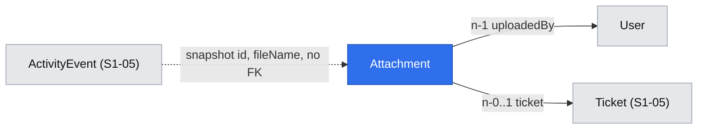

# Attachments – upload, linking, permissions, views and the object storage configuration

| | |
|---|---|
| Status | `draft` |
| Created | 2026-10-26 |
| Plan task | `S1-08` |
| System specification sections | §3.2, §4.5, §6.2, §7.5, §13.3, §14.4, §15.3, §15.10, §17.2, §18.3, §18.5, §18.9, glossary |
| Related issues / PRs | [ADR 0008](../../docs/adr/0008-attachment-serving.md) and its gaps [attachment serving](2026-10-25-attachment-serving.md) (draft, implemented by S1-08); sibling specifications [#114](https://github.com/trybun/trybun/pull/114) (S1-04 permission layer), [#115](https://github.com/trybun/trybun/pull/115) (S1-05 ticket model), [#117](https://github.com/trybun/trybun/pull/117) (S1-07 GFM editor) |

## Context

Tickets and comments carry files – screenshots, logs, documents ([§3.2](../../docs/spec/03-ticket-model.md), [§6.2](../../docs/spec/06-comments-notifications.md)). [§13.3](../../docs/spec/13-non-functional.md) fixes the rules: an allowlist checked against the file content, a size limit configurable by the Administrator, a ClamAV scan in the Worker with the state "Checking…", EXIF stripping, draft attachments purged after 24 hours, and downloads only through `GET /api/v1/attachments/{id}/content` with forced headers.

Two documents already cover most of the "how":

- [ADR 0008](../../docs/adr/0008-attachment-serving.md) (status `proposed`) designs the upload into quarantine, the type detection, the scan job, the move to `available/`, EXIF stripping, the download through the BFF, the inline display under the CSP and the purge of drafts.
- [Attachment serving](2026-10-25-attachment-serving.md) (status `draft`) proposes the specification gaps the ADR found: text formats, the clamd limits and the status `rejected`, the content responses for files that are not available, two more forced headers, previews of drafts, encrypted PDFs and the ClamAV client.

This specification does **not** repeat or re-decide them. It is written under the answers proposed there, and – as the plan row of S1-08 requires – implementation starts only once attachment serving is answered too. Where a different answer there would change something here (e.g. the status `rejected`), the item says so. It covers what neither document decides:

- the data model;
- the endpoints that list, link and delete attachments;
- the permission rules of the three attachment rows of [§7.5](../../docs/spec/07-users-organizations-permissions.md);
- the activity events;
- the web feature and the UI components;
- the configuration of the object storage and of ClamAV;
- the backup of an external S3 storage ([§15.10](../../docs/spec/15-deployment.md)).

Current state (main, 2026-10-26):

- No attachments module, no `attachments` table, no storage or ClamAV adapter. `@aws-sdk/client-s3`, `file-type`, `yauzl`, `sharp` and `clamscan` are not dependencies yet.
- The object storage is configured only for SeaweedFS of Compose: `TRYBUN_S3_ACCESS_KEY_ID` and `TRYBUN_S3_SECRET_ACCESS_KEY` (`.env.example`). The API and the Worker get no storage variables (`compose.yaml`, `x-server`).
- The backup service copies the objects with rclone (`rclone sync objects: …`, `docker/backup/backup.sh`) only when the `seaweedfs` profile is on. Its remote `objects` points at `http://seaweedfs:8333`. With an external storage, the objects are not backed up at all.
- The outbox publisher marks events without consumers as published (`apps/server/src/platform/outbox/outbox-publisher.service.ts`). A module can therefore emit events that a later task consumes.

S1-08 is in group 4 of the plan, after S1-04 (permission layer), S1-05 (tickets) and S1-06 (statuses), and in parallel with S1-07 (editor). The ticket forms and views that show attachments come later: S1-09 (portal) and S1-10 (team view) in group 5. Comments come with S1-12, notifications and live updates with S1-15.

## Goals

- Files can be uploaded, linked to a ticket, listed, downloaded and deleted by exactly the people [§7.5](../../docs/spec/07-users-organizations-permissions.md) allows. Invisible attachments return `404`.
- Each step of [ADR 0008](../../docs/adr/0008-attachment-serving.md) is built, including the answers of [attachment serving](2026-10-25-attachment-serving.md).
- The S1-07 editor's `onFilesAdd` ([#117](https://github.com/trybun/trybun/pull/117), Q7) gets its upload. The forms and views of S1-09 and S1-10 get ready-made attachment components.
- One set of storage variables configures SeaweedFS of Compose or an external S3 storage, for the API, the Worker and the backup alike.
- Done when (plan):
  - an HTML file renamed to `.png` is rejected;
  - the EICAR test file is marked infected and is never downloadable;
  - a JPEG with GPS EXIF is served without it;
  - a user without access to the ticket gets `404` for its attachment;
  - with an external S3 storage, an attachment is restored by `./trybun restore`.

## Non-goals

- Anything decided in [ADR 0008](../../docs/adr/0008-attachment-serving.md) or proposed in [attachment serving](2026-10-25-attachment-serving.md).
- Comment attachments, their audience and their access rules (S1-12). S1-12 adds the comment link to the same table and endpoints.
- The in-app notification of an infected upload and live updates of attachment states over Socket.IO (S1-15, [Q7](#open-questions), [Q8](#open-questions)).
- Anonymization and data export of attachments (S1-16, plan "How to use this plan").
- Attachments of incoming e-mails ([§6.3](../../docs/spec/06-comments-notifications.md)), imports ([§12.5](../../docs/spec/12-api-webhooks-import.md)) and the GitHub synchronization ([§11.4](../../docs/spec/11-github-integration.md)).
- Moving the objects of an existing installation from SeaweedFS to an external storage, or back.
- Attachments in the demo dataset.

## Proposed change

### What the user sees

- **Adding files.** One entry point, in any form with the editor ([Q5](#open-questions)): drag and drop, paste, or the "Attach files" button of the S1-07 toolbar ([#117](https://github.com/trybun/trybun/pull/117)). Each file is uploaded at once and appears in the form's attachment list below the editor:
  - while uploading: "Uploading…" („Wysyłanie…”);
  - then: "Checking…" („Sprawdzanie…”).
  
  The editor inserts `` for an image, else `[name](…)`. The form can be saved while files are still being checked.
- **Rejected files** never appear in the list. The message names the file and the reason: "Files of this type are not allowed" (`attachment.type_not_allowed`), "The file is larger than 25 MB" (`request.too_large`, with the configured limit), or the standard message for other errors. The editor removes its placeholder (S1-07 Q7).
- **Removing a file before saving** deletes the draft at once, without confirmation, and removes its Markdown reference from the form's text. It cannot be anything but the user's own draft.
- **On a ticket**, the attachment list shows, for each file:
  - the name, size and type icon, with a thumbnail for available images;
  - the state, always as text and icon, never by colour alone ([§13.4](../../docs/spec/13-non-functional.md)): "Checking…", "File removed: malware detected", or "File removed: could not be checked" (status `rejected`, if approved in attachment serving).

  Opening a file opens the stable path. Images open inline, every other file downloads ([§13.3](../../docs/spec/13-non-functional.md)). "Delete" is shown only when `allowedActions` contains `delete` ([§18.5](../../docs/spec/18-code-patterns.md)). It asks for confirmation, because the file cannot be restored.
- **States update** without reloading: a list polls while one of its files is being checked ([Q7](#open-questions)). An attachment changes from "Checking…" to available within a few seconds of the scan.
- **Timeline**: "Anna added the file screenshot.png" and "Jan deleted the file log.txt", shown to everyone who sees the ticket ([Q9](#open-questions)).
- Phones, tablets and desktops ([§2.9](../../docs/spec/02-agent-rules.md)):
  - the list is one column on phones;
  - "Attach files" and "Delete" are 44 px targets;
  - every action works without dragging and without hover;
  - state changes are announced in a polite live region.

### Data model

`attachments` (model `Attachment`, module `attachments`):

| Field | Column | Type and rule |
|---|---|---|
| `id` | `id` | UUIDv7, generated before the upload, because it is the object key ([ADR 0008](../../docs/adr/0008-attachment-serving.md)) |
| `fileName` | `file_name` | The client's file name after normalization: Unicode NFC; control characters removed; `/` and `\` replaced by `_`; trimmed; 1–255 characters, keeping the extension. Never logged ([§13.5](../../docs/spec/13-non-functional.md)) |
| `contentType` | `content_type` | The type of the allowlist entry of the extension (ADR 0008), never the client's |
| `size` | `size` | Integer bytes, the stored size (updated after EXIF stripping). The maximum is 100 MB ([Q2](#open-questions)), so `integer` suffices |
| `status` | `status` | Enum `AttachmentStatus`: `quarantine`, `available`, `infected` (plus `rejected` if approved in attachment serving). Default `quarantine` |
| `uploadedById` | `uploaded_by_id` | FK `users`, `RESTRICT`. Anonymization and retention delete the user's attachments ([§13.2](../../docs/spec/13-non-functional.md)) through the attachments service (S1-16) |
| `ticketId` | `ticket_id` | FK `tickets`, nullable (`null` = draft), `RESTRICT`. An import undo ([§12.5](../../docs/spec/12-api-webhooks-import.md)) deletes the attachments of its tickets through the attachments service first |
| `createdAt`, `updatedAt` | `created_at`, `updated_at` | `timestamptz` |

Notes:

- No `version`. An attachment never changes through the API, and the scan changes only `status`, `size` and `updatedAt`, so deleting needs no `If-Match`. [§17.2](../../docs/spec/17-conventions.md) already treats attachments as child records that do not change the ticket's `version`.
- S1-12 adds `comment_id` and a check that an attachment links to at most one parent. The purge condition then becomes "neither ticket nor comment".
- Indexes:
  - `(ticket_id, created_at, id)` for the list;
  - partial `(created_at) WHERE ticket_id IS NULL` for the purge;
  - partial `(updated_at) WHERE status = 'quarantine'` for the recovery job ([Q10](#open-questions)).
- A unit test checks that the Prisma enum equals `attachmentStatusSchema` ([§18.4](../../docs/spec/18-code-patterns.md)).

Attachments hang off users and, once linked, off a ticket. Activity events refer to them only by snapshot, so deleting a file never breaks the history ([§17.2](../../docs/spec/17-conventions.md)).

### API

All endpoints go through the BFF ([§14.4](../../docs/spec/14-architecture.md)). Schemas live in `@trybun/contracts/attachments`.

| Endpoint | Check | Notes |
|---|---|---|
| `POST /api/v1/attachments` | `ability.can('create', 'Attachment')` – every user account | `multipart/form-data`, field `files`, 1–10 files (more: `422`, `array.too_long`, pointer `/files`). A file over the limit stops the request while it streams: `413 request.too_large`. A type mismatch: `422 attachment.type_not_allowed` with pointer `/files/{index}`. All or nothing ([Q6](#open-questions)): on any rejection, the objects already stored by the request are deleted. Supports `Idempotency-Key`. `201` with `{ items: Attachment[] }` in `quarantine` |
| `GET /api/v1/attachments/{attachmentId}` | `read` (target record guard) | The attachment. The web polls it while it is in `quarantine` ([Q7](#open-questions)) |
| `GET /api/v1/attachments/{attachmentId}/content` | `read` | As in ADR 0008 and attachment serving (items 3 and 4) |
| `DELETE /api/v1/attachments/{attachmentId}` | `delete` | `204`. Deletes the row and, for a linked attachment, writes `attachment_deleted`; the outbox event `attachment.deleted` removes both possible objects ([Writing data](#writing-data-and-jobs)) |
| `GET /api/v1/tickets/{ticketId}/attachments` | `read` on the `Ticket` | Cursor envelope ([§18.4](../../docs/spec/18-code-patterns.md)), oldest first, `limit` default 50, at most 100. The query adds `accessibleBy(ability, 'read').Attachment` |
| `POST /api/v1/tickets/{ticketId}/attachments` | `add_attachment` on the `Ticket` | Body `{ attachmentIds }`, 1–100 UUIDs. Links the principal's own drafts ([Q4](#open-questions)). `200` with `{ items: Attachment[] }` |
| `POST /api/v1/tickets` (S1-05) | `create_ticket` | Gains optional `attachmentIds` (0–100), linked in the transaction that creates the ticket ([Q4](#open-questions)) |

Rules for `attachmentIds`, checked in the service inside the transaction, after the body is validated:

- An ID that is not an attachment the principal can read returns `404 request.not_found`. This includes another user's draft, which is invisible ([§17.2](../../docs/spec/17-conventions.md), order of checks).
- An own attachment already linked to a ticket returns `422 attachment.already_linked` with pointer `/attachmentIds/{index}` ([Q11](#open-questions)).
- A draft in any status can be linked. An infected draft stays on the ticket as "File removed: malware detected", which tells the others what happened.
- The link is one `updateMany` on `id IN (…) AND uploaded_by_id = principal AND ticket_id IS NULL`. A count lower than the number of IDs means a concurrent link or purge: the transaction is rolled back and the IDs are classified as above. A link and a purge at the same moment therefore never both succeed (ADR 0008).

Response `attachmentSchema`:

- `id`, `fileName`, `contentType`, `size`;
- `isImage` – a raster image shown inline;
- `status`;
- `ticketId` (`null` for a draft);
- `uploadedBy { id, displayName }`;
- `createdAt`;
- `allowedActions` – closed list `read`, `delete`.

The web builds the content path with `attachmentContentPath(id)` of `@trybun/markdown` (S1-07), so the path exists in one place.

### Permissions

Rules in `attachments.abilities.ts`, with a record descriptor for `Attachment` ([#114](https://github.com/trybun/trybun/pull/114)). The ticket action `add_attachment` is added to the closed list of S1-05 ([#115](https://github.com/trybun/trybun/pull/115)).

| §7.5 row or rule | Subject, action and condition |
|---|---|
| Drafts belong to the uploader ([§13.3](../../docs/spec/13-non-functional.md)) | `Attachment` `read`, `delete` with `{ ticketId: null, uploadedById: userId }`. Nobody else, not even the Administrator, sees a draft |
| Viewing a ticket's attachments | `Attachment` `read` with `{ ticket: <the read conditions of Ticket> }` – the same conditions as the ticket, through the relation, so attachments follow every visibility change of S1-11 without code of their own |
| Add attachments to visible tickets (all roles) | `Ticket` `add_attachment` with the read conditions of `Ticket` |
| Delete own attachments (all roles) | `Attachment` `delete` with `{ uploadedById: userId, ticket: <read conditions> }` |
| Delete any attachment (Developer, Project manager, Administrator) | `Attachment` `delete` with `{ ticket: { projectId: { in: <projects with a team role> } } }`; every ticket for the Administrator |
| Archived project ([§7.5](../../docs/spec/07-users-organizations-permissions.md)) | Restrictions with the reason `project.archived`, using the relation condition of [#114](https://github.com/trybun/trybun/pull/114) Q10 (`409`, as S1-01 proposes in [#111](https://github.com/trybun/trybun/pull/111)): `Ticket` `add_attachment` with `{ project: { state: 'archived' } }`, and `Attachment` `delete` with `{ ticket: { project: { state: 'archived' } } }`. Reading and downloading stay allowed. Drafts belong to no project and are not restricted |
| Upload | `create` on `Attachment` for every user principal. Integration tokens get it with their scopes (S6-02) |

Tests:

- `attachments.abilities.spec.ts`: the three §7.5 rows, each with an allowed and a denied case, plus the draft rule and the archived restriction.
- The filter-equals-check test of S1-04 includes `Attachment`.
- An integration test: a user who cannot see the ticket gets `404` for the attachment, its content, its deletion and the ticket's attachment list, with the same body as for an unknown ID.

### Writing data and jobs

Only what ADR 0008 leaves open:

- **Linking** (`attachmentIds`): in one transaction with the ticket's creation or with the link request, the service writes one activity event `attachment_added` per file. The event is public, with data `{ attachment: { id, fileName } }` ([Q9](#open-questions)), written through the activity function of S1-05. No outbox event: S1-15 decides what notifies and what updates live.
- **Deleting**, in one transaction:
  - delete the row;
  - for a linked attachment, write `attachment_deleted` with the same snapshot;
  - write the outbox event `attachment.deleted` with `{ attachmentId }`.

  Its consumer (queue `attachment-objects`, its own job, [§18.3](../../docs/spec/18-code-patterns.md)) deletes `quarantine/{id}` and `available/{id}`. `DeleteObject` of a missing key succeeds, so the job is idempotent. A scan job that still runs for the deleted row finds no row and deletes what it wrote.
- **Purge of drafts**: as ADR 0008, except that the job deletes the rows and writes `attachment.deleted` per row in the same transaction, so objects of a deleted attachment are removed in one way only (Rule 12). Objects under `quarantine/` without a row are still deleted by the purge itself, since no row exists to carry an event.
- **Scan, move, EXIF stripping**: as ADR 0008, with the scan job's consumer in queue `attachment-scans`.
- **Recovery of lost scans** ([Q10](#open-questions)): the recurring job of ADR 0008 (every 5 minutes, `PING`, then `job.retry()` of failed scans) also enqueues a scan for every attachment that has been in `quarantine` for more than 15 minutes. The `jobId` is `attachment-scan-{id}`, deduplicated while that job is kept. The scan applies only to a row still in `quarantine`: a duplicate that runs after another scan finished finds the row moved, and one that overlaps it and finds `quarantine/{id}` gone ends without effect on its retry. This covers scan jobs lost with Valkey (it is not backed up, [§15.10](../../docs/spec/15-deployment.md)) and failed jobs removed after 30 days.
- **Logs**: attachment ID, status, size and the ClamAV signature name. Never the file name or content ([§13.5](../../docs/spec/13-non-functional.md)).

### Web application

- **Feature `features/attachments/`** ([§18.5](../../docs/spec/18-code-patterns.md)):
  - `queries.ts`: `attachmentQueries.detail(id)`, for the drafts of a form, and `attachmentQueries.ofTicket(ticketId)` as `infiniteQueryOptions` for a ticket's list. Each sets `refetchInterval` while it holds an attachment in `quarantine` ([Q7](#open-questions)), so a list makes one request per interval, not one per file.
  - `mutations.ts`:
    - `useUploadAttachment`: one file per request ([Q6](#open-questions)), `FormData` through the browser API client;
    - `useDeleteAttachment`;
    - `useAddTicketAttachments`.
  - `components/attachments-field.tsx`: the client component a form uses. It implements the editor's `onFilesAdd` (S1-07 Q7, resolving `{ id, name, isImage }`), holds the form's drafts and exposes their IDs as the value of a React Hook Form `Controller`, so the form sends `attachmentIds`. It passes the IDs of the ticket's attachments and – if item 5 of [attachment serving](2026-10-25-attachment-serving.md) is approved – of the form's own image drafts as `attachmentImageIds` to the editor, so its Preview shows them ([#117](https://github.com/trybun/trybun/pull/117) decides only that the editor takes the set as given).
  - `components/ticket-attachments.tsx`: the list of a ticket, for S1-09 and S1-10.
  - Both are loaded lazily where they appear only later ([§18.5](../../docs/spec/18-code-patterns.md)).
- **`@trybun/ui`** (Rule 6): `AttachmentList` and `AttachmentItem`, presentational.
  - States: uploading, checking, available (image with thumbnail, or file), removed (infected, rejected), and failed with the error message.
  - Delete through a callback. The confirmation uses a new `AlertDialog` (shadcn/ui on Base UI); `@trybun/ui` has none yet.
  - Texts from the `ui` namespace.
  - Stories for every state in the three viewports.
- **BFF**: keeps `content-length` when the response has no `content-encoding` (ADR 0008), so downloads show progress. Uploads show no progress bar: `fetch` reports no upload progress, so the item shows "Uploading…".
- **No separate drop zone** besides the editor ([Q5](#open-questions)).

### Configuration, storage and backups

New and changed variables ([§15.3](../../docs/spec/15-deployment.md), [Q2](#open-questions), [Q3](#open-questions)). All are optional with safe defaults, which is a MINOR change by `BACKWARD_COMPATIBILITY.md`:

| Variable | Meaning | Default |
|---|---|---|
| `TRYBUN_S3_URL` | URL of the bucket with an optional folder, in the same form as `TRYBUN_BACKUP_S3_URL` (e.g. `https://s3.eu-central-1.amazonaws.com/my-bucket/trybun`). The server and the backup split it into endpoint (origin), bucket (first segment) and folder (rest); objects are `{folder}/quarantine/{id}` and `{folder}/available/{id}` | `http://seaweedfs:8333/trybun` in Compose; `http://localhost:8333/trybun` in `.env.example` |
| `TRYBUN_S3_ACCESS_KEY_ID`, `TRYBUN_S3_SECRET_ACCESS_KEY` | Existing. Now also the credentials of an external storage, and passed to the API and the Worker | – (required, as today) |
| `TRYBUN_S3_REGION` | Region, for providers that need one | `us-east-1` |
| `TRYBUN_CLAMAV_URL` | clamd over TCP, e.g. `tcp://clamav:3310` | `tcp://clamav:3310` in Compose; `tcp://localhost:3310` in `.env.example` |
| `TRYBUN_ATTACHMENT_MAX_SIZE_MB` | Maximum size of one file, 1–100 | `25` |

How these variables are used:

- **Requests**: path-style addressing (`forcePathStyle`), which SeaweedFS needs and S3-compatible providers support. A provider that accepts only virtual-hosted addressing is out of scope.
- **Bucket**: the API creates it at start-up when `HeadBucket` reports it missing. This is the case for a new SeaweedFS installation. When creation is refused (e.g. an external identity without the right), it logs a warning and `/health/ready` reports the storage as `degraded` ([§17.2](../../docs/spec/17-conventions.md)).
- **Compose**: `x-server` passes the storage variables and `TRYBUN_CLAMAV_URL` to the API and the Worker. The ClamAV service mounts `docker/clamav/clamd.conf` (ADR 0008). The API and the Worker depend on `seaweedfs` as `service_healthy`, `required: false` ([§15.9](../../docs/spec/15-deployment.md)).
- **Backup** ([§15.10](../../docs/spec/15-deployment.md), [Q13](#open-questions)):
  - The rclone remote `objects` is configured from the same variables: endpoint, credentials and region; provider `SeaweedFS` when the `seaweedfs` profile is on, else `Other`.
  - Every backup copies the folder of `TRYBUN_S3_URL` (`objects:{bucket}/{folder}`) into the snapshot's `objects/`, with SeaweedFS and with an external storage alike.
  - `./trybun restore` syncs `objects/` back into the same folder. Objects in that folder that are not in the backup are deleted. The folder must therefore belong to Trybun alone, as `.env.example` and `INSTALL.md` state.
  - A snapshot taken before S1-08 holds no attachments (the bucket did not exist); restoring it leaves the folder empty, which is the state of that time.
- **Restore test** (`scripts/restore-test.sh`): gains a variant with an external storage. Without the `seaweedfs` profile, a separate S3 server started by the test plays the external storage, and the test checks that an attachment object deleted after the backup is back after the restore.
- **`.env.example`, `INSTALL.md`, README**: the variables, the dedicated folder, and switching to an external storage before the first upload.

### Prior art

- **Jira** keeps attachments as a list per issue and records "Attachment" additions and deletions with the file name in the issue history. This proposal does the same in the activity timeline ([Q9](#open-questions)).
- **GitHub** (issues): files dropped into the editor are uploaded at once and referenced from the Markdown. Removing the reference does not delete the upload.
- **GitLab** (issues): files dropped into the editor are uploads of the project, referenced from the Markdown; there is no separate attachment list.

The proposal keeps GitHub's single entry point (the editor) but links files explicitly ([Q4](#open-questions)), because [§13.3](../../docs/spec/13-non-functional.md) requires drafts that expire and access checked by the ticket. With a link of their own, removing the reference never decides the access.

## Changes to the system specification

| Section | Change |
|---|---|
| §3.2 | Attachments of a ticket are linked when the ticket is created (`attachmentIds`) or later through `POST /api/v1/tickets/{ticketId}/attachments` ([Q4](#open-questions)) |
| §4.5 | Activity events `attachment_added` and `attachment_deleted`, public, with the snapshot `{ id, fileName }` ([Q9](#open-questions)) |
| §13.3 | Maximum file size set by `TRYBUN_ATTACHMENT_MAX_SIZE_MB` (1–100, default 25) ([Q2](#open-questions)); linking rules: only own drafts, invisible `404`, already linked `422 attachment.already_linked` ([Q4](#open-questions), [Q11](#open-questions)); an upload request is all or nothing ([Q6](#open-questions)); the objects of a deleted attachment are removed by an outbox job; lost scans are re-enqueued ([Q10](#open-questions)) |
| §15.3 | Variables `TRYBUN_S3_URL`, `TRYBUN_S3_REGION`, `TRYBUN_CLAMAV_URL`, `TRYBUN_ATTACHMENT_MAX_SIZE_MB`; `TRYBUN_S3_ACCESS_KEY_ID` and `TRYBUN_S3_SECRET_ACCESS_KEY` also for an external storage ([Q3](#open-questions)) |
| §15.10 | Every backup copies the storage folder of `TRYBUN_S3_URL`, also on an external storage; restore replaces its content; the folder must be dedicated to Trybun ([Q13](#open-questions)) |
| §17.2 "Errors" | New code `attachment.already_linked` (422); status `422` for `attachment.type_not_allowed` (named in §13.3 without a status) ([Q11](#open-questions)) |
| §18.5 | Until S1-15, a pending server state (an attachment in `quarantine`) is polled with `refetchInterval` from the feature's `queryOptions`; S1-15 replaces it with live updates ([Q7](#open-questions)) |
| §18.9 | Reference implementation rows for S1-08: "Upload streamed into the object storage and streamed download" (`modules/attachments/`, `platform/storage/`) and "Adapter of ClamAV" (`platform/clamav/`); the lint rule "a `schema` on every parameter decorator" exempts `@UploadedFiles()`, whose files the storage engine validates ([Q12](#open-questions)) |
| Plan (`docs/plan/`) | S1-15 gains "the in-app notification of an infected upload and live updates of attachment states" ([Q7](#open-questions), [Q8](#open-questions)); the S1-08 row is ticked by its implementation PR |

New or changed glossary terms (code identifier, EN/PL labels):

- `activity_event.type` `attachment_added` – "added the file {name}" / „dodał(a) plik {name}”; `attachment_deleted` – "deleted the file {name}" / „usunął(-ęła) plik {name}”.
- Ticket action `add_attachment`; attachment actions `read`, `delete`.
- Attachment states in the UI: "Uploading…" / „Wysyłanie…” (client only, not a status value).

## Open questions

Implementation must not start until every question has an answer. Each answer below is a **proposal awaiting human approval**, chosen as the smallest and most reversible option. An answer marked ⚠ changes a protected contract (`BACKWARD_COMPATIBILITY.md`) and needs explicit confirmation.

1. **One specification or two.** The external storage in the backup could ship without attachments. — **Answer (proposed, awaiting approval):** one specification, as the plan defines one task whose Done-when includes the restore. The storage variables (Q3) are needed by the attachments adapter itself and stay with phases 1–3. Q13 gates only phase 4: phases 1–3 may start once Q1–Q12 are answered, and phase 4 ships as its own PR. Alternative: a separate specification and plan task for the backup of an external storage, which removes the restore from the Done-when of S1-08.
2. **How the Administrator sets the maximum file size.** [§13.3](../../docs/spec/13-non-functional.md) says "configurable by the Administrator" without saying where. — **Answer (proposed, awaiting approval):** an environment variable `TRYBUN_ATTACHMENT_MAX_SIZE_MB` (integer 1–100, default 25), like the system default language "set by the Administrator" (`TRYBUN_DEFAULT_LANGUAGE`, [§13.1](../../docs/spec/13-non-functional.md)). The upper bound of 100 follows item 2 of [attachment serving](2026-10-25-attachment-serving.md); without it, the bound is clamd's `StreamMaxLength`. Alternative: a setting in the Administrator panel. That needs an installation-settings table, an endpoint and a form, and can replace the variable later with the variable as its default.
3. **Variables of the object storage.** [§15.3](../../docs/spec/15-deployment.md) says only that "setting variables" switches to an external storage. — **Answer (proposed, awaiting approval):** `TRYBUN_S3_URL` (bucket URL with optional folder, same form as `TRYBUN_BACKUP_S3_URL`), the existing `TRYBUN_S3_ACCESS_KEY_ID`/`_SECRET_ACCESS_KEY`, and optional `TRYBUN_S3_REGION`. Path-style addressing. The API creates a missing bucket. The default points at SeaweedFS of Compose, so existing `.env` files keep working. Alternative: separate `TRYBUN_S3_ENDPOINT`, `TRYBUN_S3_BUCKET` and `TRYBUN_S3_PREFIX`. They are more explicit, but differ from the backup variables.
4. **How a file becomes an attachment of a ticket.** — **Answer (proposed, awaiting approval):** explicitly. `POST /api/v1/tickets` accepts `attachmentIds`, and `POST /api/v1/tickets/{ticketId}/attachments` links drafts to an existing ticket. Only the principal's own unlinked drafts can be linked, at most 100 per request. A ticket edit (S1-05's `PATCH`) does not link: the edit form calls the link endpoint, because attachments are separate resources that do not change the ticket's `version` ([§17.2](../../docs/spec/17-conventions.md)). Alternative: the server links the drafts referenced in the saved Markdown. That needs no extra field, but a file in the list without a reference would be purged, and parsing the Markdown would decide access.
5. **Scope of the UI in S1-08.** No form or ticket view exists before group 5. — **Answer (proposed, awaiting approval):** S1-08 builds the web feature (queries, mutations, `AttachmentsField`, `TicketAttachments`) and the `@trybun/ui` components with stories. S1-09 and S1-10 place them in their forms and views, and their E2E tests cover the flows on the three devices. The only entry point is the editor's (drag and drop, paste, "Attach files"), with no second drop zone (Rule 2: one place to add files). Alternative: a separate attachment field next to the editor, like Jira.
6. **Several files at once.** [§13.3](../../docs/spec/13-non-functional.md) allows up to 10 files per upload. — **Answer (proposed, awaiting approval):** the endpoint accepts 1–10 files and is all or nothing: one rejected file rejects the request and deletes what it stored. The web sends **one request per file**, so every file succeeds or fails on its own (the per-file promise of S1-07 Q7), and limits one drop to 10 files. Alternative: per-file results in one response (`207`-like). That needs a second response shape and partial-success handling in every client.
7. **"Checking…" before live updates exist** (S1-15). — **Answer (proposed, awaiting approval):** the attachment query polls every 3 seconds while its status is `quarantine` and stops when the status changes or the component unmounts. S1-15 replaces the polling with a live update from the outbox events `attachment.available` and `attachment.infected` (both written by S1-08, ADR 0008), so only one mechanism remains ([§18.5](../../docs/spec/18-code-patterns.md)). The plan row of S1-15 says so. Alternative: no updates until a reload.
8. **In-app notification of an infected upload** ([§13.3](../../docs/spec/13-non-functional.md), [§6.6](../../docs/spec/06-comments-notifications.md)). The notification center arrives with S1-15. — **Answer (proposed, awaiting approval):** S1-08 writes the outbox event `attachment.infected` (with `attachmentId` and `uploadedById`). S1-15 adds its consumer that creates the notification, and its plan row says so. Until then, the uploader sees the state in the list. Alternative: S1-08 builds a minimal notification model, which S1-15 would have to absorb.
9. **Timeline events of attachments.** [§4.5](../../docs/spec/04-ticket-lifecycle.md) records every change of a ticket field, and attachments are a field of [§3.2](../../docs/spec/03-ticket-model.md). [§17.2](../../docs/spec/17-conventions.md) records a deletion in the timeline or the audit log. Neither names events for attachments. — **Answer (proposed, awaiting approval):** `attachment_added` (one per file) and `attachment_deleted`, public, with the snapshot `{ id, fileName }` that [§17.2](../../docs/spec/17-conventions.md) requires for deletable records. A file name can contain personal data; like titles in the S1-05 events ([#115](https://github.com/trybun/trybun/pull/115) Q11), it stays in the history until anonymization. Comment attachments (S1-12) write no events of their own; the comment is the entry. Alternative: events without the file name ("added a file").
10. **Attachments stuck in quarantine.** ADR 0008 retries only failed scan jobs. Valkey is not backed up, so after `./trybun restore` (or after failed jobs expire after 30 days) a linked file can stay "Checking…" forever. — **Answer (proposed, awaiting approval):** the 5-minute recovery job also enqueues a scan for every attachment in `quarantine` for more than 15 minutes, with `jobId` `attachment-scan-{id}`. The scan is idempotent. Alternative: a step in `./trybun restore`, which would not cover expired jobs.
11. **Error codes and statuses.** — **Answer (proposed, awaiting approval):**
    - `attachment.type_not_allowed`: `422` with the file's pointer;
    - an oversized file: the existing `413 request.too_large`;
    - more than 10 files: `422` `array.too_long`;
    - linking another user's draft or an unknown ID: `404 request.not_found`, because drafts are invisible to others;
    - linking an own attachment that is already linked: new `422 attachment.already_linked`.

    Alternative: one code `attachment.not_linkable` for both linking cases. That would reveal that another user's draft exists.
12. **New patterns** (Rule 12). S1-08 is the first upload, the first streamed download and the first poll. — **Answer (proposed, awaiting approval):** they become reference implementations in [§18.9](../../docs/spec/18-code-patterns.md), as listed under "Changes to the system specification": `modules/attachments/` with `platform/storage/` (custom multer storage engine streaming to the storage adapter, `StreamableFile` with forced headers) and `platform/clamav/`. The lint rule for parameter schemas exempts `@UploadedFiles()`, because multer, not Zod, receives the files; the storage engine checks them. Polling follows Q7. Alternative: an ADR for the patterns. ADR 0008 already records their design, so a pattern row is enough.
13. ⚠ **Backup and restore of an external storage** (protected surface "Backups" of `BACKWARD_COMPATIBILITY.md`). — **Answer (proposed, awaiting approval):** every backup copies the folder of `TRYBUN_S3_URL` into `objects/`, whether the storage is SeaweedFS or external. The snapshot layout changes from "the whole SeaweedFS" to "the attachment folder"; snapshots of earlier releases hold no attachments and still restore. `./trybun restore` replaces the content of that folder, deleting objects that are not in the backup. The folder must therefore be dedicated to Trybun, as `.env.example` and `INSTALL.md` state. Needs confirmation because a restore with a wrong `TRYBUN_S3_URL` deletes data on a storage outside the server. Alternatives:
    - restore with `rclone copy`, deleting nothing (later files would survive a restore of an earlier state);
    - restore only the prefixes `quarantine/` and `available/` of the folder.

## Implementation plan

Each step leaves the application working and has its tests.

**Phase 1 – storage and scanning**

1. Configuration: the variables of Q2, Q3 and `TRYBUN_CLAMAV_URL` in `platform/config` (Zod, start-up validation), `.env.example` and `compose.yaml`. Test: `load-config.spec.ts` with defaults, an external URL with a folder, and invalid values.
2. Storage adapter `platform/storage/`: put stream, get, ranged get, copy, delete, list by prefix, `HeadBucket`/`CreateBucket`. It joins `/health/ready`. Test: integration against the SeaweedFS container (Testcontainers), and a storage outage reported as `degraded`.
3. ClamAV adapter `platform/clamav/` (`INSTREAM`, `PING`, timeout) and `docker/clamav/clamd.conf`. Test: integration with the pinned ClamAV image – EICAR infected, a clean file clean, a ZIP above the limits not clean.

**Phase 2 – attachments in the API**

4. Prisma model, migration, contracts (schemas, enum, actions, error codes, translations `errors.*`), `attachments.abilities.ts` with the record descriptor. Test: enum equality; the abilities table; the filter-equals check.
5. Upload: `POST /api/v1/attachments` with the storage engine, type detection, size and count limits, all-or-nothing. Test: integration – an HTML file renamed to `.png` is rejected, a 26 MB file gets `413` and leaves no object, 11 files get `422`, encrypted ZIP rejected, and the text formats of attachment serving item 1.
6. Scan job, move, EXIF stripping, `attachment.available`/`attachment.infected` events, recovery and purge jobs. Test: integration – EICAR becomes `infected` and its object is gone; a JPEG with GPS EXIF comes out without EXIF and keeps its orientation; a draft older than 24 hours is purged; a stuck `quarantine` row is rescanned; ClamAV down keeps the file in quarantine and releases it once ClamAV is back (the recovery job invoked directly, not through its 5-minute schedule); a file deleted during its scan leaves no object.
7. Content, detail, delete, ticket list and link endpoints, `attachmentIds` in ticket creation, activity events. Test: integration – headers of the content response, the responses per status (attachment serving item 3), `404` for a user without access to the ticket, linking rules of Q4/Q11, `409 project.archived`, delete removes the objects, the events returned by the activity API.

**Phase 3 – web**

8. `AttachmentList`/`AttachmentItem` in `@trybun/ui` with stories (all states, three viewports, 44 px, live region).
9. Feature `features/attachments/`: queries with polling, mutations, `AttachmentsField` wired to `MarkdownEditor.onFilesAdd`, `TicketAttachments`; the BFF keeps `content-length`. Test: component tests with MSW (upload per file, rejection message, polling stops at `available`, delete with confirmation, removing a draft removes its reference); a unit test of the BFF route handler for `content-length` with and without `content-encoding`; play functions of the stories that add and delete files by keyboard only.
10. User documentation EN/PL (`docs/user/`): a how-to "Attaching files" (types, size, "Checking…", removed files, who may delete), then `pnpm help:generate`.

**Phase 4 – backup of an external storage**

11. Backup service: rclone remote from the storage variables, copy and restore of the folder (Q13); `INSTALL.md`, README. Test: `restore-test.sh` variant with an external S3 server: an object deleted after the backup is restored; ShellCheck.

The implementation PR also:

- updates the system specification as listed above (Rule 8);
- sets [ADR 0008](../../docs/adr/0008-attachment-serving.md) to `accepted`;
- moves this specification and [attachment serving](2026-10-25-attachment-serving.md) to `implemented/`;
- replaces the planned paths of [§18.9](../../docs/spec/18-code-patterns.md);
- ticks S1-08 in the plan.

## Acceptance criteria

- [ ] An HTML file renamed to `.png` is rejected with `attachment.type_not_allowed`
- [ ] The EICAR test file becomes `infected`, its content is never downloadable, and the list shows "File removed: malware detected"
- [ ] A JPEG with GPS EXIF is served without EXIF data
- [ ] A user without access to the ticket gets `404` for its attachment, the content, the deletion and the ticket's list
- [ ] With an external S3 storage, an attachment deleted after a backup is back after `./trybun restore`
- [ ] Another user's draft cannot be read, downloaded, deleted or linked (`404`); an own linked attachment cannot be linked again (`422 attachment.already_linked`)
- [ ] An end user can delete their own attachment but not another person's; a Developer can delete any attachment of their project; nobody can add or delete attachments in an archived project
- [ ] Adding and deleting a ticket attachment appears in the timeline with the file name
- [ ] A draft not linked within 24 hours is deleted with its objects
- [ ] While ClamAV is unavailable, files stay "Checking…" and become available without manual action once it is back
- [ ] Works on phone, tablet and desktop (Rule 9): the attachment components' stories in three viewports, 44 px targets, no hover-only or drag-only actions
- [ ] User documentation (EN, PL) updated; no product tour (Rules 3, 4)

## Changelog

- 2026-10-26 – Created (draft) for plan task S1-08; open questions answered with proposals awaiting human approval.
