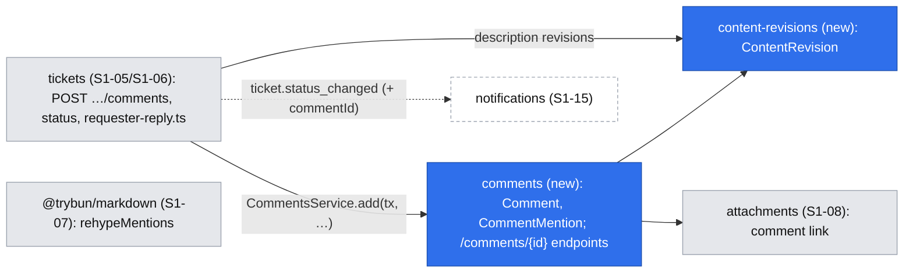
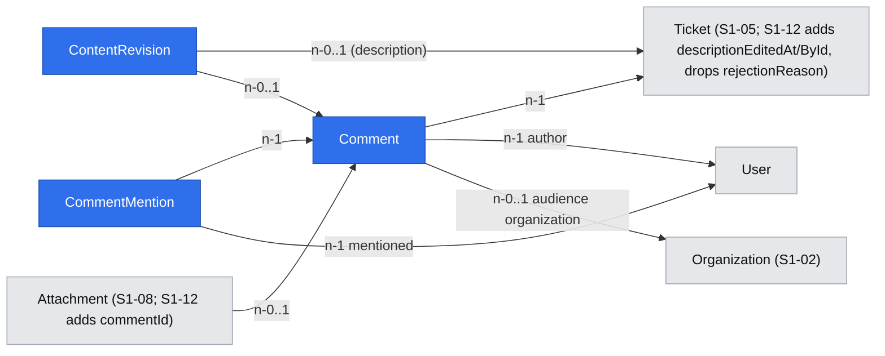

# Comments and internal notes – audience, mentions, edit history, redaction and requester replies

| | |
|---|---|
| Status | `draft` |
| Created | 2026-10-26 |
| Plan task | `S1-12` |
| System specification sections | §4.3, §5.2, §6.1, §7.5, §13.2, §13.3; also §4.5, §5.4, §6.2, §7.3, §13.5, §17.2, §18.3, §18.5, glossary |
| Related issues / PRs | Sibling specifications: S1-04 permission layer ([#114](https://github.com/trybun/trybun/pull/114)), S1-05 ticket model ([#115](https://github.com/trybun/trybun/pull/115)), S1-06 statuses ([#116](https://github.com/trybun/trybun/pull/116)), S1-07 editor and `@trybun/markdown` ([#117](https://github.com/trybun/trybun/pull/117)), S1-08 attachments ([#119](https://github.com/trybun/trybun/pull/119)), S1-09 portal ([#118](https://github.com/trybun/trybun/pull/118)), S1-11 visibility ([#121](https://github.com/trybun/trybun/pull/121)); [ADR 0008](../../docs/adr/0008-attachment-serving.md) |

## Context

People talk about a ticket in its comments. The team also writes **internal notes** that end users never see ([§6.1](../../docs/spec/06-comments-notifications.md)). For team members the default kind is the internal note, so a technical discussion does not reach the customer by accident. Every public comment stores its **audience**: the visibility the ticket had when the comment was written. A comment written before a ticket was shared therefore stays inside its original scope ([§5.2](../../docs/spec/05-visibility-and-search.md)), and its attachments follow it ([§13.3](../../docs/spec/13-non-functional.md)). Texts keep an edit history, which the team can **redact** to remove personal data ([§6.1](../../docs/spec/06-comments-notifications.md), [§13.2](../../docs/spec/13-non-functional.md)). A comment by the requester can change the status: it answers a request for information, declines a resolution, or reopens a recently closed ticket ([§4.3](../../docs/spec/04-ticket-lifecycle.md)).

None of this exists yet. The sibling tasks of Stage 1 leave these pieces to S1-12:

- S1-05 writes the description and records `description_edited` without content. Revisions are left to S1-12.
- S1-06 stores the rejection reason in a temporary column `tickets.rejection_reason`. S1-12 publishes it as a public comment, migrates the stored reasons and drops the column ([#116](https://github.com/trybun/trybun/pull/116), Q2). S1-06 also stores what the requester-reply rules need: `statusBeforeWaiting`, `waitingReason` and `closedAt`.
- S1-07 renders GFM with the shared package `@trybun/markdown` ([#117](https://github.com/trybun/trybun/pull/117), Q1). S1-12 renders comments with it and adds mentions to it.
- S1-08 links attachments to tickets. S1-12 adds the link to comments and the access rule by comment kind and audience ([#119](https://github.com/trybun/trybun/pull/119)).
- S1-09 builds the portal ticket view without a comment field and without editing ([#118](https://github.com/trybun/trybun/pull/118), Q12). S1-10 builds the team ticket view and its timeline.
- S1-11 builds visibility, sharing requests and the identity rule of §5.4 ([#121](https://github.com/trybun/trybun/pull/121)). It stores the refusal reason in a temporary column `tickets.sharing_refusal_reason`, which S1-12 publishes as a public comment, migrates and drops (its Q8). It leaves the comment audience to S1-12.

The plan's "Done when" for S1-12:

- An end user sees "edited" but not previous versions.
- After a redaction, no earlier version contains the redacted text.
- `@mention` suggestions contain only people who can see the ticket.
- A comment written before sharing is not visible to other organizations.
- Internal notes never appear in the end-user view.
- While the ticket awaits confirmation, any requester comment moves it to `in_progress`. A requester comment on a `done` ticket within 14 days reopens it as `triage`.
- The reason of a sharing refusal appears to the author as a public comment.

The specification leaves several points open, and some of them contradict the plan. Agents may not decide them (Rule 8). Each one is listed under [Open questions](#open-questions) with a proposed answer for a human to accept, change or reject. The design below already assumes the proposed answers.

## Goals

- Everyone who can see a ticket can comment on it, within the rules for closed tickets (§4.3). The team adds internal notes, which no end-user response ever contains.
- An end user sees a public comment only if they can see the ticket and the comment's audience includes them. Lists and details use one CASL rule, so they never disagree ([§18.3](../../docs/spec/18-code-patterns.md)).
- Comment attachments follow the comment's kind and audience without code of their own.
- `@mentions` suggest and accept only people who can see the ticket and the comment. A mention never grants access, and its display follows the identity rule of [§5.4](../../docs/spec/05-visibility-and-search.md).
- Comments and descriptions keep their earlier versions as content revisions. The team sees them, and so does the author of a text ([Q3](#open-questions)). Redaction replaces the text and purges the selected revisions, so no copy remains in the database.
- The requester's public comment applies the status rules of §4.3 in the same transaction.
- Rejection reasons and sharing-refusal reasons are public comments.

## Non-goals

- Notifications of mentions, comments and reopens, watchers added by commenting or mentioning, live updates (S1-15). S1-12 stores what S1-15 needs: the mentions and the cause of a status change ([Q15](#open-questions)).
- E-mail replies as comments ([§6.3](../../docs/spec/06-comments-notifications.md), S2-12). They will call the same use case.
- Mentions in descriptions ([Q5](#open-questions)).
- Comments imported from GitHub as internal notes with a GitHub author ([§11.5](../../docs/spec/11-github-integration.md), Stage 3), and the SLA first response from the first public team comment ([§9.1](../../docs/spec/09-sla.md), S4).
- Anonymization and export of comments and revisions (S1-16). S1-12 keeps the author of each revision, so S1-16 can purge a person's revisions ([§13.2](../../docs/spec/13-non-functional.md)).
- Comments by integration tokens (S6-02). The token scope `comments:write` ([§12.2](../../docs/spec/12-api-webhooks-import.md)) is mapped when tokens exist.
- Ticking task-list items in a rendered comment ([#117](https://github.com/trybun/trybun/pull/117), Q6).
- Search in comments (S2-03).

## Proposed change

### Behaviour

**Adding a comment** (`POST /api/v1/tickets/{ticketId}/comments`, body `{ kind, body, attachmentIds? }`):

1. The kind is required. End users may only send `public`; `internal` returns `403` (no `add_internal_note`). A team member chooses in the UI, where the internal note is preselected ([UI](#web-application)).
2. Inside one transaction, the ticket row is locked with S1-05's row-lock function (`lockTicketForUpdate`, [#115](https://github.com/trybun/trybun/pull/115) Q16). The rules below are checked on the locked row.
3. A public comment takes its **audience** from the ticket's effective visibility at that moment ([§5.2](../../docs/spec/05-visibility-and-search.md)): `only_me`, `my_organization` with the ticket's organization, or `all_customers`. An internal note has no audience.
4. Mentions in the body are checked against the mention scope ([Mentions](#mentions)) and stored.
5. The principal's own draft attachments in `attachmentIds` are linked to the comment (S1-08's linking rules, with the comment as the parent, [Q16](#open-questions)).
6. A public comment by an end-user requester applies the [requester-reply rules](#requester-replies) to the ticket.
7. Nothing else changes the ticket: comments are child records and do not change its `version` ([§17.2](../../docs/spec/17-conventions.md)). Only a status change caused by the requester increases it.

**Reading.** An end user gets a public comment when all of these hold:

- they can read the ticket;
- the comment's audience includes them:
  - `only_me`: they are the ticket's requester;
  - `my_organization`: they belong to the comment's organization;
  - `all_customers`: always;
- **or**, instead of the audience, they wrote the comment ([§5.2](../../docs/spec/05-visibility-and-search.md)).

Team members of the project and the Administrator get every comment, internal notes included. The audience is never changed later, by any visibility change ([§5.3](../../docs/spec/05-visibility-and-search.md)).

**Editing** (`PATCH /api/v1/comments/{commentId}`, `If-Match`): only the author edits their own comment or note. The previous text becomes a content revision. The comment gets `editedAt` and `editedById`, and the internal event `comment_edited` without content. The kind and the audience never change ([Q12](#open-questions)). Mentions that are new in the text are checked, and existing ones are kept even if the person is no longer in the scope. Removed ones are deleted. New draft attachments may be linked.

**Description edits.** S1-05's `PATCH /api/v1/tickets/{ticketId}` writes the description and `description_edited`. S1-12 adds, in the same transaction, the content revision of the replaced text, `descriptionEditedAt` and `descriptionEditedById`. There is no separate "delete description" action: emptying the description is an edit, and removing content from the history is a redaction ([Q8](#open-questions)).

**Deleting** (`DELETE /api/v1/comments/{commentId}`, `If-Match`): the author deletes their own comment or note; the team deletes any comment. The row, its revisions, its mentions and its attachments are deleted physically ([§6.1](../../docs/spec/06-comments-notifications.md), [§17.2](../../docs/spec/17-conventions.md)). The attachments go through S1-08's attachments service, which also removes their objects. The internal event `comment_deleted` (with the person who deleted it, and the time) stays in the team timeline. A deletion of someone else's comment by a team member is written to the audit log ([§13.5](../../docs/spec/13-non-functional.md)). An end user simply no longer sees the comment ([Q6](#open-questions), [Q7](#open-questions)).

**Redacting** (team, `POST /api/v1/comments/{commentId}/redaction` and `POST /api/v1/tickets/{ticketId}/description-redaction`, `If-Match` of the comment or the ticket): the body is `{ body, purgeRevisionIds }`.

- The new text replaces the current one, and the replaced text is **never** stored as a revision.
- The listed revisions are deleted. The UI preselects all of them ([Q9](#open-questions)).
- The redaction sets the edited marker, writes the internal event `comment_redacted` or `description_redacted` ("Content redacted", PL „Treść zredagowana”, without content, [§4.5](../../docs/spec/04-ticket-lifecycle.md)), and an audit log entry `comment.redacted` or `ticket.description_redacted`.
- Mentions are re-read from the new text. Mentions that disappear are deleted.

After a redaction with every revision selected, no row of the database contains the earlier text. Outbox payloads, events and the stored replays of `Idempotency-Key` never contain it ([Q19](#open-questions)) ([§18.3](../../docs/spec/18-code-patterns.md)). E-mails that were already sent cannot be recalled (Edge cases).

**Edit history** (`GET /api/v1/comments/{commentId}/revisions`, `GET /api/v1/tickets/{ticketId}/description-revisions`): the earlier versions, newest first, each with its author and the time it was written. The team gets every revision of every text it can see. The author of a text gets the revisions of that text: the comment's author, or the requester for the description ([§6.1](../../docs/spec/06-comments-notifications.md), [§7.5](../../docs/spec/07-users-organizations-permissions.md), [Q3](#open-questions)). Everyone else gets `403` (for a visible text), and the response of the text carries only `editedAt`. The UI shows "edited" (PL „edytowano”).

#### Requester replies

A pure function `modules/tickets/domain/requester-reply.ts` takes the locked ticket, whether the comment is a public comment by the ticket's requester with an end-user account ([Q10](#open-questions)), and `now`. It returns the status change or none:

| Ticket | Effect of the requester's public comment |
|---|---|
| `waiting_for_requester`, reason `confirmation` | → `in_progress`, as "No, still a problem" ([§4.3](../../docs/spec/04-ticket-lifecycle.md)) |
| `waiting_for_requester`, reason `information` | → the status before waiting (`statusBeforeWaiting` of S1-06) |
| `done`, `closedAt` less than 14 × 24 hours ago | → `triage`, a reopen (S1-06 records `reopen: true` and clears `closedAt`) |
| `done` 14 days or more after `closedAt`, `rejected`, `duplicate` | The comment is refused before this function runs: `409 ticket.comments_closed` |
| Any other status | No change |

Comments of other end users and of the team never change the status. The change goes through S1-06's status use case (`TicketsService.applyRequesterReply(tx, …)`), as a state-conditional update in the transaction of the comment. It does not use `If-Match`, increases the ticket's `version` ([§17.2](../../docs/spec/17-conventions.md)), and writes S1-06's `status_changed` event with `automaticSource` `system` and the outbox event `ticket.status_changed` with the new optional field `commentId` ([Q15](#open-questions)). A requester's comment and a "Yes, solved" sent at the same moment are serialized by the ticket lock: the first one wins, and the second one finds a ticket that is no longer waiting.

#### Reasons as public comments

- **Rejection** (S1-06's `PUT /api/v1/tickets/{ticketId}/status` with `rejectionReason`). The reason becomes a public comment by the acting team member, in the same transaction. Its audience is the ticket's effective visibility, which always includes the requester. A new reason on a ticket that is already `rejected` adds another comment instead of S1-06's `rejection_reason_changed` event. The request schema, its length (1–2000 characters) and its `422` stay as in S1-06. `rejectionReason` leaves the team response.
- **Migration of S1-06's column** ([Q13](#open-questions)). A first migration copies every stored `tickets.rejection_reason` into a public comment:
  - the author is the actor of the ticket's latest `status_changed` event into `rejected` (only the team rejects, so it exists; the migration fails rather than lose a reason when it does not);
  - the time is `closedAt`, and the ID is `uuidv7(closed_at - now())` of PostgreSQL 18, so the comment takes its place in the time-ordered timeline;
  - the audience is the ticket's current visibility. The visibility at the time of the rejection was not recorded, so this is the closest value; it always includes the requester.

  A second migration drops the column and its check constraint. Copy before drop, so nothing is lost ([§17.2](../../docs/spec/17-conventions.md), "Migrations").
- **Sharing refusal** (S1-11's `POST /api/v1/tickets/{ticketId}/sharing/reject`, which already requires the reason, GFM 1–2000 characters, [#121](https://github.com/trybun/trybun/pull/121) Q8). On every refusal the reason becomes a public comment by the refusing team member, in the same transaction. Its audience is the unchanged visibility, so the author sees it. The stored `tickets.sharing_refusal_reason` of tickets with a `rejected` request is copied into comments in the same way as the rejection reason (author: the actor of the refusal event; time and ID from that event), and the column is dropped in the second migration ([Q14](#open-questions)).

#### Mentions

- **Markup** ([Q2](#open-questions)): a mention is stored in the source as `@{<userId>}`, plain GFM text without the person's name. The editor inserts it from the suggestions. The API returns each comment with a `mentions` map `{ id, displayName }`, built for the viewer with the identity rule of [§5.4](../../docs/spec/05-visibility-and-search.md): a customer of another organization appears as "Customer" (PL „Klient”). A new plugin of `@trybun/markdown`, `rehypeMentions({ mentions })`, renders each token found in the map as `@Display name` (a `span` with the class `mention`, not a link). Tokens not in the map stay plain text. E-mails (S1-15) and the GitHub synchronization (Stage 3) resolve the tokens for their audience.
- **Scope** ([§7.3](../../docs/spec/07-users-organizations-permissions.md), [Q4](#open-questions)). A person can be mentioned only if they can see the ticket **and** would see this comment:
  - always: active team members with a membership of the project;
  - in a public comment by an end user: the members of the author's organization, if the ticket's visibility includes them (`my_organization` of that organization, or `all_customers`);
  - in a public comment by a team member: the requester, and the members of the ticket's organization if the visibility is `my_organization` or `all_customers`;
  - in an internal note: team members only.

  Deactivated and anonymized accounts are never in the scope.
- **Suggestions** (`POST /api/v1/tickets/{ticketId}/mention-candidates`, body `{ kind, query }`). The query is free text, so it goes in the body, never in the URL ([§17.2](../../docs/spec/17-conventions.md)). The endpoint returns at most 10 people of the scope whose display name contains the query, team members first. The display names follow §5.4. It needs `add_comment` (or `add_internal_note` for `kind: internal`).
- **Saving**: a new mention outside the scope returns `422 comment.mention_not_allowed` with pointer `/body`. The code is the same for an unknown ID, so nothing is revealed. At most 50 distinct mentions per text (GitHub's limit), otherwise `422 comment.too_many_mentions`. A mention never grants access to the ticket.

### Architecture

The arrows point one way only: tickets → comments → content revisions and attachments ([Q11](#open-questions)).

- **Module `comments`** owns `Comment` and `CommentMention`. Its controller serves `/api/v1/comments/{commentId}` (read, edit, delete, redaction, revisions), the ticket's comment list and the timeline. It exports `CommentsService.add(tx, principal, lockedTicket, input)`, which writes a comment for a ticket the caller has already locked and checked.
- **Module `tickets`** keeps every write of the ticket. It owns `POST /api/v1/tickets/{ticketId}/comments` because adding a comment locks the ticket and may change its status. The status change with a reason calls the same `CommentsService.add`. A dependency from comments to tickets would create a cycle, which [§18.3](../../docs/spec/18-code-patterns.md) forbids.
- **Module `content-revisions`** owns `ContentRevision`. It exports `record(tx, …)`, `purge(tx, …)` and the list query. Both tickets and comments use it, and S1-16 will use it for anonymization.
- **Timeline** (`GET /api/v1/tickets/{ticketId}/timeline`, [Q11](#open-questions)): one cursor list of comments and activity events, oldest first. Both use time-ordered UUIDv7 IDs, so the cursor is the last ID. Each page takes the next `limit` items of both queries, merges them by ID and keeps `limit`. Each query goes through `accessibleBy`, so an end user gets public events and the comments their audience allows. S1-09 and S1-10 switch their timelines to it. `GET /api/v1/tickets/{ticketId}/comments` stays the list for "hide events" (S1-10).

### Data model

**`Comment`** (`comments`, module `comments`):

| Field | Column | Type and rule |
|---|---|---|
| `id` | `id` | UUIDv7 |
| `ticketId` | `ticket_id` | FK `tickets`, `ON DELETE CASCADE` (tickets are deleted only by an import undo, [§17.2](../../docs/spec/17-conventions.md)) |
| `authorId` | `author_id` | FK `users`, `RESTRICT`; anonymization keeps the tombstone ([§13.2](../../docs/spec/13-non-functional.md)) |
| `kind` | `kind` | enum `comment_kind`: `public`, `internal` |
| `audience` | `audience` | enum `ticket_visibility` (the visibility codes of §5.1), set exactly when `kind = 'public'` |
| `audienceOrganizationId` | `audience_organization_id` | FK `organizations`, `RESTRICT`, set exactly when `audience = 'my_organization'` (the ticket's organization snapshot) |
| `body` | `body` | GFM, trimmed, 1–65,536 characters (the description limit of S1-05 Q4) |
| `editedAt`, `editedById` | `edited_at`, `edited_by_id` | Last edit or redaction, nullable; FK `users` |
| `version` | `version` | Optimistic locking ([§17.2](../../docs/spec/17-conventions.md)) |
| `createdAt`, `updatedAt` | `created_at`, `updated_at` | `timestamptz` |

Check constraints for the kind, audience and organization rules above. Index `(ticket_id, id)`.

**`CommentMention`** (`comment_mentions`): `commentId` (FK, `ON DELETE CASCADE`), `userId` (FK `users`), `createdAt`. Primary key `(comment_id, user_id)`. It is the source for S1-15's notifications and for the viewer's `mentions` map.

**`ContentRevision`** (`content_revisions`, module `content-revisions`): one row per replaced version of a text.

| Field | Column | Type and rule |
|---|---|---|
| `id` | `id` | UUIDv7 |
| `ticketId` | `ticket_id` | FK `tickets`, `ON DELETE CASCADE`: set for a description revision |
| `commentId` | `comment_id` | FK `comments`, `ON DELETE CASCADE`: set for a comment revision |
| `body` | `body` | The replaced text |
| `authorId` | `author_id` | FK `users`: who wrote this version |
| `writtenAt` | `written_at` | When this version was written (the creation, or the edit that produced it) |
| `createdAt` | `created_at` | When it was replaced |

A check constraint allows exactly one of `ticket_id` and `comment_id`. Revisions are never updated. They are deleted by a redaction, by the deletion of their comment, by S1-16's anonymization of their author, or by an import undo.

**Other tables:**

- `Ticket`: `descriptionEditedAt`, `descriptionEditedById` (nullable). `rejection_reason` and `sharing_refusal_reason` are dropped after the copy ([Reasons](#reasons-as-public-comments)).
- `Attachment` (S1-08): `commentId` (FK `comments`, nullable), with a check that `ticket_id` and `comment_id` are never both set ([#119](https://github.com/trybun/trybun/pull/119), "S1-12 adds `comment_id`"). The draft purge condition becomes "neither ticket nor comment". Deleting a comment deletes its attachments through the attachments service first, so the FK can stay `RESTRICT`.
- `ActivityEvent` (S1-05): new types `comment_edited`, `comment_deleted` (data `{ commentId, kind }`), `comment_redacted` (data `{ commentId }`) and `description_redacted`. All are internal ([Q6](#open-questions)). `rejection_reason_changed` stays in the closed list for existing events but is no longer written.

**Personal data.** Comment bodies, revision bodies and mentions are personal data. S1-16 includes them in export (own comments only, never internal notes, [§13.2](../../docs/spec/13-non-functional.md)) and anonymization (revisions of the person's own texts purged; mentions of the person deleted, their token then stays plain text). Logs carry only IDs, never bodies, display names or mention queries ([§13.5](../../docs/spec/13-non-functional.md)).

### API contracts

`@trybun/contracts/comments` (new) and `@trybun/contracts/tickets`:

| Endpoint | Check | Notes |
|---|---|---|
| `GET /api/v1/tickets/{ticketId}/comments?cursor&limit` | `read` on the `Ticket` | Cursor envelope, oldest first; the query adds `accessibleBy(ability, 'read').Comment` |
| `GET /api/v1/tickets/{ticketId}/timeline?cursor&limit` | `read` on the `Ticket` | Items `{ type: 'comment', comment } \| { type: 'event', event }` ([Q11](#open-questions)) |
| `POST /api/v1/tickets/{ticketId}/comments` | `add_comment` or `add_internal_note` on the `Ticket`, by `kind` | Body `createCommentSchema` `{ kind, body, attachmentIds? }`. `Idempotency-Key`. `201` with the comment |
| `POST /api/v1/tickets/{ticketId}/mention-candidates` | `add_comment` / `add_internal_note` | Body `{ kind, query }` (query 0–100 characters); `{ items: [{ id, displayName, kind }], nextCursor: null }`, at most 10 |
| `GET /api/v1/comments/{commentId}` | `read` | The comment |
| `PATCH /api/v1/comments/{commentId}` | `update` | `{ body, attachmentIds? }`, `If-Match` |
| `DELETE /api/v1/comments/{commentId}` | `delete` | `If-Match`, `204` |
| `POST /api/v1/comments/{commentId}/redaction` | `redact` | `{ body, purgeRevisionIds }` (0–1000 UUIDs of this comment's revisions, else `422 field.invalid_value` at `/purgeRevisionIds/{index}`), `If-Match` |
| `GET /api/v1/comments/{commentId}/revisions` | `read_revisions` | Newest first, cursor envelope |
| `GET /api/v1/tickets/{ticketId}/description-revisions` | `read_description_revisions` | As above |
| `POST /api/v1/tickets/{ticketId}/description-redaction` | `redact_description` | `{ description, purgeRevisionIds }`, `If-Match` of the ticket; returns the ticket |

**Responses.**

- `commentSchema` (team): `id`, `ticketId`, `kind`, `audience`, `audienceOrganization { id, name } | null`, `author { id, displayName }`, `body`, `mentions [{ id, displayName }]`, `attachments [attachmentSchema]`, `editedAt`, `version`, `createdAt`, `allowedActions`.
- `endUserCommentSchema`: the same without `kind` (always public), `audience` and `audienceOrganization`. `author` and `mentions` follow §5.4, through S1-11's pure function `identityVisibleTo(viewer, person)` (`modules/tickets/domain/`, [#121](https://github.com/trybun/trybun/pull/121)): `null` is shown as "Customer".
- `contentRevisionSchema`: `id`, `body`, `author { id, displayName }`, `writtenAt`. For end users, `author` follows §5.4 like the comment author.
- Ticket responses gain `descriptionEditedAt`; the team response loses `rejectionReason`.
- `allowedActions` of a comment: `update`, `delete`, `redact`, `read_revisions`. Of a ticket, new: `add_comment`, `add_internal_note`, `read_description_revisions`, `redact_description`. The portal shows the comment field exactly when `add_comment` is present.

**Error codes:** `ticket.comments_closed` (409, the reason of the restriction for closed tickets), `comment.mention_not_allowed` (422), `comment.too_many_mentions` (422). Order of checks ([§18.3](../../docs/spec/18-code-patterns.md)): an invisible ticket or comment → `404`; an archived project → `409 project.archived`; a closed ticket for an end user → `409 ticket.comments_closed`; another forbidden action → `403`; invisible draft attachments → `404`; validation → `422`; preconditions → `428`/`412`; mention rules → `422`.

**Outbox:** S1-12 writes no new outbox event, because nothing consumes one before S1-15 (as S1-05 Q14). It adds the optional field `commentId` to S1-06's `ticket.status_changed`, set when a requester comment caused the change. The field is additive ([§17.2](../../docs/spec/17-conventions.md), "Payload compatibility"). S1-15 adds `comment.created` with `{ commentId, ticketId, kind, authorId }` and reads the mentions from `comment_mentions`.

### Permissions

Rules in `comments.abilities.ts` and `tickets.abilities.ts`, following S1-04 ([#114](https://github.com/trybun/trybun/pull/114)), each §7.5 row with an allowed and a denied case:

| §7.5 row | Rule |
|---|---|
| View other people's tickets according to visibility and comment audience | `Comment` `read`: team of the project (all kinds); end users: `{ kind: 'public', ticket: <Ticket read conditions> }` combined with one of: `{ authorId: me }`; `{ audience: 'all_customers' }`; `{ audience: 'my_organization', audienceOrganizationId: <principal's organization> }`; `{ audience: 'only_me', ticket: { requesterId: me } }` |
| Add public comments to visible tickets (terminal tickets: §4.3) | `Ticket` `add_comment` with the read conditions, all roles. End-user restriction with the reason `ticket.comments_closed`: `{ status: { in: ['rejected', 'duplicate'] } }` and `{ status: 'done', closedAt: { lte: now − 14 days } }`. The ability is built per request with the injected clock, so the condition works in memory and as a filter |
| Add internal notes | `Ticket` `add_internal_note`, Developer and above |
| Edit or delete own comments and notes | `Comment` `update`, `delete` with `{ authorId: me }` and the read conditions; also on closed tickets ([Q12](#open-questions)) |
| Delete any comment | `Comment` `delete`, Developer and above of the project |
| View edit history | `Comment` `read_revisions`: team; end users `{ authorId: me }` together with the `Comment` read conditions. `Ticket` `read_description_revisions`: team; end users `{ requesterId: me }` together with the `Ticket` read conditions ([Q3](#open-questions)) |
| Redact a description or any comment | `Comment` `redact`, `Ticket` `redact_description`, Developer and above |
| Archived project | `Comment` restriction with `{ ticket: { project: { state: 'archived' } } }` for the closed list minus `read` and `read_revisions` (S1-04 Q10); the new ticket actions are restricted by S1-04's fail-closed list, except `read_description_revisions`, which stays readable |
| Attachments of comments ([§13.3](../../docs/spec/13-non-functional.md)) | `Attachment` `read` with `{ comment: <Comment read conditions> }`; `delete` with the comment's `delete` conditions. Defined in `comments.abilities.ts`, because the comments module already depends on attachments |

Tests: the filter-equals-check test of S1-04 includes `Comment` and `ContentRevision`. A property test over the demo dataset checks that no end-user list (comments, timeline, attachments) returns a record whose detail returns `404`.

### Web application

- **Team ticket view** (S1-10's timeline):
  - A comment form at the end of the timeline with the lazily loaded `MarkdownEditor` (S1-07). Above it, a two-option switch "Internal note" (PL „Notatka wewnętrzna”), preselected on every new form, and "Public comment" (PL „Komentarz publiczny”).
  - With "Public comment" chosen, a one-line hint states who will see it ("Visible to the requester" / "Visible to organization X" / "Visible to all customers of the project"). The hint is built from the ticket's visibility. The submit button reads "Add internal note" or "Comment publicly".
  - Internal notes in the timeline and the form in internal mode have their own background token, a lock icon and the label "Internal note". Colour is never the only signal ([§13.4](../../docs/spec/13-non-functional.md)).
- **Portal ticket view** (S1-09):
  - A comment field below the public timeline, always public.
  - When `allowedActions` lacks `add_comment` because the ticket is closed, the view shows "Create a new ticket" (PL „Utwórz nowe zgłoszenie”) instead ([§4.3](../../docs/spec/04-ticket-lifecycle.md)).
  - "Edit" of the own description, as §7.5 allows ([#118](https://github.com/trybun/trybun/pull/118), Q12).
- **Comment actions** in a `DropdownMenu` ("⋯", 44 px, no hover): Edit (inline editor), Delete (confirmation dialog, because the content cannot be restored), Redact (team).
- **"edited" marker**: plain text for people without `read_revisions`. For the others it is a button that opens the history in a `Dialog` (bottom sheet on phones), with the versions rendered by `Markdown`.
- **Redaction dialog**: the editor prefilled with the current text, the list of earlier versions as checkboxes (all checked), and a warning that this cannot be undone.
- **Mentions**: typing `@` in the editor opens a suggestion list (Base UI `Combobox` popup anchored to the caret line, a list above the keyboard on phones) fed by `mention-candidates`. Choosing a person inserts `@{id}`. `MarkdownEditor` gains a presentational prop `onMentionSearch(query) → Promise<candidate[]>` and `mentions` for the Preview ([#117](https://github.com/trybun/trybun/pull/117) package and component, Rule 6, with stories).
- **Images in comments**: the allowed set of `Markdown` (`attachmentImageIds`) is the set of attachment IDs the API returned to the viewer for the ticket: the ticket's own attachments and those of the visible comments. An image of an internal note, referenced in a public comment, therefore renders as a link for an end user, and the link itself returns `404`.
- Feature `features/comments/` with `queries.ts` (comments, timeline, revisions) and `mutations.ts` (add, edit, delete, redact; each invalidates the ticket's timeline and, after a requester reply, the ticket).

**User documentation** (EN, PL, Rule 3): a team page "Comments and internal notes" (kinds, audience, mentions, edit history, redaction, deleting) and an end-user page "Comment on your ticket" (replying, "edited", closed tickets). No new product tour: the tours of Stage 1 come with S1-18 (Rule 4).

### Edge cases and failure scenarios

- **Visibility changes after a comment:** narrowing a shared ticket hides its `all_customers` comments from other organizations, because they can no longer read the ticket. Widening it does not reveal the earlier `only_me` or `my_organization` comments ([§5.2](../../docs/spec/05-visibility-and-search.md)).
- **The author leaves the organization:** the author of a `my_organization` comment loses the ticket ([§7.3](../../docs/spec/07-users-organizations-permissions.md)). If the ticket is later shared, they see their own comment again through the author rule.
- **Two edits at once:** the second one gets `412` and the conflict message ([§17.2](../../docs/spec/17-conventions.md)). A redaction against a stale version also gets `412`, so it never redacts a text the redactor has not seen.
- **Redaction after e-mails were sent:** e-mails already delivered keep the old text. The redaction dialog says so. Outbox payloads never held the text.
- **The requester comments while the timer closes the ticket:** the ticket lock serializes both. If the close came first, the ticket is `done` with a fresh `closedAt`, and the comment reopens it to `triage` within the 14 days.
- **A comment on a `done` ticket by a former member of the organization** who can no longer see it: `404`, as for any invisible ticket.
- **Archived project:** every write returns `409 project.archived`. Reading the comments and their history stays possible.
- **Object storage down while deleting a comment:** the rows are deleted in the transaction. S1-08's outbox job removes the objects when the storage is back.
- **A mention token typed by hand** for someone outside the scope: `422` on save. The editor shows the error under the field, and the author removes the token.

### Prior art

- **GitHub**: edit history with "edited" on every comment and the issue body. The history is visible to everyone who can read the issue, and maintainers can delete single revisions. Mentions are limited to 50 per comment and notify only people with access. Trybun restricts the history (§6.1), keeps the deletion of revisions as redaction, and adopts the limit.
- **Jira Service Management**: "Reply to customer" and "Add internal note" side by side. Internal notes are highlighted and labelled. Trybun preselects the note (§6.1).
- **Zendesk**: a public reply is the agent's default, and a reply by the requester to a *Pending* ticket reopens it. Trybun adopts the reopen and reverses the default.
- **Linear**: mentions are stored as user IDs and rendered with the current name, as proposed here.

## Changes to the system specification

| Section | Change |
|---|---|
| §4.3 | The requester-reply rules apply to public comments of the requester's end-user account (Q10); "within 14 days" is 14 × 24 hours after `closedAt` |
| §4.5 | Comment edits, deletions and redactions are internal events; end users see the "edited" marker on the text (Q6) |
| §5.2 | The comment audience is set from the effective visibility on the locked ticket; the author rule; the mention scope per kind (Q4) |
| §6.1 | Mention markup and display (Q2); end users see the revisions of their own texts (Q3); emptying a description is an edit, removing it from history is a redaction (Q8); the redacted current text is never stored and every revision is preselected (Q9); kind and audience are immutable, and own comments can be edited and deleted on closed tickets (Q12); at most 50 mentions per text |
| §6.2 | Mentions render as `@Display name` from the API's map; tokens outside it stay text |
| §7.3 | The mention scope for team authors and internal notes (Q4) |
| §7.5 | Row "Delete any comment" and the history rows apply to descriptions as stated in Q3 and Q8 |
| §13.3 | Comment attachments are readable with their comment and deleted with it |
| §13.5 | Audit actions `comment.redacted`, `comment.deleted` (by a team member, of someone else's comment), `ticket.description_redacted` |
| §17.2 | Error codes `ticket.comments_closed`, `comment.mention_not_allowed`, `comment.too_many_mentions` |
| §18.2, §18.3 | The timeline is one cursor list merged from comments and events by their UUIDv7 IDs (Q11) |
| Plan | S1-12: publish and drop S1-11's `sharing_refusal_reason` (Q14, as #121 proposes). S1-15: `comment.created`, notifications of mentions and reopens, watchers from comments and mentions. S2-12: e-mail replies call the comment use case. S1-16: comment bodies, revisions and mentions in export and anonymization. The maintainer changes the plan |

New or changed glossary terms (code identifier, EN/PL labels):

- Mention – `comment_mention` – Mention / Wzmianka: a person named in a comment with `@`; notifies them, never grants access.
- `comment.kind` gets the UI labels of the switch: Internal note / Notatka wewnętrzna, Public comment / Komentarz publiczny.
- `comment.audience` – values are the visibility codes plus the organization for `my_organization`.
- `ticket.rejection_reason` (from S1-06) and `ticket.sharing_refusal_reason` (from S1-11) are removed.
- Activity event types `comment_edited`, `comment_deleted`, `comment_redacted`, `description_redacted` – "edited a comment" / „edytował(a) komentarz”, "Comment deleted" / „Komentarz usunięty”, "Content redacted" / „Treść zredagowana”.

## Open questions

Implementation must not start until every question has an answer. Every answer below is a **proposal awaiting human approval**, chosen as the smallest and most reversible option that still meets the plan. Answers marked ⚠ NEEDS HUMAN CONFIRMATION set a durable format or resolve a contradiction between the plan and the specification.

1. **Dependencies.** S1-12 (group 6) builds on S1-04 to S1-11. — **Answer (proposed, awaiting approval):** implementation starts after S1-05, S1-06, S1-07, S1-08, S1-09, S1-10 and S1-11 are merged. S1-12 uses their contracts as proposed in #114–#119 and #121. The identity rule of §5.4 ("Customer") is S1-11's `identityVisibleTo` ([#121](https://github.com/trybun/trybun/pull/121)); S1-12 applies it to comment authors and mention names. Comment rules build on S1-11's ticket `read` rules, so `add_comment` also covers the own `only_me` tickets a user keeps after an organization change without project access ("read and comment", [§7.3](../../docs/spec/07-users-organizations-permissions.md)).
2. ⚠ NEEDS HUMAN CONFIRMATION **Mention markup.** §6.1 has mentions, but people have no handle (no `@login` for end users), and a name in the source would reach every reader of the source. That breaks §5.4 for customers of other organizations, and the name stays after anonymization. — **Answer (proposed, awaiting approval):** `@{<userId>}` in the source. The API sends a `mentions` map per viewer, and `rehypeMentions` of `@trybun/markdown` renders it. The format is stored in content and is costly to change later. The Write tab shows the raw token, as GitHub shows `@login`. Alternatives: (a) `@[Name](id)` markup, readable in the textarea, but it leaks names across organizations; (b) a new unique handle per account, which is a new user field, and customers' handles would be visible to others.
3. ⚠ NEEDS HUMAN CONFIRMATION **Who sees the edit history.** The plan says "edit history (team only)" and "an end user sees 'edited' but not previous versions". §6.1 and §7.5 let the author of a text see the revisions of their own text. — **Answer (proposed, awaiting approval):** follow the system specification: team members see every revision; an end user sees only the revisions of texts they wrote (their comments, and the description of a ticket they requested). The "Done when" is tested for a text written by someone else. Alternative: team only, which changes §6.1 and §7.5.
4. **Mention scope for team authors and internal notes.** §7.3 defines the suggestions for end users only. — **Answer (proposed, awaiting approval):** internal notes mention team members only. Public comments by the team mention team members, the requester and, for `my_organization` or `all_customers`, the members of the ticket's organization – never customers of other organizations, even on shared tickets. Team members are active accounts with a team membership of the project (S1-05 Q9). New mentions outside the scope are rejected with `422`; existing ones survive an edit. At most 50 per text.
5. **Mentions in descriptions.** §6.1 lists mentions with comments only, and the plan names them under comments. — **Answer (proposed, awaiting approval):** comments and internal notes only. The description editor offers no suggestions, and a typed token stays text. Can be added later without changing the stored format.
6. **Who sees edit, deletion and redaction events.** §4.5 lists the public events (public status changes, public comments, public milestones), and these events are not among them. A public event about an audience-limited comment would also reveal it to other organizations. — **Answer (proposed, awaiting approval):** all four event types are internal. End users see the "edited" marker on the text, and a deleted comment disappears from their view. Alternative: public events that copy the comment's audience, which needs audience columns on `activity_events`.
7. **"Comment deleted" with author and time.** §6.1 does not say whose name. — **Answer (proposed, awaiting approval):** the event's actor is the person who deleted it, at the time of deletion (GitHub's "deleted a comment"). Its data holds only the comment ID and kind, no author snapshot or content. The row is deleted physically, without a soft delete ([§17.2](../../docs/spec/17-conventions.md)).
8. **"Deleting of descriptions" in the plan.** §6.1 and §7.5 define deleting for comments only. — **Answer (proposed, awaiting approval):** no separate action. Emptying the description is an edit (S1-05 allows an empty description) and keeps a revision; removing text from the history is a redaction. Alternative: a delete action that empties the text and purges every revision.
9. **What a redaction keeps.** §6.1 purges "the selected earlier revisions"; the "Done when" requires that no earlier version contains the redacted text. — **Answer (proposed, awaiting approval):** the replaced current text is never stored, the UI preselects every revision, and the team may keep some. The test covers the default. Alternative: always purge every revision (simpler, but against "selected").
10. **Whose comment triggers the status rules.** §4.3 says "the requester", and the requester can be a team member (team tickets, source `developer`). — **Answer (proposed, awaiting approval):** only public comments of the requester's `end_user` account, because the rules model the customer's reply and "The team can always comment" (§4.3). Internal notes never trigger them.
11. **Module boundaries and the timeline.** Adding a comment changes the ticket, and a status change adds a comment, which would make tickets and comments depend on each other. S1-05 leaves the interleaving to S1-12. — **Answer (proposed, awaiting approval):** tickets → comments → content revisions, attachments. The tickets module owns `POST …/comments` and both reason comments. A merged `GET …/timeline` with one UUIDv7 cursor replaces two client-side lists. Alternative: two infinite lists merged in the browser, which cannot page correctly.
12. **Changing an existing comment.** — **Answer (proposed, awaiting approval):** the kind and audience never change; to publish a note, write a public comment. Authors may edit and delete their own comments also on closed tickets: deleting removes personal data, and editing changes only their own text. Alternative: end users cannot edit on closed tickets.
13. **Migration of S1-06's `rejection_reason`** ([#116](https://github.com/trybun/trybun/pull/116) Q2). — **Answer (proposed, awaiting approval):** copy each stored reason into a public comment (author: the actor of the rejection event; time and UUIDv7 from `closedAt`; audience: the current visibility), then drop the column in a second migration. A new reason on a rejected ticket adds a comment.
14. **Sharing refusal reason before S1-12** ([#121](https://github.com/trybun/trybun/pull/121) Q8: required reason, temporary column `tickets.sharing_refusal_reason`). — **Answer (proposed, awaiting approval):** S1-12 publishes the reason as a public comment on every refusal, copies the stored reasons of tickets with a `rejected` request into comments as in Q13, and drops the column. The request schema stays as S1-11 defines it.
15. **Outbox events for comments.** — **Answer (proposed, awaiting approval):** none new in S1-12, following S1-05 Q14: nothing consumes them before S1-15. S1-12 adds the optional `commentId` to `ticket.status_changed`, so S1-15 can notify about "Requester replied" and reopens.
16. **Comment attachments.** — **Answer (proposed, awaiting approval):** an attachment has one parent, ticket or comment (S1-08). Comment attachments are returned with the comment, not in the ticket's attachment list. Linking writes no `attachment_added` event, because the comment shows them. Deleting a single comment attachment writes an internal `attachment_deleted` event, so its file name does not leak beyond the comment's audience.
17. **UI scope.** — **Answer (proposed, awaiting approval):** S1-12 adds the comment form, actions, history and redaction dialogs to the team view (S1-10) and the portal view (S1-09), the mention suggestions to `MarkdownEditor`, the description edit to the portal, and the two help pages. No product tour.
18. **One specification or several.** Mentions (a stored format and an editor popup), revisions and redaction, the status rules and the reasons could each ship after the core comments. — **Answer (proposed, awaiting approval):** one specification, as the plan defines one task and every part extends the same comment model and endpoints. The phases below are independently shippable, so the implementation may be one PR per phase (core comments and reading first). Alternative: split mentions and redaction into their own plan tasks and specifications.
19. **Limits and replays.** The specification gives no numbers. — **Answer (proposed, awaiting approval):** "within 14 days" is 14 × 24 hours after `closedAt` (as S1-06 Q7 for the 7 days); comment bodies 1–65,536 characters (S1-05 Q4); at most 50 mentions per text (GitHub); at most 10 mention candidates; at most 1000 revision IDs per redaction. The `Idempotency-Key` replay of `POST …/comments` stores only the status and the comment ID, and a replay reloads the comment through the ability, so no stored replay keeps a text that is later edited or redacted ([§12.1](../../docs/spec/12-api-webhooks-import.md); the mechanism has no implementation yet).
20. **Team members in end users' mention suggestions.** §7.3 lets end users mention team members, which shows them the names of the project's team. — **Answer (proposed, awaiting approval):** follow §7.3: all active team members of the project are candidates. Team members are already shown with their names (§5.4). Alternative: only team members who took part in the ticket (assignee, commenters).

## Implementation plan

Each step leaves the application working and has its tests.

**Phase 1 – Model, rules and reading**

1. Contracts: `comment_kind`, comment schemas, action and error codes, `createCommentSchema`, mention candidate and revision schemas. Enum equality with Prisma.
2. Migrations: `comments`, `comment_mentions`, `content_revisions` with check constraints; `attachments.comment_id`; the ticket's description-edit columns. Factories.
3. `comments.abilities.ts`: `Comment` read with audience, `Attachment` of comments, archived restriction. Ability table tests; filter-equals-check. Integration: a comment written while `my_organization` is invisible to another organization after the ticket is shared; an internal note never appears in an end-user list, detail or timeline.
4. `GET …/comments`, `GET /comments/{id}`, `GET …/timeline` with the merged cursor. Property test over the demo dataset.

**Phase 2 – Writing**

5. `POST …/comments` in the tickets module with the lock, the audience, draft attachments and `ticket.comments_closed`. `CommentsService.add`.
6. Mentions: `@{id}` parsing in `@trybun/markdown` (table tests), the scope, `mention-candidates`, `422` codes, the 50 limit. Integration: suggestions contain only people who can see the ticket, per kind.
7. Editing with revisions for comments and descriptions, `editedAt`, the internal events. Revisions endpoints with their rules. Integration: an end user sees "edited" but gets `403` for the revisions of someone else's text.
8. Deleting with revisions, mentions and attachments; audit entries.
9. Redaction for comments and descriptions; audit entries. Integration: after a redaction with the default selection, no row of `content_revisions`, `comments`, `tickets`, `activity_events` or `outbox_events` contains the redacted text.

**Phase 3 – Status rules and reasons**

10. `domain/requester-reply.ts` with table tests per row; `applyRequesterReply` in the comment transaction; `commentId` in `ticket.status_changed` with a parse test of the previous payload shape ([§18.7](../../docs/spec/18-code-patterns.md)). Integration: confirmation → `in_progress`; information → the status before waiting; `done` at 13 days → `triage` with `reopen`, at 14 days → `409`; another end user's comment changes nothing; a concurrent "Yes, solved" and a comment → one result.
11. The rejection reason as a comment; the copy migration and the drop migration, with a migration test on a seeded rejected ticket.
12. The sharing refusal reason as a comment, with the copy and drop of `sharing_refusal_reason`. Integration: the author sees the reason as a public comment, another organization does not.

**Phase 4 – Web and documentation**

13. `MarkdownEditor` mention suggestions and `rehypeMentions` rendering, with stories in three viewports (Rule 6).
14. `features/comments/`: team form with the kind switch and audience hint, portal field and "Create a new ticket", comment menu, history and redaction dialogs, description edit in the portal. E2E with axe on phone, tablet and desktop: an internal note is labelled and never shown in the portal.
15. User documentation EN/PL, catalogue texts, `pnpm api:generate`, demo dataset (a ticket with a public comment before sharing, an internal note, an edited comment). Update the sections of the table above as approved; move this file to `implemented/`.

## Acceptance criteria

- [ ] An end user sees "edited" on another person's text and gets no earlier versions; the author of a text sees its revisions (Q3)
- [ ] After a redaction with the default selection, no earlier version contains the redacted text
- [ ] `@mention` suggestions contain only people who can see the ticket and the comment; a new mention outside the scope returns `422`
- [ ] A comment written before sharing is not visible to other organizations
- [ ] Internal notes never appear in an end-user response (list, detail, timeline, attachments)
- [ ] While the ticket awaits confirmation, any public comment of the requester moves it to `in_progress`; a requester comment on a `done` ticket within 14 days reopens it as `triage`; after 14 days the comment returns `409 ticket.comments_closed`
- [ ] The reason of a sharing refusal appears to the author as a public comment; the reason of a rejection appears to the requester as a public comment, also for tickets rejected before S1-12
- [ ] Deleting a comment removes its content, revisions and attachments and leaves "Comment deleted" in the team timeline
- [ ] A Developer of project A gets `404` for a comment of project B; an archived project returns `409 project.archived` for every write
- [ ] Works on phone, tablet and desktop (Rule 9)
- [ ] User documentation EN/PL for team members and end users; no product tour in this task (Rules 3, 4)

## Changelog

- 2026-10-26 – Created.
