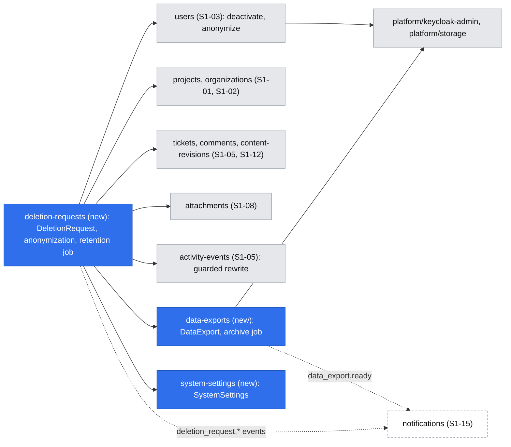
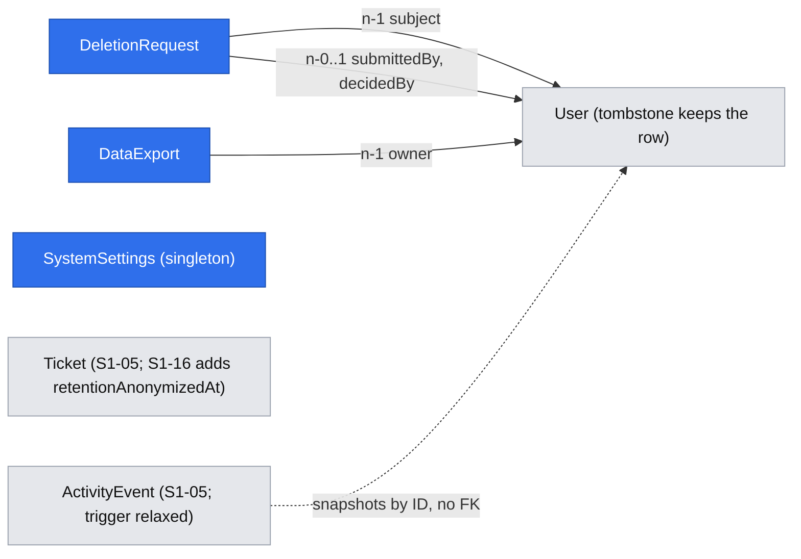

# GDPR baseline – data export, deletion requests, anonymization and retention

| | |
|---|---|
| Status | `draft` |
| Created | 2026-10-26 |
| Plan task | `S1-16` |
| System specification sections | §4.5, §6.6, §13.2, §13.5; also §5.4, §6.1, §7.4, §7.5, §13.3, §14.4, §15.10, §17.2, §18.3, §18.5, glossary |
| Related issues / PRs | Sibling specifications: S1-01 projects ([#111](https://github.com/trybun/trybun/pull/111)), S1-02 organizations ([#112](https://github.com/trybun/trybun/pull/112)), S1-03 accounts and deactivation ([#113](https://github.com/trybun/trybun/pull/113)), S1-04 permission layer ([#114](https://github.com/trybun/trybun/pull/114)), S1-05 ticket model and activity events ([#115](https://github.com/trybun/trybun/pull/115)), S1-06 statuses ([#116](https://github.com/trybun/trybun/pull/116)), S1-08 attachments ([#119](https://github.com/trybun/trybun/pull/119)), S1-10 team ticket view ([#120](https://github.com/trybun/trybun/pull/120)), S1-11 visibility ([#121](https://github.com/trybun/trybun/pull/121)), S1-12 comments, revisions and redaction ([#122](https://github.com/trybun/trybun/pull/122)) |

## Context

Trybun stores personal data of customers and of the team: accounts, tickets, comments, files, and their history. [§13.2](../../docs/spec/13-non-functional.md) gives every person four rights and the Administrator three duties:

- **Access and portability**: a person downloads their data as a ZIP archive, prepared in the background.
- **Erasure**: a person submits a deletion request. Their account is deactivated at once, and the Administrator completes the request within 30 days by **anonymizing** the account. History stays readable: the person is shown as "Deleted user" (PL „Użytkownik usunięty”).
- **Retention**: the Administrator may set a period after which the personal data of closed tickets is anonymized automatically.
- **Redaction**: the team removes personal data from free text ([§6.1](../../docs/spec/06-comments-notifications.md)).
- Every one of these actions is written to the administrative audit log ([§13.5](../../docs/spec/13-non-functional.md)).

None of this exists yet. The `users` table already has the state `anonymized` and optional personal fields, and the Keycloak Admin adapter can delete a user. The plan makes S1-16 the place where anonymization and export are built for all Stage 1 data, and every later task extends them for its own data ("How to use this plan", "Cross-cutting parts grow with the features").

The sibling specifications leave these pieces to S1-16:

- **S1-03** ([#113](https://github.com/trybun/trybun/pull/113)) builds deactivation: sessions deleted, invitations revoked, Keycloak user disabled by a Worker job. `invited` accounts are "anonymized like any account" (its Q9). Invitations point to the account and hold no e-mail address of their own.
- **S1-05** ([#115](https://github.com/trybun/trybun/pull/115)) makes `activity_events` immutable by a trigger. Snapshots `{ id, displayName }` in the event data carry names. S1-16 "adds its own exception for the anonymization of snapshots".
- **S1-06** ([#116](https://github.com/trybun/trybun/pull/116), Q2) and **S1-11** ([#121](https://github.com/trybun/trybun/pull/121), Q8) store the reasons of rejections and sharing refusals in interim columns `tickets.rejection_reason` and `tickets.sharing_refusal_reason`. S1-12 copies them into public comments and drops them. S1-06 also adds `closedAt`, which retention needs (its Q12).
- **S1-08** ([#119](https://github.com/trybun/trybun/pull/119)) deletes attachments through its service, which removes the objects by an outbox job. File names in the `attachment_added` and `attachment_deleted` events "stay in the history until anonymization" (its Q9).
- **S1-12** ([#122](https://github.com/trybun/trybun/pull/122)) builds comments, content revisions with their author, mentions, and **redaction** of comments and descriptions. It leaves their export and anonymization to S1-16.

The plan's "Done when" for S1-16:

- The export contains no internal notes and no other users' personal data.
- After anonymization the Keycloak user does not exist, and no table except tombstones contains the name or e-mail.
- A deletion request appears to the Administrator with a due date.

The specification leaves several points open, and one requirement pulls against the "Done when". Agents may not decide them (Rule 8). Each one is listed under [Open questions](#open-questions) with a proposed answer for a human to accept, change or reject. The design below already assumes the proposed answers.

## Goals

- Every person downloads their data from account settings in one click. The archive holds what they can see in the UI about themselves, never internal notes, internal events or other people's personal data.
- Every person can submit a deletion request. Their account is deactivated at once, and the Administrator is told and reminded before the due date.
- The Administrator completes or rejects a request, or anonymizes an account directly. Anonymization reaches every Stage 1 store of personal data: database, object storage and Keycloak.
- After anonymization no table contains the person's name or e-mail address. The history stays readable, with "Deleted user" in place of the person.
- The Administrator sets a retention period. A daily job then removes end users from tickets closed longer ago than that.
- One mechanism that later tasks extend for their data, and one test that fails when they forget.

## Non-goals

- **Redaction** of comments and descriptions. S1-12 builds it ([#122](https://github.com/trybun/trybun/pull/122)), and S1-16 adds no second way ([Q15](#open-questions)). Redaction of ticket titles and their history is a gap, proposed in Q15.
- Stores that do not exist in Stage 1: personal access tokens (S6-02), outgoing webhook delivery logs (S6-04), the search index and embeddings (S2-01, Stage 7), personal saved views (S2-10), affected users (S2-02), GitHub data (Stage 3). Each of these tasks adds its store to anonymization and export, as the plan says.
- Watchers, notifications and notification settings (S1-15, same group). Whichever of S1-15 and S1-16 is merged second adds them ([Q1](#open-questions)).
- Modifying backups. Their data expires with the backup retention, as [§13.2](../../docs/spec/13-non-functional.md) states.
- The privacy notice of the operator. Trybun documents what it stores and for how long; the operator writes their notice.
- A form for requests made outside the application (e-mail, letter). The Administrator uses direct anonymization for them ([Q8](#open-questions)).

## Proposed change

### Behaviour

#### Data export

On **Account settings** (S1-03), a new section "Your data" (PL „Twoje dane”) has **Download your data** (PL „Pobierz swoje dane”).

1. `POST /api/v1/data-exports` creates an export in state `preparing` and returns `202`. If an export of the person is already `preparing`, it returns that one with `200` instead of a second one ([Q4](#open-questions)).
2. In the same transaction the API writes the audit entry `data_export.requested` and the outbox event `data_export.requested`.
3. A Worker job builds the archive and streams it into the object storage under `data-exports/{id}.zip` ([Q4](#open-questions)). It then sets the state `ready`, `readyAt` and `expiresAt = readyAt + 24 hours`. With S1-15 it also writes the outbox event `data_export.ready` for the notification.
4. The settings page shows the state. While the export is `preparing`, it polls every 3 seconds, as attachments do ([#119](https://github.com/trybun/trybun/pull/119) Q7). With S1-15 the person also gets an in-app notification "Your data is ready to download".
5. **Download** (`GET /api/v1/data-exports/{id}/content`) streams the ZIP through the BFF, like attachment content:
   - `Content-Type: application/zip`;
   - `Content-Disposition: attachment; filename="trybun-data-<YYYY-MM-DD>.zip"`;
   - `Cache-Control: no-store`;
   - `X-Content-Type-Options: nosniff`.

   Only the person who requested the export can read it. Anybody else, the Administrator included, gets `404`.
6. A recurring job runs every hour. It deletes the objects of exports past `expiresAt` and sets their state to `expired`.
7. When the job fails after its retries, the export becomes `failed`, and the page offers **Try again**.

The job builds the archive **as the person**. It loads every record through the person's CASL ability (`accessibleBy`), so the export never shows more than the UI ([§13.2](../../docs/spec/13-non-functional.md), [§18.3](../../docs/spec/18-code-patterns.md)). The ability alone is not enough: a team member's ability includes internal notes. Every query of the job therefore **also** filters explicitly:

- comments: `kind = 'public'`;
- activity events: `isPublic`;
- attachments: linked to a ticket, or to a public comment, and in status `available`.

The archive never includes internal notes, internal events, their files, or any field that the end-user ticket response does not carry. When the account is no longer `active` (for example after a deletion request), the job ends the export as `failed` without building it. "The tickets the user created" of §13.2 are the tickets the person requested: in Stage 1 the creator is always the requester (S1-05).

**Archive** (`schemaVersion` 1, [Q3](#open-questions)):

```
trybun-data-2026-10-26.zip
├── data.json
└── attachments/
    └── <attachmentId>/<fileName>
```

Entry names come from file names that S1-08 already normalized ([#119](https://github.com/trybun/trybun/pull/119): no `/` or `\`, no control characters). The job still writes each file only under its own `attachments/<attachmentId>/` folder, and it refuses a name of `.` or `..`, so no entry can escape the archive's folders (zip slip).

`data.json`, validated by `dataExportArchiveSchema` of `@trybun/contracts/data-exports`:

| Key | Content |
|---|---|
| `schemaVersion`, `generatedAt` | `1`, ISO 8601 UTC |
| `account` | `id`, `email`, `displayName`, `kind`, `isAdministrator`, `language`, `timeZone`, `githubLogin`, `createdAt` |
| `organization` | `{ name }` of the person's organization, or `null` |
| `projects` | The projects the person can access: `key`, `name`, own `role` (team role or `end_user`) |
| `tickets` | The tickets the person requested and can read. Each has: `identifier`, `project` (key, name), `title`, `description`, `publicStatus`, `visibility`, `createdAt`, `closedAt`, the revisions of the description the person wrote, its **public** comments readable by the person (see below), its **public** events, and references to the person's own files |
| `comments` | The person's own public comments on other tickets they can read: `ticketIdentifier`, `body`, `createdAt`, `editedAt`, the revisions the person wrote, file references |
| `attachments` | Every file the person uploaded that they can still read and that is `available`: `id`, `fileName`, `contentType`, `size`, `createdAt`, `ticketIdentifier`, `path` in the ZIP |

**Other people in the archive** ([Q2](#open-questions)): the archive contains no name, e-mail address or account ID of anyone else.

- The author of a comment and the actor of an event are written as `you`, `team`, `customer` or `system`.
- Mention tokens of other people (`@{<userId>}`, [#122](https://github.com/trybun/trybun/pull/122) Q2) become `@person`. Tokens of the person become their own name.
- Snapshots of other people in event data are left out. For example, an assignment event shows the type and time, never the assignee.
- File names of other people's attachments are left out, and their files are not in the ZIP.
- The **text** of other people's public comments on the person's own tickets stays in the archive, because it is part of the conversation the person received. Free text is never filtered automatically ([§13.2](../../docs/spec/13-non-functional.md)).

#### Deletion requests

**Submitting** (`POST /api/v1/users/me/deletion-request`). On Account settings, **Delete my account** (PL „Usuń moje konto”) opens a dialog. It says:

- the account is deactivated and signed out at once;
- the Administrator completes the request within 30 days;
- the history stays, shown as "Deleted user";
- the data can be downloaded first.

It offers **Download your data** and **Delete my account**. While an export of the person is `preparing`, **Delete my account** is disabled with the hint "Wait until your data is ready to download". A deactivated person cannot sign in to download it later ([Q4](#open-questions)). In one transaction:

1. The deletion request is created: state `requested`, `submittedAt`, and `dueAt = submittedAt + 30 days` ([Q17](#open-questions)).
2. S1-03's deactivation runs (`UsersService.deactivate(tx, …)`): web sessions deleted, pending invitations revoked, the audit entry and the outbox event `user.deactivated`. The Keycloak user is disabled by S1-03's job, and S1-05 unassigns open tickets.
3. The audit entry `deletion_request.submitted` is written. With S1-15 the outbox event `deletion_request.submitted` is written too, and all active Administrators get an in-app and an e-mail notification ([§6.6](../../docs/spec/06-comments-notifications.md)). Before S1-15 no event is written, because nothing would consume it (as S1-05 Q14 and S1-12 Q15 do). The Administrator sees the request on the Deletion requests page and in the request count of the panel's navigation.

The response ends the session. The web application signs out and shows the public page `/deletion-requested`, with catalogue texts in EN and PL: "Your deletion request was received. Your account is deactivated, and the Administrator will delete your data within 30 days." The page shows no data and needs no session ([Q20](#open-questions)).

S1-03's guards apply: the last active Administrator cannot submit a request (`409 user.last_administrator`). A person with a request in state `requested` cannot sign in, so a second request cannot be made. A partial unique index also allows only one `requested` request per account.

**Handling** (Administrator panel, page **Deletion requests**, PL „Wnioski o usunięcie”):

- A list of requests. Each row shows the person (display name and e-mail address while the account still has them), `submittedAt`, the **due date**, the days left, and the state. Open requests come first, sorted by due date.
- An open request less than 7 days from its due date is marked "Due soon". An open request past its due date is marked "Overdue". Each mark has an icon and text, never colour alone ([§13.4](../../docs/spec/13-non-functional.md)).
- On phones the list renders as cards (Rule 9).
- **Complete** opens a confirmation dialog. It lists what anonymization does and says that this cannot be undone. Then `POST /api/v1/deletion-requests/{id}/completion` anonymizes the account ([Anonymization](#anonymization)) and sets `completed`, `decidedById` and `decidedAt` in the same transaction.
- **Reject** asks for a reason (GFM, 1–2000 characters) and calls `POST /api/v1/deletion-requests/{id}/rejection`. It sets `rejected` and the reason. The account **stays deactivated**, and the Administrator may reactivate it on the Accounts page ([Q12](#open-questions)). With S1-15 the reason is sent to the person by e-mail in their language, because a deactivated person cannot sign in. Audit: `deletion_request.rejected`.
- **Reminder** (built with the notifications, [Q1](#open-questions)): a daily job writes the outbox event `deletion_request.due_soon` once per open request when it is 7 days or less from its due date, and records `reminderSentAt`. Administrators then get the notification of [§6.6](../../docs/spec/06-comments-notifications.md). Before the job exists, nothing sets `reminderSentAt`, so the requests open at that time are reminded on its first run. The "Due soon" and "Overdue" marks are computed from `dueAt` and need no job.
- Nothing completes a request automatically. An overdue request stays open and visible until an Administrator decides it.

**Direct anonymization** ([Q8](#open-questions)): the Accounts page of S1-03 gains **Anonymize** for every account that is not `anonymized`. It is for requests received outside the application, and for `invited` accounts that never accepted. `POST /api/v1/users/{id}/anonymization` does this in one transaction:

- if the account has a request in state `requested`, it completes that request;
- otherwise it creates a request with `submittedById` = the Administrator and completes it at once.

So every anonymization has exactly one completed deletion request: one code path and one trail. Guards: nobody anonymizes their own account (`403`), and the last active Administrator cannot be anonymized (`409 user.last_administrator`).

#### Anonymization

One use case, `DeletionRequestsService.complete(tx, principal, request)`, runs in **one database transaction**. It calls the exported services of the modules that own the data ([§18.3](../../docs/spec/18-code-patterns.md), "Using another module"). The account row stays as the **tombstone**: its ID, `kind` and `createdAt` remain, so every foreign key, activity event and audit entry still points to it ([§13.2](../../docs/spec/13-non-functional.md), [§13.5](../../docs/spec/13-non-functional.md)).

| Store (Stage 1) | Effect | Owner |
|---|---|---|
| Account | If it is still `active`, S1-03's deactivation runs first. Then `email`, `displayName`, `language`, `timeZone`, `githubLogin` and `hideTimelineEvents` (S1-10) are reset. `isAdmin` becomes `false`, and `state` becomes `anonymized`. This is the first write of the use case, because the guarded rewrite checks the state. `keycloakUserId` stays until the Keycloak job has deleted the user ([Q9](#open-questions)). Stage 1 has no avatar: the avatar of §13.2 comes from the identity provider and is not stored | `users` |
| Product tour progress | Deleted | `users` |
| Web sessions | Deleted (by the deactivation, again by `keycloakUserId` for safety) | `platform/authentication` |
| Project memberships | Deleted, with the audit entry of S1-01 | `projects` |
| Organization membership | Removed through `OrganizationsService.removeMembership` (S1-02 [#112](https://github.com/trybun/trybun/pull/112), also for archived organizations) | `organizations` |
| Invitations | Pending ones are revoked by the deactivation. Rows stay and point to the tombstone ([#113](https://github.com/trybun/trybun/pull/113)) | `invitations` |
| Tickets requested by or assigned to the person | Content kept; requester and assignee point to the tombstone | – |
| Comments written by the person | Content kept; the author is the tombstone ([§13.2](../../docs/spec/13-non-functional.md)) | – |
| Content revisions written by the person (`content_revisions.author_id`) | **Purged**, in every text ([§6.1](../../docs/spec/06-comments-notifications.md), [#122](https://github.com/trybun/trybun/pull/122)) | `content-revisions` |
| Mentions of the person (`comment_mentions`) | Deleted ([#122](https://github.com/trybun/trybun/pull/122)). The token in the text then renders as "@Deleted user" ([Q10](#open-questions)) | `comments` |
| Attachments uploaded by the person | Deleted through the attachments service. Its outbox event `attachment.deleted` removes the objects ([#119](https://github.com/trybun/trybun/pull/119)). A linked file leaves an automatic `attachment_deleted` event without file name ([Q11](#open-questions)) | `attachments` |
| Activity events | Kept. `actorId` already points to the tombstone. **Snapshots** of the person in `data` lose their display name, and snapshots of the deleted attachments lose their file name. This is done through the guarded rewrite below ([Q6](#open-questions)) | `activity-events` |
| Audit log entries | Unchanged. They hold only IDs, which now point to the tombstone ([§13.5](../../docs/spec/13-non-functional.md)) | – |
| Data exports of the person | Rows deleted; an outbox event per export removes its object | `data-exports` |
| Deletion requests | The completed one is kept, as the record of the erasure. The `rejectionReason` of earlier rejected requests of the person is cleared: the reason for keeping the data no longer applies ([Q12](#open-questions)) | `deletion-requests` |
| Keycloak user and its linked identities (GitHub, Google, Microsoft) | Deleted by a Worker job on the outbox event `user.anonymized`, after the commit ([Q9](#open-questions)) | `users` + `platform/keycloak-admin` |
| Outbox payloads, job data, technical logs | Nothing to do: they hold only identifiers ([§13.5](../../docs/spec/13-non-functional.md), [§18.3](../../docs/spec/18-code-patterns.md)) | – |
| Backups | Not modified. The data expires with the backup retention (default 30 days, [§13.6](../../docs/spec/13-non-functional.md)) | – |
| Keycloak login and admin events | Not modified. They expire after 90 days ([§13.2](../../docs/spec/13-non-functional.md), [Q9](#open-questions)) | – |

The use case also writes the audit entry `user.anonymized` (actor: the Administrator, target: the account) and the outbox event `user.anonymized` with `{ userId }`.

**Keycloak job** (queue `user-anonymizations`). It reads the tombstone. If `keycloakUserId` is set, it calls `KeycloakAdmin.deleteUser`, where `404` counts as success, and then sets `keycloakUserId` to `null`. A repeated job finds `null` and does nothing. Until the job succeeds, the disabled Keycloak user (S1-03) cannot sign in, and the API refuses the `anonymized` account anyway. A job that exhausts its retries stays in the failed jobs for the Administrator ([§17.2](../../docs/spec/17-conventions.md)), and `GET /api/v1/users/{id}` shows `keycloakDeletionPending: true` on the Accounts page ([Q9](#open-questions)).

**Display.** A person reference in a response is `{ id, displayName }`. For an anonymized account the API returns `{ id, displayName: null }`, and the web application renders the catalogue text "Deleted user" (PL „Użytkownik usunięty”) in the viewer's language. This is distinct from S1-11's `null` reference, which means "Customer" ([#121](https://github.com/trybun/trybun/pull/121) Q9). Snapshots without a name render the same way. Anonymized accounts never appear in pickers, mention suggestions, assignee lists or the Accounts filter "active".

**Guarded rewrite of activity events** ([Q6](#open-questions)). S1-05's trigger refuses every `UPDATE` of `activity_events`. S1-16 changes it to allow exactly one kind of update:

- A SQL function `anonymize_activity_event_data(data jsonb, from_user uuid, to_user uuid, attachment_ids uuid[])` returns `data` with:
  - every person snapshot `{ id: from_user, displayName }` replaced by `{ id: to_user, displayName: null }`;
  - the `fileName` of every attachment snapshot in `attachment_ids` set to `null`.
- The anonymization sets three transaction-local parameters with `SET LOCAL`: `trybun.anonymize_from`, `trybun.anonymize_to` and `trybun.anonymize_attachments`.
- The trigger lets an `UPDATE` through only when all of these hold:
  - the parameters are set, and the account `to_user` is `anonymized`;
  - either `from_user = to_user` (account anonymization), or `to_user` is the retention tombstone `RETENTION_TOMBSTONE_USER_ID` (retention). No other person can be re-pointed;
  - `NEW.data` equals the function's result for `OLD.data`;
  - `NEW.actor_id` is `OLD.actor_id`, or it is `to_user` where `OLD.actor_id` was `from_user`;
  - every other column is unchanged.
- Every other update is still refused. `DELETE` stays as S1-05 defines it.

The same function serves account anonymization (`from_user = to_user`, the tombstone keeps its ID) and retention (`to_user` = the retention tombstone, [Q7](#open-questions)). The rewrite is one parameterized statement per anonymization in `activity-events.sql.ts`, limited to the events whose `data` or `actor_id` contains the person (a GIN index on `data` with `jsonb_path_ops`).

#### Retention

**Setting** ([Q13](#open-questions)): the Administrator panel gains **Data retention** (PL „Retencja danych”). It has a switch, "Anonymize closed tickets automatically", off by default, and a number of months (whole number, at least 1, at most 120).

- `PUT /api/v1/system-settings/retention` with `If-Match` stores `retentionMonths` (`null` = off) in the singleton `system_settings` row.
- Before saving, the dialog says how many closed tickets the next run would process (`GET …/retention/preview`) and that this cannot be undone.
- Audit: `system_settings.retention_changed`, with the old and new value in `details` (S1-02's `details`, [#112](https://github.com/trybun/trybun/pull/112)).

**Daily job** (job scheduler `retention-anonymization`, daily at 02:30 UTC, [§17.2](../../docs/spec/17-conventions.md), [Q14](#open-questions)):

1. With retention off, the run ends without effect and without an audit entry.
2. Otherwise it selects tickets that meet all of these, in any project, archived ones included:
   - the status is terminal (`done`, `rejected`, `duplicate`);
   - `closedAt ≤ now − retentionMonths` (calendar months, UTC);
   - `retentionAnonymizedAt` is `null` or earlier than `closedAt` (a ticket reopened and closed again is processed again).
3. It works in batches of 100 tickets, each batch in its own transaction, with the tickets locked by S1-05's row lock. For each ticket:
   - every reference to an **end-user** account on the ticket is replaced by the **retention tombstone**. That covers the requester, comment authors and editors, revision authors, mentions (deleted), activity-event actors and snapshots (guarded rewrite), and later watchers (S1-15) and affected users (S2-02). Team members stay ([Q14](#open-questions));
   - attachments uploaded by end users to the ticket and to its comments are deleted through the attachments service, with their file names removed from the event snapshots;
   - free text (title, description, comments, revisions) is **not** changed ([§13.2](../../docs/spec/13-non-functional.md));
   - `retentionAnonymizedAt` is set.
4. Each batch writes, in its own transaction, the audit entry `retention.batch_completed` (actor: none) with `details` `{ runId, ticketCount, attachmentCount }`. So every committed change is recorded, even when a later batch fails. A failed batch is retried by the job; batches already committed stay done, and the next run continues.

What retention does **not** change, by design:

- audit log entries keep the end user's account ID ([§13.5](../../docs/spec/13-non-functional.md)). It is a pseudonymous identifier of an account that still exists, never a name or address;
- the ticket's organization snapshot. A `my_organization` ticket stays visible to its organization (the visibility follows the snapshot, [#121](https://github.com/trybun/trybun/pull/121)). An `only_me` ticket is then visible to the team only, because its requester is the tombstone.

The **retention tombstone** is one system account created by the migration: fixed ID, kind `end_user`, state `anonymized`, no personal fields ([Q7](#open-questions)). It is shown as "Deleted user", like any anonymized account. Accounts of the people themselves are not changed by retention: they keep their other tickets.

### Architecture



The arrows point one way. `deletion-requests` sits on top of the modules that own personal data and calls their exported services, so no owning module depends on it ([§18.3](../../docs/spec/18-code-patterns.md), no cycles).

- **Module `deletion-requests`** owns `DeletionRequest`, the anonymization use case, the direct anonymization endpoint `POST /users/{id}/anonymization`, the reminder job and the retention job. Retention is "automatic anonymization" and uses the same services ([Q18](#open-questions)).
- **Module `data-exports`** owns `DataExport`, its endpoints and the archive job. It **reads** across models through Prisma relations, always through the person's ability, which [§18.3](../../docs/spec/18-code-patterns.md) allows for reads. It writes only its own rows and objects.
- **Module `system-settings`** owns the singleton `SystemSettings` row. Retention is its first field.
- **Owning modules** each export the narrow methods the use cases call, for example:
  - `UsersService.anonymize(tx, userId)`;
  - `ProjectsService.removeAllMemberships(tx, userId)`;
  - `ContentRevisionsService.purgeAuthoredBy(tx, userId)`;
  - `CommentsService.deleteMentionsOf(tx, userIds, ticketIds?)`;
  - `AttachmentsService.deleteUploadedBy(tx, userId, scope)`;
  - `ActivityEventsService.replacePerson(tx, { from, to, attachmentIds, ticketIds? })`;
  - `TicketsService.replaceEndUserReferences(tx, ticketIds, tombstoneId)`.

**Proposed pattern** (Rule 12, [§18.9](../../docs/spec/18-code-patterns.md), [Q18](#open-questions)), "Personal data of a module":

- A module that stores personal data exports its anonymization method, and the use case of `deletion-requests` calls it.
- Its export data is read by `data-exports` through the ability.
- The integration test "no personal data left" (step 5 of the [Implementation plan](#implementation-plan)) reads the columns from the database schema and fails on any column that references `users` or holds text and is missing from its allowlist. A task that adds personal data must declare how it is handled, so a forgotten store fails CI.

Reference implementation: `apps/server/src/modules/deletion-requests/`.

### Data model



**`DeletionRequest`** (`deletion_requests`, module `deletion-requests`):

| Field | Column | Type and rule |
|---|---|---|
| `id` | `id` | UUIDv7 |
| `userId` | `user_id` | FK `users`, `RESTRICT`: the account to erase. Partial unique index on `user_id` where `state = 'requested'` |
| `state` | `state` | enum `deletion_request_state`: `requested`, `completed`, `rejected` (glossary) |
| `submittedById` | `submitted_by_id` | FK `users`: the person themselves, or the Administrator for a direct anonymization |
| `submittedAt` | `submitted_at` | `timestamptz` |
| `dueAt` | `due_at` | `submitted_at + interval '30 days'`, stored |
| `reminderSentAt` | `reminder_sent_at` | Nullable |
| `decidedById`, `decidedAt` | `decided_by_id`, `decided_at` | Set with `completed` or `rejected` |
| `rejectionReason` | `rejection_reason` | GFM, 1–2000 characters, set exactly when `rejected` |
| `version` | `version` | Optimistic locking: completion and rejection send `If-Match` ([§17.2](../../docs/spec/17-conventions.md)) |
| `createdAt`, `updatedAt` | | `timestamptz` |

Check constraints keep the decision fields consistent with the state. Index `(state, due_at)` for the list and the reminder job.

**`DataExport`** (`data_exports`, module `data-exports`): `id` (UUIDv7, also the object key), `userId` (FK `users`, `RESTRICT`), `state` (enum `data_export_state`: `preparing`, `ready`, `failed`, `expired`), `size` (bytes, nullable), `readyAt`, `expiresAt`, `createdAt`, `updatedAt`. There is a partial unique index on `user_id` where `state = 'preparing'`. Not versioned: only the job and the purge change it, through conditional updates.

**`SystemSettings`** (`system_settings`, module `system-settings`): one row with a fixed ID, created by the migration. `retentionMonths` (integer 1–120, nullable = off), `version`, `updatedAt`. Later settings become columns of the same row ([Q13](#open-questions)).

**Other tables:**

- `tickets.retention_anonymized_at` (nullable `timestamptz`), and a partial index for the job on `closed_at` where the status is terminal.
- `users`: the retention tombstone row (fixed UUIDv7 in the contracts, `RETENTION_TOMBSTONE_USER_ID`). Check constraint: `state = 'anonymized'` implies that `email`, `display_name`, `language`, `time_zone` and `github_login` are `null`.
- `activity_events`: the changed trigger and the function above, and a GIN index on `data` (`jsonb_path_ops`).
- **Interim reason columns** ([Q16](#open-questions)). S1-12 drops `tickets.rejection_reason` and `tickets.sharing_refusal_reason` before S1-16 (group 6 before group 7), so S1-16 handles the reasons as public comments. If the order changes and the columns still exist when S1-16 is built, three rules apply:
  - they are team-only fields and never enter an export;
  - like a description, their content is kept by anonymization and retention;
  - they are redacted by editing them (the reason of a `rejected` ticket can be changed, [#116](https://github.com/trybun/trybun/pull/116)). S1-16 builds nothing extra for them.

**Personal data in the new tables.** `deletion_requests.rejection_reason` may name the person. It is written by the Administrator about a legal obligation to keep data, and it is cleared when the person is anonymized later ([Q12](#open-questions)). The other new columns hold identifiers, states and times only. Logs carry only IDs ([§13.5](../../docs/spec/13-non-functional.md)).

### API contracts

New contracts: `@trybun/contracts/data-exports` (`dataExportSchema`, `dataExportArchiveSchema`, states), `@trybun/contracts/deletion-requests` and `@trybun/contracts/system-settings`.

| Endpoint | Check | Notes |
|---|---|---|
| `POST /api/v1/data-exports` | `create` on `DataExport` (every active account, for itself) | `202` with the new export, or `200` with the one already `preparing`. Body empty |
| `GET /api/v1/data-exports?cursor&limit` | `read` | The person's own exports, newest first, cursor envelope ([§18.4](../../docs/spec/18-code-patterns.md)) |
| `GET /api/v1/data-exports/{id}` | `read` (`{ userId: me }`) | Polled while `preparing` |
| `GET /api/v1/data-exports/{id}/content` | `read` | Streams the ZIP. `409 data_export.not_available` when it is not `ready` or past `expiresAt` |
| `POST /api/v1/users/me/deletion-request` | `create` on `DeletionRequest` for itself | `201` with `{ id, dueAt }`; the session ends. `409 user.last_administrator` |
| `GET /api/v1/deletion-requests?state&cursor&limit` | `read` (Administrator) | Open first, by `dueAt`. Items: `id`, `user { id, displayName, email }`, `state`, `submittedAt`, `dueAt`, `submittedBy`, `decidedBy`, `decidedAt`, `rejectionReason`, `version`, `allowedActions` (`complete`, `reject`) |
| `POST /api/v1/deletion-requests/{id}/completion` | `complete` | `If-Match`. `409 deletion_request.not_pending` when decided; `409 user.last_administrator` |
| `POST /api/v1/deletion-requests/{id}/rejection` | `reject` | `{ reason }`, `If-Match`. `409 deletion_request.not_pending` |
| `POST /api/v1/users/{id}/anonymization` | `anonymize` on `User` | `204`. `403` for the own account, `409 user.last_administrator`, `409 user.anonymized` when already anonymized |
| `GET /api/v1/system-settings/retention` | `read` on `SystemSettings` (Administrator) | `{ retentionMonths, version }` |
| `GET /api/v1/system-settings/retention/preview?retentionMonths=` | `read` | `{ ticketCount }`: the tickets the next run would process. The value is a number, not free text, so it may go in the query |
| `PUT /api/v1/system-settings/retention` | `update` | `{ retentionMonths: 1–120 \| null }`, `If-Match` |

- The **Accounts page** response of S1-03 (`GET /api/v1/users`, `GET /api/v1/users/{id}`) gains `deletionRequest { id, state, dueAt } | null` (the open one) and `keycloakDeletionPending`. `allowedActions` of a `User` gains `anonymize`.
- `GET /api/v1/users/me` gains `allowedActions` `export_data` and `request_deletion`; the settings page shows each button only when it is present.
- **Error codes** (new): `data_export.not_available` (409), `deletion_request.not_pending` (409), `user.anonymized` (409). Reused: `user.last_administrator` (S1-03), `request.precondition_*`.
- **Outbox events** (identifiers only, [§18.3](../../docs/spec/18-code-patterns.md)):
  - with a consumer in S1-16: `data_export.requested` with `{ dataExportId, userId }` (the archive job), `data_export.deleted` with `{ dataExportId }` (object removal), `user.anonymized` with `{ userId }` (the Keycloak job);
  - only once the notifications exist (Phase 4, [Q1](#open-questions)): `data_export.ready` with `{ dataExportId, userId }`, and `deletion_request.submitted`, `deletion_request.due_soon` and `deletion_request.rejected` with `{ deletionRequestId, userId }`. Nothing would consume them before, as S1-05 Q14 and S1-12 Q15 decide for their events.

  All are new event types, so the payload rules of [§17.2](../../docs/spec/17-conventions.md) apply from their first release.

### Permissions

Rules in `data-exports.abilities.ts`, `deletion-requests.abilities.ts`, `system-settings.abilities.ts` and `users.abilities.ts`, following S1-04 ([#114](https://github.com/trybun/trybun/pull/114)). Each [§7.5](../../docs/spec/07-users-organizations-permissions.md) row has an allowed and a denied test:

| §7.5 row | Rule |
|---|---|
| Export own data, request account deletion (all roles) | `DataExport` `create`, `read` with `{ userId: me }`; `DeletionRequest` `create` for `{ userId: me }`. Anybody else's export → `404`, the Administrator included |
| Execute anonymization, set retention period (Administrator) | `DeletionRequest` `read`, `complete`, `reject`; `User` `anonymize` with `{ id: { not: me }, state: { not: 'anonymized' } }`; `SystemSettings` `read`, `update`. A Project manager or Developer gets `403` for the Administrator pages (no record to hide, like the Accounts page of S1-03) |

The guards that need the database (last Administrator, an open request) are checked in the service on locked rows, after the ability.

### Audit log

Written in the transaction of the change ([§13.5](../../docs/spec/13-non-functional.md)):

| Action | Actor | Target |
|---|---|---|
| `data_export.requested` | The person | `DataExport` |
| `deletion_request.submitted` | The person (or the Administrator for a direct anonymization) | `DeletionRequest` |
| `deletion_request.completed` | The Administrator | `DeletionRequest` |
| `deletion_request.rejected` | The Administrator | `DeletionRequest` |
| `user.anonymized` | The Administrator | `User` |
| `system_settings.retention_changed` | The Administrator | `SystemSettings`, `details` `{ from, to }` |
| `retention.batch_completed` | None (system) | `SystemSettings`, `details` `{ runId, ticketCount, attachmentCount }`, one per committed batch |

The entries of the deactivation (`user.deactivated`), membership removal and attachment deletion are written by their owning services, as for any other caller.

### Web application

- **Account settings** (S1-03, `/settings`), section "Your data":
  - **Download your data**, with the state of the latest export: "Preparing…", "Ready – download until {time}", "Failed – try again" or "Expired". Polling while preparing.
  - **Delete my account**, with the dialog of [Deletion requests](#deletion-requests).
  - The same section exists in the portal account menu, because it is one page for both account kinds (S1-03).
- **Public page** `/deletion-requested` (no session, no data; [Q20](#open-questions)).
- **Administrator panel**:
  - **Deletion requests** page: list, marks, **Complete** and **Reject** dialogs;
  - **Data retention** page: switch, months, preview count, confirmation;
  - **Accounts** page (S1-03): **Anonymize** with the same confirmation, the open request's due date in the row, and "Keycloak deletion pending" when set.
- **"Deleted user"** for `displayName: null` in every person display: timeline, comments, lists, ticket fields. It goes into the shared person component of S1-10 and S1-12, not into each view.
- Confirmations are `Dialog` (bottom sheet on phones). Every action is a 44 px target, with no hover-only control (Rule 9).
- Features `features/data-exports/`, `features/deletion-requests/`, `features/system-settings/` with `queries.ts` and `mutations.ts` ([§18.5](../../docs/spec/18-code-patterns.md)).

**User documentation** (EN, PL, Rule 3):

- how-to "Download your data" and "Delete your account" (everyone);
- how-to "Handle a deletion request", "Anonymize an account" and "Set the retention period" (Administrator);
- reference "Personal data in Trybun" (Administrator). It covers what anonymization changes in each store, what stays (content, history, audit log), backups (30 days), Keycloak events (90 days), and the `data.json` format.

No product tour: each flow is one dialog, and the help pages cover them (Rule 4).

### Edge cases and failure scenarios

- **Object storage down while building an export:** the job retries with backoff ([§17.2](../../docs/spec/17-conventions.md)), and the export stays "Preparing…". After the last attempt it becomes `failed`. Objects of a half-written archive are deleted by the failure handler, and again by the hourly purge.
- **Very large exports:** the archive is streamed. Attachments are read one at a time from storage and written into the ZIP stream, never loaded fully into memory. No size limit is set (at most the person's own files).
- **Deletion request while an export is preparing:** the job finds the account deactivated and ends as `failed`. The dialog suggested downloading first.
- **Keycloak down during anonymization:** the database part is committed. The account is `anonymized` and refused, and the Keycloak user is already disabled by S1-03's job. The deletion job retries, and the Accounts page shows "Keycloak deletion pending" until it succeeds.
- **Jobs in the wrong order:** S1-03's job that disables the Keycloak user may run after the deletion job. It must treat Keycloak's `404` as success, and S1-16 adds that test to S1-03's job.
- **The same address invited again while the Keycloak deletion is pending:** the new account is created (the tombstone has no address), but Keycloak still holds a disabled user with that address, so the registration of the acceptance fails with ADR 0009's error. It works once the job has run. The Accounts page shows the pending deletion of the old account, so the Administrator knows why.
- **Two Administrators complete the same request:** `If-Match` and the conditional update serialize them. The second gets `412`, or `409 deletion_request.not_pending` after reloading.
- **Anonymizing an `invited` account** (never signed in): no Keycloak user, no sessions. The e-mail address is cleared, so a new invitation to the same address creates a fresh account ([#113](https://github.com/trybun/trybun/pull/113) Q9).
- **The person wrote their own name into a comment or title:** the text stays. The dialog of **Complete** reminds the Administrator that free text is changed only by redaction (S1-12). Titles cannot be redacted yet ([Q15](#open-questions)).
- **E-mails already sent** (S1-15) keep the name and the text. They are outside the system.
- **Retention lowered from 24 to 1 month:** the preview shows the count before saving, and the next run processes all of them, in batches.
- **A ticket reopened by the team after retention:** it keeps the tombstone as requester. New end-user activity on it is processed when it is closed again and its new `closedAt` passes the period.
- **Archived project:** user-facing writes return `409 project.archived`, but anonymization and retention still apply. GDPR obligations override the read-only state, as S1-05 does for the system unassignment ([#115](https://github.com/trybun/trybun/pull/115) Q8).
- **A restore from a backup** brings back anonymized data from before the anonymization ([§15.10](../../docs/spec/15-deployment.md)). "Personal data in Trybun" tells the Administrator to repeat the anonymizations completed after the backup date. The audit log lists them (`user.anonymized`).

### Prior art

- **GitHub**: a deleted account's issues and comments are attributed to the `@ghost` user, and the content stays. Trybun does the same with a tombstone per account, so the audit log keeps one ID per person.
- **Zendesk**: deleting an end user keeps their tickets, and permanent deletion is a separate step; ticket deletion schedules handle retention. Trybun keeps tickets and removes the people instead ([§17.2](../../docs/spec/17-conventions.md): tickets are never deleted).
- **Jira (Atlassian)**: anonymizing a user replaces their name in history with an alias. Trybun uses the same alias, "Deleted user".

## Changes to the system specification

| Section | Change |
|---|---|
| §4.5 | Events stay immutable except for the guarded rewrite of anonymization and retention: names in person snapshots and file names of deleted attachments are removed, and actors of retention are re-pointed to the retention tombstone (Q6) |
| §5.4 | A person reference with `displayName: null` is "Deleted user"; `null` stays "Customer" |
| §6.6 | "Deletion request submitted or due soon" is sent when the request is created and once 7 days before the due date; "Your data is ready" (in-app) for the person who requested an export (Q4); the rejection reason is sent by e-mail (Q12) |
| §13.2 Deletion requests | `dueAt` is 30 days after submission; nothing completes automatically; a rejected request leaves the account deactivated (Q12); the Administrator can anonymize directly, which records a completed request (Q8) |
| §13.2 Anonymization | Table rows: product tour progress, memberships, invitations, data exports; Keycloak user deleted by a job, which retries; Keycloak events expire after 90 days (Q9); mentions render as "@Deleted user" (Q10) |
| §13.2 Retention period | Applies to end-user accounts only, through one retention tombstone (Q7); calendar months after `closedAt`; archived projects included; 1–120 months; daily at 02:30 UTC (Q14) |
| §13.2 Right of access | Archive layout and `schemaVersion`; other people appear only as roles; other people's public comments on own tickets are included without their identity (Q2, Q3); one export in preparation at a time; exports are not in backups (Q4) |
| §13.5 | Recorded actions named: `data_export.requested`, `deletion_request.submitted`, `deletion_request.completed`, `deletion_request.rejected`, `user.anonymized`, `system_settings.retention_changed`, `retention.batch_completed` |
| §15.10 | The backup copy of the object storage excludes `data-exports/` (Q4) |
| §17.2 | Error codes `data_export.not_available`, `deletion_request.not_pending`, `user.anonymized` |
| §18.2, §18.9 | Pattern "Personal data of a module" with reference implementation `modules/deletion-requests/` (Q18) |
| `BACKWARD_COMPATIBILITY.md` | New protected surface "Data export archive" (`data.json` with `schemaVersion`): a change that removes or renames a key needs a new `schemaVersion` (Q3) |
| Plan | S1-16 starts after S1-12; its notification phase after S1-15 (Q1). New task for title redaction (Q15). The maintainer changes the plan |

New or changed glossary terms (code identifier, EN/PL labels):

- Data export – `data_export`: `preparing`, `ready`, `failed`, `expired` – Data export / Eksport danych; Preparing / Przygotowywanie, Ready / Gotowy, Failed / Nieudany, Expired / Wygasły.
- Retention tombstone – `RETENTION_TOMBSTONE_USER_ID` – shown as Deleted user / Użytkownik usunięty: the one account that replaces end users on tickets anonymized by retention.
- Retention period – `system_settings.retention_months` – Retention period / Okres retencji.
- Deletion request (existing): EN/PL labels of the states – Requested / Złożony, Completed / Zrealizowany, Rejected / Odrzucony; marks Due soon / Wkrótce termin, Overdue / Po terminie.

## Open questions

Implementation must not start until every question has an answer. Every answer below is a **proposal awaiting human approval**, chosen as the smallest and most reversible option that still meets the plan and does not weaken data protection. Answers marked ⚠ NEEDS HUMAN CONFIRMATION resolve a conflict between requirements, relax a guarantee of the system specification, or fix a model that is costly to change later.

1. **Dependencies and order.** S1-16 (group 7) touches the data of every Stage 1 task, and S1-15 (same group) owns notifications and e-mail. — **Answer (proposed, awaiting approval):** implementation starts after S1-01 to S1-12 are merged, under their proposed contracts (#111–#122). By then the interim reason columns are gone (Q16). Phases 1–3 do not need S1-15. Phase 4 (the notification events and their notifications, the reminder job, the rejection e-mail, and the deletion of watchers, notifications and notification settings) is built by whichever of S1-15 and S1-16 is merged second, following the plan's cross-cutting rule. Until then the Administrator finds new requests on the Deletion requests page and its count in the panel navigation.
2. ⚠ NEEDS HUMAN CONFIRMATION **Other people's data in the export.** [§13.2](../../docs/spec/13-non-functional.md) puts "the tickets the user created (with their public comments and public events)" in the archive. Those comments are partly written by other people. The plan's "Done when" says "no other users' personal data". — **Answer (proposed, awaiting approval):** the archive has no name, e-mail address or account ID of anyone else. Authors and actors are the roles `you`, `team`, `customer` and `system`. Mention tokens of others become `@person`. Person snapshots are left out of event data, and other people's file names and files are left out. The **text** of other people's public comments on the person's own tickets stays, as the conversation the person received (GDPR Art. 15(4) balance). The Done-when test seeds names and e-mails of others and asserts they are absent. Alternative: leave out other people's comments entirely, which narrows §13.2.
3. **Shape of `data.json`.** — **Answer (proposed, awaiting approval):** as in [Data export](#data-export), with `schemaVersion: 1` and a Zod schema in the contracts. For everybody, tickets show the **public** status: team members see their internal status in the UI, but the export must stay free of internal events, and one shape for both kinds is simpler. Revisions are included only where the person wrote them. A new protected surface "Data export archive" in `BACKWARD_COMPATIBILITY.md` ensures that keys are only added within a `schemaVersion`. Alternative: internal status for team members.
4. **Export delivery.** — **Answer (proposed, awaiting approval):**
   - one export in `preparing` per person; a repeated request returns it;
   - the archive is stored under `data-exports/{id}.zip` in the attachment storage, and deleted by an hourly purge after 24 hours;
   - the backup copy excludes `data-exports/` (an rclone filter in `docker/backup/`), because a 24-hour file need not be restored and would keep personal data for another 30 days. This adds files to nothing and removes no existing data from backups, so restores of earlier backups keep working;
   - the person is told by polling until S1-15, then also by an in-app notification;
   - the content endpoint needs the person's session, so "the link" means the **Download** button;
   - **Delete my account** is disabled while an export is `preparing`, because a deactivated person can no longer sign in to download it. Exports for people who cannot sign in (deactivated, or with a rejected request) are not built by S1-16: the Administrator reactivates the account for the download if needed.

   Alternative: keep exports in backups (no change to the backup service).
5. **New dependency for writing ZIP streams.** No ZIP writer exists in the repository. — **Answer (proposed, awaiting approval):** `archiver` (MIT, widely used, streams entries from Node streams). It is added with an explicit stable range after the 7-day cooldown (Rule 10), and the implementation checks its advisories first. Alternative: `yazl` (MIT, smaller, fewer features), or `fflate` (MIT, no dependencies).
6. ⚠ NEEDS HUMAN CONFIRMATION **Rewriting immutable activity events.** [§4.5](../../docs/spec/04-ticket-lifecycle.md) says nobody can edit events, and anonymization "replaces personal data of the author but keeps the event". S1-05 stores display names in snapshots and asks S1-16 for the exception. — **Answer (proposed, awaiting approval):** the trigger allows exactly the update computed by `anonymize_activity_event_data` for the person named in transaction-local parameters, only for an `anonymized` target account, and only to the same account or to the retention tombstone. Every other update is still refused by the database. Alternative: snapshots keep only the ID, and names are always read from the account (this changes S1-05's model and the "readable after deletion" rule of §4.5).
7. ⚠ NEEDS HUMAN CONFIRMATION **The tombstone of retention.** [§13.2](../../docs/spec/13-non-functional.md) replaces references "with the tombstone", but retention does not anonymize the account, which stays in use for other tickets. — **Answer (proposed, awaiting approval):** one system account, the **retention tombstone** (fixed ID, `end_user`, `anonymized`, no personal fields). It is created by the migration and shown as "Deleted user". It is excluded from every list and picker by its state. Alternatives: (a) one tombstone per person, created at their first retention run, which keeps a link between their old tickets; (b) nullable references (`requester_id` becomes optional), which changes S1-05's model.
8. **Who anonymizes, and when.** §7.5 lets the Administrator "execute anonymization", but §13.2 describes it only as completing a request. — **Answer (proposed, awaiting approval):** completing a request, plus **Anonymize** on the Accounts page for any account not yet `anonymized` (for requests received outside the application, and for `invited` accounts). A direct anonymization creates and completes a request in one transaction, so every erasure has one record. Guards: not the own account (`403`), not the last active Administrator (`409`). An `active` account is deactivated first, in the same transaction.
9. **Keycloak deletion.** §13.2 deletes the Keycloak user, which is an external call. — **Answer (proposed, awaiting approval):** a Worker job on `user.anonymized`, after the commit. The tombstone keeps `keycloakUserId` until the job succeeds, so no outbox payload carries it. `404` counts as success, and the Accounts page shows a pending deletion. The linked identities go with the user. Keycloak login and admin events are **not** purged: Keycloak can only clear all events of a realm, so they expire after 90 days. The "Personal data in Trybun" page says so. The Done-when test runs the job against the Keycloak container.
10. **Mentions of an anonymized person.** #122 deletes the mention rows, and the token `@{id}` is then plain text. That would show a raw UUID. — **Answer (proposed, awaiting approval):** keep #122's deletion. The mentions map of S1-12 also resolves tokens of `anonymized` accounts to `{ id, displayName: null }`, rendered as "@Deleted user". This is a small addition to S1-12's map builder.
11. **File names in event snapshots.** #119 keeps them "until anonymization". — **Answer (proposed, awaiting approval):** anonymization and retention delete the person's attachments. The deletion writes an automatic `attachment_deleted` event with `fileName: null`, and the guarded rewrite sets the `fileName` of earlier snapshots of those attachments to `null`. The timeline then reads "A file was removed". File names of other people's attachments stay. Alternative: keep file names as content, like titles.
12. **A rejected request.** §13.2 sends the reason to the person but says nothing about the account. — **Answer (proposed, awaiting approval):** the account stays deactivated (the person asked to leave), and the Administrator may reactivate it. The reason is required (1–2000 characters). It is cleared when the person is anonymized later, because it may name them and the plan's "Done when" allows no name outside tombstones; the request itself stays as the record. It is sent by e-mail in the person's language once S1-15 exists. Until then the page tells the Administrator to inform the person, and the reason is visible in the list.
13. **Where the retention setting lives.** §13.2 and §7.5 make it an Administrator setting in the application, and no settings table exists. S1-08 proposes an environment variable for the file size ([#119](https://github.com/trybun/trybun/pull/119) Q2). — **Answer (proposed, awaiting approval):** a singleton `system_settings` row with `retentionMonths`, edited in the panel with `If-Match` and audited, because §7.5 grants it as an action to the Administrator role. Later settings become columns of the same row. Alternative: `TRYBUN_RETENTION_MONTHS`, which needs a restart and is not audited.
14. **Retention details.** — **Answer (proposed, awaiting approval):**
    - only references to `end_user` accounts are replaced, because team members' work is the organization's own record and §13.2 names "end-user participants";
    - months are calendar months after `closedAt`, UTC;
    - 1–120 months;
    - daily at 02:30 UTC (before the default backup at 03:00, [§15.10](../../docs/spec/15-deployment.md));
    - batches of 100;
    - archived projects included;
    - a reopened and closed ticket is processed again;
    - one audit entry per committed batch, so a partly failed run is still recorded.
15. ⚠ NEEDS HUMAN CONFIRMATION **"Redaction" in S1-16.** The plan row names redaction, and S1-12 builds it for descriptions and comments ([#122](https://github.com/trybun/trybun/pull/122)). Titles are stored in `title_changed` events ([#115](https://github.com/trybun/trybun/pull/115) Q11), and no rule redacts them, so personal data in a title stays in its history. — **Answer (proposed, awaiting approval):** S1-16 builds no redaction of its own and relies on S1-12's. The title gap goes to a new plan task: "redact title", reusing Q6's guarded rewrite for the ticket's `title_changed` events. Until then the "Complete" dialog and the help page name the limitation. Alternative: add title redaction to S1-16 (one more endpoint and dialog, same mechanism).
16. **Interim reason columns** (`rejection_reason`, [#116](https://github.com/trybun/trybun/pull/116) Q2; `sharing_refusal_reason`, [#121](https://github.com/trybun/trybun/pull/121) Q8). — **Answer (proposed, awaiting approval):** with Q1's order they are dropped by S1-12 before S1-16, and their text is in public comments. Those comments then follow the comment rules: in the requester's export as other people's comments (Q2), content kept on anonymization, redacted by S1-12. If the columns still exist, the rules of [Data model](#data-model) apply, and S1-16 builds nothing extra.
17. **Due date and reminder.** — **Answer (proposed, awaiting approval):** `dueAt` = submission + 30 days, the "30 days" of §13.2, stored on the request. One reminder 7 days before, by a daily job built with the notifications (Phase 4), recorded in `reminderSentAt`. The "Due soon" and "Overdue" marks work from the first phase. No automatic completion: erasure stays a human decision.
18. **Modules and the pattern.** — **Answer (proposed, awaiting approval):** new modules `deletion-requests` (requests, anonymization, retention), `data-exports` and `system-settings`. Owning modules export narrow anonymization methods. The pattern "Personal data of a module" with the table-scan test is proposed for [§18](../../docs/spec/18-code-patterns.md) (Rule 12), and later tasks follow it. Alternative: one module `personal-data` for all three, which breaks the "plural of the main resource" rule.
19. **One specification or three.** Export, deletion requests with anonymization, and retention each work alone. — **Answer (proposed, awaiting approval):** one specification, as the plan defines one task and retention reuses the anonymization mechanism. The phases below are independently shippable (deletion requests ship only together with anonymization, so a request can always be completed), so the implementation may be one PR per phase. Alternative: the maintainer splits S1-16 into three plan tasks.
20. **UI scope.** — **Answer (proposed, awaiting approval):** the "Your data" section in Account settings; the public page `/deletion-requested` (a new public URL, added to the protected list of `BACKWARD_COMPATIBILITY.md` with `/setup`); the Administrator pages "Deletion requests" and "Data retention"; **Anonymize** on the Accounts page; "Deleted user" in the shared person display; five how-to pages and one reference page in EN and PL. No product tour.
21. **Names of audit actions and events.** — **Answer (proposed, awaiting approval):** as listed in [Audit log](#audit-log) and [API contracts](#api-contracts), `resource.event` ([§17.1](../../docs/spec/17-conventions.md)). Downloads of an export are not audited: the request is, and the archive is readable only by its owner.

## Implementation plan

Each step leaves the application working and has its tests.

**Phase 1 – Deletion requests and anonymization** (one shippable unit: a request can always be completed)

1. Contracts: states, schemas, action and error codes, `RETENTION_TOMBSTONE_USER_ID`; enum equality with Prisma. Migration: `deletion_requests` with constraints, the `users` check constraint. Factories.
2. `UsersService.anonymize` and the anonymization methods of `projects`, `organizations`, `content-revisions`, `comments` and `attachments`.
3. The trigger change and `anonymize_activity_event_data`, with a migration test. The trigger refuses an update without parameters, an update that differs from the function's result, an update for an account that is not `anonymized`, and a re-pointing to any account other than the same one or the retention tombstone.
4. Submitting with deactivation and the audit entry; the settings dialog; `/deletion-requested`; the Administrator list with due dates and marks; completion, rejection and direct anonymization; the Keycloak job. Integration and E2E:
   - **a deletion request appears to the Administrator with a due date**;
   - the account is `deactivated` and its sessions are gone in the same transaction;
   - the last Administrator gets `409`.
5. Integration test **"no personal data left"**, built from the schema rather than from the factories alone:
   - list every column that references `users` and every `text`, `varchar` and `jsonb` column of the schema (`information_schema`);
   - an allowlist in the test names how each one is handled (cleared, purged, kept as free text by design). A column missing from the allowlist fails the test, so a later task that adds a store must declare it;
   - seed the person and one record of every model through the factories, with unique marker strings as name and e-mail in every person field and snapshot;
   - anonymize, process the outbox and its jobs, then find the markers in no column except the declared free-text ones (which the seed leaves without markers);
   - the objects of the person's attachments are gone from the storage container;
   - the Keycloak user is gone from the Keycloak container (`404`), and `keycloakUserId` is cleared;
   - S1-03's disable job run after the deletion succeeds (`404` as success).
6. "Deleted user" in the person display (web), the Accounts page action, the S1-12 mentions map (Q10). Component tests.

**Phase 2 – Data export**

7. `DataExport` model, endpoints, abilities, the archive job with `archiver` streaming into `platform/storage`, the purge job, the rclone exclusion, and the anonymization method of `data-exports` (added to the allowlist of step 5). Integration: **the export contains no internal notes and no other users' personal data**. The test covers an end user and a team member: seeded internal notes, their files, internal events, and other people's names, e-mails, IDs, mentions and files are absent. The person's public comments, revisions and files are present. Another account, the Administrator included, gets `404` for the export and its content. A file named `..` stays inside `attachments/`.
8. Settings section with polling, download, and the disabled **Delete my account** while preparing; E2E on phone, tablet and desktop with axe.

**Phase 3 – Retention**

9. `system_settings`, the retention endpoints with preview, the panel page, the audit entry.
10. The retention tombstone migration, `tickets.retention_anonymized_at`, the job with batches and per-batch audit entries. Integration:
    - a ticket closed 13 months ago with a 12-month period loses its end-user references and their files, keeps its text and its team references, and is not processed twice;
    - a reopened and closed ticket is processed again;
    - an archived project is included;
    - a failure in the second batch leaves the first batch committed and audited.

**Phase 4 – Notifications (after S1-15, Q1)**

11. The outbox events `deletion_request.submitted`, `deletion_request.due_soon`, `deletion_request.rejected` and `data_export.ready`; the reminder job; notification types "Deletion request submitted or due soon" (in-app and e-mail to Administrators) and "Your data is ready" (in-app); the rejection e-mail; deletion of watchers, notifications and notification settings in anonymization and retention, added to the allowlist of step 5. Integration: the reminder is written once at 7 days, also for requests opened before this phase.

**Phase 5 – Documentation**

12. User documentation EN/PL, `pnpm help:generate`, `pnpm api:generate`, demo dataset (an open request due soon, an overdue one, an anonymized account in a ticket history). Update the sections of [Changes to the system specification](#changes-to-the-system-specification) as approved; move this file to `implemented/`.

## Acceptance criteria

- [ ] The export contains no internal notes, no internal events and no name, e-mail address or account ID of another person
- [ ] The export contains the person's account, their tickets with public comments and public events, their own public comments, the revisions they wrote, and their available files
- [ ] Another account, the Administrator included, gets `404` for a person's export
- [ ] After anonymization the Keycloak user does not exist, and no table contains the person's name or e-mail address
- [ ] History stays readable: comments, events and tickets of the person show "Deleted user"
- [ ] A deletion request deactivates the account at once and appears to the Administrator with a due date 30 days later
- [ ] An activity event can be changed only by the guarded anonymization rewrite
- [ ] With retention set, closed tickets older than the period lose their end-user references and files, and keep their text
- [ ] Every action of the [Audit log](#audit-log) table writes its entry in the same transaction
- [ ] Works on phone, tablet and desktop (Rule 9)
- [ ] User documentation EN/PL for everyone and the Administrator; no product tour in this task (Rules 3, 4)

## Changelog

- 2026-10-26 – Created.
