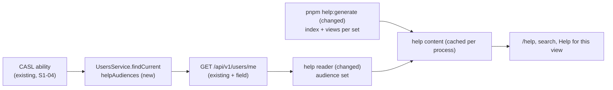

# Help audiences decided by the server – Administrator help for Administrators only

| | |
|---|---|
| Status | `draft` |
| Created | 2026-10-26 |
| Plan task | `S1-19` |
| System specification sections | §2.3, §14.2, §14.4, §17.1, §18.5, glossary |
| Related issues / PRs | Decision of 2026-10-24 in [#67](https://github.com/trybun/trybun/pull/67) (S0-09, question 1). Sibling specifications: S1-03 invitations and accounts ([#113](https://github.com/trybun/trybun/pull/113)), S1-04 permission layer ([#114](https://github.com/trybun/trybun/pull/114)), S1-09 end-user portal ([#118](https://github.com/trybun/trybun/pull/118)), S1-18 tours and user documentation ([#128](https://github.com/trybun/trybun/pull/128)) |

## Context

The user documentation has three audiences – `end-user`, `team` and `administrator` – and the help viewer gives every reader the pages of the audiences meant for them ([§2.3](../../docs/spec/02-agent-rules.md)). Today the web application decides this from the **account kind** of `GET /api/v1/users/me` (`AUDIENCES_OF_KIND` in `apps/web/src/features/help/audiences.ts`):

- an end user receives the `end-user` pages;
- every team account receives the `end-user`, `team` **and** `administrator` pages.

`pnpm help:generate` writes the view map of contextual help (**Help for this view**) and one MiniSearch index per language and account kind. A page the reader does not receive is not listed, not in their search index, and its address answers "not found".

On 2026-10-24 the maintainer decided in #67 that the `administrator` pages are for Administrators only. Until the API tells the web application who is an Administrator, every team account receives them, which §2.3 allows because they describe configuration, never customer data. S1-19 closes this gap. The plan row asks that the server decide the help audiences of the principal, for example in a field of `GET /api/v1/users/me` ([§14.4](../../docs/spec/14-architecture.md): no visibility logic in the frontend), and that the web application choose the pages and the search index per **audience set** instead of per account kind.

What already exists on `main` and is reused:

- `GET /api/v1/users/me` returns `kind` and the global action `open_administration`. `UsersService.findCurrent` derives that action from the CASL ability (`ability.can('read', ADMINISTRATION)`), which S1-04 generalizes ([#114](https://github.com/trybun/trybun/pull/114)) and S1-03 extends with `language` and `timeZone` ([#113](https://github.com/trybun/trybun/pull/113)).
- The help reader (`features/help/reader.ts`) reads the current account from the query prefetched by the application shell, cached per request. When the API cannot answer, it falls back to `end_user`.
- S1-09 ([#118](https://github.com/trybun/trybun/pull/118), its question 2) proposes moving `app/(team)/help/` to `app/help/`, with the shell chosen by account kind. S1-19 does not touch that choice: the **shell** still follows the account kind, and only the **pages** follow the audiences. S1-19 changes `features/help` and the reader, so it works whether the route files sit in `(team)` or in `app/help/`.
- S1-18 ([#128](https://github.com/trybun/trybun/pull/128)) adds a help-coverage check that expects routes under `/admin` to have an `administrator` page, and team routes outside `/admin` to have a `team` or `end-user` page, "which Developers and Project managers do not receive after S1-19". This specification keeps that assumption.

## Goals

- A Developer and a Project manager do not receive the `administrator` pages: these pages are not listed, not found by search, not offered as **Help for this view**, and their addresses answer "not found".
- An Administrator receives the `administrator` pages, as today.
- An end user still receives only the `end-user` pages.
- The server decides who receives which audiences. The web application only follows the API's answer (§14.4).

## Non-goals

- New help pages or changes to their content, except the sentence of the team page that describes who receives which pages. The pages of S1-18 are written in S1-18.
- Product tours. A tour's audience stays the account kind of its views ([§18.5](../../docs/spec/18-code-patterns.md)). Tours of Administrator views run only where those views open, and only an Administrator can open them.
- The shell of `/help` (S1-09, [#118](https://github.com/trybun/trybun/pull/118), its question 2).
- A generator check of links between pages of different audiences (proposed as a follow-up in [Q5](#open-questions)).
- Help audiences other than the three of §2.3, such as one per project role. The design allows more audience sets later, but S1-19 adds none.
- Access control for the Administrator panel itself (S0-12 and S1-04).

## Proposed change

### 1. The API names the reader's help audiences

`GET /api/v1/users/me` gains a field `helpAudiences`: the audiences whose pages the principal receives, ordered from the least to the most specific ([Q1](#open-questions)). Its values are the glossary codes `end_user`, `team` and `administrator` ([Q2](#open-questions)). The server decides it in `UsersService.findCurrent`, next to `allowedActions` ([Q3](#open-questions)):

| Principal | `kind` | `helpAudiences` |
|---|---|---|
| End user | `end_user` | `["end_user"]` |
| Developer, Project manager (a team account without the Administrator role) | `team` | `["end_user", "team"]` |
| Administrator | `team` | `["end_user", "team", "administrator"]` |

- `end_user` is always present: every reader receives the pages for end users, and the team reads them to know what customers see (§2.3).
- `team` is present for team accounts.
- `administrator` is present exactly when the ability allows `read` on `Administration`. This is the same rule that gives `open_administration`, so the Administrator panel and its help cannot disagree.
- The field is computed per request from the ability and is never stored. When the Administrator role is granted or revoked (S1-03), the next request returns the new set.

### 2. The web application follows the audiences

- `features/help/reader.ts` returns the reader's audience set (`getHelpReaderAudiences()`) instead of the account kind. It uses the same prefetched query of the current account. When the API cannot answer, the reader receives `["end_user"]`, as today ([Edge cases](#edge-cases-and-failure-scenarios)).
- `getHelpPages`, `getHelpPage`, `getHelpViews` and `getHelpSearchIndex` take the audience set instead of the account kind. `AUDIENCES_OF_KIND` is removed. `HELP_AUDIENCE_SETS` takes its place: the closed list of the sets the API can return, which are the three rows of the table ([Q4](#open-questions)).
- `pnpm help:generate` writes the view map and one MiniSearch index per language and **audience set**, keyed by the set. Pages, addresses and the rule "the most specific audience available to the reader wins" for **Help for this view** stay as they are. An Administrator on a view named by both a `team` page and an `administrator` page receives the `administrator` page. A Developer receives the `team` page.
- An audience set that is not in `HELP_AUDIENCE_SETS` (for example after a future API change that ships before the web application) receives the content of the largest known set it contains. The reader can therefore never see more than the API allowed.
- The address segment of an audience stays `end-user`, `team` or `administrator`. `features/help/audiences.ts` holds the one mapping between the API code and the folder segment ([Q2](#open-questions)).
- The rendered help content stays cached per process: it is the same for every reader of one audience set and language, which [§18.5](../../docs/spec/18-code-patterns.md) allows ("identical for every user of an audience").

### 3. Links between pages respect the audiences

After S1-19, a link from a `team` page to an `administrator` page would lead a Developer to "not found". `docs/user/README.md` therefore gets a writer rule: a page links only to pages that every one of its readers receives. An `end-user` page may link only to `end-user` pages, a `team` page to `end-user` and `team` pages, and an `administrator` page to every page. Today the only link between audiences goes from the `administrator` tutorial "Set up Trybun" to the `end-user` page "Choose a password", which the rule allows (checked with a search of `docs/user/` for `../../` links). Review enforces the rule. A generator check is proposed as a follow-up and is not part of S1-19 ([Q5](#open-questions)).

### 4. Documentation

- The team page "What end users see in the help" (`team/explanation/help-for-end-users.md`, EN and PL) changes "Team members receive the pages of every audience" to: team members receive the end-user and team pages, and Administrators also receive the Administrator pages.
- `docs/user/README.md`: the search indexes are built per language and audience set, and the link rule of section 3 is added.
- No new page and no tour: nothing new is shown to users, and readers only see fewer pages.

The server decides the audiences once per request. The web application uses them only to look up generated content, so it has no rule of its own about who receives what.

## Data model

No database change.

## API contracts

- `@trybun/contracts/help` (new subpath, like `@trybun/contracts/product-tours`): `helpAudienceSchema = z.enum(['end_user', 'team', 'administrator'])`. The order of the options is the order from the least to the most specific audience.
- `currentUserSchema` (`@trybun/contracts/users`) gains `helpAudiences: z.array(helpAudienceSchema).min(1)`.
- The change is additive. Today only the web application of the same release calls the endpoint, so the OpenAPI document and the typed client are regenerated (`pnpm api:generate`, [`BACKWARD_COMPATIBILITY.md`](../../BACKWARD_COMPATIBILITY.md), HTTP API).
- No new endpoint and no new error code.

## UI/UX

Nothing new appears. A Developer or a Project manager no longer sees the "Administrator" group under **All topics**, and search no longer finds Administrator pages for them. Opening an Administrator address directly shows the existing "not found" page, as for any invisible record (§14.4). Everything else is unchanged on phone, tablet and desktop.

## Edge cases and failure scenarios

- **The API is unreachable or refuses `/users/me`.** The reader receives `["end_user"]`, as the account-kind fallback does today. The team shell still renders and the help shows only the end-user pages. This fails closed: no reader receives more than the API allowed.
- **Administrator role revoked while the help is open.** The search index already in the browser keeps the Administrator pages until the next navigation. Opening one of them is a server request that answers "not found". This is accepted, because the pages hold configuration, never customer data (§2.3).
- **Administrator role granted.** The next page request shows the Administrator pages. No sign-out is needed.
- **Deactivated account.** `/users/me` answers `401` and the existing session handling applies. There is no help-specific behaviour.
- **Unknown audience set** (a newer API than the web application): the largest known set it contains (section 2).
- **A page linking to a page some of its readers do not receive**: those readers get "not found" when they follow the link. The writer rule of section 3 and review prevent it (Q5).

## Risks and impact

- **Contract.** `helpAudiences` becomes part of `/users/me`. Adding values later is additive. Removing the field would be a breaking change once API tokens exist ([`BACKWARD_COMPATIBILITY.md`](../../BACKWARD_COMPATIBILITY.md)), but integrations have little reason to read it.
- **Rule placement.** The `administrator` audience follows the `Administration` rule of the ability. If S1-04 changes that subject, both `open_administration` and `helpAudiences` follow it, which is the intent.
- **Rollback.** Reverting the web side alone restores the per-kind content, with the field unused. Reverting the API side alone makes the reader fall back to `["end_user"]` for everyone, which fails closed. Revert both together.

## Changes to the system specification

| Section | Change |
|---|---|
| §2.3 "Filtering by audience" | The help audiences of the reader are decided by the server and returned by `GET /api/v1/users/me` (`helpAudiences`). End users receive `end-user` pages, team members the `end-user` and `team` pages, and Administrators all three. Remove the sentence "Until the API tells … (plan task S1-19) …". "One search index per account kind" becomes "per audience set" |
| §14.2 technology table, "User documentation" | MiniSearch index per language and **audience set** |
| §14.4 | No change. S1-19 applies "decisions are made only by the API" to the help |
| §18.5 "Permissions" | Add: the help audiences returned by the API decide the help pages a reader receives, and the account kind decides only the shell |
| §18.5 "Rendering and reading data" | "identical for every user of an audience" becomes "of an audience set" |
| Plan | S1-19 marked `[x]` in the implementation PR |

New or changed glossary terms (code identifier, EN/PL labels):

- Help audience – `help_page.audience`: `end_user`, `team`, `administrator` – End users / Użytkownicy końcowi, Team / Zespół, Administrator / Administrator: the readers a help page is written for. Its folder and address segment are `end-user`, `team` and `administrator` (§2.3) (Q2).

## Open questions

Implementation must not start until every question has an answer. The answers below are autonomous defaults from the specification run. Each one is **a proposal awaiting human approval**.

1. **Where the API names the audiences.** The plan suggests "e.g. a field of `GET /api/v1/users/me`". — **Answer (proposed, awaiting approval):** a field `helpAudiences` on `GET /api/v1/users/me`. The help reader already reads that prefetched query, so the field costs no extra request. Alternatives: (a) a separate endpoint `GET /api/v1/users/me/help-audiences`, which means one more call on every help page and shell render; (b) the web application maps `allowedActions` `open_administration` to the `administrator` audience, which adds no new contract but puts the rule "who reads Administrator help" in the frontend, against the plan row and §14.4.
2. **Code values of the audiences.** §17.1 requires glossary codes in snake_case for enum values in the API, but §2.3 names the audiences `end-user`, `team`, `administrator` as folder and address segments. There is no glossary term for the audience yet. — **Answer (proposed, awaiting approval):** a glossary term "Help audience" (`help_page.audience`: `end_user`, `team`, `administrator`). The API uses these codes. Folders and addresses stay kebab-case, as §17.1 asks for files and route segments, so no address changes. One mapping in `features/help/audiences.ts` converts between the two. Alternative: the API returns `end-user` (one spelling everywhere, but an exception to §17.1 that would need an ADR).
3. **Which rule decides the audiences on the server.** — **Answer (proposed, awaiting approval):** `end_user` for every principal, `team` for team accounts, and `administrator` when `ability.can('read', 'Administration')`, computed in `UsersService.findCurrent`. This reuses the existing CASL rule behind `open_administration`, so the panel and its help never disagree, and it adds no new subject. Alternative: a dedicated CASL subject `Help` with one action per audience, which is more explicit but duplicates the Administrator rule and needs S1-04's ability to grow a subject without records.
4. **Which audience sets get generated content.** — **Answer (proposed, awaiting approval):** the three cumulative sets of the table (`end_user`; `end_user` + `team`; all three), listed once in `HELP_AUDIENCE_SETS`. An unknown set receives the largest listed set it contains, which fails closed. This matches the plan's "one search index per audience set" and keeps the generated files at three indexes per language. Alternative: all seven non-empty combinations. They are complete, but four of them cannot occur with today's rules and would more than double the committed index size.
5. **Links across audiences.** After S1-19, a link from a `team` page to an `administrator` page leads Developers to "not found". The plan row does not ask for a check. — **Answer (proposed, awaiting approval):** S1-19 adds only the writer rule to `docs/user/README.md` (section 3). Review enforces it, and no current page breaks it. A check in `pnpm help:generate` that rejects such a link is proposed to the maintainer as a follow-up plan task, or as part of S1-18's coverage check ([#128](https://github.com/trybun/trybun/pull/128)). Alternative: build the check in S1-19. It needs link parsing the generator does not have today, and it is not needed for the 404 and search behaviour of the plan row.

## Acceptance criteria

- [ ] `GET /api/v1/users/me` returns `helpAudiences` `["end_user"]` for an end user, `["end_user", "team"]` for a Developer and a Project manager, and `["end_user", "team", "administrator"]` for an Administrator (integration tests per principal)
- [ ] A Developer and a Project manager get "not found" for an `administrator` page address and never find it in the search: the page test of `/help/[...slug]` returns `notFound()`, and their audience set's index of each language holds no `administrator` page
- [ ] An Administrator receives the `administrator` pages: they are listed under **All topics**, found by search, and opened by their address
- [ ] An end user still receives only `end-user` pages: listed, searched and addressed
- [ ] **Help for this view** on a view named by a `team` page and an `administrator` page opens the `administrator` page for an Administrator and the `team` page for a Developer (unit test of the view map per audience set)
- [ ] When `/users/me` fails, the reader receives only `end-user` pages
- [ ] `pnpm lint` passes with the content regenerated per audience set
- [ ] E2E on phone, tablet and desktop with the seeded `developer@example.com`, `manager@example.com` and `admin@example.com`: an Administrator page address shows "not found" to the first two and the page to the Administrator
- [ ] Works on phone, tablet and desktop (Rule 9): no layout change, covered by the E2E above
- [ ] User documentation updated (Rule 3): "What end users see in the help" in EN and PL, and `docs/user/README.md`. No tour change (Rule 4)

## Implementation plan

One implementation PR. Implementation starts after S1-04 is merged, because S1-04 generalizes the ability `/users/me` reads (on `main` today `findCurrent` calls `ability.can('read', ADMINISTRATION)` directly, and S1-19 needs only that rule). It does not wait for S1-09 or S1-18. Each step leaves the application working.

**Phase 1 – The API names the audiences**

1. `helpAudienceSchema` in `@trybun/contracts/help` and `helpAudiences` in `currentUserSchema`. `UsersService.findCurrent` computes it (Q3). Unit test of the contract order. Integration tests of `/users/me` for the Administrator, a Project manager, a Developer, a team member without a project and an end user. `pnpm api:generate`. The web application ignores the field for now.

**Phase 2 – The web application follows them**

2. `features/help/audiences.ts`: `HELP_AUDIENCES` taken from `helpAudienceSchema`, the mapping to folder segments, `HELP_AUDIENCE_SETS` and the resolution of an unknown set (Q2, Q4). The generator writes views and indexes per set. `pnpm help:generate`. Unit tests: view map per set, index contents per set, unknown set.
3. `getHelpReaderAudiences()` and the help functions take the audience set. The `(team)` (or `app/help`, after S1-09) layout and pages use it. Page tests: `notFound()` for an `administrator` address with the Developer set, the page with the Administrator set, the `end_user` fallback when `/users/me` fails. E2E with the three seeded team accounts on the three devices.

**Phase 3 – Documentation and specification**

4. "What end users see in the help" in EN and PL, `docs/user/README.md` with the link rule (Q5), `.ai/memory/help.md` if a pitfall shows up. Update §2.3, §14.2, §18.5 and the glossary as approved, mark S1-19 in the plan, and move this file to `implemented/`.

## Changelog

- 2026-10-26 – Created.
