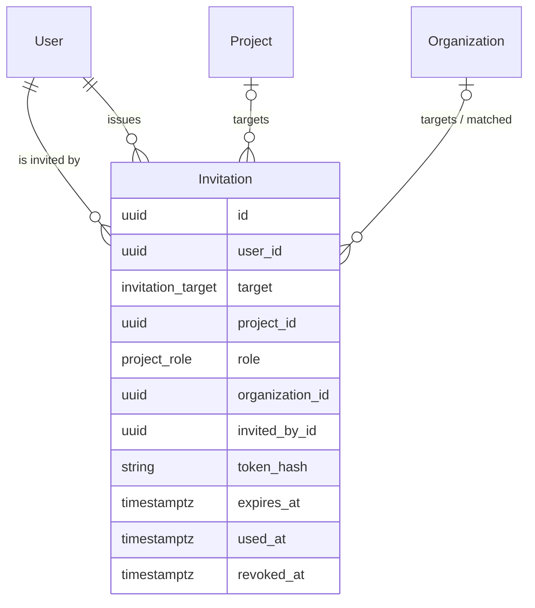

# Invitations, account deactivation and user settings

| | |
|---|---|
| Status | `approved` |
| Created | 2026-10-26 |
| Plan task | `S1-03` |
| System specification sections | §7.1, §7.3, §7.4, §7.5, §13.1, §13.5, §14.4, §15.6 |
| Related issues / PRs | [ADR 0009](../../docs/adr/0009-invitation-flow.md) · [`2026-10-25-invitation-acceptance.md`](2026-10-25-invitation-acceptance.md) (draft, S1-03) · PR #113 · S1-01 projects spec (PR #111) · S1-02 organizations spec |

## Context

Accounts are created only by invitations and by the first-run wizard ([§7.4](../../docs/spec/07-users-organizations-permissions.md)). Today the API has the `users` table with `kind`, `state`, `language`, `time_zone` and `github_login`, `GET /api/v1/users/me`, the authentication guard that refuses accounts that are not `active`, and the Keycloak Admin API client of the first-run wizard (`createAdministrator`, `deleteUser`). There are no invitations, no way to deactivate an account and no account settings page. Language and time zone are set only in the first-run wizard.

[ADR 0009](../../docs/adr/0009-invitation-flow.md) decides how an invitation is **accepted** on Keycloak: the token, the acceptance page `/invitations`, the password form, the provider sign-ins, the GitHub binding with the 2FA set-up, and the first broker login flow. The draft change specification [`2026-10-25-invitation-acceptance.md`](2026-10-25-invitation-acceptance.md) proposes the gaps the ADR found (questions 1–5 there, cited below as AQ1–AQ5: password on the acceptance page, orphaned Keycloak users, the provider address of end users, the landing after an organization or Administrator invitation, the expiry of a resent invitation). **This specification does not repeat or decide those.** It covers the rest of S1-03:

- **issuing** invitations: who invites whom, the preview before sending ("This person will join the organization X"), the copyable link, resending and revoking, pending invitations in the UI;
- **existing accounts**: access granted directly, without a new invitation;
- **domain-based organization assignment** when an account is created from an invitation ([§7.3](../../docs/spec/07-users-organizations-permissions.md));
- the account kinds `team` and `end_user` as invitations create them;
- **deactivation and reactivation** (ends all sessions);
- **user settings**: language and time zone.

Implementation of S1-03 starts only after the open questions of both specifications are answered (plan, row S1-03).

## Goals

- An Administrator or a Project manager invites a person in one dialog and gets a link they can copy, even before e-mail is configured.
- A used, expired, revoked or replaced link is rejected (plan "Done when").
- Inviting an existing account of the right kind grants the access directly (plan "Done when").
- An end user invited to a project that belongs to an organization with their e-mail domain joins that organization, as the inviting person was told before sending.
- A deactivated account's next request is rejected, and all its sessions end at once (plan "Done when").
- Every person sets their language and time zone, and the setting follows them to every device.

## Non-goals

- The acceptance flow itself – [ADR 0009](../../docs/adr/0009-invitation-flow.md) and [`2026-10-25-invitation-acceptance.md`](2026-10-25-invitation-acceptance.md).
- Unassigning open tickets on deactivation (S1-05), closing WebSocket connections on deactivation (S1-15), revoking API tokens on deactivation (S6-02) – as the plan says. This task publishes the event they react to.
- Sending invitation and "access granted" e-mails before outgoing e-mail exists (S1-15, [Q1](#open-questions)).
- Changing the account kind or the e-mail address of an account ([Q2](#open-questions)).
- Editing the display name (it comes from the acceptance; Keycloak's account console stays out of scope).
- The full permission matrix as executable tests (S1-04); this task writes the rules of invitations and accounts, which S1-04 adds to its matrix.
- Bulk invitations, invitation by CSV, invitations from the import ([§12.5](../../docs/spec/12-api-webhooks-import.md) creates `invited` accounts but sends nothing).

## Proposed change

### 1. Who invites whom

The targets of [§7.4](../../docs/spec/07-users-organizations-permissions.md) and the rows of [§7.5](../../docs/spec/07-users-organizations-permissions.md):

| Target | Account kind | Who may issue |
|---|---|---|
| Project with role `developer` or `project_manager` | `team` | Administrator; Project manager of that project |
| Project with role `end_user` | `end_user` | Administrator; Project manager of that project |
| Organization | `end_user` | Administrator |
| Administrator role | `team` | Administrator |

Developers and end users issue no invitations. An invitation to an archived project or an archived organization is refused (`409` `project.archived` / `organization.archived`). A team invitation is refused while GitHub sign-in is not configured (`422` `invitation.github_sign_in_missing`; the same setting that ticks the getting-started item "Configure GitHub sign-in", [§15.6](../../docs/spec/15-deployment.md)).

### 2. One dialog, three outcomes

The **Add member** dialog of the project's Members tab (S1-01) accepts either a team account picked from the list or an e-mail address, with a role ([Q3](#open-questions)). The Administrator's **Accounts** page (new, see 6) has **Invite** for every target. After the address and the target are entered, and before sending, the dialog shows what will happen – asked from the API, which owns the rules:

- **New invitation** – no account has the address. When the target is a project with role `end_user` and the address's domain belongs to an active organization that has this project, the dialog says "This person will join the organization X" (PL: „Ta osoba dołączy do organizacji X”) ([§7.3](../../docs/spec/07-users-organizations-permissions.md)).
- **Access granted directly** – an active account of the right kind has the address; no invitation is created, the access is granted on **Add**, and the person is notified (the notification arrives with S1-15, [Q1](#open-questions)).
- **New invitation for an existing `invited` account** – the account has not accepted yet, so a direct grant would have no way to take effect; the account gets one more invitation for the new target, with its own link ([Q8](#open-questions)).
- **Refused, with the reason** – an account of the other kind (the explanation of [§7.4](../../docs/spec/07-users-organizations-permissions.md): a kind change is an Administrator action), a deactivated account ([Q6](#open-questions)), an account that already has this access, an end user of another organization invited to an organization ([Q7](#open-questions)).

E-mail addresses are compared after normalization: trimmed and lower-cased ([Q4](#open-questions)).

### 3. Issuing creates the account and shows the link once

- Issuing a new invitation creates the **account in state `invited`** (kind from the target, e-mail address, language and time zone empty, no Keycloak user), as [§7.4](../../docs/spec/07-users-organizations-permissions.md) defines the state, and the invitation that references it. The invitation stores no e-mail address of its own: the account carries it, so anonymization has one place to clear ([§13.2](../../docs/spec/13-non-functional.md)).
- The token, its hash, the link `https://<domain>/invitations#token=<token>` and the conditional claim are those of [ADR 0009](../../docs/adr/0009-invitation-flow.md). Because only the hash is stored, **the link is shown only in the response that created the token** – after issuing and after resending. The dialog shows it with **Copy link** right away. A pending invitation offers **Copy new link**, which resends (a new token, the old link stops working) after a confirmation that says so ([Q5](#open-questions)).
- **Domain-based organization assignment** is decided when the invitation is issued and stored on it (the organization the dialog named). On acceptance the API applies it only if the organization is still active and still has the project; otherwise the account gets personal access to the project, as [§7.3](../../docs/spec/07-users-organizations-permissions.md) describes for the non-matching case. With an organization, the end user gets no personal membership – the project is reached through the organization. Adding or removing a domain later never moves the account ([§7.3](../../docs/spec/07-users-organizations-permissions.md)).
- **Several open invitations of one account** (e.g. invited to two projects before accepting) stay separate rows with their own links, and each grants only its own target. The first acceptance activates the account. A further link of an account that is already `active` is accepted only by a session of that same account (its Keycloak user), which then gets the target – so a person holding one link can never claim the access of another invitation, e.g. the Administrator role ([Q8](#open-questions)).
- **Resending** replaces the token (expiry: AQ5). **Revoking** sets `revoked_at`. Archiving a project or an organization revokes its pending invitations ([§7.3](../../docs/spec/07-users-organizations-permissions.md); this task adds that effect to the archive use cases of S1-01 and S1-02).
- An `invited` account whose invitations are all expired or revoked stays `invited`; a new invitation to the same address reuses it ([Q9](#open-questions)).
- **Domain matching** happens when the account is created, i.e. when the first invitation of a new address is issued ([§7.3](../../docs/spec/07-users-organizations-permissions.md)); a domain belongs to at most one organization, so there is at most one match. How subdomains match is the rule of S1-02 ([Q14](#open-questions)).

### 4. Existing accounts

Access is granted to an `active` account through the services that own it ([§18.3](../../docs/spec/18-code-patterns.md), "Using another module"): project membership of S1-01 for project roles, organization membership of S1-02 for organizations, the Administrator flag of the `users` module. An `invited` account gets a further invitation instead (section 2). An existing account never gets a domain-based organization: domain matching applies only when an account is created ([§7.3](../../docs/spec/07-users-organizations-permissions.md)).

### 5. Acceptance (reference only)

As [ADR 0009](../../docs/adr/0009-invitation-flow.md) and [`2026-10-25-invitation-acceptance.md`](2026-10-25-invitation-acceptance.md) define it. This specification adds only: the account's language is set from the language of the acceptance page (the request language of [§13.1](../../docs/spec/13-non-functional.md)) and its time zone from the browser's time zone when it is a valid IANA name, else left empty (the system default applies); the display name is the first and last name of the Keycloak user; `invitation.accepted` is recorded with the client IP; and only the invitation of the link used is claimed (section 3).

### 6. Accounts page, deactivation and the Administrator role

The Administrator panel gets an **Accounts** page: a list of accounts with display name, e-mail address, kind, state and the Administrator flag, filtered by kind and state and searchable by name and address; pending invitations of an account with **Copy new link** and **Revoke**; and the actions below. On phones the list renders as cards ([§13.4](../../docs/spec/13-non-functional.md), Rule 9).

- **Deactivate** (confirmation dialog naming the effects): in one transaction the account becomes `deactivated`, its pending invitations are revoked, all its web sessions are deleted (`sessions` rows of its Keycloak `sub`, through the session service of `platform/authentication`, [§14.4](../../docs/spec/14-architecture.md)), the audit entry `user.deactivated` and the outbox event `user.deactivated` are written. A Worker job handles the event idempotently: it disables the Keycloak user (`enabled: false`, so no new Keycloak sign-in once it has run) and ends its Keycloak sessions (`POST /users/{id}/logout`). The API already refuses every request of an account that is not `active`, so the next request is rejected even before the job runs and while an issued access token is still valid ([§14.4](../../docs/spec/14-architecture.md)). S1-05, S1-15 and S6-02 add their reactions to the same event.
- **Reactivate**: the account returns to `active` (or to `invited` when it has no Keycloak user yet), the job enables the Keycloak user; audit `user.reactivated`. Revoked invitations stay revoked; access granted before the deactivation is kept. A reactivated `invited` account has no working link: the page then offers **Invite** for it right away.
- **Grant / revoke the Administrator role** of a team account ([§7.5](../../docs/spec/07-users-organizations-permissions.md), [Q13](#open-questions)): audit `user.admin_granted` / `user.admin_revoked`. Granting to a new address goes through an invitation (target "Administrator role").
- **Guards** ([Q10](#open-questions)): nobody deactivates their own account or revokes their own Administrator role, and the last active Administrator can be neither deactivated nor demoted (`409` `user.last_administrator`), so the system can always be administered ([§7.4](../../docs/spec/07-users-organizations-permissions.md), break-glass account).

### 7. User settings

An **Account settings** page (`/settings`, in the account menu of the team views and of the portal) with the language (the supported languages, [§13.1](../../docs/spec/13-non-functional.md)) and the time zone (a searchable list of IANA names, with **Use this device's time zone** suggesting the browser's zone). Saving writes the account (`PATCH /api/v1/users/me`) and, for the language, calls the `changeLanguage` Server Action of `lib/i18n` ([§18.5](../../docs/spec/18-code-patterns.md)), so the page renders in the new language at once. The language switch of the application shell also saves the account language for a signed-in person, so there is one control, not two that disagree ([Q11](#open-questions)). At sign-in, the web application sets the `NEXT_LOCALE` cookie from the account's language, so another device follows it. Until a time zone is set, the system default applies ([§13.1](../../docs/spec/13-non-functional.md)).

### Data model

`User`, `Project` (S1-01) and `Organization` (S1-02) exist or arrive earlier; `Invitation` is new. Takeaway: the invitation points to the account it will activate; it holds no personal data of its own.

- `Invitation` (`invitations`): `userId` (the invited account), `target` enum `invitation_target` (`project`, `organization`, `administrator`), `projectId` and `role` (`project_role`, for `project`), `organizationId` (the target for `organization`; the matched organization for a `project` invitation with role `end_user`, or null), `invitedById`, `tokenHash` (unique, SHA-256 base64url), `expiresAt`, `usedAt`, `revokedAt`, `createdAt`, `updatedAt`. A check constraint keeps the columns consistent with `target`. Not versioned: resending and revoking are single-field transitions guarded by conditional updates, like the claim.
- The state shown in the UI is derived: `pending` (neither used nor revoked, not expired), `accepted`, `revoked`, `expired`. It is not stored, so it can never disagree with the timestamps.
- `project_role` gains `end_user` if S1-01 did not add it (its Q9 leaves it to S1-03).
- `users.email` is stored normalized ([Q4](#open-questions)), kept so by a check constraint `email = lower(btrim(email))`; the existing unique index then compares addresses case-insensitively, and lookups by address are exact, indexed matches.
- Retention: invitations are kept with their account; anonymization of the account keeps the rows, which then point to the tombstone ([§13.2](../../docs/spec/13-non-functional.md)).

### API contracts

New contracts feature `@trybun/contracts/invitations`; additions to `@trybun/contracts/users`. All paths under `/api/v1`, plural nouns, actions as sub-resources ([§17.2](../../docs/spec/17-conventions.md)).

| Endpoint | Ability | Notes |
|---|---|---|
| `POST /invitation-previews` | `create` on `Invitation` for the target | `{ email, target }` → `{ outcome: 'invite' \| 'grant', organization: { id, name } \| null }`; a refusal is the same `422`/`409` the creation would return. Writes nothing |
| `POST /invitations` | `create` on `Invitation` for the target | `{ email, target }` → `201` `{ outcome: 'invited', invitation, link }` or `200` `{ outcome: 'access_granted', user: { id, displayName } }`. The `link` appears only here and in the resending response |
| `GET /invitations?projectId&organizationId&userId&state&cursor&limit` | `read` | Pending by default; cursor pagination ([§18.4](../../docs/spec/18-code-patterns.md)). A Project manager sees the invitations of their projects |
| `POST /invitations/{id}/resending` | `resend` | `{ invitation, link }`; only for a pending or expired invitation |
| `POST /invitations/{id}/revocation` | `revoke` | `204`; only for a pending one |
| `GET /users?kind&state&query&cursor&limit` | `read` on `User` (Administrator) | The Accounts page, the full account ([Q12](#open-questions)) |
| `POST /users/{id}/deactivation` · `POST /users/{id}/reactivation` | `deactivate` · `reactivate` | `204`; `409` `user.last_administrator`; the guards of 6 |
| `PUT /users/{id}/administrator-role` · `DELETE /users/{id}/administrator-role` | `grant_admin` · `revoke_admin` | `204`; idempotent, so no `If-Match`; `409` `user.last_administrator` |
| `PATCH /users/me` | own account | `{ language?, timeZone? }` with `languageSchema` and `timeZoneSchema`; `timeZone: null` returns to the system default |

- `target` is a discriminated union: `{ type: 'project', projectId, role }`, `{ type: 'organization', organizationId }`, `{ type: 'administrator' }`.
- The invitation response: `id`, `user { id, email, displayName }`, `target` (with the project or organization name), `invitedBy { id, displayName }`, `state`, `expiresAt`, `createdAt`, `allowedActions` (`resend`, `revoke`). It never contains the token or its hash.
- `GET /users/me` gains `language` and `timeZone`.
- Invisible records return `404`, never `403`: a Project manager of project A gets `404` for an invitation to project B and for a target project or organization they cannot see; `403` only for a visible target they may not invite to, and for the target "Administrator role", which is no record ([§7.5](../../docs/spec/07-users-organizations-permissions.md), [§17.2](../../docs/spec/17-conventions.md)).
- The preview and the creation tell the inviter whether an address has an account, of which kind and in which state – what §7.4 requires them to explain. They are team endpoints with 2FA under the per-user rate limit of [§14.4](../../docs/spec/14-architecture.md) ([Q15](#open-questions)).
- New error codes: `invitation.account_kind_mismatch` (422, pointer `/email`), `invitation.account_deactivated` (422, `/email`), `invitation.access_exists` (409), `invitation.organization_conflict` (422, `/email`), `invitation.github_sign_in_missing` (422), `invitation.not_pending` (409, resend or revoke of a used or revoked invitation), `invitation.account_mismatch` (403, a further link of an active account accepted by another session), `user.last_administrator` (409); `project.archived` (S1-01) and `organization.archived` (S1-02) are reused. The acceptance codes (`invitation.token_invalid`, …) are those of ADR 0009.

### Permissions

`invitations.abilities.ts` and the account rules of `users.abilities.ts` ([§18.3](../../docs/spec/18-code-patterns.md)); S1-04 adds them to the matrix tests.

| Principal | Actions |
|---|---|
| Administrator | every action on every invitation and account |
| Project manager | `create`, `read`, `resend`, `revoke` on invitations with target `project` of their projects |
| Developer, end user | none |
| Everyone | `PATCH /users/me` on their own account |

### Audit log and events

Written in the transaction of the change ([§13.5](../../docs/spec/13-non-functional.md)): `invitation.issued`, `invitation.resent`, `invitation.revoked` (by a person, or by the system when a project or organization is archived or an account deactivated), `invitation.accepted` (with the client IP), `user.deactivated`, `user.reactivated`, `user.admin_granted`, `user.admin_revoked`. A direct grant records the entry of the owning module (`project_member.added` of S1-01, the organization membership entry of S1-02). Outbox events: `invitation.issued`, `user.access_granted`, `user.deactivated`, `user.reactivated` – payloads with identifiers only, never the token ([§17.2](../../docs/spec/17-conventions.md)).

### UI

- **Add member** dialog (S1-01, extended) and **Invite** on the Accounts page: e-mail address or team-account picker, target, role; the preview line under the form; after an invitation, the link with **Copy link** and the note "Only this link works. It expires on {date}." Bottom sheet on phones, 44 px targets (Rule 9).
- **Members tab** (S1-01): a "Pending invitations" section with address, role, invited by, expiry, **Copy new link** and **Revoke** per row (only what `allowedActions` lists).
- **Accounts** page (Administrator panel) and **Account settings** as above.
- **Getting-started checklist**: the item "Invite the team" ([§15.6](../../docs/spec/15-deployment.md)), ticked from the data when a team account other than the first Administrator exists, `invited` or `active`, linked to the help page "Invite people".
- No new product tour: the dialogs are one step, and help pages cover them (Rule 4).
- User documentation (EN, PL, Rule 3): how-to "Invite people to a project" (Project manager, Administrator), how-to "Accept an invitation" (end users, team), how-to "Deactivate or reactivate an account" and reference "Accounts" (Administrator), how-to "Change your language and time zone" (everyone), with `views` naming the new routes.

### Failure scenarios

- **Two people invite the same address at once**: the account insert hits the unique address; the second request finds the account and continues as a second invitation of the same `invited` account – never two accounts.
- **Deactivation while the Keycloak job fails**: the account is already refused by the API and its web sessions are gone; the job retries ([§17.2](../../docs/spec/17-conventions.md)). Until it succeeds, a person can complete a Keycloak sign-in, but the web application gets `401` from `GET /users/me` and shows "Your account is deactivated" – an accepted interim; a job that exhausts its retries stays in the failed jobs ([§13.2](../../docs/spec/13-non-functional.md)) for the Administrator.
- **Revoked or replaced link opened**: `invitation.token_invalid`, the page tells the person to ask the inviter for a new link (ADR 0009).
- **Matched organization archived before acceptance**: personal project access instead (section 3); the person is told nothing different, they land in the project.
- **Project archived between preview and creation**: `409` `project.archived`.

## Changes to the system specification

| Section | Change |
|---|---|
| §7.3 E-mail domains | The organization is matched when the account is created by the first invitation and applied on acceptance if the organization is still active and still has the project; otherwise personal access (Q14) |
| §7.3 Archiving | An archived organization's pending invitations are revoked, as for projects (Q14) |
| §7.4 Invitations | Issuing creates the account in state `invited`; the link is shown only when the token is created (issue, resend), "copy" later means a new link; each invitation grants only its own target, a further link of an active account needs a session of that account (Q8); addresses are normalized (Q4); team invitations need GitHub sign-in configured; e-mail sending per Q1 |
| §7.4 Existing accounts | Means `active` accounts; an `invited` account gets a further invitation; deactivated accounts and end users of another organization are refused with an explanation (Q6, Q7) |
| §7.4 Deactivation | Also revokes pending invitations; Keycloak user disabled and its sessions ended by a Worker job; reactivation returns to `active` or `invited`; the last active Administrator cannot be deactivated or demoted, nobody deactivates or demotes themselves (Q10) |
| §7.5 | New rows: "View, resend and revoke invitations of own project" – Project manager, Admin; "View the list of accounts" – Admin |
| §13.1 | The language is stored in the account, set on acceptance from the request language, applied at sign-in; the shell's language switch saves it (Q11) |
| §13.5 | Recorded actions named: `invitation.issued`, `invitation.resent`, `invitation.revoked`, `invitation.accepted`, `user.deactivated`, `user.reactivated`, `user.admin_granted`, `user.admin_revoked` |
| §15.6 | "Invite the team" is ticked when a team account other than the first Administrator exists |
| Plan (changed with this specification) | S1-15 gains invitation and "access granted" e-mails and the delivery of the token to the mail job (Q1); S1-03 names S1-20 (#130) for the account kind change and the e-mail change (Q2); S1-03 stays one task (Q13) |

New or changed glossary terms (code identifier, EN/PL labels):

- `invitation.target`: `project`, `organization`, `administrator` – Project / Projekt, Organization / Organizacja, Administrator role / Rola Administratora.
- Invitation state (derived, not stored): `pending`, `accepted`, `revoked`, `expired` – Pending / Oczekujące, Accepted / Przyjęte, Revoked / Odwołane, Expired / Wygasłe.

## Open questions

Every question has an answer. The maintainer accepted the specification and the answers below – including questions 1, 2 and 14 – in the review of #113 on 2026-10-29; ⚠ marks the answers that change the plan or a requirement. Implementation still must not start until AQ1–AQ5 of [`2026-10-25-invitation-acceptance.md`](2026-10-25-invitation-acceptance.md) have an answer too.

1. ⚠ **Invitation e-mails before outgoing e-mail exists.** [§7.4](../../docs/spec/07-users-organizations-permissions.md) says the link "is sent by e-mail", but SMTP sending arrives with S1-15 (group 7), and only the token's hash is stored, so a later Worker job cannot put the link into an e-mail. — **Answer:** S1-03 sends no e-mail; the inviter copies the link, which §7.4 already allows ("inviting works even before e-mail is configured"). It publishes `invitation.issued` and `user.access_granted`. S1-15 adds the e-mails and decides how the token reaches the mail job (options for its specification: send synchronously in the issuing request, or an encrypted, short-lived job payload deleted after sending); the S1-15 row of the plan names it. The maintainer confirmed it in the review of #113.
2. ⚠ **Kind change and e-mail change.** [§7.1](../../docs/spec/07-users-organizations-permissions.md), [§7.4](../../docs/spec/07-users-organizations-permissions.md) and [§7.5](../../docs/spec/07-users-organizations-permissions.md) make both Administrator actions, but no plan task names them, and the kind change to `team` needs the team invitation flow. — **Answer:** out of S1-03; the plan task S1-20 (group 4, after S1-03, added in #130) builds both. Until then a kind mismatch is refused with the explanation of §7.4. The maintainer confirmed it in the review of #113.
3. **One dialog for adding people.** S1-01 adds existing team accounts with a picker; invitations need an address. — **Answer:** extend S1-01's **Add member** dialog to take a picked account or an e-mail address (Rule 2, one way to add someone). Alternative: a separate **Invite** button next to **Add member**.
4. **Normalizing e-mail addresses.** `users.email` is unique but compared case-sensitively today, so `Anna@firma.pl` and `anna@firma.pl` could be two accounts, and domain matching needs a canonical domain. — **Answer:** a shared `emailSchema` in `@trybun/contracts` trims and lower-cases the whole address; a migration lower-cases existing addresses (only the first Administrator and seeded accounts exist) and adds a check constraint `email = lower(btrim(email))`, so no write path can store another form. The lookup of S1-02, `findAccountByEmail` in `organizations.sql.ts` (#149), compares `lower(email) = lower($1)` – a scan of `users`, because no index has the lower-case form – and becomes an exact match on the unique index of `users.email` with the normalized input; no second index on `lower(email)` is needed. Alternative: lower-case only the domain (RFC 5321 allows case-sensitive local parts, which no common provider uses).
5. **Copying the link later.** With hash-only storage, the link cannot be shown again. — **Answer:** **Copy new link** resends (new token, old link invalid) after a confirmation. Alternative: store the token encrypted to show the same link again – rejected, because it weakens "only its hash is stored" ([§13.5](../../docs/spec/13-non-functional.md)).
6. **Inviting the address of a deactivated account.** — **Answer:** refused with `invitation.account_deactivated`; the Administrator reactivates the account first. Granting access silently to a deactivated account would hide the decision.
7. **Organization invitation of an end user who belongs to another organization.** Moving users between organizations is an Administrator action with effects on visibility ([§7.3](../../docs/spec/07-users-organizations-permissions.md)). — **Answer:** refused with `invitation.organization_conflict`, pointing to the organization move of S1-02. An end user without an organization is added directly.
8. **Inviting an `invited` account again, and several open invitations.** §7.4 grants access "directly" to existing accounts, but an `invited` account cannot sign in yet. — **Answer:** an `invited` account gets a further invitation for the new target; each invitation grants only its own target; a further link of an account that is already `active` is accepted only by a session of that account (`invitation.account_mismatch` otherwise). Rejected alternative: the first acceptance claims all open invitations – whoever holds one link would get the targets of the others, including the Administrator role.
9. **`invited` accounts whose invitations all expired or were revoked.** They hold an e-mail address of a person who never accepted. — **Answer:** kept, so a new invitation reuses them and the history stays readable; they are listed on the Accounts page and anonymized like any account (S1-16). A cleanup job is a later decision, like AQ2.
10. **Guards and effects of deactivation.** §7.4 needs the system to stay administrable but sets no rule, and says nothing about pending invitations. — **Answer:** no self-deactivation or self-demotion; the last active Administrator cannot be deactivated or demoted (`409` `user.last_administrator`); deactivating an account revokes its pending invitations, so a link cannot reactivate it.
11. **The shell's language switch for a signed-in person.** Today it sets only the `NEXT_LOCALE` cookie. — **Answer:** it also saves the account language, and sign-in sets the cookie from the account, so one choice applies everywhere, including e-mails. Alternative: the account language only on the settings page, the switch per device.
12. **The accounts list and S1-01's member picker.** S1-01 (its Q3) proposes `GET /api/v1/users?kind=team` with only `id`, `displayName`, `githubLogin` for Project managers; the Accounts page needs the full account. — **Answer:** one response schema per endpoint (typed client, OpenAPI): `GET /api/v1/users` is the Administrator's full list, and the picker moves to `GET /api/v1/projects/{projectId}/member-candidates` (Project manager, Administrator of that project); whichever of the two specifications is implemented second adapts. Alternative: one endpoint whose schema depends on the ability.
13. **Scope of the task.** Invitations, deactivation and user settings each work without the others, and the Accounts page with granting and revoking the Administrator role is not named in the plan row (it is needed as the place to deactivate, and a role granted by an invitation must be revocable). — **Answer:** one specification and one implementation pull request for the one plan task, as the plan and "one task = one PR" (AGENTS.md) define, built in the order of the phases below; the Accounts page and the Administrator role stay in. Alternative: the maintainer splits S1-03 into three plan tasks along the phases.
14. ⚠ **Domain matching and archived organizations.** §7.3 applies matching "when an account is created from an invitation"; with accounts created on issue (section 3) the match is shown at issue and applied on acceptance, and §7.3 does not say what happens to pending invitations of an archived organization. — **Answer:** as section 3 (matched at issue, applied on acceptance only if the organization is still active and has the project, else personal access); an archived organization's pending invitations are revoked like a project's; subdomain matching follows the S1-02 specification. Alternative: create the account only on acceptance and match then – the preview could then differ from the result. The maintainer confirmed it in the review of #113.
15. **What the inviter learns about an address.** The preview tells a Project manager whether an address has an account, its kind and state. — **Answer:** keep the explanations, which §7.4 asks for (kind mismatch), for Project managers and Administrators alike; Project managers are team members with 2FA, and the per-user rate limit applies. Alternative: Project managers get one generic refusal and the Administrator the details.

## Phasing

1. **Invitations** – issuing, preview, existing accounts, domain matching, resend, revoke, pending invitations in the Members tab and on the Accounts page, and the acceptance of ADR 0009. Needs S1-01 and S1-02 merged and AQ1–AQ5 answered.
2. **Deactivation and the Administrator role** – the Accounts page actions and the Worker job.
3. **User settings** – `PATCH /users/me`, the settings page, the language at sign-in.

Each phase leaves the application working (Q13).

## Implementation plan

1. Contracts: `@trybun/contracts/invitations` (target union, responses, action codes, error codes), `emailSchema`, additions to `users`; Prisma model `Invitation`, enum `invitation_target`, `project_role.end_user` if missing, address normalization migration with its check constraint, `findAccountByEmail` of S1-02 switched to an exact match; factories. Test: enum equality and check-constraint tests (an upper-case address is refused by the database; adding an organization member by `Anna@Firma.pl` finds `anna@firma.pl`).
2. Issuing: `invitations` module with preview, creation (account in `invited`, domain match through the S1-02 service, direct grant through the S1-01 and S1-02 services), list, resend, revoke, abilities, audit entries, outbox events; revocation in the archive use cases. Integration tests: the four targets, each refusal, the concurrent invitation of one address, a Project manager's `404` for another project.
3. Acceptance: as ADR 0009 and the acceptance specification after their answers, plus the further links of active accounts (Q8) and the language and time zone of 5. Integration tests on the Keycloak container ("To confirm in S1-03" of the ADR); a used and an expired link are rejected; a team member binds a GitHub account with a different e-mail.
4. Web: the extended **Add member** dialog, pending invitations in the Members tab, the Accounts page with **Invite**, the `/invitations` page; stories of new `@trybun/ui` components. E2E on phone, tablet, desktop with axe: a Project manager invites an end user and copies the link; the person accepts and lands in the project.
5. Deactivation and reactivation, the Administrator role with its guards, the Worker job for Keycloak. Integration tests: the next request of a deactivated account returns `401`, its session rows are gone, the job disables the Keycloak user and is idempotent; the last Administrator cannot be demoted.
6. User settings: `PATCH /users/me`, `/settings`, the language switch saving the account, the cookie at sign-in. Tests: the time zone is validated, the page renders in the new language after saving.
7. Getting-started item "Invite the team", seed data (a pending and an expired invitation, a deactivated account), user documentation EN and PL with `pnpm help:generate`, system specification updates of the table above.

## Acceptance criteria

- [ ] A used, expired, revoked or replaced invitation link is rejected with `invitation.token_invalid`
- [ ] A team member binds a GitHub account with a different e-mail address
- [ ] A deactivated account's next request returns `401`, and its web sessions are deleted in the same transaction
- [ ] Inviting an existing active account of the right kind grants the access directly and creates no invitation
- [ ] Accepting one link never grants the target of another invitation; a further link of an active account works only in that account's session
- [ ] `users.email` holds only normalized addresses (check constraint), and an address differing only in letter case finds the same account – in invitations and in the organization members of S1-02
- [ ] An address with an account of the other kind is refused with `invitation.account_kind_mismatch`
- [ ] An end user invited to a project of an organization with their domain joins that organization; with another project they get personal access, and the preview said so
- [ ] The link is returned only when issuing or resending, and never by a list or detail response
- [ ] A Project manager cannot invite to another project (`404`) or to the Administrator role (`403`)
- [ ] The last active Administrator cannot be deactivated or demoted
- [ ] A language chosen on one device applies after signing in on another
- [ ] Each change writes its audit entry in the same transaction
- [ ] Works on phone, tablet and desktop (Rule 9)
- [ ] User documentation and product tour updated where relevant (Rules 3, 4)

## Changelog

- 2026-10-26 – Created for the rest of S1-03 (the acceptance flow stays in [`2026-10-25-invitation-acceptance.md`](2026-10-25-invitation-acceptance.md)).
- 2026-10-28 – Q4 extended: a check constraint keeps `users.email` normalized, and the case-insensitive lookup of S1-02 (`findAccountByEmail`, #149) becomes an exact indexed match – the follow-up the review of #149 found.
- 2026-10-29 – Approved in the review of #113 (open questions 1–15 as proposed, questions 1, 2 and 14 confirmed by the maintainer); plan row S1-15 extended, and S1-03 names S1-15 and S1-20 in its out-of-scope note.
