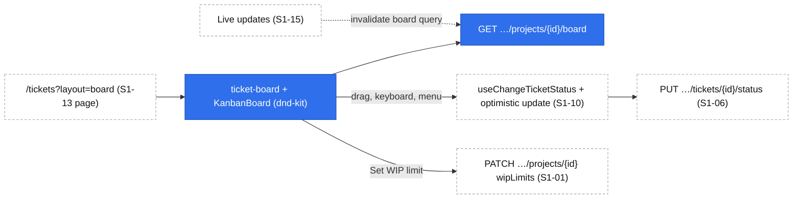

# Kanban board – status columns, drag and drop and WIP limits

| | |
|---|---|
| Status | `draft` |
| Created | 2026-10-26 |
| Plan task | `S1-14` |
| System specification sections | §2.4, §2.9, §3.1, §4.3, §7.5, §8 (introduction), §8.2, §13.4, §14.2, §17.2, §18.3, §18.5, §18.6, glossary |
| Related issues / PRs | Sibling specifications: S1-01 projects ([#111](https://github.com/trybun/trybun/pull/111)), S1-04 permission layer ([#114](https://github.com/trybun/trybun/pull/114)), S1-05 ticket model ([#115](https://github.com/trybun/trybun/pull/115)), S1-06 statuses ([#116](https://github.com/trybun/trybun/pull/116)), S1-10 team ticket view ([#120](https://github.com/trybun/trybun/pull/120)), S1-13 team list view ([#123](https://github.com/trybun/trybun/pull/123)); S1-15 notifications is written in parallel |

## Context

The team handles tickets through statuses ([§4.1](../../docs/spec/04-ticket-lifecycle.md)). S1-06 ([#116](https://github.com/trybun/trybun/pull/116)) proposes the API for status changes, `PUT /api/v1/tickets/{ticketId}/status` with `If-Match`, with the resolution-confirmation redirect and `closedAt`. S1-10 ([#120](https://github.com/trybun/trybun/pull/120)) proposes the status control of the ticket view with the reason dialog for `rejected` and the original dialog for `duplicate`. S1-13 ([#123](https://github.com/trybun/trybun/pull/123)) proposes the team list at `/tickets` with its filters, predefined views (`?view=<code>`) and the shared URL schema `ticketListSearchParamsSchema`, whose filter part the board is meant to reuse. Nothing shows the work of a project at a glance, and a status change always means opening a ticket.

[§8.2](../../docs/spec/08-team-views.md) defines the Kanban board: one project, a column per main-flow status plus `waiting_for_requester`, `done` limited to the last 14 days, `rejected` and `duplicate` only from the card menu, drag and drop with a keyboard alternative ([§13.4](../../docs/spec/13-non-functional.md), WCAG 2.2 criterion 2.5.7), a fixed card order, and optional WIP limits that warn but never block. [§14.2](../../docs/spec/14-architecture.md) names `dnd-kit` with pointer, touch and keyboard sensors, and [§2.9](../../docs/spec/02-agent-rules.md) the layout per device.

The plan's "Done when" for S1-14:

- A card can be moved by keyboard only.
- Exceeding a WIP limit shows a warning and still moves the card.
- Dropping into `done` with resolution confirmation enabled lands in `waiting_for_requester` with a message.
- Switching between the list and the board keeps the active filters.

Out of scope according to the plan (→ S2-08, S4-06): the "blocked" marker and the SLA badge on cards.

The specification leaves several points open, and the list/board switch depends on S1-13's proposal, which is not approved yet. Agents may not decide gaps of the specification (Rule 8), so each one is listed under [Open questions](#open-questions) with a proposed answer for a human to accept, change or reject. The design below already assumes the proposed answers.

## Goals

- A team member opens the board of one project and sees its open tickets in seven status columns, ordered by priority and last update.
- A status change is one drag, one keyboard sequence or one card-menu choice, without opening the ticket (Rule 2). Every way calls S1-06's status API, so the rules of [§4.3](../../docs/spec/04-ticket-lifecycle.md) are applied in one place.
- The move is shown immediately (optimistic update, [§18.5](../../docs/spec/18-code-patterns.md)) and rolled back with the standard message when the API refuses it.
- A Project manager sets WIP limits per status; a column over its limit is marked with an icon and text, and the move is never blocked.
- List and board are two layouts of one page with one filter state (S1-13), so the active filters survive the switch.
- Works on phones (one column at a time, card menu), tablets (touch drag) and desktops, and is a key page of the Lighthouse budget ([§2.9](../../docs/spec/02-agent-rules.md)).

## Non-goals

- The "blocked" marker (S2-08) and the SLA badge (S4-06) on cards; labels and milestones on cards and as filters (Stage 2, Stage 4).
- Manual ordering of cards and swimlanes: [§8.2](../../docs/spec/08-team-views.md) and [§17.2](../../docs/spec/17-conventions.md) rule out a manual order; swimlanes are not specified.
- Live updates of the board from other people's changes (S1-15, [Q15](#open-questions)).
- The product tour "Kanban board" (S1-18); S1-14 adds its `data-tour` targets ([Q17](#open-questions)).
- Keyboard shortcuts and command palette entries such as "Open the board" (Stage 2, [§8.4](../../docs/spec/08-team-views.md)).
- New status rules: the board only calls S1-06's API. The reason and original dialogs are S1-10's components.
- Filters, sorting and saved views of the list (S1-13).

## Proposed change

### Route and view switch

The board is the layout `board` of S1-13's team ticket page: `/tickets?layout=board&projectId=…` plus the filter parameters of S1-13's `ticketListSearchParamsSchema` ([#123](https://github.com/trybun/trybun/pull/123), [Q1](#open-questions)). `layout` is a new parameter of that schema (`list` by default), because `view` already holds S1-13's predefined view code. A **List / Board** switch in the page header changes only `layout`, so the filters – and a selected predefined view – stay as they are.

- **Project**: the board shows one project ([§8.2](../../docs/spec/08-team-views.md)). With exactly one project in the filter, it is used. With none or several, the board shows a project picker instead of the columns, listing the projects whose `allowedActions` contain `view_board`; choosing one sets the project filter to that project. When only one such project exists, it is chosen without asking (Rule 2, [Q19](#open-questions)).
- **Other filters** (assignee, priority, type, source, organization, sharing request – S1-13's filter set, its Q5) filter the cards, with S1-13's rules (values of invisible records match nothing). A status filter filters cards like any other filter; columns of excluded statuses stay visible and empty, with the text "No cards match the filters" ([Q1](#open-questions), [Q19](#open-questions)).
- **Sorting** of the list does not apply to the board; cards always follow [§8.2](../../docs/spec/08-team-views.md).
- Entry points: the switch on `/tickets`, and a **Board** action on each row of the Projects page (S1-01) that opens `/tickets?layout=board&projectId=…` ([Q19](#open-questions)).

### Columns and cards

| Column | Cards |
|---|---|
| `new`, `triage`, `todo`, `in_progress`, `in_verification`, `waiting_for_requester` | Tickets of the project in that status that match the filters |
| `done` | Tickets in `done` with `closedAt` (S1-06) within the last 14 × 24 hours ([Q8](#open-questions)) |

- **Order** within a column: priority (`critical`, `high`, `normal`, `low`), then `updatedAt` descending, then `id` ([§8.2](../../docs/spec/08-team-views.md)). A moved card therefore goes to the top of its priority group.
- **Paging**: each column loads its first 50 cards; **Show more** at the end of a column loads the next 50 ([Q3](#open-questions)).
- **Column header**: the status label (catalogue of S1-06), the number of cards matching the filters, and – when the column has a WIP limit – the WIP indicator ([WIP limits](#wip-limits)).
- **Card**: identifier (`ERP-12`, a link to the ticket view of S1-10), title, assignee (avatar initials and name for screen readers, or "Unassigned"), and priority (icon and text, never color alone, [§13.4](../../docs/spec/13-non-functional.md)). In `waiting_for_requester` the card also shows the waiting reason ("Waiting for information" / "Waiting for confirmation", [Q9](#open-questions)).
- **Card menu** (a button on every card, 44 px on touch devices): **Move to** with the other columns, **Reject…** and **Mark as duplicate…**, and **Open ticket**. **Reject…** and **Mark as duplicate…** open the existing dialogs – S1-10's `duplicate-dialog` and the rejection-reason dialog that S1-10 and S1-13 share (`reject-dialog` / `lazy-rejection-reason-dialog.tsx`, [#120](https://github.com/trybun/trybun/pull/120), [#123](https://github.com/trybun/trybun/pull/123)) – and send S1-06's `PUT …/status` with `rejectionReason` or `duplicateOfTicketId` ([#116](https://github.com/trybun/trybun/pull/116)); the board adds no dialog and no status rule of its own. Items are shown only when the card's `allowedActions` contain `change_status`.

### Moving a card

Three ways, one result ([§13.4](../../docs/spec/13-non-functional.md)):

| Way | Interaction |
|---|---|
| Pointer | Drag the whole card to another column (dnd-kit pointer sensor on the card, 5 px activation distance so a click on the identifier still opens the ticket) |
| Touch (tablet and desktop layouts) | Long press on the card (touch sensor on the card, 250 ms, 5 px tolerance) then drag, so scrolling still works; dnd-kit's auto-scroll moves the board horizontally while a card is dragged near its left or right edge |
| Keyboard | Focus the card's drag handle (`KanbanDragHandle`, a button with the label "Move ERP-12", 44 px on touch devices; the keyboard sensor listens only on it), **Space** or **Enter** picks it up, **←/→** move it between columns, **Space** or **Enter** drops it, **Escape** cancels (dnd-kit keyboard sensor). Translated live-region announcements say what is picked up, over which column and where it was dropped ([Q12](#open-questions)) |
| Menu (all layouts, the only way on phones) | Card menu → **Move to** → column |

A move to another column calls S1-06's `PUT /api/v1/tickets/{ticketId}/status` with `{ status }` and `If-Match` of the card's version, through S1-10's `useChangeTicketStatus` in `features/tickets/mutations.ts`, extended with an optimistic update of the board query:

- The card moves at once to its place in the target column; the column counts change.
- **Success**: the card takes the ticket from the response (new version). When the response status differs from the target – the resolution-confirmation redirect of S1-06 – the card moves to `waiting_for_requester` and a toast shows S1-10's catalogue text for the redirect: "The requester is asked to confirm that the problem is solved. The ticket closes automatically after 7 days." (PL „Poprosiliśmy zgłaszającego o potwierdzenie rozwiązania problemu. Zgłoszenie zamknie się automatycznie po 7 dniach.”, [#120](https://github.com/trybun/trybun/pull/120)). The client never predicts the redirect; it follows the response ([Q10](#open-questions)).
- **Error**: the card goes back to its column. `412` shows the standard conflict message ([§17.2](../../docs/spec/17-conventions.md)) and refetches the board; other errors show their translated code.
- **Undo** follows S1-10 ([#120](https://github.com/trybun/trybun/pull/120), its Q10): a change between non-terminal statuses shows a toast with **Undo**, which sends the inverse move with the new version; a move into or out of a terminal status, a dialog-confirmed move (**Reject…**, **Mark as duplicate…**) and a redirected `done` have no undo.
- A drop onto the card's own column, or a cancelled drag, sends nothing.
- Moving a card out of `done` is a reopen (S1-06) and needs no confirmation ([Q10](#open-questions)).
- Dropping onto `waiting_for_requester` sets the waiting reason `information` (S1-06, its Q4).

### WIP limits

- A **WIP limit** is an optional whole number from 1 to 999 per project and status, for the six columns other than `done` ([Q4](#open-questions)). It is stored with the project and changed with `update_settings` (Project manager and Administrator, [§7.5](../../docs/spec/07-users-organizations-permissions.md)).
- **What counts**: all tickets of the project in that status, whatever the board's filters, so the limit means the same for everybody ([Q5](#open-questions)).
- **Indicator** in the column header: "WIP 3 / 4" (PL „WIP 3 / 4”). Over the limit (count > limit), the indicator gets the warning style, a warning icon and the text "Over the WIP limit" (PL „Przekroczony limit WIP”), and the column a warning border. At the limit it stays neutral ([Q7](#open-questions)).
- **Move into a column that becomes over its limit**: the card moves as usual, and after the API confirms the move a toast says (the count is the column's `wipCount` from the board data plus the moved card, which the following refetch confirms) "In progress is over its WIP limit (5 of 4)" (PL „Kolumna W realizacji przekracza limit WIP (5 z 4)”). There is no confirmation and no block ([§8.2](../../docs/spec/08-team-views.md)).
- **Editing** ([Q6](#open-questions)): the column header menu has **Set WIP limit…** for a person whose project carries `update_settings` – a small dialog with a number field and **Remove limit**. The **General** tab of the project settings page of S1-01 gains a **WIP limits** group with one field per column. Both save through `PATCH /api/v1/projects/{projectId}` with the project's `If-Match`.

### Layout per device

Following [§2.9](../../docs/spec/02-agent-rules.md):

| Phone (below `md`) | Tablet (`md`) | Desktop (`xl`) |
|---|---|---|
| One column at a time, full width; a column picker (select with the column names and counts) above it, and horizontal swipe between columns (CSS scroll snap); status changes through the card menu, no drag ([Q11](#open-questions)) | Several columns with horizontal scroll, touch drag | All seven columns side by side without horizontal scroll from 1280 px (`xl`), each at least 168 px wide; pointer and keyboard drag |

The board fills the viewport height; each column scrolls vertically on its own. In an **archived project** the board is read-only: no drag handles, no card menu actions, no WIP editing, and the archived banner of S1-01 – all derived from `allowedActions`.

### API

Endpoints follow the request pipeline of [§18.3](../../docs/spec/18-code-patterns.md); schemas live in `@trybun/contracts/tickets` (board) and `@trybun/contracts/projects` (WIP limits).

| Endpoint | Action | Notes |
|---|---|---|
| `GET /api/v1/projects/{projectId}/board` | `view_board` on the `Project` | Query: the filter part of S1-13's `listTicketsQuerySchema` except `projectId`; no `sort`, `order` or `cursor`. Returns `{ wipLimits, columns: [{ status, count, wipCount, items, nextCursor }] }` for the seven columns in board order, with up to 50 items each ([Q2](#open-questions)) |
| `GET /api/v1/projects/{projectId}/board/columns/{status}?cursor&limit` | `view_board` on the `Project` | The next page of one column, the cursor envelope of [§18.4](../../docs/spec/18-code-patterns.md); `status` outside the seven columns → `404` |
| `PATCH /api/v1/projects/{projectId}` (S1-01) | `update_settings` | Gains the field `wipLimits` – a partial map from column status to a whole number 1–999, or `null` to remove a limit; `If-Match` of the project. Invalid values return `422 request.validation_failed` with the pointer `/wipLimits/<status>` and the existing field codes (`number.too_small`, `number.too_large`, `field.invalid_type`, `field.unrecognized` for `done`, `rejected`, `duplicate`) |

- **Card**: S1-13's list item `ticketListItemSchema` (the team ticket response of S1-05 and S1-06 without `description`, S1-13 its Q10), so a card and a list row are one shape, with one mapping function and the same `allowedActions`; the board renders only identifier, title, priority, assignee and waiting reason.
- `count` is the number of cards matching the filters; `wipCount` the number of all tickets of the project in that status, sent only for columns with a limit. The `done` column applies the 14-day window to `count`; it has no limit and therefore no `wipCount`.
- Queries add `accessibleBy(ability, 'read')` for tickets ([§18.3](../../docs/spec/18-code-patterns.md)), so the board never shows a ticket its detail refuses. Counts come from one grouped query per request; an index `tickets (project_id, status, priority, updated_at)` supports the order and the cursor `(priority, updatedAt, id)`.
- **Project response** (S1-01) gains `wipLimits` (an object with the limited statuses only; `{}` when none).
- **Action code** of `Project`: `view_board` ([Q14](#open-questions)).
- No new error codes, no activity events and no outbox events: status changes write S1-06's events, and S1-01 records no history of settings changes (S1-01, its Q4).

### Permissions

Rules follow S1-04 ([#114](https://github.com/trybun/trybun/pull/114)), each tested with an allowed and a denied case:

| §7.5 row | Rule |
|---|---|
| View all tickets of the project (and "view internal statuses") | `view_board` on `Project` for a Developer or Project manager of the project and for the Administrator; an end user who can see the project gets `403`, anyone else `404` |
| Project settings: resolution confirmation, WIP limits | `update_settings` (S1-01) also covers `wipLimits`; a Developer sending `wipLimits` gets `403` with nothing changed |
| Change status | Unchanged (S1-06); its absence from a card's `allowedActions` hides the drag handle and the menu actions |

Reading the board is allowed in an archived project: `view_board` joins `read`, `read_members` and `unarchive` as the exceptions of S1-01's global archived restriction ([#111](https://github.com/trybun/trybun/pull/111)); `update_settings` and `change_status` stay denied (S1-04, its Q10).

### Data model

`Project` (S1-01) gains `wipLimits` (`wip_limits`, `jsonb`, not null, default `{}`): keys are column status codes, values whole numbers 1–999. The Zod schema `wipLimitsSchema` of `@trybun/contracts/projects` validates it in the API; a check constraint keeps it a JSON object in the database ([Q4](#open-questions)). It changes the project's `version` like any other project field. No personal data.

### Web application

- `features/tickets/`: `components/ticket-board.tsx` (composes the board), `board-card.tsx`, `board-column-header.tsx`, `board-project-picker.tsx`, `wip-limit-dialog.tsx` (through a `lazy-*.tsx` wrapper, [§18.5](../../docs/spec/18-code-patterns.md)); `queries.ts` gains `['tickets', 'board', projectId, filters]` (prefetched on the server and hydrated) and `['tickets', 'board', projectId, filters, status]` (infinite query of one column); `mutations.ts` extends `useChangeTicketStatus` with the optimistic board update; `search-params.ts` gains `view: 'list' | 'board'` in S1-13's schema.
- `features/projects/mutations.ts`: `useUpdateProject` (S1-01) sends `wipLimits`; the settings page gains the WIP limits group.
- `@trybun/ui` ([§18.6](../../docs/spec/18-code-patterns.md), Rule 6): a presentational compound component `KanbanBoard` (`KanbanBoard`, `KanbanColumn`, `KanbanColumnHeader`, `KanbanCard`, `KanbanDragHandle`) built on dnd-kit with the sensors above, the phone layout, the drop indicator and the announcements from the `ui` namespace; it reports `onCardMove(cardId, toColumnId)` and knows nothing about tickets. Stories for every state (empty, over the limit, dragging, read-only) on phone, tablet and desktop, with `play` functions for the keyboard move and touch targets ([Q13](#open-questions)).
- Texts in the `tickets` and `projects` namespaces of `@trybun/i18n`, EN and PL.
- Help page (Rule 3): team reference "Kanban board" in EN and PL (`views`: the board route), covering columns, moving cards, the card menu, the confirmation redirect and WIP limits; the project settings reference of S1-01 gains WIP limits; `pnpm help:generate`.
- `data-tour` targets for S1-18's tour: `kanban-board-view-switch`, `kanban-board-column-header`, `kanban-board-card`, `kanban-board-card-menu` ([Q17](#open-questions)).
- The board joins the Lighthouse key pages of Stage 1 ([§2.9](../../docs/spec/02-agent-rules.md)) with an E2E page object `BoardPage`.

The board adds one read endpoint and one project field; every change goes through an API proposed by a sibling task, so the status rules stay in S1-06.

### Prior art

- **Jira**: column constraints show "max N" and highlight the column when exceeded without blocking; quick filters do not change the count. Adopted for the WIP indicator and the unfiltered count.
- **GitHub Projects**: board and table are layouts of one view over the same filter; the board's column field is the status. Adopted for the list/board switch that keeps filters.
- **Linear**: board and list share one filter bar; the status of an issue changes by drag or a menu, and cards carry identifier, title, assignee and priority. Adopted for the card content and the card menu.
- **dnd-kit** documents its keyboard sensor and screen-reader announcements as its accessibility model; the board uses them rather than its own key handling.

## Changes to the system specification

| Section | Change |
|---|---|
| §3.1 | New project field "WIP limits": optional limit per board column except `done`, 1–999 (Q4) |
| §8.2 | WIP limits count all tickets of the project in the status, regardless of filters; "exceeded" means count > limit; the toast after a move (Q5, Q7) |
| §8.2 | The `done` column shows tickets whose `closedAt` lies within the last 14 × 24 hours (Q8) |
| §8.2 | The board is a layout of the team ticket page; the filters of the list apply to the cards; the board needs one project (Q1) |
| §8.2 | Cards in `waiting_for_requester` show the waiting reason (Q9); the card menu has **Move to**, **Reject…**, **Mark as duplicate…**; on phones status changes only through the card menu (Q11) |
| §7.5 | Note under the matrix: the board is covered by "View all tickets of the project" (action `view_board`, Q14) |
| S1-01 proposal ([#111](https://github.com/trybun/trybun/pull/111)) | `view_board` is an exception of the archived restriction; the project gains `wipLimits` (Q4); the Projects page rows gain a **Board** action (Q19) |
| §18.5 | "Commands and keyboard shortcuts": the keys of a drag interaction (dnd-kit keyboard sensor) belong to the component, not to the command registry (Q12) |
| §2.9 | No change: the board is already a key page of Stage 1 |
| Glossary | Code identifiers below |
| Plan | S1-15: the board subscription that invalidates the board query (Q15); S1-18: the "Kanban board" tour uses the targets of S1-14 (Q17). The maintainer changes the plan |

New or changed glossary terms (code identifier, EN/PL labels):

- Kanban board – code identifier `board` (layout `layout=board`, action `view_board`); labels unchanged (Board / Tablica).
- WIP limit – code identifier `project.wip_limits`; labels unchanged (WIP limit / Limit WIP).

## Open questions

Implementation must not start until every question has an answer. Each answer below is a **proposal awaiting human approval**, chosen as the smallest and most reversible option. The answer marked ⚠ extends the unapproved S1-13 proposal ([#123](https://github.com/trybun/trybun/pull/123)) and needs explicit confirmation.

1. ⚠ **Layout parameter on S1-13's page.** "Switching between the list and the board keeps the active filters" (§8) needs one filter state for both. S1-13 ([#123](https://github.com/trybun/trybun/pull/123)) owns `/tickets`, its filters, its URL schema `ticketListSearchParamsSchema` (which already says the board reuses its filter part) and `?view=<code>` for predefined views; this proposal does not re-decide any of them. — **Answer (proposed, awaiting approval):** the board is a second layout of that page, selected by a new parameter `layout=list|board` (default `list`; [§18.5](../../docs/spec/18-code-patterns.md) lists the view mode among the URL state), added to S1-13's schema by S1-14. The board requires exactly one project (a picker otherwise), ignores the list's `sort`/`order`, applies a status filter to cards while keeping all columns, and keeps a selected predefined view: "My open tickets" on the board shows my open tickets of the chosen project. Needs confirmation because it adds a parameter to a schema another unapproved proposal defines; if S1-13 changes its URL design, this answer follows S1-13. Alternative: a separate route `/projects/{projectId}/board` that copies the filter parameters when switching.
2. **Read API of the board.** — **Answer (proposed, awaiting approval):** a dedicated `GET /api/v1/projects/{projectId}/board` that returns the seven columns with counts and their first 50 cards in one request (one round trip for the first paint, the Lighthouse budget), plus `GET …/board/columns/{status}` for **Show more**. Alternative: seven calls of S1-13's `GET /api/v1/tickets` with a status filter and a `board` sort – no new endpoint, but seven requests, and the `done` window and the WIP counts still need new parameters.
3. **How many cards a column loads.** — **Answer (proposed, awaiting approval):** 50 per column, then **Show more** (cursor). A project with many open tickets stays fast; a column with more than 50 cards is a signal for a WIP limit anyway.
4. **Where and for which statuses WIP limits are stored.** — **Answer (proposed, awaiting approval):** a `jsonb` column `projects.wip_limits` validated by a Zod schema, changed through S1-01's project `PATCH` with `update_settings` and covered by the project's `version` – no new table, endpoint or action. Limits are allowed for the six columns other than `done`, because `done` only shows a 14-day window and is not work in progress; values 1–999. Alternative: a table `project_wip_limits (project_id, status, limit)` with its own endpoint – queryable per status, but more surface for seven numbers.
5. **What counts toward a limit.** — **Answer (proposed, awaiting approval):** all tickets of the project in that status, independent of the board's filters (as Jira's column constraints ignore quick filters), so a filtered board never hides that a column is over its limit. The header shows the filtered card count and, separately, "WIP n / limit".
6. **Where WIP limits are edited.** — **Answer (proposed, awaiting approval):** both from the column header menu (**Set WIP limit…**, Rule 2: where the need is noticed) and in the **General** tab of the project settings of S1-01, next to resolution confirmation, where §7.5 groups them. Both use the same mutation.
7. **What "exceeding" means and how it is signalled.** — **Answer (proposed, awaiting approval):** exceeded when the count is greater than the limit; at the limit the indicator stays neutral. Exceeded columns get the warning style, an icon and the text "Over the WIP limit" (never color alone, §13.4); a move that makes a column exceed shows a toast. No confirmation dialog, because §8.2 says the limit never blocks a move.
8. **"Last 14 days" of the `done` column.** — **Answer (proposed, awaiting approval):** `status = 'done'` and `closedAt` (S1-06, its Q12) within the last 14 × 24 hours, the same reading as S1-06's 7 days. A ticket reopened and closed again counts from its latest close. A Project manager cannot change the window in Stage 1.
9. **The waiting reason on cards.** §8.2 lists the card fields but not the waiting reason, which decides what the team waits for. — **Answer (proposed, awaiting approval):** cards in `waiting_for_requester` show "Waiting for information" or "Waiting for confirmation" as a small text chip; S1-06 already returns `waitingReason` to the team.
10. **Redirect and reopen feedback.** — **Answer (proposed, awaiting approval):** the client places the card where it was dropped and then follows the status in the response; when it differs (the resolution-confirmation redirect), the card moves to `waiting_for_requester` and the toast explains it. The client never predicts the redirect from the project setting and the ticket source, so the rule stays in S1-06 only. Moving a card out of `done` (a reopen) needs no confirmation, like any status change in the team's workflow (§4.3), and has no undo (S1-10, its Q10).
11. **Drag on phones.** §2.9 asks for one column at a time and a status change "also" from the card menu on phones. — **Answer (proposed, awaiting approval):** no drag on phones: with one column visible there is no drop target, and a long press would fight with vertical scrolling. The card menu's **Move to** is the way; tablets and desktops have touch, pointer and keyboard drag.
12. **Keyboard drag and the command registry.** §18.5 says components never bind keys on their own and every shortcut goes into the command registry. — **Answer (proposed, awaiting approval):** the keys of dnd-kit's keyboard sensor (Space/Enter, arrows, Escape) work only while a focused drag handle is active; they are part of the drag interaction of the `KanbanBoard` component, like arrow keys in a menu, not application shortcuts. They are not registered; §18.5 says so explicitly. Board-level shortcuts (e.g. a key that opens the card menu) wait for the command palette in Stage 2.
13. **dnd-kit package and its place.** — **Answer (proposed, awaiting approval):** the latest stable release line of dnd-kit after the 7-day cooldown (Rule 10), chosen at implementation – `@dnd-kit/core` (with `@dnd-kit/utilities` if needed) unless the newer `@dnd-kit/react` has a stable 1.x release; never a pre-release. It is a dependency of `@trybun/ui` only, wrapped by the presentational `KanbanBoard` component, so the roadmap and Gantt views reuse it. Compatibility with the React Compiler is checked in Storybook and recorded in `.ai/memory/react-compiler.md`.
14. **Who may open the board, and the action code.** §7.5 has no row for the board; §8 makes the team views available "to Developer and above". — **Answer (proposed, awaiting approval):** a `Project` action `view_board`, granted with the row "View all tickets of the project" (team roles of the project and the Administrator) and returned in the project's `allowedActions`, so the web application shows the switch and the project picker from the API's decision. An end user who can see the project gets `403`, anyone else `404`. The list of S1-13 needs no such action, because it spans projects and enforces "team only" through its team query schema; the board is per project, and its project picker and the **Board** entry point must know in advance which projects allow it. Alternative: no new action – the board endpoint accepts only team principals with a role in the project, as S1-13's query schema does, and the picker lists every project of the person.
15. **Live updates.** §14.4 mentions subscriptions "to a ticket or a board"; the Socket.IO gateway comes with S1-15 (group 7, in parallel). — **Answer (proposed, awaiting approval):** S1-14 ships without live updates: the board refetches on window focus and after the person's own changes (TanStack Query defaults). S1-15 adds the board subscription (authorized with `view_board`) that invalidates the board query key of S1-14. The maintainer adds this to the S1-15 row.
16. **Undo on the board.** — **Answer (proposed, awaiting approval):** the same rule as the ticket view (S1-10, its Q10), so a status change behaves the same everywhere: undo for moves between non-terminal statuses, none into or out of terminal statuses, none for a redirected `done`.
17. **Tour and help.** The plan gives the "Kanban board" tour and "user documentation for all MVP views" to S1-18, while Rule 3 updates user documentation in the same PR. — **Answer (proposed, awaiting approval):** S1-14 adds the reference page "Kanban board" (EN, PL), the WIP limits in the project settings reference, and the `data-tour` targets of the tour; S1-18 writes the tour definition and its E2E target check, as the plan states.
18. **One specification or two.** WIP limits could ship after the board. — **Answer (proposed, awaiting approval):** one specification and one PR built in phases (board, moves, WIP limits), because WIP limits have no use without the board and are part of the same plan row.
19. **Small UI choices around the board.** The specification does not settle them. — **Answer (proposed, awaiting approval):** with only one project allowing `view_board`, the board opens it without asking (Rule 2); the Projects page of S1-01 gains a **Board** row action; the phone column picker shows each column's card count; a status filter leaves the excluded columns visible and empty ("No cards match the filters"), so the board's shape never changes. Each is a UI detail that can be dropped without touching the API.

## Implementation plan

Each step leaves the application working and has its tests. S1-14 starts after S1-05, S1-06, S1-10 and S1-13 are merged (plan groups 3, 5 and 6).

**Phase 1 – Read the board**

1. Contracts: `view_board`, `boardResponseSchema` (items of S1-13's `ticketListItemSchema`), the board query schema (the filter part of S1-13's `listTicketsQuerySchema` without project), `BOARD_COLUMNS` (the seven statuses in order). Unit test: `BOARD_COLUMNS` contains every non-terminal status plus `done`.
2. Rule `view_board` in `projects.abilities.ts` and in the project's `allowedActions`. Ability table test: allowed for a Developer, Project manager and Administrator, denied for an end user (`403`) and a team member of another project (`404`).
3. `GET …/board` and `GET …/board/columns/{status}` with the index migration. Integration tests: the order by priority then `updatedAt`; `done` without tickets closed 15 days ago; filters reduce `count` but not `wipCount`; paging past 50 cards; an invisible project `404`; an archived project readable.
4. `KanbanBoard` in `@trybun/ui` with dnd-kit, stories on three viewports with `play` functions (keyboard move, touch targets, phone column picker). Memory note on dnd-kit and the React Compiler.
5. Web: `layout` in S1-13's `ticketListSearchParamsSchema`, the switch, the project picker, `ticket-board` with prefetch and hydration, read-only rendering. Component tests; E2E: **switching between the list and the board keeps the active filters**.

**Phase 2 – Move cards**

6. Card menu with **Move to**, **Reject…**, **Mark as duplicate…** (S1-10's dialogs), and drag through `useChangeTicketStatus` with the optimistic board update, rollback, `412` handling, the redirect toast and undo. Component tests for rollback and the redirect; E2E on phone, tablet and desktop: **a card can be moved by keyboard only**; **dropping into `done` with resolution confirmation enabled lands in `waiting_for_requester` with a message**; on a phone the card moves through the card menu.

**Phase 3 – WIP limits**

7. Migration `add_project_wip_limits`; `wipLimitsSchema`; `wipLimits` in S1-01's project `PATCH` and response. Integration tests: a Project manager sets and removes a limit; a Developer gets `403`; `done` as a key and 0 as a value return `422` with their pointers; a stale version `412`.
8. Column indicator, the over-limit style and toast, **Set WIP limit…**, the settings group. E2E: **exceeding a WIP limit shows a warning and still moves the card**.

**Phase 4 – Documentation and budget**

9. Help pages EN/PL, `data-tour` targets, `pnpm help:generate`; the board in the Lighthouse key pages; demo dataset with a WIP limit on `in_progress` of a demo project.
10. Update §3.1, §7.5, §8.2, §18.5 and the glossary as approved; move this file to `implemented/`.

## Acceptance criteria

- [ ] A card can be moved to another column by keyboard only, with screen-reader announcements, and through the card menu without dragging
- [ ] Exceeding a WIP limit shows the warning in the column header and a toast, and the card is still moved
- [ ] Dropping a card from an end user into `done` with resolution confirmation enabled places it in `waiting_for_requester` and shows the explaining toast
- [ ] Switching between the list and the board keeps the active filters
- [ ] The board shows one project, the seven columns of §8.2, `done` only for the last 14 days, cards sorted by priority then last update; `rejected` and `duplicate` are set from the card menu with S1-10's dialogs
- [ ] A refused move returns the card to its column; `412` shows the conflict message
- [ ] Only a Project manager or the Administrator can set WIP limits; WIP counts ignore the filters
- [ ] An end user gets `403` for the board of a project they can see; a team member of another project `404`; an archived project shows a read-only board
- [ ] Works on phone (one column at a time, card menu), tablet (touch drag) and desktop (Rule 9); the board passes the Lighthouse budget
- [ ] User documentation EN/PL for the board and WIP limits, and the `data-tour` targets for S1-18's tour (Rules 3, 4)

## Changelog

- 2026-10-26 – Created.
