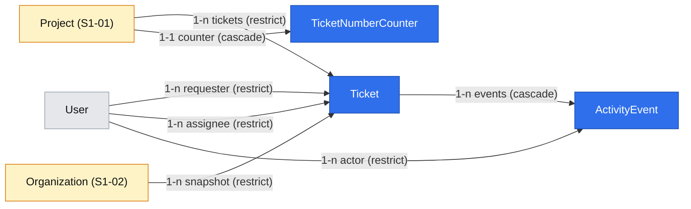

# Ticket model – fields, numbers, assignment and activity events

| | |
|---|---|
| Status | `draft` |
| Created | 2026-10-26 |
| Plan task | `S1-05` |
| System specification sections | §3.1, §3.2, §3.3, §4.1, §4.3, §4.5, §7.3, §7.4, §7.5, §13.2, §17.1, §17.2, §18.3, §18.9, glossary |
| Related issues / PRs | Sibling specifications: [#111](https://github.com/trybun/trybun/pull/111) (S1-01 projects), [#112](https://github.com/trybun/trybun/pull/112) (S1-02 organizations), [#113](https://github.com/trybun/trybun/pull/113) (S1-03 invitations and accounts); S1-06 statuses (in progress) |

## Context

The ticket is the single unit of work of the system ([§3](../../docs/spec/03-ticket-model.md)). Nothing of it exists yet: the database has no `tickets` or `activity_events` table, the contracts have no `tickets` feature, and no endpoint creates or changes a ticket. Projects (S1-01), organizations (S1-02) and accounts (S1-03) are specified in the sibling pull requests above and are assumed as proposed there.

S1-05 builds the model that every later Stage 1 task works on: statuses (S1-06), attachments (S1-08), the portal (S1-09), the team ticket view (S1-10), visibility (S1-11), comments (S1-12), the list and the board (S1-13, S1-14) and notifications (S1-15). The plan's scope for S1-05: fields, per-project sequential identifiers, source, type, priority, requester, assignee, organization snapshot; the project immutable after creation; the project key immutable after the first ticket; unassigning the open tickets of a team member who is deactivated or removed from the project, with an automatic event; activity events for every field change with denormalized values; ticket numbers from a locked counter, never reused. Out of scope: parent, relations other than `duplicate_of`, labels, milestone, start and due dates.

The plan's "Done when" for S1-05:

- 50 concurrent creations produce numbers 1–50 without gaps or duplicates;
- changing `projectId` returns `ticket.project_immutable`;
- every field change appears in the timeline with old and new value;
- changing the key of a project with tickets is rejected;
- deactivating the assignee unassigns their open tickets with an automatic event.

Two sibling proposals hand work to S1-05: S1-01 ([#111](https://github.com/trybun/trybun/pull/111), Q6) proposes that S1-05 adds `409 project.has_tickets` for deleting a project with tickets, and S1-02 ([#112](https://github.com/trybun/trybun/pull/112), Q7) proposes that the organization snapshot is a restricting foreign key that S1-05 adds and maps to `409 organization.not_empty`. Both are covered here.

While reading the specification against the plan and the sibling proposals, this proposal found gaps and boundary conflicts the specification does not decide. Agents may not decide them (Rule 8), so each is listed under [Open questions](#open-questions) with a proposed answer for a human to accept, change or reject. The design below assumes the proposed answers.

## Goals

- A ticket is created in a project with a number allocated from a per-project counter: unique, consecutive and never reused, also under concurrent creation ([§17.2](../../docs/spec/17-conventions.md)).
- The fields of [§3.2](../../docs/spec/03-ticket-model.md) that Stage 1 needs and no other plan task owns: identifier, title, description, project, type, source, organization snapshot, priority, status (column and initial value only, [Q1](#open-questions)), requester, assignee, timestamps, `version`.
- The project of a ticket never changes (`ticket.project_immutable`), and the key of a project with tickets never changes (`project.key_immutable`).
- A project with tickets cannot be deleted (`project.has_tickets`); an organization with tickets cannot be deleted (`organization.not_empty`).
- Every change of a ticket field writes an immutable activity event with author, time, previous and new value; references are stored as snapshots ([§4.5](../../docs/spec/04-ticket-lifecycle.md)).
- Open tickets of a team member who is deactivated or removed from a project lose their assignee, with an automatic event ([§7.4](../../docs/spec/07-users-organizations-permissions.md)).
- The permission rules of the ticket rows of [§7.5](../../docs/spec/07-users-organizations-permissions.md) that S1-05 builds, with an allowed and a denied test each, and `allowedActions` on the ticket response (plan, "Cross-cutting parts grow with the features").
- The reference implementation of "activity events from the record before and after the change" ([§18.3](../../docs/spec/18-code-patterns.md), "Writing data").

## Non-goals

- Changing the status, transition rules, waiting reason, public status, the `duplicate_of` relation, resolution confirmation (S1-06). S1-05 only creates the status column and sets the initial status ([Q1](#open-questions)).
- Visibility and sharing requests (S1-11). Until then an end user sees only the tickets they requested ([Q2](#open-questions)).
- Attachments (S1-08), comments, internal notes and content revisions (S1-12), watchers and notifications (S1-15).
- Parent ticket (S2-07), relations `blocks` and `relates_to` (S2-08), labels (S2-09), milestone and dates (S4-01, S5-01), affected users and requester count (S2-02), fingerprint and occurrence count (Stage 6), GitHub links (Stage 3), SLA (Stage 4). No placeholder columns for them (plan, "Out of scope").
- The ticket forms, the ticket view and the timeline UI (S1-09, S1-10), type-dependent templates (S1-10, S1-17), the list and the board (S1-13, S1-14). S1-05 is API-first; its only UI change is on the project settings page of S1-01 ([Q12](#open-questions)).
- Anonymization and export of ticket data (S1-16, which covers the data of Stage 1).

## Proposed change

### What the user sees

S1-05 has almost no UI of its own ([Q12](#open-questions)); the ticket views come with S1-09 and S1-10, built on the API below. Visible effects:

- **Project settings** (S1-01): once the project has a ticket, the **Key** field is read-only with the hint "The key cannot be changed after the first ticket, because it is part of ticket identifiers." (PL: „Klucza nie można zmienić po utworzeniu pierwszego zgłoszenia, ponieważ jest częścią identyfikatorów zgłoszeń.”), and **Delete project** is replaced by the hint "Projects with tickets cannot be deleted. Archive the project instead." (PL: „Projektu ze zgłoszeniami nie można usunąć. Zamiast tego zarchiwizuj projekt.”) ([Q6](#open-questions)).
- **Organizations** (S1-02): **Delete** is replaced by the same kind of hint for an organization with tickets.
- **Demo dataset**: `pnpm db:seed` adds tickets in every source, type and priority to the demo projects, some assigned, with field-change events, so S1-09, S1-10 and S1-13 have data to build on.
- **Error texts** for the new error codes in EN and PL (`errors.<code>`, [§18.5](../../docs/spec/18-code-patterns.md)).

### Data model



The ticket hangs off the project, the requester and (optionally) the assignee and the organization snapshot; its events hang off the ticket. The restricting keys from projects and organizations are what make `project.has_tickets` and `organization.not_empty` hold even without the service checks.

**`Ticket`** (`tickets`, owned by `modules/tickets/`):

| Field | Column | Type and rule |
|---|---|---|
| `id` | `id` | UUIDv7 |
| `projectId` | `project_id` | FK `projects`, `ON DELETE RESTRICT`; never updated after insert |
| `number` | `number` | integer ≥ 1; unique with `project_id` |
| `title` | `title` | trimmed, 1–255 characters ([Q4](#open-questions)) |
| `description` | `description` | GFM Markdown, 0–65,536 characters, empty string when none ([Q4](#open-questions)) |
| `type` | `type` | enum `ticket_type` (`bug`, `feature`, `task`, `question`); **nullable** – null until triage for end-user tickets ([Q3](#open-questions)) |
| `source` | `source` | enum `ticket_source` (`user`, `developer`, `integration`); set from the principal at creation, never changed |
| `priority` | `priority` | enum `ticket_priority` (`low`, `normal`, `high`, `critical`), default `normal` |
| `status` | `status` | enum `ticket_status` with the nine internal statuses of [§4.1](../../docs/spec/04-ticket-lifecycle.md); initial value per [§4.3](../../docs/spec/04-ticket-lifecycle.md); changed only by S1-06 ([Q1](#open-questions)) |
| `organizationId` | `organization_id` | FK `organizations`, `ON DELETE RESTRICT`, nullable; the requester's organization at creation, never changed ([Q13](#open-questions)) |
| `requesterId` | `requester_id` | FK `users`, `ON DELETE RESTRICT` |
| `assigneeId` | `assignee_id` | FK `users`, `ON DELETE RESTRICT`, nullable |
| `version` | `version` | integer, versioned record ([§17.2](../../docs/spec/17-conventions.md)) |
| `createdAt`, `updatedAt` | `created_at`, `updated_at` | `timestamptz` |

Indexes: unique `(project_id, number)`; `(assignee_id)` for the unassignment and the later "My open tickets" view; `(requester_id)` for an end user's own tickets; `(organization_id)`. A check constraint keeps `number ≥ 1`; a trigger is not needed for the immutable project because no use case writes `project_id` after the insert, and the API rejects the attempt ([Q5](#open-questions)).

The **identifier** `KEY-number` is never stored ([§3.2](../../docs/spec/03-ticket-model.md), [§17.2](../../docs/spec/17-conventions.md)): the response composes it from the project key and the number, which is safe because the key cannot change once a ticket exists.

**`TicketNumberCounter`** (`ticket_number_counters`, owned by `modules/tickets/`, [Q7](#open-questions)): `projectId` (primary key, FK `projects`, `ON DELETE CASCADE`), `lastNumber` (integer). The creation transaction allocates the next number with one statement in `tickets.sql.ts`:

```sql
INSERT INTO ticket_number_counters (project_id, last_number) VALUES ($1, 1)
ON CONFLICT (project_id) DO UPDATE SET last_number = ticket_number_counters.last_number + 1
RETURNING last_number
```

The statement takes the row lock of the counter until the transaction ends, so concurrent creations in one project are serialized at this point and get consecutive numbers; a rolled-back creation rolls back its increment, so no gap appears. Undoing an import ([§12.5](../../docs/spec/12-api-webhooks-import.md)) deletes tickets but never lowers or deletes the counter, so their numbers are not reused.

"The project has tickets" means **the counter row exists** – a ticket was created at least once – not that ticket rows exist now. After an import undo that removed every ticket, the key stays frozen and the project stays undeletable, because identifiers of the removed tickets may already have appeared in e-mails or branch names ([§3.1](../../docs/spec/03-ticket-model.md)). A project whose counter does not exist never had a ticket, so deleting it and reusing its key reuses no identifier.

**`ActivityEvent`** (`activity_events`, owned by a new module `modules/activity-events/`, [Q11](#open-questions)):

| Field | Column | Type and rule |
|---|---|---|
| `id` | `id` | UUIDv7 (time-ordered, so it is also the timeline order) |
| `ticketId` | `ticket_id` | FK `tickets`, `ON DELETE CASCADE` (tickets are deleted only by an import undo, [§17.2](../../docs/spec/17-conventions.md)) |
| `type` | `type` | event type, closed list in the contracts: `title_changed`, `description_edited`, `type_changed`, `priority_changed`, `assignee_changed`; later tasks add theirs (`status_changed` in S1-06, …) |
| `data` | `data` | JSONB `{ "from": <value>, "to": <value> }`, absent for `description_edited`; a value is an enum code, a string, `null`, or a snapshot `{ "id", "displayName" }` for references ([§4.5](../../docs/spec/04-ticket-lifecycle.md)) |
| `actorId` | `actor_id` | FK `users`, nullable: null for an automatic event of the system |
| `automaticSource` | `automatic_source` | enum `activity_event_source`, nullable: `system` (rules of the system, e.g. the unassignment); later `github`, `integration` ([§4.5](../../docs/spec/04-ticket-lifecycle.md)). Null for a person's change |
| `isPublic` | `is_public` | boolean, decided by the producing rule when the event is written; all S1-05 events are internal (`false`) – S1-06 writes public status changes |
| `createdAt` | `created_at` | `timestamptz` |

Index `(ticket_id, id)`. The table is **immutable**: a `BEFORE UPDATE OR DELETE` trigger of the migration refuses every `UPDATE`, and every `DELETE` while the event's ticket still exists (`EXISTS (SELECT 1 FROM tickets WHERE id = OLD.ticket_id)`). The only delete that passes is the one cascaded from the deletion of its ticket by an import undo, because PostgreSQL runs the cascade after the ticket row is gone. S1-16 adds its own exception for the anonymization of snapshots ([§13.2](../../docs/spec/13-non-functional.md)) when it builds anonymization. Events have no foreign key to records that people delete ([§17.2](../../docs/spec/17-conventions.md)). Tickets and accounts are deleted only by an import undo, which deletes only tickets and accounts without other activity ([§17.2](../../docs/spec/17-conventions.md)), so the cascade from `tickets` and the restricting `actor_id` never block or break a history that should remain ([Q11](#open-questions)). `actor_id` and the snapshots carry personal data (a display name), which S1-16 must replace on anonymization – recorded as a requirement for S1-16 under [Changes to the system specification](#changes-to-the-system-specification).

Enums follow the glossary codes and have a unit test that keeps each Prisma enum equal to its contract enum ([§18.4](../../docs/spec/18-code-patterns.md)). Migrations: `add_tickets`, `add_activity_events`.

### API

All endpoints follow the request pipeline of [§18.3](../../docs/spec/18-code-patterns.md): the target record guard for the ticket in the path (`404`, then `403` or `409 project.archived`), validation (`422`), a missing `If-Match` (`428`), then the service: records referenced in the body (`projectId`, `assigneeId`) not visible → `404`, field-level rules → `403`, business rules → `422`/`409`, stale version → `412`. A `PATCH` that changes nothing still checks the version, so a stale `If-Match` returns `412`. Schemas live in `@trybun/contracts/tickets` and `@trybun/contracts/activity-events`.

| Endpoint | Action | Notes |
|---|---|---|
| `POST /api/v1/tickets` | `create_ticket` on the `Project` of `projectId` | Body `{ projectId, title, description?, type?, priority?, assigneeId? }`. An invisible project returns `404`; an archived one `409 project.archived`. `type`, `priority` and `assigneeId` need the team (full form, [§7.5](../../docs/spec/07-users-organizations-permissions.md)); an end user sending them gets `403` with nothing created. `201` with the ticket and its `Location`. Supports `Idempotency-Key` ([§12.1](../../docs/spec/12-api-webhooks-import.md)) |
| `GET /api/v1/tickets?projectId&identifier&cursor&limit` | `read` | Cursor envelope ([§18.4](../../docs/spec/18-code-patterns.md)), newest first (`number` descending within a project, else `createdAt`, `id`). `identifier=ERP-12` returns at most one item, for routes that use the identifier ([Q12](#open-questions)). Filters, sorting and saved views come with S1-13 |
| `GET /api/v1/tickets/{ticketId}` | `read` | Weak `ETag` |
| `PATCH /api/v1/tickets/{ticketId}` | `update` (title, description), `update_fields` (type, priority), `assign` / `assign_self` (assignee) | `If-Match`. A body with any field the principal may not change is rejected as a whole with `403` and nothing changes (as the project `PATCH` of S1-01). `projectId` different from the current project → `422 ticket.project_immutable` ([Q5](#open-questions)). Every changed field writes its event in the same transaction; a body that changes nothing returns `200` without an event and without a new `version` |
| `GET /api/v1/tickets/{ticketId}/activity-events?cursor&limit` | `read` on the ticket | Oldest first. The team gets every event; an end user gets only events with `isPublic` (none in S1-05). S1-10 builds the timeline on it; S1-12 interleaves comments |

- **Team ticket response** (`ticketSchema`): `id`, `projectId`, `number`, `identifier`, `title`, `description`, `type`, `source`, `priority`, `status`, `organization { id, name } | null`, `requester { id, displayName }`, `assignee { id, displayName } | null`, `version`, `createdAt`, `updatedAt`, `allowedActions`.
- **End-user ticket response** (`endUserTicketSchema`): `id`, `projectId`, `number`, `identifier`, `title`, `description`, `requester { id, displayName }`, `version`, `createdAt`, `updatedAt`, `allowedActions` – without type, priority, assignee, source, organization and the internal status ([§3.2](../../docs/spec/03-ticket-model.md), columns "End user"); S1-06 adds the public status. The controller chooses the schema by the account kind of the principal, and the serializer strips every other field ([§18.3](../../docs/spec/18-code-patterns.md)).
- **Activity event response**: `id`, `type`, `data`, `actor { id, displayName } | null`, `automaticSource`, `createdAt`. The actor's name is read from the account at read time (anonymization then shows "Deleted user"); the snapshots in `data` keep the name at the time of the change ([§4.5](../../docs/spec/04-ticket-lifecycle.md)).
- **Creation defaults**: `source` from the principal – `user` for an end user, `developer` for a team account, `integration` for an integration token (Stage 6); `status` from `initialStatusOf(source)` – `new` for `user` and `integration`, `todo` for `developer` ([§4.3](../../docs/spec/04-ticket-lifecycle.md), [Q1](#open-questions)); `priority` `normal`; `type` `task` for a team account that omits it, null for an end user ([Q3](#open-questions)); `organizationId` from the requester's membership ([Q13](#open-questions)); `requesterId` the principal. Creating writes no activity event: the timeline begins with the ticket itself, as on GitHub ([Q11](#open-questions)).
- **Assignee rules** ([§3.2](../../docs/spec/03-ticket-model.md), [§7.5](../../docs/spec/07-users-organizations-permissions.md), [Q9](#open-questions), [Q10](#open-questions)): the assignee must be an `active` `team` account with a membership of the project (`developer` or `project_manager`), else `422 ticket.assignee_not_eligible` (pointer `/assigneeId`). A Developer may set the assignee only to themselves (taking over a ticket assigned to someone else included) or to `null` when they are the current assignee; any other change returns `403`. A Project manager and the Administrator may set any eligible assignee or `null`.
- **Action codes** of `Ticket` (closed list in the contracts): `read`, `update`, `update_fields`, `assign`, `assign_self`. New action of `Project`: `create_ticket`.
- **New error codes**: `ticket.project_immutable` (422, pointer `/projectId`), `ticket.assignee_not_eligible` (422, pointer `/assigneeId`), `project.key_immutable` (409), `project.has_tickets` (409); `organization.not_empty` (409) as proposed by S1-02. `project.archived` (S1-01) is reused.
- **Project response** (S1-01) gains `hasTickets` (boolean: the counter row exists, see [Data model](#data-model)) ([Q6](#open-questions)).

### Permissions

Rules in `modules/tickets/tickets.abilities.ts`, built on the project and account rules of S1-01 and S1-04:

| Principal | Rules |
|---|---|
| Administrator | `create_ticket` on every project; on every ticket `read`, `update`, `update_fields`, `assign` |
| Project manager of the project | `create_ticket`; on its tickets `read`, `update`, `update_fields`, `assign` |
| Developer of the project | `create_ticket`; on its tickets `read`, `update`, `update_fields`, `assign_self` |
| End user | `create_ticket` on the projects they have access to (organization or personal, S1-02, S1-03); on tickets they requested `read`, `update` ([Q2](#open-questions)) |
| Global restriction (S1-01 / S1-04) | `cannot` every action except `read` on tickets of an archived project (`{ project: { state: 'archived' } }`), reason `project.archived` |

Queries add `accessibleBy(ability, 'read')`, so the list and the detail never disagree and an invisible ticket returns `404`. `tickets.abilities.spec.ts` covers the §7.5 rows S1-05 builds – "Create a ticket (simplified form)", "Create a ticket (full form)", "View own tickets", "View all tickets of the project", "Edit own ticket title and description", "Edit any ticket title and description", "Edit ticket fields (type, priority)", "Assign tickets" – each with an allowed and a denied case, plus `404` for a ticket of another project and for another end user's ticket.

### Writing data

Each use case is one service method in one transaction ([§18.3](../../docs/spec/18-code-patterns.md)):

- **Row locks** are a problem §18 has no pattern for, and Prisma cannot express `FOR SHARE` / `FOR UPDATE`. This spec proposes one ([Q16](#open-questions)): a locking read is one function in the owning module's `<feature>.sql.ts` (`lockProjectForShare(tx, projectId)`, …), a parameterized `$queryRaw` that returns the identifier and the state fields the caller must re-check; the caller decides on the **locked row**, never on an earlier read through the ability.
- **Create**: the project must be visible through the ability (`404`), then it is locked `FOR SHARE` and its `state` re-checked on the locked row (`409 project.archived`); the number is allocated from the counter and the ticket inserted. The share lock makes creation wait for a concurrent archive, key change or deletion of the project, which take the row exclusively; concurrent creations do not block each other on it.
- **Update**: one conditional update on `id` and `version` (`versionedUpdate`), then `ActivityEventsService.recordChanges(tx, actor, before, after)` – the one function of the activity module that turns a before/after pair into events ([§18.3](../../docs/spec/18-code-patterns.md)); its pure core `domain/field-changes.ts` diffs the fields and builds the snapshots, and is unit-tested with a table of every field.
- **Assign**: the eligibility check reads the membership row and the account row `FOR SHARE`, so a concurrent removal or deactivation waits until the assignment commits, and its unassignment job then sees the new assignee.
- **Project key change** (S1-01 use case, extended): lock the project row `FOR UPDATE`, then check in a new statement that the project has no counter row; otherwise `409 project.key_immutable` ([Q6](#open-questions)).
- **Project deletion** (S1-01 use case, extended): the same lock and check, `409 project.has_tickets`; the restricting foreign key of `tickets` is the backstop, and its violation is mapped to the same code, never to a `500`.
- **Organization deletion** (S1-02 use case): the restricting foreign key of `tickets.organization_id` is mapped to `409 organization.not_empty`, as S1-02 proposes.

The projects module reads `tickets` for these checks through the Prisma relation ("Reads may join across models", [§18.3](../../docs/spec/18-code-patterns.md)); the tickets module reads projects, memberships and organizations the same way. Neither imports the other's service, so no module cycle appears.

No audit log entries: ticket changes are not administrative actions ([§13.5](../../docs/spec/13-non-functional.md)). No outbox events for creating or changing a ticket: S1-05 has no consumer, and S1-15 adds them additively ([Q14](#open-questions)).

### Unassignment on deactivation and removal

[§7.4](../../docs/spec/07-users-organizations-permissions.md): open tickets assigned to a team member who is deactivated, or removed from the project, are unassigned with an automatic event. "Open" means a non-terminal status ([§4.1](../../docs/spec/04-ticket-lifecycle.md)). Built as outbox handlers ([Q8](#open-questions)):

- **Deactivation**: S1-03 ([#113](https://github.com/trybun/trybun/pull/113)) writes the outbox event `user.deactivated` and invites S1-05 to react. S1-05 adds the job `unassign-deactivated-user` in `tickets-worker.module.ts`.
- **Removal from a project**: S1-01 writes no outbox event for `DELETE …/members/{userId}`. S1-05 adds the outbox event `project_member.removed` (`{ projectId, userId }`) to that use case and the job `unassign-removed-member`.
- **Change of account kind**: converting a team account to `end_user` removes all its team roles ([§7.1](../../docs/spec/07-users-organizations-permissions.md)). No plan task builds the conversion yet; the task that does writes `project_member.removed` for each removed membership, so the same job unassigns the tickets ([Q8](#open-questions)).
- **The handler** (system principal, idempotent): it re-reads the current state and does nothing when the reason no longer holds – the account is active again, or the person is a member of the project again. Otherwise it repeats, one transaction each, until no row is returned: `UPDATE tickets SET assignee_id = NULL, version = version + 1 WHERE id IN (up to 100 open tickets with that assignee, in all projects for a deactivation, in the one project for a removal) AND assignee_id = $user AND status NOT IN ('done', 'rejected', 'duplicate') RETURNING id` (in `tickets.sql.ts`), and writes `assignee_changed` with `automaticSource: system`, no actor and `from` the snapshot of the person for each returned ticket. The condition is the assignee and the status, never the version read earlier, so a concurrent edit cannot make the job skip a ticket; `version` still increases, so a person editing at the same time gets `412` ([§17.2](../../docs/spec/17-conventions.md)). A repeated delivery finds nothing left to unassign. Tickets of archived projects are unassigned too ([Q8](#open-questions)).
- Reopening a terminal ticket (S1-06) keeps its assignee even when that person is no longer eligible; S1-06 was told of this, and decides whether a reopen clears such an assignee.
- The tickets then appear in the predefined view "Unassigned" (S1-13).

### Prior art

- **Per-project numbers**: Jira and Linear allocate `KEY-123` per project; GitHub numbers issues per repository and never reuses a number. Jira keeps an issue's old key after a project key change and redirects; [§3.1](../../docs/spec/03-ticket-model.md) avoids that complexity by freezing the key after the first ticket, which this spec enforces.
- **Moving tickets**: Jira and GitHub allow moving issues between projects or repositories and renumber them; [§3.2](../../docs/spec/03-ticket-model.md) forbids it, which keeps identifiers, numbering and the organization snapshot stable.
- **Timeline**: GitHub records one timeline event per change with actor and old/new value (`renamed`, `assigned`, `labeled`) and shows the issue body as the first item, with no separate "created" event; this spec does the same. Zendesk keeps an immutable audit trail per ticket, which [§4.5](../../docs/spec/04-ticket-lifecycle.md) also requires.
- **Unassignment on deactivation**: Zendesk and Jira Service Management leave tickets assigned to a deactivated agent until someone reassigns them; [§7.4](../../docs/spec/07-users-organizations-permissions.md) chooses automatic unassignment so they surface in "Unassigned".

## Changes to the system specification

| Section | Change |
|---|---|
| §3.1 | Key: a change once the project has a ticket returns `409 project.key_immutable` (Q6) |
| §3.2 | Title 1–255 characters, description at most 65,536 characters (Q4); type is empty until triage for end-user tickets and `task` when the team omits it (Q3); `ticket.project_immutable` is `422` with pointer `/projectId` (Q5); the organization snapshot is the requester's membership at creation, whatever the state of the organization and the access path (Q13); the assignee is an active team account with a membership of the project (Q9) |
| §4.5 | Event shape: one event per changed field with type, `{ from, to }`, actor or automatic source, public flag decided when written; creation writes no event (Q11) |
| §7.3 | Deleting a project with tickets returns `409 project.has_tickets`; deleting an organization with tickets `409 organization.not_empty` (S1-02) |
| §7.3 | Archived project: the system's unassignment of a deactivated or removed member still applies to its tickets (Q8) |
| §7.4 | The unassignment of a deactivated or removed member runs as a Worker job after the change and skips people who were reactivated or re-added meanwhile; a change of account kind to `end_user` unassigns like a removal (Q8) |
| §13.2 | Anonymization (S1-16) also replaces the display name in the snapshots of activity events |
| §17.2 Errors | New codes `ticket.project_immutable`, `ticket.assignee_not_eligible`, `project.key_immutable`, `project.has_tickets`; `organization.not_empty` is added by S1-02 to the contracts, S1-05 adds only its mapping and test |
| §18.2, §18.3 | New pattern "Row lock": a locking read in `<feature>.sql.ts` returning the fields to re-check; decisions on the locked row (Q16) |
| §18.9 | New reference implementation rows: "Activity events from the record before and after the change" → `apps/server/src/modules/activity-events/`; "Row lock" → `apps/server/src/modules/tickets/tickets.sql.ts`; both S1-05 |
| Plan, S1-05 | "Done when" gains "deleting a project with tickets returns `409 project.has_tickets`" ([#111](https://github.com/trybun/trybun/pull/111), its Q6) and "deleting an organization with tickets returns `409 organization.not_empty`" ([#112](https://github.com/trybun/trybun/pull/112), its Q7). The maintainer changes the plan |
| Plan, S1-05/S1-06/S1-10/S1-11/S1-13 | Boundaries of Q1, Q2, Q10 and Q12. The maintainer changes the plan |

New or changed glossary terms (code identifier, EN/PL labels):

- `ticket.number` – the per-project number of a ticket; `ticket.identifier` stays the display form `KEY-number`.
- `activity_event.type`: `title_changed`, `description_edited`, `type_changed`, `priority_changed`, `assignee_changed` – "changed the title" / „zmienił(a) tytuł”, "edited the description" / „edytował(a) opis”, "changed the type" / „zmienił(a) typ”, "changed the priority" / „zmienił(a) priorytet”, "changed the assignee" / „zmienił(a) przypisanie”; later tasks add theirs.
- `activity_event.automatic_source`: `system` – "System" / „System”; later `github`, `integration`.

## Open questions

Implementation must not start until every question has an answer. Each answer below is a **proposal awaiting human approval**, chosen as the smallest and most reversible option. Answers marked ⚠ change the plan, a permission principle or a shared contract, and need explicit confirmation.

1. ⚠ **Boundary with S1-06 (status).** A ticket cannot exist without a status, but the plan gives "initial statuses" to S1-06. — **Answer (proposed, awaiting approval):** S1-05 creates `tickets.status` with the full enum of [§4.1](../../docs/spec/04-ticket-lifecycle.md) and sets the initial status of [§4.3](../../docs/spec/04-ticket-lifecycle.md) with a pure function `initialStatusOf(source)`; S1-06 owns every status change, the transition rules, the waiting reason, the public status and its mapping, `duplicate_of` and resolution confirmation, and writes `status_changed` through the activity function of S1-05. The `PATCH` of S1-05 does not accept `status`; S1-06 changes it through its own endpoint (`PUT /api/v1/tickets/{ticketId}/status`, action `change_status`). The S1-06 specification proposes the same boundary. Alternative: S1-06 before S1-05 in the plan.
2. **Visibility before S1-11.** The visibility and sharing-request fields of [§3.2](../../docs/spec/03-ticket-model.md) belong to S1-11, but S1-05 needs an end-user read rule. — **Answer (proposed, awaiting approval):** no `visibility` or `sharing_request` column in S1-05 (plan, "no placeholder models"); an end user reads only the tickets they requested, which is exactly `only_me`. S1-11 adds both columns with the defaults `only_me` and `none` for existing rows and widens the rule.
3. **Type of end-user tickets.** [§3.2](../../docs/spec/03-ticket-model.md) says the type is "completed during triage" and the team form defaults to `task` ([§3.3](../../docs/spec/03-ticket-model.md)); it does not say what an end-user ticket holds before triage, nor what the API does when the team omits the type. — **Answer (proposed, awaiting approval):** `type` is nullable; an end-user ticket has no type until the team sets one; a team account that omits it gets `task`. Priority is never empty: `normal` by default for everyone ([§3.2](../../docs/spec/03-ticket-model.md)).
4. **Length limits.** [§3.2](../../docs/spec/03-ticket-model.md) gives none. — **Answer (proposed, awaiting approval):** title trimmed, 1–255 characters (Jira's limit); description at most 65,536 characters (GitHub's issue body limit); both reported as the standard field errors `string.too_short` / `string.too_long`.
5. **Status code of `ticket.project_immutable`.** [§3.2](../../docs/spec/03-ticket-model.md) names the code but not its status, and a strict schema would answer an unknown `projectId` with the generic `field.unrecognized`. — **Answer (proposed, awaiting approval):** the update schema accepts `projectId` only to reject it: a value different from the current project returns `422 ticket.project_immutable` with pointer `/projectId` (a rule about the input, like `project.key_taken`); the current project's ID is accepted and changes nothing.
6. ⚠ **Showing that the key and deletion are locked.** The web application adapts only to `allowedActions` ([§18.5](../../docs/spec/18-code-patterns.md)), but whether a project has tickets is not a condition the CASL rules can express for `accessibleBy` queries. — **Answer (proposed, awaiting approval):** the API enforces both rules in the service under the row lock (`409 project.key_immutable`, `409 project.has_tickets`); the project response gains the fact `hasTickets`, which the web application uses only to show the key read-only and to replace **Delete** with a hint, never to decide an action; `allowedActions` keeps `update` and `delete` as S1-01 defines them. Alternative: a denormalized `projects.has_tickets` column set by the first ticket, with `cannot` rules on it, so `allowedActions` drops `delete` and gains an `update_key` action – more precise, but it makes the tickets module write a projects column.
7. **Where the counter lives.** — **Answer (proposed, awaiting approval):** its own table `ticket_number_counters`, owned by the tickets module and created on the first ticket with one upsert, so the tickets module never writes the project row and the project's `version` and `updatedAt` do not change with every ticket. Alternative: a `last_ticket_number` column on `projects`, written through an exported method of the projects service.
8. ⚠ **How the unassignment runs.** [§7.4](../../docs/spec/07-users-organizations-permissions.md) does not say whether it happens in the transaction of the deactivation or removal, and S1-01 writes no outbox event for a removal. — **Answer (proposed, awaiting approval):** as idempotent Worker jobs on the outbox events `user.deactivated` (S1-03) and a new `project_member.removed` that S1-05 adds to the removal use case of S1-01; each job re-checks that the person is still deactivated or still not a member, and unassigns in batches of 100. It keeps the projects and users modules free of a dependency on tickets. Tickets of archived projects are unassigned too: §7.3 forbids user-facing changes there, and the unassignment is a consequence of the Administrator's action that would otherwise leave tickets assigned to a deactivated person after unarchiving. This reads §7.3 ("all user-facing changes are rejected") as not covering a system consequence, which changes how §7.3 is applied, so it needs confirmation. The task that builds the change of account kind ([§7.1](../../docs/spec/07-users-organizations-permissions.md), in no plan task yet) writes `project_member.removed` for every removed membership. Alternatives: a synchronous call in the same transaction through an exported tickets service (atomic, but users and projects then depend on tickets); skipping archived projects (they stay assigned to the person after unarchiving).
9. **Who can be assigned.** "Only an active team member of the project" ([§3.2](../../docs/spec/03-ticket-model.md)) leaves the Administrator open: they see every project without a membership. — **Answer (proposed, awaiting approval):** only `active` team accounts with a `developer` or `project_manager` membership of the project; an Administrator who wants to work on tickets is added as a member first. `422 ticket.assignee_not_eligible` otherwise.
10. **Boundary with S1-10 (assignment rules).** The plan lists "assignment rules" under S1-10 and the assignee under S1-05. — **Answer (proposed, awaiting approval):** S1-05 builds the API rules (eligibility, Developer only themselves, `assign` / `assign_self` in `allowedActions`), because permission logic lives only in the API; S1-10 builds the assignee picker and "Assign to me" on top of them.
11. **Shape of activity events.** [§4.5](../../docs/spec/04-ticket-lifecycle.md) lists what an event records but not its shape. — **Answer (proposed, awaiting approval):** one row per changed field (GitHub's model; one `PATCH` that changes two fields writes two events with the same time); `type` from a closed list per field, `data` `{ from, to }`, actor or `automaticSource`, `isPublic` decided by the producing rule; no event for the creation. Title values are stored in events as §4.5 requires; [§6.1](../../docs/spec/06-comments-notifications.md) redaction covers descriptions and comments only, so personal data in a title stays in its history until anonymization – S1-12 may propose title redaction if needed. The events of a ticket are deleted with it (`ON DELETE CASCADE`) only by an import undo, the one case where tickets are deleted ([§17.2](../../docs/spec/17-conventions.md)); this reads "events never reference deletable records by foreign key" as aimed at labels, milestones and other records people delete, and the module `activity-events` is its own module because S1-06, S1-12 and later tasks write events for other changes.
12. **API only, and how routes find a ticket.** — **Answer (proposed, awaiting approval):** S1-05 ships the API, the demo dataset and the project settings hints; the ticket forms and views are S1-09 and S1-10. Web routes will use the identifier (`/tickets/ERP-12`), which is stable because the key is frozen after the first ticket; the list endpoint resolves it with `identifier=ERP-12`, the only filter S1-05 adds besides `projectId` (alternative: S1-13 adds it with the other filters, and S1-09/S1-10 wait for it). No user documentation page is added in S1-05 except a sentence on the key in the project settings reference of S1-01.
13. **Organization snapshot edge cases.** [§3.2](../../docs/spec/03-ticket-model.md) says "the requester's organization at the moment of creation, if any", but not for an end user whose organization is archived or who creates the ticket through personal access to a project outside the organization's projects. — **Answer (proposed, awaiting approval):** the snapshot is the requester's organization membership at creation, whatever the organization's state and the access path; team accounts never have one. S1-11 decides what the snapshot means for `my_organization` visibility in those cases.
14. **Outbox events of ticket changes.** — **Answer (proposed, awaiting approval):** S1-05 writes none for creating or changing a ticket, because nothing consumes them yet; S1-15 adds `ticket.created` and `ticket.updated` (or finer events) additively ([§17.2](../../docs/spec/17-conventions.md), "Payload compatibility"). S1-05 writes only `project_member.removed` (Q8), which it consumes.
15. **One task or several.** The plan row bundles the ticket model, the activity module and the unassignment. — **Answer (proposed, awaiting approval):** keep one task and one implementation PR, built in the phases below: the "Done when" needs all three, and neither the activity module nor the unassignment works without tickets. Alternative: three implementation PRs, one per phase, each leaving the system working.
16. ⚠ **Row locks.** §18 has no pattern for row locks, and Prisma cannot express `FOR SHARE` or `FOR UPDATE`; the raw-SQL pattern of §18.3 covers search queries returning identifiers. — **Answer (proposed, awaiting approval):** a new pattern "Row lock" (Rule 12, [§18.9](../../docs/spec/18-code-patterns.md) "A problem without a pattern"): one function per locking read in the owning module's `<feature>.sql.ts`, a parameterized `$queryRaw` that returns the identifier and the fields to re-check; visibility is still decided through the ability first, and every decision is taken on the locked row. A module locks only its own rows, other modules call its exported function (the projects module exports `lockProjectForShare`/`lockProjectForUpdate`). S1-05 is its reference implementation. Alternative: `SERIALIZABLE` transactions with retries, which need a retry loop that §18.3 forbids in request handlers.

## Implementation plan

Each step leaves the application working and has its tests.

**Phase 1 – Model and creation**

1. Prisma models `Ticket`, `TicketNumberCounter`, enums; migration `add_tickets` with the restricting foreign keys and indexes; contracts `@trybun/contracts/tickets` (schemas, enums, action codes, error codes); enum equality test; factories `ticket.factory.ts`.
2. `initialStatusOf` and the creation defaults as pure functions with table tests; `tickets.abilities.ts` with `create_ticket` and `read`; the row-lock functions ([Q16](#open-questions)); `POST /tickets`, `GET /tickets`, `GET /tickets/{id}` with both response schemas. Integration tests: **50 concurrent creations in one project produce 1–50 without gaps or duplicates**; a rolled-back creation leaves no gap; an end user's `type` gets `403`; an archived project gets `409 project.archived`; an invisible project and another end user's ticket get `404`.

**Phase 2 – Changes and activity events**

3. `modules/activity-events/`: model, migration `add_activity_events` with the immutability trigger, `domain/field-changes.ts` with table tests, `ActivityEventsService.recordChanges`, `GET /tickets/{id}/activity-events`; factory `activity-event.factory.ts`.
4. `PATCH /tickets/{id}` with `If-Match`, field-level `403`, `ticket.project_immutable`, assignee eligibility and the Developer rule. Integration tests: **every field change appears in the events with old and new value**, a reference with its snapshot; an end user sees no internal events; an update or delete of an event is refused by the trigger; **changing `projectId` returns `ticket.project_immutable`**.
5. Project key and deletion rules in the S1-01 use cases, `hasTickets` in the project response; organization deletion mapped to `organization.not_empty`. Integration tests: **changing the key of a project with tickets returns `409 project.key_immutable`**; deleting it returns `409 project.has_tickets`; a key change racing with the first creation never leaves a ticket under a changed key; deleting an organization with tickets returns `409 organization.not_empty`.

**Phase 3 – Unassignment, web and documentation**

6. `project_member.removed` in the removal use case; the jobs `unassign-deactivated-user` and `unassign-removed-member` with their schemas. Integration tests: **deactivating the assignee unassigns their open tickets with an automatic event**, terminal tickets keep their assignee, a reactivation before the job runs keeps the assignments, a repeated delivery changes nothing, a removal unassigns only that project's tickets.
7. `tickets.abilities.spec.ts` with an allowed and a denied case per §7.5 row of [Permissions](#permissions); `allowedActions` table test per principal and project state.
8. Web: the key hint and the deletion hint on the project settings page (S1-01) and on the organization (S1-02), EN and PL texts, `errors.<code>` texts; `pnpm api:generate`; demo dataset tickets and events; the sentence on the key in the project settings reference (EN, PL) with `pnpm help:generate`.
9. Update §3.1, §3.2, §4.5, §7.3, §7.4, §13.2, §17.2, §18.9 and the glossary as approved; move this file to `implemented/`.

## Acceptance criteria

- [ ] 50 concurrent creations in one project all return `201` and produce the numbers 1–50 without gaps or duplicates (the test sets the connection pool and the interactive-transaction `maxWait` and `timeout` so that no creation fails waiting for the counter lock); a rolled-back creation leaves no gap; numbers of different projects are independent
- [ ] Creation defaults: source from the principal, status `new` for an end user and `todo` for the team, priority `normal`, type `task` for the team and empty for an end user, the requester's organization as snapshot; a Developer may create a ticket assigned only to themselves
- [ ] `PATCH` with another `projectId` returns `422 ticket.project_immutable` and changes nothing
- [ ] Every field change of title, type, priority and assignee appears in the activity events with old and new value; a description edit appears as `description_edited` without content; an assignee snapshot keeps the display name after the account is renamed
- [ ] Activity events cannot be updated or deleted
- [ ] Changing the key of a project with tickets returns `409 project.key_immutable`; deleting it returns `409 project.has_tickets`, also after an import undo removed all its tickets; `hasTickets` is true from the first ticket on; deleting an organization with tickets returns `409 organization.not_empty`
- [ ] `GET /tickets?identifier=ERP-12` returns that ticket, or no item when it is invisible
- [ ] Deactivating the assignee unassigns their open tickets in every project with an automatic event, also when a ticket was edited between the event and the job; removing a member from a project unassigns their open tickets of that project; terminal tickets keep their assignee
- [ ] A Developer can assign only themselves or unassign themselves (`403` otherwise); a person who is not an active team member of the project cannot be assigned (`422 ticket.assignee_not_eligible`)
- [ ] An end user sees only their own tickets, without type, priority, assignee, source, organization and internal status; another end user's ticket and a ticket of a project without access return `404`
- [ ] Every §7.5 row listed under [Permissions](#permissions) has an allowed and a denied test; a ticket response lists exactly the actions the principal may perform
- [ ] Works on phone, tablet and desktop (Rule 9): an E2E test checks the key and deletion hints on the project settings page and the deletion hint of the organization, on the three devices with axe
- [ ] User documentation updated where relevant (Rule 3): the project settings reference explains the frozen key; no product tour, as [§2.4](../../docs/spec/02-agent-rules.md) lists none for this task (Rule 4)

## Changelog

- 2026-10-26 – Created.
