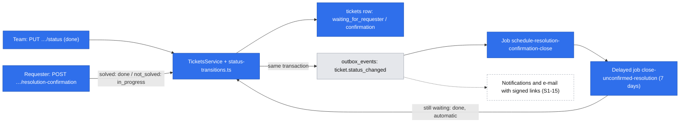
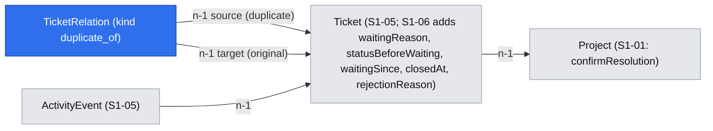

# Ticket statuses – transitions, reopen, duplicates and resolution confirmation

| | |
|---|---|
| Status | `draft` |
| Created | 2026-10-26 |
| Plan task | `S1-06` |
| System specification sections | §3.1, §3.2, §3.5, §4.1, §4.2, §4.3, §4.4, §4.5, §7.3, §7.5, §9.2, §13.2, §17.2, §18.3, glossary |
| Related issues / PRs | Sibling specifications: S1-01 projects ([#111](https://github.com/trybun/trybun/pull/111)), S1-04 permission layer ([#114](https://github.com/trybun/trybun/pull/114)), S1-05 ticket model (written in parallel) |

## Context

Every ticket has an internal status from a global set of nine ([§4.1](../../docs/spec/04-ticket-lifecycle.md)). End users see one of five public statuses, mapped from the internal one ([§4.2](../../docs/spec/04-ticket-lifecycle.md)). The team may move a ticket between any statuses. A few transitions carry rules: `rejected` needs a reason, `duplicate` needs an original in the same project, `waiting_for_requester` has a waiting reason, and leaving a terminal status is a reopen ([§4.3](../../docs/spec/04-ticket-lifecycle.md)). When a project uses resolution confirmation ([§3.1](../../docs/spec/03-ticket-model.md)), a ticket from an end user that the team marks as done first asks the requester "Is your problem solved?". It closes by itself after 7 days without an answer.

None of this exists yet. S1-05 (same group 3) creates the `tickets` table with the `status` column, the initial status at creation and the activity events. S1-06 builds everything that happens to the status after creation.

The plan's "Done when" for S1-06:

- "Yes, solved" moves to `done`, "No, still a problem" to `in_progress`, and no action in 7 days moves to `done` with an automatic event.
- `rejected` without a reason is rejected.

Out of scope according to the plan (→ S1-12): status changes caused by requester comments, and publishing the reason of a rejection as a public comment.

The specification leaves several questions open, and S1-06 depends on records that later tasks introduce (comments, watchers, affected users, e-mails). The specification does not decide these points, so agents may not decide them either (Rule 8). Each one is listed under [Open questions](#open-questions) with a proposed answer for a human to accept, change or reject. The design below already assumes the proposed answers.

## Goals

- The team changes the status of a ticket through one API action. `rejected` requires a reason and `duplicate` requires an original. `waiting_for_requester` always has a waiting reason.
- Every response that carries a ticket shows its public status, mapped by one function in `@trybun/contracts` that the API and the web application share ([§14.4](../../docs/spec/14-architecture.md), "One language and shared contracts").
- Leaving a terminal status is recorded as a reopen. Reopening a duplicate removes its `duplicate_of` relation.
- `duplicate_of` always points to an original in the same project that is not itself a duplicate (no chains).
- With resolution confirmation on, the requester answers "Yes, solved" or "No, still a problem". Without an answer, the ticket moves to `done` 7 days after the request, as an automatic event.
- Every status change is an activity event, with the public ones marked as public ([§4.5](../../docs/spec/04-ticket-lifecycle.md)).
- The first business rule in `domain/` (`status-transitions.ts`, the example named in [§18.3](../../docs/spec/18-code-patterns.md)) and the first business timer on the timer pattern of S0-04.

## Non-goals

- Status changes caused by requester comments: the return from `waiting_for_requester` with reason `information`, a comment counting as "No, still a problem", and reopening a `done` ticket by a comment within 14 days (S1-12, as the plan states). S1-06 stores what S1-12 needs: the status before waiting, and `closedAt`.
- Publishing the reason of a rejection as a public comment (S1-12). Until then the reason is stored on the ticket ([Q2](#open-questions)).
- UI: the status control and the reason and original dialogs of the team ticket view (S1-10), the confirmation buttons of the portal (S1-09), the Kanban columns and the toast after a redirect to confirmation (S1-14), and bulk changes (S1-13). Each of these calls the API of this task ([Q14](#open-questions)).
- The e-mail asking for confirmation, with its signed one-click links and the confirmation page they open ([Q11](#open-questions)).
- Duplicate effects on records that do not exist yet: watchers of the duplicate become watchers of the original (S1-15), and the requester becomes an affected user of the original (S2-02) ([Q10](#open-questions)).
- Notifications about status changes (S1-15), SLA effects of pauses and reopens (S4), automatic transitions from GitHub (Stage 3), integration regressions and occurrences on duplicates (S6).
- Relations `blocks` and `relates_to` (S2-08). S1-06 creates `ticket_relations` with the kind `duplicate_of` only.
- User documentation. S1-06 has no view. The reference page for statuses comes with S1-18 ([Q14](#open-questions)).

## Proposed change

### Behaviour

**Changing the status** (team, action `change_status`). One request names the target status, plus a reason for `rejected` or an original for `duplicate`. The rules are pure functions in `modules/tickets/domain/status-transitions.ts`. They take the ticket, the request, the project's `confirmResolution` and `now`, and return the new status fields, the relation change and the events.

| Situation | Result |
|---|---|
| Target = current status | No change, `200` with the unchanged ticket. Exceptions: `rejected` with a different reason replaces the reason, with a `rejection_reason_changed` event without the text; `duplicate` with a different original re-points the relation, with an event ([Q16](#open-questions)) |
| Target `rejected` | Requires `rejectionReason` (GFM, trimmed, 1–2000 characters). It is stored on the ticket until S1-12 ([Q2](#open-questions)) |
| Target `duplicate` | Requires `duplicateOfTicketId`. The original must be visible to the actor (otherwise `404`) and in the same project (otherwise `422 ticket.duplicate_other_project`). If the original is itself a duplicate, the link goes to its original. A link that resolves to the ticket itself returns `422 ticket.duplicate_of_self`. The original may be in any status other than `duplicate`, terminal ones included ([Q9](#open-questions)). Tickets that were duplicates of this ticket are re-pointed to the new original in the same transaction, each with an automatic `duplicate_original_changed` event ([Q8](#open-questions)). The transaction locks the ticket, the original and the tickets that point to the ticket (`SELECT … FOR UPDATE`, in ID order), so two concurrent requests cannot create a chain or a cycle (A → B and B → A) |
| Target `waiting_for_requester`, set by the team | Waiting reason `information` ([Q4](#open-questions)). On a ticket already waiting for confirmation, the reason switches to `information` and `waitingSince` restarts; the close timer then finds nothing to do |
| Target `waiting_for_requester` from a terminal status | A reopen; `statusBeforeWaiting` is `triage`, so a later return after the requester's reply (S1-12) never goes back to a terminal status ([Q20](#open-questions)) |
| Target `done`, resolution confirmation on, source `user`, current status non-terminal and not already waiting for confirmation | The ticket goes to `waiting_for_requester` with reason `confirmation` instead. The response carries the actual status, so the client can explain the redirect |
| Target `done` while waiting for confirmation | `done` directly. The team overrides the wait ([Q5](#open-questions)) |
| From a terminal to a non-terminal status | A **reopen**: `closedAt` is cleared, the event carries `reopen: true` ([Q6](#open-questions)). An assignee who is no longer an active team member of the project is removed in the same transaction, with S1-05's automatic `assignee_changed` event ([Q22](#open-questions)) |
| Leaving `duplicate` (to any status) | The `duplicate_of` relation is deleted, with a `duplicate_link_removed` event |
| Leaving `rejected` | `rejectionReason` is cleared |
| Into a terminal status (also from another terminal status) | `closedAt = now` ([Q12](#open-questions)) |

**Waiting fields.** Entering `waiting_for_requester` sets `waitingReason`, `statusBeforeWaiting` (the status before the ticket started waiting) and `waitingSince = now`. Switching the reason while waiting (either way) replaces the reason and `waitingSince`, and keeps `statusBeforeWaiting`. Leaving `waiting_for_requester` clears all three fields.

**Resolution confirmation** (requester, action `confirm_resolution`). The requester answers `solved` ("Yes, solved", PL „Tak, rozwiązane”), which moves the ticket to `done`, or `not_solved` ("No, still a problem", PL „Nie, problem nadal występuje”), which moves it to `in_progress`. Only the requester of a ticket waiting for confirmation may answer. The action is tied to the end-user account kind and is not inherited by team roles (S1-04 [#114](https://github.com/trybun/trybun/pull/114), its Q3). An answer is a state-conditional update (`WHERE status = 'waiting_for_requester' AND waiting_reason = 'confirmation'`). The first answer wins, whether it comes from the requester, the team or the timer. A later answer gets `409 ticket.resolution_confirmation_not_pending`: from the state rule of the ability when the ticket is already loaded as not pending, and from the conditional update when the race is lost inside the transaction.

**Automatic close.** Every status change writes the outbox event `ticket.status_changed` in its transaction ([Q15](#open-questions)). Its consumer, the job `schedule-resolution-confirmation-close` of the `tickets` module, runs only when the new waiting reason is `confirmation`. It adds the delayed job `close-unconfirmed-resolution`, with the payload `{ ticketId }` and deduplication key `resolution-confirmation-<ticketId>` (debounce, `replace`, `extend`, [§17.2](../../docs/spec/17-conventions.md)). The job runs 7 × 24 hours after `waitingSince` ([Q7](#open-questions)). When it runs, it re-reads the ticket as the system principal:

- not waiting for confirmation any more, or `waitingSince + 7 days` still in the future: nothing happens (timers are never cancelled);
- project archived: nothing changes, and the job moves itself back to the delayed state for 24 hours (BullMQ `job.moveToDelayed` followed by `DelayedError`, so no second job and no deduplication key are involved), so the ticket closes on the first run after unarchiving ([Q19](#open-questions));
- otherwise: a state-conditional update to `done`, `closedAt = now`, `version + 1` without `If-Match` ([§17.2](../../docs/spec/17-conventions.md)), and a `status_changed` event with `automatic_source` `system`.

No periodic sweep is needed: the outbox guarantees the consumer runs at least once after the commit, the consumer fails and is retried when adding the delayed job fails, and failed jobs stay visible to the Administrator ([§17.2](../../docs/spec/17-conventions.md)).

All three paths (the team, the requester and the timer) go through the same service and the same domain rule. Only the outbox event connects the change to the timer, and later to notifications.

### Data model

S1-05 creates `Ticket` (`tickets`) with `status` (enum `ticket_status`, the nine codes of §4.1), `source`, `requesterId`, `projectId`, `version` and the activity events (`modules/activity-events/`). S1-06 adds:

- On `Ticket`:
  - `waitingReason` (`waiting_reason`, enum `ticket_waiting_reason`: `information`, `confirmation`), nullable;
  - `statusBeforeWaiting` (`status_before_waiting`, `ticket_status`), nullable;
  - `waitingSince` (`waiting_since`, timestamptz), nullable;
  - `closedAt` (`closed_at`, timestamptz), nullable: the time of the latest transition into a terminal status ([Q12](#open-questions));
  - `rejectionReason` (`rejection_reason`, text), nullable, until S1-12 ([Q2](#open-questions)).
  - Check constraints: the three waiting fields are all set exactly when `status = 'waiting_for_requester'`. `closed_at` is set exactly when the status is terminal. `rejection_reason` is set exactly when `status = 'rejected'`.
- `TicketRelation` (`ticket_relations`): `id` UUIDv7; `kind` (enum `ticket_relation_kind`, only `duplicate_of`; S2-08 adds the other values); `sourceTicketId` (the duplicate), `targetTicketId` (the original), both foreign keys to `tickets`; `createdAt`. A partial unique index allows one `duplicate_of` per source ticket. Same project and "the target is not a duplicate" are rules of the service, covered by integration tests. A relation is a child record and does not change the ticket's `version` ([§17.2](../../docs/spec/17-conventions.md)): re-pointing a duplicate changes `duplicateOf` in its response without a new ETag, like other child records.

**Personal data.** `rejectionReason` is free text written by the team and may contain personal data. Until S1-12 replaces it, it falls under redaction, export and anonymization of S1-16 like a description ([Q2](#open-questions)). No other new field holds personal data. Outbox payloads and job data carry only identifiers and codes.

### Contracts and API

`@trybun/contracts/tickets` (the feature folder created by S1-05) gains:

- `ticketStatusSchema` (if S1-05 has not created it yet), `publicStatusSchema` (`received`, `awaiting_reply`, `in_progress`, `resolved`, `closed`), `waitingReasonSchema`, `resolutionAnswerSchema` (`solved`, `not_solved`);
- `TERMINAL_STATUSES`, `isTerminalStatus(status)` and `publicStatusOf(status)` – the mapping of §4.2, with a unit test over all nine codes;
- action codes `change_status` and `confirm_resolution`;
- error codes `ticket.duplicate_of_self` (422), `ticket.duplicate_other_project` (422) and `ticket.resolution_confirmation_not_pending` (409).

| Endpoint | Action | Notes |
|---|---|---|
| `PUT /api/v1/tickets/{ticketId}/status` | `change_status` | Body `changeTicketStatusSchema`: a discriminated union on `status`. `rejected` requires `rejectionReason`; `duplicate` requires `duplicateOfTicketId`; for other statuses, both fields are unrecognized. Requires `If-Match` with the ticket's version (`428`/`412`, [§17.2](../../docs/spec/17-conventions.md)). Returns the ticket with its new `ETag`. Missing reason → `422 request.validation_failed` with pointer `/rejectionReason` ([Q3](#open-questions)) |
| `POST /api/v1/tickets/{ticketId}/resolution-confirmation` | `confirm_resolution` | Body `{ answer: "solved" \| "not_solved" }`. No `If-Match`: the state condition protects the answer. Returns the ticket |

Order of checks ([§18.3](../../docs/spec/18-code-patterns.md)): an invisible ticket → `404`; an archived project → `409 project.archived` (S1-01's restriction, extended to tickets as S1-04 Q10 proposes); the requester of a ticket that is not waiting for confirmation → `409 ticket.resolution_confirmation_not_pending` (a `cannot` rule with a reason is returned with its code's status instead of `403`, [§18.3](../../docs/spec/18-code-patterns.md) "Authorization"); any other visible ticket without the action → `403`; an invisible original → `404`; validation → `422`; preconditions → `428`/`412`; business rules → `422`.

**Responses** (the ticket schemas belong to S1-05, the end-user shape to S1-09). S1-06 adds:

- team: `status`, `publicStatus`, `waitingReason`, `closedAt`, `rejectionReason`, `duplicateOf` (`{ id, number, projectKey }` or `null`);
- end user: `publicStatus`, `waitingReason` (it selects the public description of §4.2), `duplicateOf` only when the end user may read the original ([§3.5](../../docs/spec/03-ticket-model.md)), otherwise `null`. Never `status`, never `rejectionReason`. The reason reaches the requester as a comment from S1-12;
- `allowedActions` gains `change_status` and `confirm_resolution`.

### Permissions

Rules in `tickets.abilities.ts`, following S1-04 ([#114](https://github.com/trybun/trybun/pull/114)), each tested with an allowed and a denied case:

| §7.5 row | Rule |
|---|---|
| Change status | `change_status` on `Ticket` for Developer, Project manager and Administrator of the ticket's project; never for end users or integration principals |
| Confirm or decline resolution of own ticket | `confirm_resolution` on `Ticket` for an end-user account with `requesterId = principal.id`. A `cannot` rule for tickets that are not waiting for confirmation carries the reason `ticket.resolution_confirmation_not_pending`, so `allowedActions` lists the action only while it is possible |

Both are project-owned changes, so the archived restriction of S1-04 Q10 applies. A personal access token needs the scope `tickets:write` ([§12.2](../../docs/spec/12-api-webhooks-import.md)).

### Activity events and outbox

Through S1-05's function for activity events:

| Event type | Data | Public |
|---|---|---|
| `status_changed` | `{ from, to }` status codes, `reopen`, `waitingReason`, `duplicateOf` (`{ id, number, projectKey }` when the target is `duplicate`) | When the public status changes ([§4.5](../../docs/spec/04-ticket-lifecycle.md)); a change of the waiting reason alone stays internal, while the portal shows the new public description from the ticket itself ([Q21](#open-questions)) |
| `duplicate_original_changed` | `{ from, to }` snapshots of the originals; automatic | No |
| `duplicate_link_removed` | `{ from }` snapshot of the original | No |
| `rejection_reason_changed` | none (the text stays out of events) | No |

Status values are stored as codes and shown with the catalogue labels in the viewer's language ([Q13](#open-questions)). `rejectionReason` never goes into an event or an outbox payload, so redacting it leaves no copy behind ([§4.5](../../docs/spec/04-ticket-lifecycle.md)).

Outbox event `ticket.status_changed` (schema in `modules/tickets/tickets.events.ts`): `{ ticketId, projectId, from, to, fromPublic, toPublic, waitingReason, reopen, actorId | null }`. It has one consumer in S1-06 (the timer scheduler). S1-15 adds notifications, and S6 adds webhooks with their own versioned schema.

### Texts

The `tickets` namespace of `@trybun/i18n` gains, in EN and PL, the labels of the nine internal statuses (§4.1), of the five public statuses, the public descriptions of §4.2 (including both waiting reasons), the two answers, and `errors.<code>` for the three new error codes. The web views of S1-09 and S1-10 and the e-mails of S1-15 use them.

### Prior art

- **Zendesk**: *Solved* turns into *Closed* automatically after a few days (4 in its default automation), and a requester reply on *Pending* reopens the ticket. This matches the 7-day close and the S1-12 return rule. Zendesk does not ask the requester; the explicit "Yes, solved" / "No, still a problem" answer is Trybun's own rule (§4.3).
- **GitHub issues**: a close has a reason (`completed`, `not_planned`, `duplicate`), and closing as a duplicate links the original. This is the same pairing of a terminal status with its reason or original as in `PUT …/status`.
- **Linear**: marking an issue as a duplicate closes it and links it to the canonical issue. Trybun moves the watchers to the original as well, in S1-15 ([Q10](#open-questions)).
- None of them enforces a state machine for the team, which supports "convention, not a hard state machine" (§4.3).

## Changes to the system specification

| Section | Change |
|---|---|
| §4.3 | A team move to `waiting_for_requester` sets reason `information`; `confirmation` is set only by the redirect from `done` (Q4); after a reopen into waiting, the status before waiting is `triage` (Q20) |
| §4.3 | Moving a ticket that waits for confirmation to `done` closes it directly (Q5) |
| §4.3 | A reopen is a move from a terminal to a non-terminal status; terminal → terminal is not a reopen (Q6); a reopen removes an assignee who is no longer eligible (Q22) |
| §4.3 | "7 calendar days" means 7 × 24 hours after the request; in an archived project the automatic close waits until the project is unarchived (Q7, Q19) |
| §4.3 | When a ticket becomes a duplicate, its own duplicates are re-pointed to the new original (Q8); the original may be in any status other than `duplicate` (Q9) |
| §4.3 | The duplicate effects on watchers and affected users are implemented by the tasks that introduce those records (Q10) |
| §4.5 | Status values in events are codes; labels come from the catalogues (Q13) |
| Glossary | New terms below |
| Plan | S1-12: publish the stored rejection reason as a public comment and remove `rejection_reason` (Q2). S1-15: watcher transfer for duplicates, the confirmation e-mail with signed links (Q10, Q11). S1-09: the confirmation page that signed links open (Q11). S2-02: the affected user for duplicates (Q10). The maintainer changes the plan |

New or changed glossary terms (code identifier, EN/PL labels):

- `ticket.status_before_waiting` – Status before waiting / Status przed oczekiwaniem.
- `ticket.waiting_since` – Waiting since / Oczekuje od.
- `ticket.closed_at` – Closed at / Data zamknięcia: the time of the latest transition into a terminal status.
- `ticket.rejection_reason` – Rejection reason / Powód odrzucenia (until S1-12, Q2).
- Resolution answer `solved`, `not_solved` – Yes, solved / Tak, rozwiązane; No, still a problem / Nie, problem nadal występuje.
- `ticket_relation` already exists. S1-06 uses only `duplicate_of`.

## Open questions

Implementation must not start until every question has an answer. Each answer below is a **proposal awaiting human approval**, chosen as the smallest and most reversible option. The answer marked ⚠ adds a column with personal data that a later task must remove, and needs explicit confirmation.

1. **Boundary with S1-05.** Both tasks are in group 3 and touch `tickets`. — **Answer (proposed, awaiting approval):** S1-05 creates `tickets.status` with the full enum and the initial status at creation (§4.3), the activity event model and the ticket `PATCH` without `status`. S1-06 owns everything after creation, as listed in this document. The S1-05 specification proposes the same split. S1-06 implementation starts after S1-05 is merged.
2. ⚠ **Where the rejection reason lives before S1-12.** §4.3 publishes it as a public comment, but comments arrive with S1-12 (group 6). An activity event cannot hold it, because events are immutable and the text could not be redacted (§4.5). — **Answer (proposed, awaiting approval):** a nullable `tickets.rejection_reason` (GFM, trimmed, 1–2000 characters), shown to the team only and cleared on leaving `rejected`. S1-12 then publishes the reason as a public comment on every rejection, migrates the stored reasons of rejected tickets into comments, and drops the column. While the column exists, S1-16 includes it in redaction, export and anonymization. Alternatives: (a) S1-06 validates the reason but does not store it (the text is lost); (b) the plan moves the reason rule to S1-12 and changes S1-06's "Done when".
3. **API shape.** — **Answer (proposed, awaiting approval):** a separate `PUT /api/v1/tickets/{ticketId}/status` with the ticket's `If-Match`, because the conditional fields and the redirect do not fit S1-05's `PATCH`, and `change_status` is a different action than `update`. Jira's transitions endpoint and GitHub's `state_reason` pair a status with its reason in the same way. A missing reason uses the existing validation codes (`field.invalid_type` or `string.too_short` at `/rejectionReason`), so no new field error code is needed. Alternative: `status` as a field of `PATCH`, with a field-level `change_status` check like S1-01's `update_settings`.
4. **Waiting reason of a manual move.** §4.3 defines the two reasons but not who chooses them. — **Answer (proposed, awaiting approval):** a team move always sets `information` (the triage action "ask for information", §8.3). `confirmation` comes only from the redirect, because it starts the 7-day close.
5. **Moving a ticket that waits for confirmation to `done`.** Taken literally, §4.3 would redirect it to confirmation again, and the team could never close it. — **Answer (proposed, awaiting approval):** it goes to `done` directly. The team overrides the wait, for example when the requester confirmed by phone. Alternative: restart the confirmation and the 7 days.
6. **Terminal → terminal.** §4.3 says that moving "from a terminal status to any other status" is a reopen. — **Answer (proposed, awaiting approval):** only terminal → non-terminal is a reopen, because a reopen means the ticket is open again (SLA, §9.4). Terminal → terminal (e.g. `done` → `duplicate`) sets `closedAt` anew and applies the rules of the new status (the reason, the original).
7. **"7 calendar days".** — **Answer (proposed, awaiting approval):** 7 × 24 hours after `waitingSince`, independent of time zones and business calendars.
8. **Existing duplicates of a ticket that becomes a duplicate.** §3.5 forbids chains but only states the rule for the new link. — **Answer (proposed, awaiting approval):** in the same transaction, re-point every `duplicate_of` that targets the ticket to its new original, with an automatic internal `duplicate_original_changed` event in each re-pointed ticket.
9. **Which tickets may be originals.** — **Answer (proposed, awaiting approval):** any visible ticket of the same project that is not the ticket itself. A duplicate original is flattened to its original. Terminal originals (`done`, `rejected`) are allowed, as in GitHub.
10. **Duplicate effects before watchers and affected users exist.** §4.3 makes the requester and the watchers of the duplicate watchers of the original, and the requester an affected user. Watchers come with S1-15, affected users with S2-02. — **Answer (proposed, awaiting approval):** each of these tasks adds its effect to S1-06's duplicate use case, as the plan already does for permissions and anonymization ("Cross-cutting parts grow with the features"). Tickets marked as duplicates before then are not migrated. The maintainer adds both effects to the rows of S1-15 and S2-02. Alternative: S1-15 also backfills watchers for existing duplicates.
11. **Signed one-click links.** §4.3 sends the two answers as signed links in the e-mail, and they open a confirmation page with a `POST`. No task names them: S1-15 sends e-mails, and S1-09 has "resolution-confirmation actions" in the portal. — **Answer (proposed, awaiting approval):** S1-06 offers the action to the signed-in requester only. S1-15 adds the confirmation e-mail with signed links, and S1-09 adds the page they open. The link token and the token-authorized `POST` are designed in S1-15's specification and call the same service method. The maintainer adds this to both rows.
12. **`closedAt`.** The 14-day comment rule (S1-12), the Kanban `done` column of the last 14 days (S1-14) and retention anonymization (S1-16) all need the time a ticket became terminal. The specification has no field for it. — **Answer (proposed, awaiting approval):** `tickets.closed_at`, set on every transition into a terminal status and cleared on reopen. It is maintained by S1-06, because only the status change sets it.
13. **Status snapshots in events.** §4.5 stores values that refer to other records as identifier plus display name, and lists the status among them. Statuses are a fixed global list, never renamed, and their labels depend on the viewer's language. — **Answer (proposed, awaiting approval):** status events store codes only, and labels come from the catalogues. §4.5 is updated to say so. Originals in duplicate events are stored as snapshots (`id`, `number`, `projectKey`).
14. **UI in S1-06.** Group 3 runs before the views (S1-09, S1-10, S1-13, S1-14, group 5 and later). — **Answer (proposed, awaiting approval):** S1-06 delivers API, domain rules, the timer, contracts and catalogue texts, without a view, product tour or user documentation. The views add their status controls and help pages. The reference page for statuses comes with S1-18, as the plan states. The "Done when" is verified by integration tests.
15. **Outbox event.** S1-01 writes no outbox event without a consumer. — **Answer (proposed, awaiting approval):** S1-06 writes `ticket.status_changed` for every status change, because the timer has to start after the commit ([§18.3](../../docs/spec/18-code-patterns.md), "After the commit, only through the outbox"). The timer scheduler is its first consumer, and later consumers reuse the same event.
16. **A request for the current status.** — **Answer (proposed, awaiting approval):** `200` with no change and no event (an idempotent `PUT`). A new reason on `rejected` replaces the stored reason with a `rejection_reason_changed` event that carries no text (§4.5 records every field change; the text stays redactable). A new original on `duplicate` re-points the relation with a `duplicate_original_changed` event.
17. **One specification or two.** Resolution confirmation could be split from the status transitions. — **Answer (proposed, awaiting approval):** keep one, as the plan defines. Confirmation is a variant of the `done` transition and cannot ship without it.
18. **Who may see `rejectionReason` in the API.** — **Answer (proposed, awaiting approval):** team members only. Until S1-12, the requester sees `closed` with the generic description of §4.2, without the reason.
19. **Automatic close in an archived project.** §7.3 stops all jobs except those required by law. — **Answer (proposed, awaiting approval):** the close job changes nothing while the project is archived and checks again every 24 hours. It closes the ticket on the first run after unarchiving when the 7 days have passed, so unarchiving needs no hook. Alternative: unarchiving restarts the 7 days, which needs a hook in S1-01's unarchive use case.
20. **Status before waiting after a reopen.** A team move from a terminal status to `waiting_for_requester` would store a terminal status as the status before waiting, and the return rule of S1-12 would close the ticket again on the requester's reply. — **Answer (proposed, awaiting approval):** store `triage`, the status a requester comment reopens a `done` ticket to (§4.3). Alternative: forbid entering `waiting_for_requester` from a terminal status.
21. **Public events for a change of the waiting reason.** `information` → `confirmation` keeps the public status `awaiting_reply` but changes its public description (§4.2). — **Answer (proposed, awaiting approval):** follow §4.5 literally: a status event is public only when the public status changes. The portal still shows the current description, which it derives from the ticket's `waitingReason`.
22. **Assignee of a reopened ticket.** S1-05 unassigns only open tickets when a member is deactivated or removed from the project (§7.4), so a terminal ticket can keep an assignee who is no longer eligible (§3.2). — **Answer (proposed, awaiting approval):** a reopen removes such an assignee in the same transaction, with the same automatic `assignee_changed` event S1-05 records for the unassignment. The ticket then appears in "Unassigned". The S1-05 specification leaves this decision to S1-06.

## Implementation plan

Each step leaves the application working and has its tests.

**Phase 1 – Rules and model**

1. Contracts: the status, public-status, waiting-reason and answer enums, `publicStatusOf`, `isTerminalStatus`, action and error codes, `changeTicketStatusSchema`, `confirmResolutionSchema`. Unit tests for the mapping over all codes, and enum equality with Prisma.
2. Migration: the new `tickets` columns with check constraints, `ticket_relations` with the partial unique index. Factories for waiting, rejected and duplicate tickets.
3. `domain/status-transitions.ts`: pure functions for every row of the [behaviour table](#behaviour), the waiting fields and the reopen detection, with a fixed `now`. A table-driven unit test per row.

**Phase 2 – Team status changes**

4. `tickets.abilities.ts` rule `change_status`, `allowedActions` and the response fields. Ability table test with an allowed and a denied case per row, and the `allowedActions` per principal.
5. `PUT /api/v1/tickets/{ticketId}/status` with `If-Match`, activity events and the outbox event. Integration tests: a Developer of project A gets `404` for project B; an end user who can see the ticket gets `403`, one who cannot gets `404`; archived project → `409`; `rejected` without a reason → `422` at `/rejectionReason`; duplicate of an invisible ticket → `404`; of another project → `422`; of itself → `422`; flattening and re-pointing; two concurrent opposite duplicate requests (A → B, B → A) leave no cycle; reopening a duplicate removes the relation; `closedAt` set and cleared; each check constraint rejects a direct invalid insert; stale version → `412`; no activity event or outbox payload contains the rejection reason text.
6. Resolution-confirmation redirect: `done` on a `user` ticket in a project with confirmation on lands in `waiting_for_requester`/`confirmation`; off, or a `developer` ticket, lands in `done`; `done` while waiting for confirmation closes directly.

**Phase 3 – Requester answer and timer**

7. Rule `confirm_resolution` with its state reason. `POST …/resolution-confirmation`. Integration tests: "Yes, solved" → `done`; "No, still a problem" → `in_progress`; another end user who can see the ticket → `403`, one who cannot → `404`; a team member → `403`; not waiting → `409`; two answers started together on two connections (a barrier before the update) → one `200`, one `409`.
8. Worker: `schedule-resolution-confirmation-close` consumer and `close-unconfirmed-resolution` timer in `tickets-worker.module.ts`. Integration tests call the handler with an injected fixed clock, and one test checks the delay and deduplication key of the added job: no action in 7 days → `done` with an automatic public event and a new version; an answer before the timer → the timer does nothing; re-entering confirmation restarts the 7 days; an archived project → no change and the job delayed by 24 hours.
9. Catalogue texts EN/PL. `pnpm api:generate`. Demo dataset: one ticket waiting for confirmation and one duplicate.
10. Update §4.3, §4.5 and the glossary as approved; move this file to `implemented/`.

## Acceptance criteria

- [ ] "Yes, solved" moves the ticket to `done`, "No, still a problem" to `in_progress`; without an answer, it moves to `done` 7 days after the request with an automatic, public `status_changed` event
- [ ] `PUT …/status` to `rejected` without a reason returns `422 request.validation_failed` with pointer `/rejectionReason`, and nothing changes
- [ ] Marking a ticket a duplicate of a duplicate links it to the original; its own duplicates are re-pointed; an original in another project returns `422 ticket.duplicate_other_project`, an invisible one `404`
- [ ] Reopening a `duplicate` removes the relation and records `duplicate_link_removed`; reopening any terminal ticket records `reopen: true`, clears `closedAt` and removes an assignee who is no longer an active team member of the project
- [ ] Every ticket response carries the public status of §4.2; end-user responses never carry `status` or `rejectionReason`
- [ ] With resolution confirmation on, `done` on a ticket with source `user` lands in `waiting_for_requester` with reason `confirmation`; with it off, or for source `developer`, in `done`
- [ ] Only the requester can answer, only while the ticket waits for confirmation; `allowedActions` lists `confirm_resolution` exactly then
- [ ] A Developer of project A gets `404` for a status change of a ticket in project B; an archived project returns `409 project.archived`
- [ ] Every status change writes its activity event and `ticket.status_changed` in the same transaction; no event or payload contains the rejection reason
- [ ] Works on phone, tablet and desktop (Rule 9): not applicable, S1-06 has no view (Q14)
- [ ] User documentation and product tour: none, S1-06 has no view; the reference page for statuses comes with S1-18 (Rules 3, 4)

## Changelog

- 2026-10-26 – Created.
