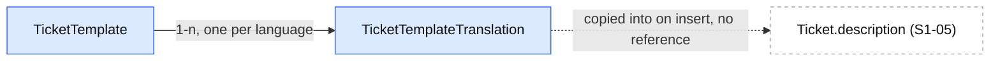

# Ticket templates management

| | |
|---|---|
| Status | `draft` |
| Created | 2026-10-26 |
| Plan task | `S1-17` |
| System specification sections | §3.3, §3.4, §7.2, §7.5, §13.1, §13.5, §17.2, §18.3–§18.5, glossary |
| Related issues / PRs | Sibling specifications: [#114](https://github.com/trybun/trybun/pull/114) (S1-04 permission layer), [#113](https://github.com/trybun/trybun/pull/113) (S1-03 accounts and language), [#115](https://github.com/trybun/trybun/pull/115) (S1-05 ticket model), [#117](https://github.com/trybun/trybun/pull/117) (S1-07 GFM editor), [#118](https://github.com/trybun/trybun/pull/118) (S1-09 portal, its Q9), [#120](https://github.com/trybun/trybun/pull/120) (S1-10 full form, its Q1), [#112](https://github.com/trybun/trybun/pull/112) (S1-02, audit `details`) |

## Context

[§3.4](../../docs/spec/03-ticket-model.md) defines ticket templates: one universal **end-user template** shown as placeholder text in the description field, and one **team template per ticket type** that the full form inserts into the description together with default field values. Templates are global for the whole system, have language versions ([§13.1](../../docs/spec/13-non-functional.md)), and are managed by the Administrator ([§7.2](../../docs/spec/07-users-organizations-permissions.md), row "Ticket templates" of [§7.5](../../docs/spec/07-users-organizations-permissions.md)). Changing a template affects new tickets only.

The two forms come before this task. S1-10 ([#120](https://github.com/trybun/trybun/pull/120), its Q1) proposes that until S1-17 the four team templates are catalogue texts (`tickets.templates.<type>`, EN and PL) and the default priorities a contract constant `TICKET_TYPE_DEFAULT_PRIORITY`; S1-09 ([#118](https://github.com/trybun/trybun/pull/118), its Q9) proposes that the end-user placeholder comes from the `portal` catalogue. Both say that S1-17 moves the texts into the managed model and replaces the source. Today nothing stores templates and the Administrator cannot change them.

The plan's scope for S1-17: "Ticket templates management for the Administrator (EN/PL versions)". "Done when":

- a changed template affects only new tickets;
- the template appears in the creator's language.

This specification assumes the sibling proposals as proposed there and does not re-decide their questions – in particular S1-10's replacement rule (its Q3) and its choice of the creator's language (its Q4). Where the system specification leaves a gap for S1-17, the gap is listed under [Open questions](#open-questions) with a proposed answer (Rule 8); the design below assumes those answers.

## Goals

- The Administrator edits the end-user template and the four team templates, each in every supported language (EN, PL), and the default priority of each team template, in the Administrator panel, on a phone as well as on a desktop.
- The full form of S1-10 and the portal form of S1-09 read the templates from the API instead of the catalogues; users see the same texts as before until the Administrator changes them.
- A changed template affects only tickets created afterwards: a template is copied into the description when it is inserted, and no ticket refers to a template.
- The template and the placeholder appear in the language of the person creating the ticket.
- Every change is recorded in the administrative audit log ([§13.5](../../docs/spec/13-non-functional.md)).

## Non-goals

- Creating, deleting or disabling templates, several templates per type, per-project templates, or templates that add form fields (GitHub issue forms' `body` inputs). [§3.4](../../docs/spec/03-ticket-model.md) keeps exactly one end-user template and one per ticket type ([Q2](#open-questions)).
- A history of earlier template texts or a "restore the shipped text" action ([Q11](#open-questions)).
- Applying templates to existing tickets, the replacement rule of the form and the type change in the ticket view – S1-10 ([#120](https://github.com/trybun/trybun/pull/120), its Q2 and Q3).
- Adding a third language. S1-17 only defines what a template shows for a language that has no version yet ([Q12](#open-questions)).
- A product tour: [§2.4](../../docs/spec/02-agent-rules.md) lists none for template management.

## Proposed change

### Model

One record per template – a fixed set of five, created by the migration ([Q2](#open-questions)) – and one record per template and language ([Q1](#open-questions)):

Tickets never reference a template: the form copies the text into the description, so a later change cannot reach an existing ticket.

| Model / table | Field | Notes |
|---|---|---|
| `TicketTemplate` / `ticket_templates` | `id` | UUIDv7 |
| | `audience` | enum `ticket_template_audience`: `end_user`, `team` |
| | `ticketType` | enum `ticket_type` of S1-05; `null` for `end_user`, required for `team`; a check constraint enforces the pair, a unique index allows one template per audience and type (`NULLS NOT DISTINCT`) |
| | `defaultPriority` | enum `ticket_priority` of S1-05; `null` for `end_user`, required for `team` ([Q3](#open-questions)) |
| | `version` | optimistic locking ([§17.2](../../docs/spec/17-conventions.md) lists ticket templates among the versioned records) |
| | `updatedById`, `updatedAt` | the last editor (none for the seeded rows) and time; shown on the list |
| `TicketTemplateTranslation` / `ticket_template_translations` | `templateId`, `language`, `body` | primary key (`templateId`, `language`); `language` holds a code of `languageSchema` (as `users.language`); `body` is text |

`version` covers the template and all its translations: one save changes both and increments it once.

**Content rules** ([Q4](#open-questions), [Q5](#open-questions)) – a pure function in `domain/template-content.ts`, unit-tested with a table:

| Audience | Format | Length of each language version |
|---|---|---|
| `end_user` | Plain text, shown as the placeholder of the description field; line breaks kept | 0–1,000 characters |
| `team` | GFM ([§6.2](../../docs/spec/06-comments-notifications.md)), inserted into the description | 0–65,536 characters, the description limit of S1-05, so an inserted template always fits |

Only the length is checked; the end-user template may contain any characters and is shown literally (Markdown in it is not rendered). An empty version means "no placeholder" or "nothing inserted" in that language. A save changes the languages it sends and keeps the others.

**Language** ([Q6](#open-questions), [Q12](#open-questions)): the API returns, for every template, a body for every code of `languageSchema`. A language without a stored version gets the version of the system default language (`TRYBUN_DEFAULT_LANGUAGE`), else the English one, and is listed in `fallbackLanguages` – one pure function `templateBodiesOf(translations, defaultLanguage)` in `domain/`. The web application picks the body of the creator's language with S1-10's rule (account language, else the request language, [#120](https://github.com/trybun/trybun/pull/120) Q4); the portal form uses the same rule.

### Moving the catalogue texts into the model

As S1-10 Q1 and S1-09 Q9 propose ([Q8](#open-questions)):

1. The migration `add_ticket_templates` creates the tables and inserts the five templates with their EN and PL versions, copied verbatim from the catalogue keys `tickets.templates.<type>` and the `portal` placeholder keys at the time of the migration, and the default priorities of `TICKET_TYPE_DEFAULT_PRIORITY` (`question` → `low`, the others `normal`). Users therefore see no change on update. Existing installations get the rows from the migration; the demo dataset needs nothing extra.
2. The full form and the portal form read `GET /api/v1/ticket-templates` instead of the catalogues.
3. The catalogue keys and the constant are removed in the same PR (the catalogue check of [§13.1](../../docs/spec/13-non-functional.md) then fails on any remaining use).

A later change of the shipped texts never overwrites an installation's templates: the texts live in the database from the first migration on.

### Permissions

`ticket-templates.abilities.ts` (rules of S1-04's ability factory, [#114](https://github.com/trybun/trybun/pull/114)) for the subject `TicketTemplate`, actions `read` and `update` (closed list `ticketTemplateActionSchema` of `@trybun/contracts/ticket-templates`):

| Principal | `read` | `update` |
|---|---|---|
| Administrator | all | all |
| Developer, Project manager (any team account) | all | – |
| End user | `audience = end_user` ([Q7](#open-questions)) | – |

A team template is invisible to an end user (`404`, [§17.2](../../docs/spec/17-conventions.md)). A team member without the Administrator role gets `403` on `PATCH`. Templates are global, so the archived state of projects does not apply. `ticket-templates.abilities.spec.ts` covers the row "Ticket templates" of [§7.5](../../docs/spec/07-users-organizations-permissions.md) with an allowed and a denied case, plus the read rules above.

### API

All endpoints under `/api/v1`, schemas in `@trybun/contracts/ticket-templates`, the request pipeline of [§18.3](../../docs/spec/18-code-patterns.md).

| Endpoint | Purpose | Notes |
|---|---|---|
| `GET /ticket-templates` | List | The templates the principal may read, in a fixed order (end-user template, then `bug`, `feature`, `task`, `question`); a list bounded by a closed set, so one envelope with `nextCursor: null` and no `cursor` ([§18.4](../../docs/spec/18-code-patterns.md)) |
| `GET /ticket-templates/{id}` | Detail | Same shape as an item, with the `ETag` of its `version` |
| `PATCH /ticket-templates/{id}` | Change | `If-Match`; `{ bodies?: { en?, pl? }, defaultPriority? }`; only the languages sent change, the others keep their stored version (or stay missing); `defaultPriority` only for a `team` template; increments `version` |

- **Response** (`ticketTemplateSchema`): `id`, `audience`, `ticketType | null`, `defaultPriority | null`, `bodies` (a record keyed by `languageSchema`), `fallbackLanguages` (languages without a stored version, [Q12](#open-questions)), `version`, `updatedAt`, `updatedBy { id, displayName } | null`, `allowedActions`.
- **Request** (`updateTicketTemplateSchema`): `bodies` as a partial record keyed by `languageSchema` with string values of at most 65,536 characters; the service then checks the length limit of the audience ([Q4](#open-questions)) and returns the validation field error of the length at `/bodies/<language>`.
- New error code in `@trybun/contracts/errors`: `ticket_template.default_priority_not_allowed` (422, field `/defaultPriority`) – a default priority sent for the end-user template.
- `PATCH` with unchanged values returns `200` with the template, does not increment `version` and writes no audit entry.
- No activity event (templates are not tickets), no outbox event and no live update: nothing consumes template changes; forms read the current templates when they open ([§18.1](../../docs/spec/18-code-patterns.md) "Simple first").

### Audit log

One action added to `AuditAction` ([§13.5](../../docs/spec/13-non-functional.md) lists "templates"): `ticket_template.updated`, with the template as target, written in the transaction of the change ([§18.3](../../docs/spec/18-code-patterns.md)). It records who changed which template and when, never the text: template bodies are free text ([§17.2](../../docs/spec/17-conventions.md)). If S1-02's audit `details` is approved ([#112](https://github.com/trybun/trybun/pull/112), its Q9), the entry adds `{ "languages": [...], "defaultPriorityChanged": true }` – codes only ([Q10](#open-questions)).

### Web application

Feature folder `features/ticket-templates/` (the name of the server module, [§18.5](../../docs/spec/18-code-patterns.md)): `queries.ts` (`ticketTemplatesQueryOptions`, key `['ticket-templates', 'list']`), `mutations.ts` (`useUpdateTicketTemplate`, with `If-Match` and the standard `412` message), `components/` (`ticket-template-list`, `ticket-template-form`, the editor through `lazy-markdown-editor.tsx`).

**Administrator panel** (`(team)/admin/ticket-templates`, entry **Ticket templates** / „Szablony zgłoszeń” in the panel's navigation), from 360 px with 44 px targets (Rule 9):

- **List** (`/admin/ticket-templates`): five rows – "End-user form (placeholder)", "Bug", "Feature", "Task", "Question" – with the first line of the body in the viewer's language, the default priority, and "Changed {relative time} by {name}"; cards on phones, a table from the tablet breakpoint. A row opens the edit page.
- **Edit** (`/admin/ticket-templates/{id}`): a language switch (segmented control **English** / **Polski**, the language of the viewer first) above one editor per language – the `MarkdownEditor` of S1-07 with write/preview for a team template, a plain multi-line `Textarea` for the end-user template with a preview of the empty description field showing the placeholder; for a team template a **Default priority** select. Below the editor: "Changes apply to new tickets only. Existing tickets keep their description." (PL „Zmiany dotyczą tylko nowych zgłoszeń. Istniejące zgłoszenia zachowują swój opis.”). A language listed in `fallbackLanguages` shows the fallback text with the note "Not translated yet – showing the {language} version" (PL „Jeszcze nieprzetłumaczone – wyświetlana jest wersja {language}”). **Save** sends the changed languages at once (React Hook Form with `updateTicketTemplateSchema`, [§18.5](../../docs/spec/18-code-patterns.md)); a field error switches to the language that has it. Leaving with unsaved changes asks to discard them. Without `update` in `allowedActions` the page is read-only (an Administrator always has it; the page is reachable only from the panel).

**Consumers** ([Q8](#open-questions), [Q9](#open-questions)):

- S1-10's full form takes the template and the default priority of the chosen type from `ticketTemplatesQueryOptions` instead of the catalogue and `TICKET_TYPE_DEFAULT_PRIORITY`; `ticket-form-templates.ts` keeps its rule and receives the templates as a parameter.
- S1-09's portal form takes the placeholder from the same query (an end user receives only the end-user template).
- Both forms prefetch the templates on the server with the page and use the templates loaded when the form opened: the query of an open form is not refetched (`staleTime: Infinity` in the form's `useQuery`, no refetch on focus). A template changed while someone fills the form therefore cannot turn the inserted text into an "edited" one under S1-10's replacement rule.

### User documentation and tours

- Administrator how-to "Edit ticket templates" (EN, PL) under `docs/user/*/administrator/how-to/`, `views: /admin/ticket-templates` and `/admin/ticket-templates/[id]`; it says that changes apply to new tickets only (Rule 3). `pnpm help:generate`.
- S1-18's help page for the ticket forms mentions that templates come from the Administrator. No tour (Rule 4, [§2.4](../../docs/spec/02-agent-rules.md) lists none).

### Prior art

- **GitHub issue templates and forms**: per repository, stored as files, copied into the issue body when it is opened – a later template change never touches existing issues. The copy semantics are adopted; per-repository templates and form inputs are not ([§3.4](../../docs/spec/03-ticket-model.md): global, no added fields).
- **Jira**: description defaults per issue type come from apps or field configuration schemes; heavier than [§3.4](../../docs/spec/03-ticket-model.md) needs.
- **Zendesk / Freshdesk**: ticket forms and macros per brand with dynamic content in several languages, the language version chosen by the requester's language with a fallback to the default language. The fallback rule of [Q12](#open-questions) follows it.

## Changes to the system specification

| Section | Change |
|---|---|
| §3.4 | The set is fixed: one end-user template and one template per ticket type, created by the system; the Administrator edits their texts per language and the default priority of the team templates (Q2, Q3). The end-user template is plain text up to 1,000 characters, a team template GFM up to the description limit; an empty version inserts nothing (Q4, Q5). A language without a version falls back to the system default language, then English (Q12). A form uses the templates loaded when it opened (Q9) |
| §7.5 | New row "Read ticket templates": End user – the end-user template only; Developer, Project manager, Administrator – all (Q7). The row "Ticket templates" becomes "Edit ticket templates" (Administrator) |
| §13.5 | The audit action `ticket_template.updated` without the text (Q10) |
| §18.2, §18.3 | Pattern "Content in several languages managed by the Administrator": a translations table keyed by record and language code, a body for every supported language in the response, the fallback function in `domain/` (Q1) |
| Glossary | `ticket_template.audience` – `end_user` "End users" / „Użytkownicy końcowi”, `team` "Team" / „Zespół”; `ticket_template.default_priority` – "Default priority" / „Domyślny priorytet” |
| Plan, S1-17 | No change; S1-10 Q1 and S1-09 Q9 already assign the migration of the catalogue texts to S1-17 |

## Open questions

Implementation must not start until every question has an answer. Each answer below is a **proposal awaiting human approval**, chosen as the smallest and most reversible option. Answers marked ⚠ introduce a pattern and need explicit confirmation.

1. ⚠ **How language versions are stored.** [§3.4](../../docs/spec/03-ticket-model.md) and [§13.1](../../docs/spec/13-non-functional.md) require language versions, and §18 has no pattern for translated content entered by people (later candidates: SLA policy names, e-mail texts the Administrator edits). — **Answer (proposed, awaiting approval):** a table `ticket_template_translations (template_id, language, body)` with the language code as part of the key, proposed as the pattern "content in several languages managed by the Administrator" (Rule 12). Alternatives: one column per language (`body_en`, `body_pl` – a schema change for every language, against "further languages without code changes" of §13.1); a JSONB map of language → text (no constraint per language, harder to check in SQL).
2. **Which templates exist.** — **Answer (proposed, awaiting approval):** exactly five, created by the migration – the end-user template and one per value of `ticket_type` – with no create, delete or disable action. A new ticket type (if one is ever added) adds its template in the same migration. An "empty" template is an empty body, not a missing record.
3. **Default field values.** §3.4 says a team template "sets default field values" and shows only the priority. — **Answer (proposed, awaiting approval):** the Administrator edits the default priority of each team template; it replaces S1-10's constant `TICKET_TYPE_DEFAULT_PRIORITY` in the form. No other default field (assignee, labels) in Stage 1. The API's own default when a request omits the priority (`normal`, S1-05) stays unchanged: the template prefills the form, it does not change the API contract.
4. **Format and limits.** — **Answer (proposed, awaiting approval):** the end-user template is plain text (a placeholder cannot render Markdown; Markdown in it is shown literally), at most 1,000 characters; a team template is GFM, at most 65,536 characters (S1-05's description limit, so the inserted text always fits). Only the length is checked, per audience in the service; the contract caps every body at 65,536 characters.
5. **Empty versions and partial saves.** — **Answer (proposed, awaiting approval):** a version may be empty, which means "no placeholder" or "nothing inserted" in that language – rejecting empty bodies would block an Administrator who wants a type without structure. A save changes only the languages it sends, so adding a language later never breaks a client that sends only the existing ones.
6. **Where the language is chosen.** — **Answer (proposed, awaiting approval):** the API returns the bodies of all languages (five short records), and the web application picks the creator's language with S1-10's rule (its Q4), so both forms follow one rule and no request parameter is needed. Alternative: `GET /ticket-templates?language=` returning one body per template – smaller responses, but a second place that decides the language.
7. **Who may read templates.** §7.5 gives management to the Administrator but does not say who reads them; the forms need them. — **Answer (proposed, awaiting approval):** every team account reads all templates; an end user reads only the end-user template, and a team template is `404` for them. Team templates are not secret, but end users have no use for them.
8. **Migrating the catalogue texts** (S1-10 Q1, S1-09 Q9). — **Answer (proposed, awaiting approval):** the migration seeds the five templates verbatim from the catalogue texts and the constant; the forms switch to the API; the catalogue keys and the constant are removed in the same PR. This answer depends on those two sibling answers; if either is changed, this specification is revised before approval.
9. **A template changed while a form is open.** S1-10's replacement rule compares the description with the template of the previous type; a refetched, changed template would make the inserted text count as edited. — **Answer (proposed, awaiting approval):** a form keeps the templates it loaded when it opened (no refetch while it is open); the next form gets the new ones. No live update of templates.
10. **What the audit entry contains.** — **Answer (proposed, awaiting approval):** `ticket_template.updated` with actor, time and the template as target, never the text (free text stays out of logs, §17.2). With S1-02's `details` (its Q9), also the changed language codes and whether the default priority changed.
11. **History and "restore the shipped text".** — **Answer (proposed, awaiting approval):** not in S1-17. The audit log shows who changed a template and when; earlier texts are not kept. A restore action can be added later from the seed texts if Administrators ask for it.
12. **A language without a version.** §13.1 says further languages are added only with translation files, but a new language has no template versions until someone writes them. — **Answer (proposed, awaiting approval):** the response fills a missing language with the version of the system default language, else English, and lists it in `fallbackLanguages`; the edit page marks it "Not translated yet" and shows the fallback text as the starting point; a save that sends the language stores it. The task that adds a language may seed its versions in a migration.
13. **One specification or several.** — **Answer (proposed, awaiting approval):** one task and one PR, built in the phases below. Management without the switch of the forms would let the Administrator edit texts nobody sees, and the switch without management would only move the texts.

## Implementation plan

Requires S1-04 (abilities), S1-05 (`ticket_type`, `ticket_priority`), S1-07 (editor), S1-09 and S1-10 (the forms) merged. Each step leaves the application working and has its tests.

**Phase 1 – Model and API**

1. Migration `add_ticket_templates`: enum, both tables, check and unique constraints, the five seeded templates with EN and PL versions copied from the catalogues. Contracts `@trybun/contracts/ticket-templates` (schemas, actions, the error code), a unit test that the Prisma enum equals the contract enum. Unit tests of `template-content.ts` (limits per audience, end-user template without default priority) and `templateBodiesOf` (stored language, default-language fallback, English fallback, `fallbackLanguages`).
2. Module `ticket-templates`: abilities with the table test, `GET` list and detail, `PATCH` with `If-Match` and the audit entry. Integration tests: an end user lists only the end-user template and gets `404` for a team template; a Developer gets `403` on `PATCH`; `428` without and `412` with a stale `If-Match`; a save of one language keeps the other; a body over the audience's limit returns `422` at `/bodies/<language>`; a default priority for the end-user template returns `ticket_template.default_priority_not_allowed`; an unchanged save writes no audit entry; a change writes `ticket_template.updated` without the text. `pnpm api:generate`.

**Phase 2 – Administrator panel**

3. Navigation entry, list and edit pages, `useUpdateTicketTemplate`; component tests (language switch, field error switches to its language, read-only without `update`, `412` keeps the typed text). E2E on phone, tablet and desktop with axe: the Administrator edits the PL version of `bug` and the default priority of `question`. Help page "Edit ticket templates" (EN, PL), `pnpm help:generate`.

**Phase 3 – Forms read the managed templates**

4. S1-10's full form and S1-09's portal form read `ticketTemplatesQueryOptions` (prefetched, no refetch while open); remove `tickets.templates.*`, the portal placeholder keys and `TICKET_TYPE_DEFAULT_PRIORITY`. Component test of the full form: with the form open, the templates query receives a changed `bug` template; switching to `task` and back to `bug` still replaces the text, because the form compares with the templates it opened with (Q9). E2E: **a changed template affects only new tickets** – the Administrator changes the `bug` template and the end-user template; an existing `bug` ticket keeps its description, the full form opened afterwards inserts the new text, and the portal form shows the new placeholder; **the template appears in the creator's language** – a person whose language is PL gets the PL team template and an end user whose language is PL the PL placeholder, while an EN person gets the EN versions.
5. Update §3.4, §7.5, §13.5, §18 and the glossary as approved; move this file to `implemented/`.

## Acceptance criteria

- [ ] The Administrator edits the end-user template and the four team templates in EN and PL, and the default priority of each team template; no one else can change them (`403`), and an end user cannot read team templates (`404`)
- [ ] A changed template affects only new tickets; existing descriptions never change
- [ ] The template and the placeholder appear in the creator's language; a language without a version shows the system default language's version, else English
- [ ] After the update users see the same texts as before (seeded from the catalogues), and the catalogue keys and the constant are gone
- [ ] A form keeps the templates it opened with; a stale save returns `412` with the conflict message and keeps the typed text
- [ ] Every change writes `ticket_template.updated` to the audit log, without the text
- [ ] Works on phone, tablet and desktop (Rule 9): E2E of the list and the edit page on the three devices with axe; touch targets ≥ 44 px
- [ ] User documentation updated (Rule 3): "Edit ticket templates" in EN and PL; no product tour (Rule 4, none listed in §2.4)

## Changelog

- 2026-10-26 – Created.
