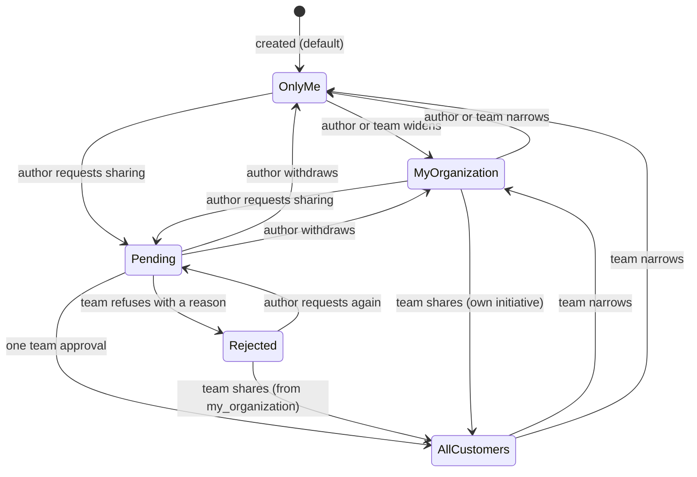

# Ticket visibility – visibility levels, sharing requests and organization changes

| | |
|---|---|
| Status | `draft` |
| Created | 2026-10-26 |
| Plan task | `S1-11` |
| System specification sections | §3.2, §4.5, §5.1, §5.2, §5.3, §5.4, §6.7, §7.3, §7.5, §13.3, §13.5, §14.4, §18.3, §18.5, glossary |
| Related issues / PRs | Sibling specifications: [#112](https://github.com/trybun/trybun/pull/112) (S1-02 organizations), [#114](https://github.com/trybun/trybun/pull/114) (S1-04 permission layer), [#115](https://github.com/trybun/trybun/pull/115) (S1-05 ticket model, Q2 and Q13), [#116](https://github.com/trybun/trybun/pull/116) (S1-06 statuses, Q2), [#118](https://github.com/trybun/trybun/pull/118) (S1-09 end-user portal, Q8); S1-10 team ticket view and S1-12 comments (written in parallel) |

## Context

An end user decides who among the customers can see their ticket: only themselves, their organization, or – after the team approves – all customers of the project ([§5.1](../../docs/spec/05-visibility-and-search.md)). Today nothing of this exists. The S1-05 proposal ([#115](https://github.com/trybun/trybun/pull/115), Q2) builds tickets without a visibility: an end user reads only the tickets they requested, which is exactly `only_me`. S1-11 adds the columns `visibility` and `sharing_request`, widens the read rule, and builds the sharing request with its team decision.

The plan's scope for S1-11: `only_me`, `my_organization`, `all_customers` with team approval (sharing request states), shared tickets, widening and narrowing rules, the warning text, and the effects of an organization change on ticket visibility ([§7.3](../../docs/spec/07-users-organizations-permissions.md)). Out of scope: comment audience and the refusal reason as a public comment (S1-12), the "Pending sharing approvals" view (S1-13), the notification to the project team (S1-15).

The plan's "Done when" for S1-11:

- a pending request is visible to the author's organization only;
- a refusal sets the request to `rejected` and leaves the visibility unchanged;
- `my_organization` is not offered while no organization exists;
- after an organization change the user still sees their own `only_me` tickets and no longer sees `my_organization` tickets of the old organization;
- a list never returns a ticket whose detail returns 404 (property test over the demo dataset).

This specification builds on the sibling proposals as written there: the principal and the restrictions of S1-04, the ticket model, the activity events and the row locks of S1-05, the organization membership of S1-02, and the switch S1-09 places in the simplified form. It does not decide their questions again.

The specification leaves gaps for this task: which own tickets stay visible after a change of organization or project access, what a sharing request does to an `only_me` ticket of a person who changed organization, where the refusal reason lives before comments exist, and how the web application learns the options it may show. Agents may not decide them (Rule 8). Each is listed under [Open questions](#open-questions) with a proposed answer. The design below assumes the proposed answers.

## Goals

- `ticket.visibility` (effective visibility) and `ticket.sharing_request` stored and kept consistent by the database ([§5.1](../../docs/spec/05-visibility-and-search.md)).
- One set of CASL rules decides which tickets an end user sees, for lists and details alike, from the principal's **current** organization and project access. An organization change takes effect on the next request without a migration of tickets ([§7.3](../../docs/spec/07-users-organizations-permissions.md)).
- The widening and narrowing rules of [§5.3](../../docs/spec/05-visibility-and-search.md) and the sharing request with one team approval or a refusal with a reason ([§5.2](../../docs/spec/05-visibility-and-search.md)), as actions in `allowedActions`.
- Only meaningful options in the switch, decided by the API: no `my_organization` for a person without an active organization, and therefore never while no organization exists.
- The warning of [§5.1](../../docs/spec/05-visibility-and-search.md) when **All customers** is chosen.
- The identities of other customers ("Customer", [§5.4](../../docs/spec/05-visibility-and-search.md)) decided by the API.
- Activity events for every visibility change, the approval as a public event, and audit log entries for the team's decisions ([§4.5](../../docs/spec/04-ticket-lifecycle.md), [§13.5](../../docs/spec/13-non-functional.md)).

## Non-goals

- Comment audience, and publishing the refusal reason as a public comment (S1-12). S1-11 stores the reason until then ([Q8](#open-questions)).
- The predefined view "Pending sharing approvals" and the triage queue (S1-13). S1-11 adds the field they filter on.
- The in-app notification of the project team, and watcher removal after a change of organization (S1-15, [Q10](#open-questions)).
- Redaction before approval ([§5.2](../../docs/spec/05-visibility-and-search.md), S1-12 and S1-16). The approval dialog only reminds the team to check the content.
- Similar tickets and search (S2-02, S2-03). They read through the same rule when they arrive.
- The "duplicate and redacted copy" flow for `only_me` tickets ([§5.2](../../docs/spec/05-visibility-and-search.md), last paragraph): it uses only S1-05, S1-06 and later watcher tasks, and adds no visibility rule.
- The reference page about visibility and the "Creating a ticket" tour (S1-18).

## Proposed change

### What users see

**End user, creating a ticket** (form of S1-09). Below the description, a small **Visibility** control (PL: „Widoczność”), default **Only me**. It lists only the options the API returns for this project ([Q7](#open-questions)): **Only me** always, **My organization** only when the person belongs to an active organization, **All customers** always. Choosing **All customers** shows the warning under the control:

- EN: "Make sure the description and attachments contain no confidential data."
- PL: „Upewnij się, że opis i załączniki nie zawierają poufnych danych.”

In the typical case the person takes no extra step (Rule 2). The control is the existing `Select` of `@trybun/ui` inside a `Field` ([Q14](#open-questions)), with `data-tour="ticket-form-visibility"` for the tour of S1-18.

**End user, own ticket** (ticket view of S1-09). A line under the title: "Visible to: Only me" (PL: „Widoczne dla: Tylko dla mnie”), and the same control when the ticket's `allowedActions` permit a change. States of a sharing request:

| State | Text (EN / PL) |
|---|---|
| `pending` | "Waiting for the team to share this ticket with all customers." / „Czeka na udostępnienie wszystkim klientom przez zespół.” |
| `rejected` | "The team did not share this ticket with all customers." / „Zespół nie udostępnił tego zgłoszenia wszystkim klientom.” – followed, when the visibility is `my_organization`, by "Your organization can still see it." / „Twoja organizacja nadal je widzi.” |
| approved (visibility `all_customers`) | Public timeline entry "Shared with everyone" / „Udostępnione wszystkim” ([§5.2](../../docs/spec/05-visibility-and-search.md)) |

The reason of a refusal reaches the author as a public comment once S1-12 exists ([Q8](#open-questions)).

Own tickets in projects the person can no longer open (after a change of organization, [§7.3](../../docs/spec/07-users-organizations-permissions.md)) stay in **My tickets** across all projects (S1-09, `involvement=mine`), which reads through the same rules, and open from there.

**Team, ticket view** (S1-10). The visibility field shows the current value and offers only the permitted changes. A pending request shows the badge "Sharing requested" (PL: „Prośba o udostępnienie”) with two actions:

- **Share with all customers** (PL: „Udostępnij wszystkim klientom”) opens a confirmation dialog: "Check that the description and attachments contain no data identifying the customer." (PL: „Sprawdź, czy opis i załączniki nie zawierają danych identyfikujących klienta.”) – the one extra step Rule 2 allows for predictability, because the content becomes visible to every customer of the project. The same dialog confirms sharing at the team's initiative.
- **Refuse** (PL: „Odmów”) opens a dialog with a required short reason.

Everything works from 360 px with 44 px targets (Rule 9); the dialogs are the `Dialog` of `@trybun/ui`, a `Drawer` on phones as elsewhere in the application.

### Data model

S1-11 adds three columns to `tickets` (owned by `modules/tickets/`, S1-05) in one migration `add_ticket_visibility`. Existing rows get `only_me` and `none`, the meaning they already have (S1-05 Q2).

| Field | Column | Type and rule |
|---|---|---|
| `visibility` | `visibility` | enum `ticket_visibility` (`only_me`, `my_organization`, `all_customers`), not null, default `only_me` |
| `sharingRequest` | `sharing_request` | enum `ticket_sharing_request` (`none`, `pending`, `rejected`), not null, default `none` |
| `sharingRefusalReason` | `sharing_refusal_reason` | GFM text, trimmed, 1–2000 characters, nullable; until S1-12 ([Q8](#open-questions)) |

Check constraints keep the combinations of [§5.1](../../docs/spec/05-visibility-and-search.md) and [§5.4](../../docs/spec/05-visibility-and-search.md):

- `visibility = 'my_organization'` only when `organization_id IS NOT NULL`;
- `sharing_request <> 'none'` only when `visibility <> 'all_customers'` (approval clears the request);
- `source <> 'user'` implies `visibility = 'only_me'` and `sharing_request = 'none'` – team and integration tickets are visible to the team only, and imported tickets are always `only_me` ([§12.5](../../docs/spec/12-api-webhooks-import.md)) ([Q6](#open-questions));
- `sharing_refusal_reason IS NOT NULL` exactly when `sharing_request = 'rejected'`.

Index `(project_id, sharing_request)` where `sharing_request = 'pending'` (partial), for the view of S1-13; the read rules use the existing indexes on `requester_id` and `organization_id` and a new `(project_id, visibility)`.

The enums follow the glossary codes and have the unit test that keeps each Prisma enum equal to its contract enum ([§18.4](../../docs/spec/18-code-patterns.md)).

The states are pairs of the two columns: `Pending` and `Rejected` keep the effective visibility `only_me` or `my_organization`; only an approval or the team's own initiative reaches `all_customers`, and an `only_me` ticket never reaches it without its author's request. Widening or narrowing a `Rejected` ticket between `only_me` and `my_organization` keeps the `rejected` marker and its reason; reaching `all_customers` clears both.

### Who sees a ticket

The team sees every ticket of its projects (S1-05). For an **end user** `U`, the rules of `read` on `Ticket` in `tickets.abilities.ts` are four CASL rules on identifiers the principal carries ([Q1](#open-questions), [Q2](#open-questions), [Q3](#open-questions)):

| Rule | Condition | Meaning |
|---|---|---|
| R1 own | `requesterId = U` and `visibility` in (`only_me`, `all_customers`) | Own tickets, in any project, even without current access to it ([§7.3](../../docs/spec/07-users-organizations-permissions.md)) |
| R2 own in the current organization | `requesterId = U` and `organizationId = U.organizationId` (only when `U` has an organization, archived or not) | Own `my_organization` tickets, while the person still belongs to the organization of the snapshot |
| R3 organization | `visibility = 'my_organization'` and `organizationId = U.organizationId` and `projectId` in the projects `U` has access to (only while the organization is **active**) | Tickets of the person's organization, including pending requests |
| R4 shared | `visibility = 'all_customers'` and `projectId` in the projects `U` has access to | Shared tickets |

Consequences, which are the "Done when":

- A pending request keeps `my_organization` (or `only_me`), so it is visible to the author's organization only (R3).
- After a change of organization, R1 still returns the person's `only_me` tickets; R2 and R3 no longer match `my_organization` tickets of the old organization, including the person's own. Shared tickets stay visible in projects the person still has access to (R4).
- While the organization is archived, its members keep their own tickets (R1, R2) and lose their colleagues' tickets (R3), as they lose the access granted through the organization ([§7.3](../../docs/spec/07-users-organizations-permissions.md)).

The principal of S1-04 carries the projects of the person's active organization; S1-11 adds `organizationId` and `organizationState` of the current membership to the same loader ([#114](https://github.com/trybun/trybun/pull/114), "Principal and its grants"), so the rules need no relation conditions. Every query keeps `accessibleBy(ability, 'read')`, so the list, the detail, `involvement=mine` of S1-09, the attachments of the ticket ([§13.3](../../docs/spec/13-non-functional.md), S1-08) and the comments of S1-12 all follow the same rules. Nothing is migrated on an organization change: visibility is evaluated on every request against the current membership, and no cache is kept across requests ([§14.4](../../docs/spec/14-architecture.md)).

The other end-user actions on own tickets – `update` of S1-05 and the visibility actions below – additionally require current access to the project: the person keeps **read and comment** access to own `only_me` tickets without it ([§7.3](../../docs/spec/07-users-organizations-permissions.md)); the comment rule is S1-12's.

### Changing visibility

Visibility changes are actions on the ticket, one code per target value, so `allowedActions` tells the web application exactly which options to offer ([Q7](#open-questions)). New action codes of `Ticket` (closed list in `@trybun/contracts/tickets`): `set_visibility_only_me`, `set_visibility_my_organization`, `set_visibility_all_customers`, `approve_sharing`, `reject_sharing`. Every rule excludes the current value, so `allowedActions` lists only real changes – with one exception: while the author's request is pending, the author's `set_visibility_only_me` and `set_visibility_my_organization` are allowed even for the current effective visibility, because they withdraw the request (the control shows a pending ticket as **All customers**, marked as waiting).

| Action | End user (requester, with project access) | Developer and above |
|---|---|---|
| `set_visibility_only_me` | ticket not shared; withdraws a pending request | any `user` ticket not yet `only_me` |
| `set_visibility_my_organization` | ticket not shared, its organization snapshot is the person's **active** organization ([Q4](#open-questions)); withdraws a pending request | `user` ticket with an organization snapshot; the service also requires that the snapshot is the requester's current active organization ([Q4](#open-questions)) |
| `set_visibility_all_customers` | **requests** sharing: not shared and not pending | **shares** at the team's initiative: only from `my_organization` |
| `approve_sharing`, `reject_sharing` | – | request `pending` |

Rules standing for a state of the record carry an error code as their reason ([§18.3](../../docs/spec/18-code-patterns.md), "Authorization"), returned with its status instead of `403` ([Q12](#open-questions)):

| Code | HTTP | When |
|---|---|---|
| `ticket.sharing_not_pending` | 409 | Approve or refuse without a pending request, e.g. a colleague decided first |
| `ticket.sharing_pending` | 409 | The team changes the visibility of a ticket with a pending request – it decides the request first |
| `ticket.author_consent_required` | 409 | The team shares an `only_me` ticket ([§5.2](../../docs/spec/05-visibility-and-search.md)) |
| `ticket.organization_changed` | 409 | The team sets `my_organization` on a ticket whose requester no longer belongs to the snapshot's organization, or it is archived – the ticket would be shown to people the author left and hidden from the author (R1, R2) |

CASL conditions cannot compare the snapshot with the requester's current membership, so `ticket.organization_changed` is a business rule checked by the service on the locked row ([§18.3](../../docs/spec/18-code-patterns.md), "Request pipeline", step 6); `allowedActions` may still list the action in this rare case, and the web application shows the error. When two state rules apply, `ticket.sharing_pending` wins (the request is decided first).

Every other refusal is `403 request.forbidden` – e.g. an end user narrowing a shared ticket, which needs the team ([§5.3](../../docs/spec/05-visibility-and-search.md)). Visibility actions on tickets of archived projects are refused by the archived restriction of S1-04, which fails closed for new actions.

Effects, each in one transaction with the conditional update on `version` (`versionedUpdate`, S1-05) and its activity event:

| Use case | `visibility` | `sharing_request` | Activity event (public?) |
|---|---|---|---|
| Widen or narrow (author or team) | target | unchanged; `none` when it withdraws a pending request | `visibility_changed` `{ from, to }` (no); a withdrawal writes `sharing_request_withdrawn` `{ from, to }` instead (no), also when the visibility stays the same |
| Request sharing (author) | `my_organization` if the snapshot is the author's active organization, else unchanged ([Q4](#open-questions)) | `pending`; the reason of an earlier refusal is cleared | `sharing_requested` `{ from, to }` (no) |
| Approve (team) | `all_customers` | `none` | `sharing_approved` `{ from }` – **public**, shown as "Shared with everyone" |
| Refuse (team) | unchanged | `rejected`, reason stored | `sharing_rejected` (no), without the reason |
| Share at own initiative (team), also after a refusal | `all_customers` | `none`, a stored reason cleared | `visibility_changed` `{ from, to }` (no) |

The pair of columns is diffed as one field by the activity function of S1-05, so one use case writes exactly one event from the table ([Q11](#open-questions)). Comment audiences are not changed by any of these ([§5.3](../../docs/spec/05-visibility-and-search.md), S1-12). A request for the current value returns `200` without an event or a new `version` (as S1-06 Q16) – except the author's withdrawal of a pending request above, which is a change of `sharing_request`.

**Audit log** ([§13.5](../../docs/spec/13-non-functional.md)), with the ticket as target, written in the same transaction: `ticket.visibility_changed` when a team member changes the visibility (including sharing at their initiative), `ticket.sharing_approved`, `ticket.sharing_rejected`. Changes by the author are not administrative actions and are not audited ([Q17](#open-questions)).

**Concurrency.** All three endpoints decide in the service on the ticket row locked `FOR UPDATE` (row-lock pattern proposed by S1-05 Q16), re-checking the action with the ability on the locked row before the version, so an author's withdrawal and a team decision never both apply. Two team members deciding at the same time: the first wins; the second gets `409 ticket.sharing_not_pending` – from the target record guard when the decision was already committed, from the re-check on the locked row otherwise. Concurrent edits that do not change the state rules get `412` from `If-Match`.

### Creating a ticket with a visibility

`createTicketSchema` (S1-05) gains `visibility` (optional, default `only_me`). A new ticket is treated as an `only_me` ticket whose author applies the chosen visibility as their first change, by the same rules: the API evaluates `set_visibility_*` on the draft ticket (requester, organization snapshot, source, `only_me`) with the principal's ability. A value outside these options returns `403` with nothing created, as S1-05 does for the team-only fields. Choosing `all_customers` creates the ticket with `sharing_request = 'pending'` and the effective visibility of the table above. Creation writes no activity event (S1-05 Q11); the pending request is visible to the team through the field.

Team accounts create tickets with source `developer`, which are visible to the team only ([§5.4](../../docs/spec/05-visibility-and-search.md)); their only option is `only_me`, and the full form of S1-10 has no visibility control ([Q6](#open-questions)).

**Options for the form** ([Q7](#open-questions)): the end-user project response `endUserProjectSchema` (S1-09) gains `ticketVisibilityOptions` – the visibility codes the principal may choose when creating a ticket in this project, computed with the same ability on the same draft. A person without an organization gets `["only_me", "all_customers"]`; therefore, while no organization exists, nobody is offered `my_organization` ([§7.3](../../docs/spec/07-users-organizations-permissions.md), "System without organizations").

### API

All endpoints follow the request pipeline of [§18.3](../../docs/spec/18-code-patterns.md); schemas in `@trybun/contracts/tickets`.

| Endpoint | Guard action | Notes |
|---|---|---|
| `POST /api/v1/tickets` (S1-05) | `create_ticket` on the project | Body gains `visibility?` (above) |
| `PUT /api/v1/tickets/{ticketId}/visibility` | `read` | Body `{ visibility }`, `If-Match`. The service checks `set_visibility_<visibility>` on the locked ticket (`403` or a state code above). Returns the ticket |
| `POST /api/v1/tickets/{ticketId}/sharing/approve` | `approve_sharing` | `If-Match`; no body. Returns the ticket |
| `POST /api/v1/tickets/{ticketId}/sharing/reject` | `reject_sharing` | `If-Match`; body `{ reason }` (GFM, trimmed, 1–2000 characters; field errors `string.too_short` / `string.too_long`). Returns the ticket |

Response changes:

- **Team ticket response** (`ticketSchema`): `visibility`, `sharingRequest`, `sharingRefusalReason` (until S1-12).
- **End-user ticket response** (`endUserTicketSchema`): `visibility`, `sharingRequest`; `requester` becomes `{ id, displayName } | null`, where `null` means "Customer" (PL: „Klient”) ([Q9](#open-questions)).
- **End-user activity events** (S1-05, S1-09): the actor follows the same identity rule; `sharing_approved` is a public event type.
- **End-user project response**: `ticketVisibilityOptions` (above).
- `allowedActions` of tickets gain the five new codes; responses list them only when permitted.

### Identities of other customers

One pure function `identityVisibleTo(viewer, person)` in `modules/tickets/domain/` decides whether an end user sees a person's name ([§5.4](../../docs/spec/05-visibility-and-search.md), [Q9](#open-questions)): yes when the viewer is a team member, when the person is a team member, when the viewer is the person, or when both currently belong to the same organization (active or archived; two people without an organization never count as the same organization); otherwise the response carries `null` and the web application shows "Customer". The decision is the API's ([§14.4](../../docs/spec/14-architecture.md)); the serializer never sends the name. The ticket and activity-event responses use it; S1-12 uses it for comment authors.

### Demo dataset

The demo dataset (S1-05) gains, for the property test and for manual review: two active organizations and one archived organization, each with members, and one end user without an organization; tickets of every visibility; pending requests starting from `only_me` (author without an organization) and from `my_organization`, and a rejected request; a shared ticket; team and integration tickets (`only_me`); one end user who moved from one organization to the other, with own `only_me`, `my_organization` and `all_customers` tickets in a project of the old organization that they can no longer open. One project serves both active organizations, another only the first.

### Tests

- **Rules** (unit, `tickets.abilities.spec.ts`): the §7.5 rows "View own tickets", "View other people's tickets according to visibility", "Choose visibility of own ticket", "Narrow visibility of own ticket that is not shared", "Change visibility of any ticket, incl. narrowing a shared ticket" and "Approve or reject sharing with all customers, share a ticket", each with an allowed and a denied case, plus every row of the action table and the four state codes. Principal fixtures of S1-04 gain an end user who changed organization.
- **Pure functions** (unit): the effective visibility of a request, the creation options and `identityVisibleTo`, as tables.
- **Filter equals check** (integration, S1-04): for `Ticket` and every principal fixture, `accessibleBy` returns exactly the tickets for which `ability.can('read')` is true.
- **Done-when tests** (integration, Testcontainers): a pending request is returned to a colleague of the author's organization and is `404` for an end user of another organization; a refusal sets `rejected` and leaves the visibility unchanged; with no organization in the system, `ticketVisibilityOptions` is `["only_me", "all_customers"]` for every end user and `my_organization` is refused; after a move between organizations, the person still reads their own `only_me` ticket and gets `404` for `my_organization` tickets of the old organization, their own included.
- **Property test over the demo dataset** (integration, [Q13](#open-questions)): for every principal of the dataset (each end user, a Developer, a Project manager, the Administrator) and every ticket of the dataset, the ticket is in the principal's list – `GET /api/v1/tickets` without filters, all pages – exactly when `GET /api/v1/tickets/{ticketId}` returns `200`; otherwise the detail returns `404`. The check enumerates all pairs, so it needs no random generator.
- **E2E** (phone, tablet, desktop, axe): an end user creates a ticket with **All customers**, sees the warning and the pending state; a Developer approves it after the dialog; the author sees "Shared with everyone".

### Prior art

- **Jira Service Management** shares requests with the reporter's organization or with chosen people, and has no team approval; Trybun adds the approval because a shared ticket exposes the content to other companies.
- **Zendesk** lets organization members see each other's tickets through an organization setting, not per ticket; Trybun keeps the choice per ticket with the private default required by GDPR Art. 25 ([§5.1](../../docs/spec/05-visibility-and-search.md)).
- **Discourse** shows a moderation queue for posts awaiting approval with one approval required – the same "one approval by any team member" rule as [§5.2](../../docs/spec/05-visibility-and-search.md).

## Changes to the system specification

| Section | Change |
|---|---|
| §3.2 | Visibility and sharing request are kept consistent by the database; tickets with source other than `user` are always `only_me` without a request (Q6); the refusal reason until S1-12 (Q8) |
| §4.5 | The approval of a sharing request is a public event; other visibility events are internal (Q11) |
| §5.1 | The options are those of the principal's active organization (Q4, Q7); team tickets have no visibility choice (Q6) |
| §5.2 | Requesting sharing from an `only_me` ticket widens it to `my_organization` only when its organization snapshot is the author's active organization (Q4); the team decides a pending request before changing the visibility; the approval confirmation reminds the team to check the content |
| §5.3 | The author withdraws a pending request by choosing `only_me` or `my_organization`; a change to the current value changes nothing |
| §5.4 | "Same organization" means the current memberships of the viewer and the person (Q9) |
| §7.3 | Which own and organization tickets an end user sees after a change of organization or project access, and while the organization is archived (Q1, Q2, Q3); watcher removal is done by S1-15 (Q10) |
| §7.5 | Row "Choose visibility of own ticket": end users only, team tickets are `only_me` (Q6) |
| §13.5 | The audit actions `ticket.visibility_changed`, `ticket.sharing_approved`, `ticket.sharing_rejected` |
| §17.2 | The error codes `ticket.sharing_not_pending`, `ticket.sharing_pending`, `ticket.author_consent_required`, `ticket.organization_changed` (409) |
| §18.3 / §18.5 | Options of a field the principal may choose, as a list computed with the ability on a draft record (`ticketVisibilityOptions`), if adopted as a pattern (Q7) |
| Plan (for the maintainer) | S1-12 publishes the stored refusal reason as a public comment, migrates the stored reasons and drops the column (Q8); S1-15 removes watchers who lost access after a change of organization (Q10); S1-11's UI lands in the S1-09 and S1-10 views (Q15) |

New or changed glossary terms:

- `ticket.sharing_refusal_reason` – Sharing refusal reason / Powód odmowy udostępnienia (until S1-12, Q8).

## Open questions

Implementation must not start until every question has an answer. Every answer below is a **proposal awaiting human approval**, chosen as the smallest and most reversible option. Answers marked ⚠ touch data scoping, a plan boundary or a pattern, and need explicit confirmation.

1. ⚠ NEEDS HUMAN CONFIRMATION **Own tickets after losing access.** §7.3 says the person keeps their `only_me` tickets even without project access, loses `my_organization` tickets of the old organization, and keeps "shared tickets of projects they still have access to". It does not say whether the person keeps their **own** shared ticket in a project they no longer access. — **Answer (proposed, awaiting approval):** yes – R1 covers own `only_me` and `all_customers` tickets in any project; only own `my_organization` tickets of another organization disappear. The author consented to share that ticket with every customer, and hiding it from its own author would be the only case where a person loses a ticket the whole project sees. Alternative: own shared tickets need project access too (stricter, one more condition on R1).
2. **Organization tickets and project access.** A `my_organization` ticket may lie in a project the author reached by personal access, outside the organization's projects (S1-05 Q13). — **Answer (proposed, awaiting approval):** colleagues see it only when they have access to that project (R3), like shared tickets (R4); the person never sees tickets of a project they cannot open, except their own (R1, R2).
3. **Archived organization.** §7.3: members "keep … read access to the tickets they created, lose access granted through the organization and cannot create tickets through it". — **Answer (proposed, awaiting approval):** own tickets stay visible (R1, R2); colleagues' `my_organization` tickets are hidden while the organization is archived (R3 requires an active organization) and reappear on unarchiving; `my_organization` is not offered, and a sharing request does not widen to it.
4. **Sharing request from an `only_me` ticket.** §5.1 keeps a pending ticket at `my_organization` "or `only_me` if the author has no organization". After a change of organization the snapshot names the old organization. — **Answer (proposed, awaiting approval):** the request widens the ticket to `my_organization` only when its snapshot is the author's current active organization; otherwise it stays `only_me` while pending. The author may choose `my_organization` only under the same condition, and so may the team (`409 ticket.organization_changed`), so a ticket is never exposed to an organization its author left, nor hidden from its author by such a change.
5. **Withdrawing and repeating a request.** — **Answer (proposed, awaiting approval):** while a request is pending, the author withdraws it by choosing `only_me` or `my_organization` (`sharing_request = none`, event `sharing_request_withdrawn`); after a refusal they may request again at any time (§5.2), which clears the stored reason.
6. **Visibility of team and integration tickets.** §7.5 lets every role "choose visibility of own ticket", but §5.4 makes tickets with source `developer` or `integration` visible to the team only. — **Answer (proposed, awaiting approval):** they are always `only_me` without a request (check constraint); the team's full form has no visibility control, and the §7.5 row becomes end-user only. A team member who wants customers to see a problem shares an end user's ticket or creates it on a customer's behalf, which no Stage 1 task builds.
7. ⚠ NEEDS HUMAN CONFIRMATION **How the web application learns the options.** The web application must not compute them ([§14.4](../../docs/spec/14-architecture.md)). — **Answer (proposed, awaiting approval):** on a ticket, one action code per target value in `allowedActions` (the existing pattern); for creation, a field `ticketVisibilityOptions` on the end-user project response, computed with the same ability on a draft ticket – as proposed by S1-09 (#118 Q8). The list field is a new response shape next to `allowedActions`, so it is proposed as a pattern for "options of a field the principal may choose" (Rule 12). Alternative: project actions `create_ticket_my_organization` and `create_ticket_all_customers` in the project's `allowedActions` – no new shape, but action codes that encode field values.
8. ⚠ NEEDS HUMAN CONFIRMATION **Where the refusal reason lives before S1-12.** §5.2 publishes it to the author as a public comment, but comments arrive with S1-12 (group 6), and immutable events cannot hold redactable text. — **Answer (proposed, awaiting approval):** as S1-06 does for the rejection reason (#116 Q2): a nullable `tickets.sharing_refusal_reason`, required by the refusal, shown to the team only, cleared by a new request. S1-12 then publishes it as a public comment on every refusal, migrates the stored reasons of `rejected` tickets into comments and drops the column; while it exists S1-16 covers it in export, redaction and anonymization. Until S1-12, the author sees the refused state without the reason. Alternative: S1-11 requires but does not store the reason (the text is lost).
9. **Identities of other customers.** The plan lists §5.4 for S1-11, and S1-09 leaves the "Customer" display to it. §5.4 does not say whether "the requester's own organization" is the ticket's snapshot or current membership. — **Answer (proposed, awaiting approval):** the current memberships of both people, evaluated by `identityVisibleTo`; a requester who left the organization is shown as "Customer" to their former colleagues. It reveals the least, and S1-12 reuses the function for comment authors.
10. **Watchers after a change of organization.** §7.3 removes the person from the watchers of tickets they no longer see; watchers arrive with S1-15. — **Answer (proposed, awaiting approval):** S1-11 writes no outbox event and touches no watchers. S1-15 removes watchers without access when it sends (§6.7) and, if it needs it, adds the outbox event of a membership change to S1-02's use case. The maintainer adds this to the row of S1-15.
11. **Activity events.** — **Answer (proposed, awaiting approval):** one event per use case: `visibility_changed`, `sharing_requested`, `sharing_request_withdrawn`, `sharing_rejected` (internal) and `sharing_approved` (public, as §5.2 requires); the reason never enters an event. Making visibility changes public would extend the closed list of public events in §4.5.
12. **Error codes.** — **Answer (proposed, awaiting approval):** the four `409` codes of [Changing visibility](#changing-visibility), as reasons of state rules; everything else is `403 request.forbidden`; an end user's attempt on a ticket they cannot see is `404`. A change to the current value is `200` without an event.
13. **Property test without a generator library.** No property-testing library is installed. — **Answer (proposed, awaiting approval):** an exhaustive check over all pairs of principals and tickets of the demo dataset, which is small and deterministic; no new dependency. Alternative: `fast-check` (MIT) with generated datasets – broader, but a new dependency (Rule 10) and slower integration tests.
14. **The control.** §5.1 asks for "a small switch". — **Answer (proposed, awaiting approval):** the existing `Select` of `@trybun/ui` in a `Field`, which fits three labelled options at 360 px; no new component. Alternative: a radio group from shadcn/ui on Base UI (one tap instead of two, but a new component with stories, Rule 6).
15. **UI ownership and sequencing with S1-09 and S1-10.** All three are in group 5. — **Answer (proposed, awaiting approval):** S1-11 owns the API, the rules, the texts and the visibility components in `features/tickets/`; as S1-09 proposes (#118 Q8), whichever of S1-09 and S1-11 merges second wires the control into the form, and the same for S1-10's team ticket view and its approve and refuse actions. S1-11 writes the how-to pages "Choose who can see your ticket" (end users) and "Share a ticket with all customers" (team) in EN and PL; S1-18 adds the reference page and the tour.
16. **Redaction before approval.** — **Answer (proposed, awaiting approval):** no redaction in S1-11; the approval dialog reminds the team, and redaction arrives with S1-12 and S1-16.
17. **What is audited.** §13.5 lists "visibility changes by the team, shared-ticket approvals and refusals". — **Answer (proposed, awaiting approval):** exactly these three actions; changes by the author are in the activity timeline only.
18. **One specification or several.** The plan row bundles visibility, sharing and the effects of organization changes. — **Answer (proposed, awaiting approval):** one specification and one implementation PR: the organization effects are the read rules themselves, and the sharing request needs the visibility columns. A split into S1-11a (columns, read rules, `only_me` and `my_organization`) and S1-11b (sharing request, refusal reason, identities) was considered: S1-11a would meet four of the five "Done when" items alone, but two items need the sharing request, the plan defines one task, and S1-11b changes the same rules, endpoint and components again. The identity rule (Q9) is small and needed as soon as other people's tickets become visible. Alternative: the maintainer splits the plan row, and the phases below become two PRs after step 3.

## Phasing and implementation plan

One phase, one PR (Q18), after S1-04 and S1-05 are merged; the UI steps land in the views of S1-09 and S1-10 that exist at that time (Q15). Each step leaves the application working.

1. Migration `add_ticket_visibility` with the enums, columns, check constraints and indexes; contract enums with the Prisma equality test. Test: the check constraints refuse every forbidden combination.
2. Principal loader with `organizationId` and `organizationState`; the read rules R1–R4; the demo dataset. Tests: the read rows of `tickets.abilities.spec.ts`, the filter equals check, the organization-change and archived-organization tests, the property test.
3. Visibility actions, state rules with their codes, `PUT …/visibility`, the activity events and audit entries. Tests: every row of the action table allowed and denied; events and audit entries per use case; `412` and `409 ticket.sharing_not_pending` for concurrent decisions.
4. Sharing approval and refusal endpoints with the stored reason; `visibility` in `createTicketSchema`; `ticketVisibilityOptions`. Tests: refusal leaves the visibility; creation with each option and a forbidden option; options without organizations.
5. `identityVisibleTo` in the ticket and activity-event responses. Tests: the identity table; a ticket of another organization shows the requester as `null`.
6. Web: the visibility control with the warning in the portal form and the portal ticket view; the team field with **Share with all customers** and **Refuse** in the team ticket view; catalogue texts EN and PL; how-to pages. Tests: component tests, E2E on phone, tablet and desktop with axe.
7. Specification changes of the table above; this file moved to `implemented/`. Test: `pnpm lint:spec`.

## Acceptance criteria

- [ ] A pending request is visible to the author's organization only
- [ ] A refusal sets the request to `rejected` and leaves the visibility unchanged; the reason is required
- [ ] `my_organization` is not offered while no organization exists, nor to a person without an active organization
- [ ] After an organization change the user still sees their own `only_me` tickets and no longer sees `my_organization` tickets of the old organization
- [ ] A list never returns a ticket whose detail returns 404 (property test over the demo dataset)
- [ ] An `only_me` ticket is never shared without its author's request; an end user cannot narrow a shared ticket
- [ ] Every visibility change writes one activity event; the approval is public; the team's changes and decisions are in the audit log
- [ ] End users of other organizations see the requester as "Customer"
- [ ] Works on phone, tablet and desktop (Rule 9)
- [ ] User documentation updated (Rule 3); the tour comes with S1-18 (Rule 4)

## Changelog

- 2026-10-26 – Created.
