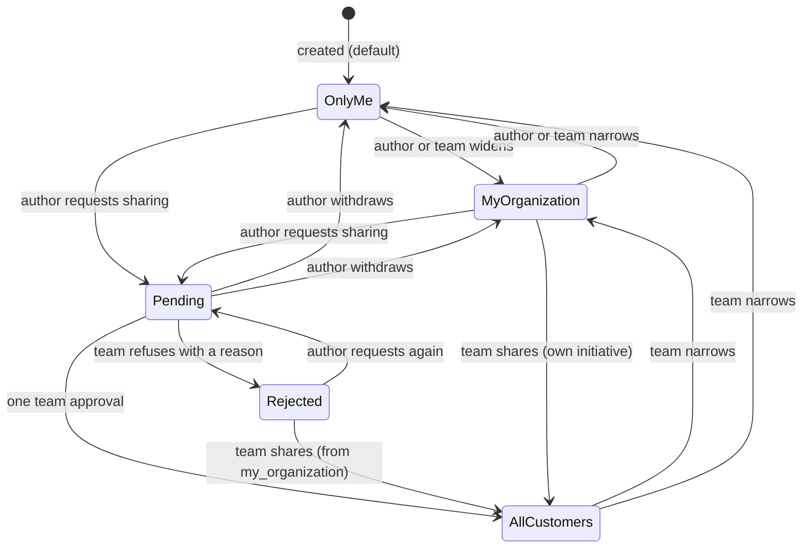

# Ticket visibility – visibility levels, sharing requests and organization changes

| | |
|---|---|
| Status | `approved` |
| Created | 2026-10-26 |
| Plan task | `S1-11` |
| System specification sections | §3.2, §4.5, §5.1, §5.2, §5.3, §5.4, §5.7, §6.7, §7.3, §7.5, §13.3, §13.5, §14.4, §18.3, glossary |
| Related issues / PRs | Builds on the implemented specifications of S1-02 [organizations](implemented/2026-10-26-organizations.md) ([#112](https://github.com/trybun/trybun/pull/112)), S1-04 [permission layer](implemented/2026-10-26-permission-layer.md) ([#114](https://github.com/trybun/trybun/pull/114)), S1-05 [ticket model](implemented/2026-10-26-ticket-model.md) ([#115](https://github.com/trybun/trybun/pull/115)), S1-06 [statuses](implemented/2026-10-26-ticket-statuses.md) ([#116](https://github.com/trybun/trybun/pull/116)), S1-08 [attachments](implemented/2026-10-26-attachments.md) and S1-09 [end-user portal](implemented/2026-10-26-end-user-portal.md) ([#118](https://github.com/trybun/trybun/pull/118)); the approved S1-10 [team ticket view](implemented/2026-10-26-team-ticket-view.md) ([#120](https://github.com/trybun/trybun/pull/120), implementation open in [#256](https://github.com/trybun/trybun/pull/256)); S1-12 comments and S1-21 title redaction ([spec](2026-10-26-title-redaction.md)) not implemented yet |

## Context

An end user decides who among the customers can see their ticket: only themselves, their organization, or – after the team approves – all customers of the project ([§5.1](../../docs/spec/05-visibility-and-search.md)). Today nothing of this exists. S1-05 built tickets without a visibility: an end user reads only the tickets they requested (`ticketReadConditions` in `apps/server/src/modules/tickets/tickets.abilities.ts` returns `{ requesterId }`), which is exactly `only_me`. S1-11 adds the columns `visibility` and `sharing_request`, widens the read rule, and builds the sharing request with its team decision.

The plan's scope for S1-11: `only_me`, `my_organization`, `all_customers` with team approval (sharing request states), shared tickets, widening and narrowing rules, the warning text, and the effects of an organization change on ticket visibility ([§7.3](../../docs/spec/07-users-organizations-permissions.md)). Out of scope: comment audience and the refusal reason as a public comment (S1-12), the "Pending sharing approvals" view (S1-13), the notification to the project team (S1-15).

The plan's "Done when" for S1-11:

- a pending request is visible to the author's organization only;
- a refusal sets the request to `rejected` and leaves the visibility unchanged;
- `my_organization` is not offered while no organization exists;
- after an organization change the user still sees their own `only_me` tickets and no longer sees `my_organization` tickets of the old organization;
- a list never returns a ticket whose detail returns 404 (property test over the demo dataset).

This specification builds on the implemented code and the approved answers of the sibling specifications, and does not decide their questions again:

- the principal of S1-04 and its pattern: relation conditions limited to the principal, no data preloaded on it (S1-04 Q2, [§18.3](../../docs/spec/18-code-patterns.md));
- the ticket model, the activity events and the locks of S1-05 and S1-06;
- the organization membership of S1-02;
- the portal form and ticket view of S1-09, whose Q8 gives S1-11 the visibility field, its rules, the warning and the way the form learns its options;
- the project actions of S1-10 Q15 that tell a form what it may do before the ticket exists.

The system specification leaves gaps for this task. It does not say:

- which own tickets stay visible after a change of organization or project access;
- what a sharing request does to an `only_me` ticket of a person who changed organization;
- where the refusal reason lives before comments exist;
- how the web application learns the options it may show.

Agents may not decide them (Rule 8). Each is listed under [Open questions](#open-questions). Every answer is approved by the maintainer.

## Goals

- `ticket.visibility` (effective visibility) and `ticket.sharing_request` stored and kept consistent by the database ([§5.1](../../docs/spec/05-visibility-and-search.md)).
- One set of CASL rules decides which tickets an end user sees, for lists and details alike, from the person's **current** organization membership and project access. An organization change takes effect on the next request without a migration of tickets ([§7.3](../../docs/spec/07-users-organizations-permissions.md)).
- The widening and narrowing rules of [§5.3](../../docs/spec/05-visibility-and-search.md) and the sharing request with one team approval or a refusal with a reason ([§5.2](../../docs/spec/05-visibility-and-search.md)), as actions in `allowedActions`.
- Only meaningful options in the control, decided by the API: **My organization** only where the person's active organization has access to the project, and therefore never while no organization exists.
- The warning of [§5.1](../../docs/spec/05-visibility-and-search.md) when **All customers** is chosen.
- The identities of other customers ("Customer", [§5.4](../../docs/spec/05-visibility-and-search.md)) decided by the API.
- Activity events for every visibility change, the approval as a public event, and audit log entries for the team's decisions ([§4.5](../../docs/spec/04-ticket-lifecycle.md), [§13.5](../../docs/spec/13-non-functional.md)).

## Non-goals

- Comment audience, and publishing the refusal reason as a public comment (S1-12). S1-11 stores the reason until then ([Q8](#open-questions)).
- The predefined view "Pending sharing approvals" and the triage queue (S1-13). S1-11 adds the field they filter on.
- The in-app notification of the project team, watcher removal after a change of organization, and an outbox event of a membership change (S1-15, [Q10](#open-questions)).
- Redaction before approval ([§5.2](../../docs/spec/05-visibility-and-search.md), S1-12 and S1-16), and the link from the approval dialog to the title redaction of S1-21. The approval dialog only reminds the team to check the content.
- A visibility control in the team's full form (S1-10): team tickets are always `only_me` ([Q6](#open-questions)).
- Similar tickets and search (S2-02, S2-03). They read through the same rule when they arrive. Until then, no portal list shows other people's tickets.
- The "duplicate and redacted copy" flow for `only_me` tickets ([§5.2](../../docs/spec/05-visibility-and-search.md), last paragraph): it uses only S1-05, S1-06 and later watcher tasks, and adds no visibility rule.
- The reference page about visibility and the "Creating a ticket" tour (S1-18).

## Proposed change

### What users see

**End user, creating a ticket** (portal form of S1-09, `apps/web/src/features/tickets/components/new-ticket-form.tsx`). Below the description, a **Visibility** control (PL: „Widoczność”), default **Only me**. It is the existing `RadioGroup` of `@trybun/ui` inside a `Field` ([Q14](#open-questions)), with `data-tour="ticket-form-visibility"` for the tour of S1-18. Its options follow the project's `allowedActions` ([Q7](#open-questions)):

- **Only me** always (`create_ticket`);
- **My organization** with `create_ticket_my_organization`, which the API grants only when the person's active organization has access to the project ([Q19](#open-questions));
- **All customers** with `create_ticket_all_customers`.

A control with a single option is not shown. Choosing **All customers** shows the warning under the control:

- EN: "Make sure the description and attachments contain no confidential data."
- PL: „Upewnij się, że opis i załączniki nie zawierają poufnych danych.”

In the typical case the person takes no extra step (Rule 2): the default is kept, and each option is one tap. The page `app/(portal)/portal/projects/[projectId]/tickets/new/page.tsx` already loads the project; it passes the project's `allowedActions` to the form, which today takes only `projectId`.

**End user, own ticket** (portal ticket view of S1-09). A line under the title: "Visible to: Only me" (PL: „Widoczne dla: Tylko dla mnie”), and the same control when the ticket's `allowedActions` permit a change. States of a sharing request:

| State | Text (EN / PL) |
|---|---|
| `pending` | "Waiting for the team to share this ticket with all customers." / „Czeka na udostępnienie wszystkim klientom przez zespół.” |
| `rejected` | "The team did not share this ticket with all customers." / „Zespół nie udostępnił tego zgłoszenia wszystkim klientom.” – followed, when the visibility is `my_organization`, by "Your organization can still see it." / „Twoja organizacja nadal je widzi.” |
| approved (visibility `all_customers`) | Public timeline entry "Shared with everyone" / „Udostępnione wszystkim” ([§5.2](../../docs/spec/05-visibility-and-search.md)) |

The reason of a refusal reaches the author as a public comment once S1-12 exists ([Q8](#open-questions)).

Own tickets in projects the person can no longer open (after a change of organization, [§7.3](../../docs/spec/07-users-organizations-permissions.md)) stay in **My tickets** across all projects (S1-09, `involvement=mine`), which reads through the same rules, and open from there. Own `my_organization` tickets of the old organization are no longer in it.

**End user, another person's ticket** (portal ticket view of S1-09). S1-11 is the first task that lets an end user read tickets they did not request – their organization's (R3) and shared ones (R4, [below](#who-sees-a-ticket)). **My tickets** lists only their own (§5.7), so in S1-11 they reach such a ticket by its link, e.g. one a colleague sent; the portal search (S2-03) and watching (S1-15) list them later. The same view shows what §5.4 allows: title, description, public status and the public timeline, with the requester's name or "Customer" ([Identities](#identities-of-other-customers)). It has no visibility control, no edit and no resolution question, because the ticket's `allowedActions` hold none of them (see [Who sees a ticket](#who-sees-a-ticket)).

**Team, ticket view** (S1-10). S1-11 adds the visibility and the sharing request to S1-10's field panel. The field shows the current value and offers only the permitted changes. A pending request shows the badge "Sharing requested" (PL: „Prośba o udostępnienie”) with two actions:

- **Share with all customers** (PL: „Udostępnij wszystkim klientom”) opens a confirmation dialog: "Check that the description and attachments contain no data identifying the customer." (PL: „Sprawdź, czy opis i załączniki nie zawierają danych identyfikujących klienta.”) – the one extra step Rule 2 allows for predictability, because the content becomes visible to every customer of the project. The same dialog confirms sharing at the team's initiative.
- **Refuse** (PL: „Odmów”) opens a dialog with a required short reason.

Everything works from 360 px with 44 px targets (Rule 9); the dialogs are the `Dialog` of `@trybun/ui`, a `Drawer` on phones as elsewhere in the application. The team's full form has no visibility control ([Q6](#open-questions)).

### Data model

S1-11 adds three columns to `tickets` (owned by `modules/tickets/`) in one migration `add_ticket_visibility`. Existing rows get `only_me` and `none`, the meaning they already have (S1-05 Q2).

| Field | Column | Type and rule |
|---|---|---|
| `visibility` | `visibility` | enum `ticket_visibility` (`only_me`, `my_organization`, `all_customers`), not null, default `only_me` |
| `sharingRequest` | `sharing_request` | enum `ticket_sharing_request` (`none`, `pending`, `rejected`), not null, default `none` |
| `sharingRefusalReason` | `sharing_refusal_reason` | GFM text, trimmed, 1–2000 characters, nullable; until S1-12 ([Q8](#open-questions)) |

Check constraints keep the combinations of [§5.1](../../docs/spec/05-visibility-and-search.md) and [§5.4](../../docs/spec/05-visibility-and-search.md):

- `visibility = 'my_organization'` only when `organization_id IS NOT NULL`;
- `sharing_request <> 'none'` only when `visibility <> 'all_customers'` (approval clears the request);
- `source <> 'user'` implies `visibility = 'only_me'` and `sharing_request = 'none'` – team and integration tickets are visible to the team only ([Q6](#open-questions)). Imported tickets are always `only_me` whatever their source ([§12.5](../../docs/spec/12-api-webhooks-import.md)); the import sets it, since a CSV import may map the source to `user`, which this constraint does not cover;
- `sharing_refusal_reason IS NOT NULL` exactly when `sharing_request = 'rejected'`.

A partial index `(project_id)` where `sharing_request = 'pending'` serves the view of S1-13. The read rules use the existing indexes on `requester_id` and `organization_id` and a new `(project_id, visibility)`.

The enums follow the glossary codes and have the unit test that keeps each Prisma enum equal to its contract enum ([§18.4](../../docs/spec/18-code-patterns.md)).

The states are pairs of the two columns. `Pending` and `Rejected` keep the effective visibility `only_me` or `my_organization`. Only an approval or the team's own initiative reaches `all_customers`, and an `only_me` ticket never reaches it without its author's request. Widening or narrowing a `Rejected` ticket between `only_me` and `my_organization` keeps the `rejected` marker and its reason; reaching `all_customers` clears both.

### Who sees a ticket

The team sees every ticket of its projects, the Administrator every ticket (S1-05, unchanged). For an **end user** `U`, `ticketReadConditions` (`tickets.abilities.ts`) becomes the rules R1–R4 below ([Q1](#open-questions), [Q2](#open-questions), [Q3](#open-questions)). The attachment rules wrap it (S1-08), so attachments follow the same rules.

| Rule | Condition | Meaning |
|---|---|---|
| R1 own | `requesterId = U` and `visibility` in (`only_me`, `all_customers`) | Own tickets, in any project, even without current access to it ([§7.3](../../docs/spec/07-users-organizations-permissions.md)) |
| R2 own in the current organization | `requesterId = U` and `organization: { is: { members: { some: { userId: U } } } }` (archived or not) | Own `my_organization` tickets, while the person still belongs to the organization of the snapshot |
| R3 organization | `visibility = 'my_organization'` and `organization: { is: { state: 'active', members: { some: { userId: U } } } }` and project access of `U` | Tickets of the person's organization, including pending requests, while the organization is **active** |
| R4 shared | `visibility = 'all_customers'` and project access of `U` | Shared tickets |

"Project access of `U`" is `project: { is: access }` for each entry of `endUserProjectAccess(principal)` – personal access or access through the active organization – so R3 and R4 are one CASL rule per access path, as `ticketChangeConditions` already does. `ticketReadConditions` therefore returns a list of conditions, one per CASL rule, as `ticketChangeConditions` does; the `read` rule of tickets and the attachment `read` rule (`attachments.abilities.ts`) loop over it. All conditions are relation conditions limited to the principal ([§18.3](../../docs/spec/18-code-patterns.md), S1-04 Q2): a person belongs to at most one organization, so "the snapshot's organization has `U` as a member" means "the snapshot is `U`'s current organization". The principal is not changed. `ticketRuleSelect` gains `visibility`, `sharingRequest`, `source`, `organizationId`, and of the snapshot's organization its `state` and the principal's own membership.

Consequences, which are the "Done when":

- A pending request keeps `my_organization` (or `only_me`), so it is visible to the author's organization only (R3).
- After a change of organization, R1 still returns the person's `only_me` tickets; R2 and R3 no longer match `my_organization` tickets of the old organization, including the person's own. Shared tickets stay visible in projects the person still has access to (R4).
- While the organization is archived, its members keep their own tickets (R1, R2) and lose their colleagues' tickets (R3), as they lose the access granted through the organization ([§7.3](../../docs/spec/07-users-organizations-permissions.md)).

Every query keeps `accessibleBy(ability, 'read')`. The list, the detail, `involvement=mine` of S1-09, the attachments of the ticket ([§13.3](../../docs/spec/13-non-functional.md), S1-08) and the comments of S1-12 all follow the same rules. Nothing is migrated on an organization change: visibility is evaluated on every request against the current membership, and no cache is kept across requests ([§14.4](../../docs/spec/14-architecture.md)). The `involvement=mine` query already loads its page through the ability, so after an organization change an end user's page can be shorter than `limit` too. S1-09 says this only of team members; clients already follow `nextCursor`.

The other end-user actions on own tickets – `update` and `add_attachment` of `ticketChangeConditions`, and the visibility actions below – additionally require current access to the project. Without it, the person keeps **read and comment** access to own `only_me` tickets ([§7.3](../../docs/spec/07-users-organizations-permissions.md)); the comment rule is S1-12's. These actions stay the requester's own ([§7.5](../../docs/spec/07-users-organizations-permissions.md), "Edit own ticket title and description"): `ticketChangeConditions` combines only the own-ticket rules R1 and R2 with each project access path and does **not** take over R3 and R4. A colleague who reads a `my_organization` ticket, and a customer who reads a shared one, may neither edit it, nor add or delete attachments on it (`attachments.abilities.ts` wraps `ticketChangeConditions` for `delete`), nor change its visibility.

### Changing visibility

Visibility changes are actions on the ticket, one code per target value, so `allowedActions` tells the web application exactly which options to offer ([Q7](#open-questions)). New values of `ticketActionSchema` (`@trybun/contracts/tickets`, closed list): `set_visibility_only_me`, `set_visibility_my_organization`, `set_visibility_all_customers`, `approve_sharing`, `reject_sharing`.

The archived restriction `archivedProjectsOfTicketsRestriction` lists the closed list minus `read`, so it refuses them on archived projects with `409 project.archived` without a change. The Administrator holds them through `TEAM_ACTIONS`; the state rules below apply to the Administrator too.

Every rule excludes the current value, so `allowedActions` lists only real changes – with one exception. While the author's request is pending, the author's `set_visibility_only_me` and `set_visibility_my_organization` are allowed even for the current effective visibility, because they withdraw the request (the control shows a pending ticket as **All customers**, marked as waiting).

| Action | End user (requester, under `ticketChangeConditions`) | Developer and above |
|---|---|---|
| `set_visibility_only_me` | ticket not shared; withdraws a pending request | any `user` ticket not yet `only_me` |
| `set_visibility_my_organization` | ticket not shared; its snapshot's organization is active, has `U` as a member and has access to the project ([Q4](#open-questions), [Q19](#open-questions)); withdraws a pending request | `user` ticket with an organization snapshot; the service also requires the same three conditions for the requester ([Q4](#open-questions)) |
| `set_visibility_all_customers` | **requests** sharing: not shared and not pending | **shares** at the team's initiative: only from `my_organization` |
| `approve_sharing`, `reject_sharing` | – | request `pending` |

Rules standing for a state of the record carry an error code as their reason, written `cannot(…).because('<code>')` like `ticket.resolution_confirmation_not_pending` ([§18.3](../../docs/spec/18-code-patterns.md)). The API returns them with their status instead of `403` ([Q12](#open-questions)):

| Code | HTTP | When |
|---|---|---|
| `ticket.sharing_not_pending` | 409 | Approve or refuse without a pending request, e.g. a colleague decided first |
| `ticket.sharing_pending` | 409 | The team changes the visibility of a ticket with a pending request – it decides the request first |
| `ticket.author_consent_required` | 409 | The team shares an `only_me` ticket ([§5.2](../../docs/spec/05-visibility-and-search.md)) |
| `ticket.organization_changed` | 409 | The team sets `my_organization` on a ticket whose requester no longer belongs to the snapshot's organization, which is archived or has lost access to the project, or a ticket is created with `my_organization` when the snapshot locked at creation does not allow it – the ticket would be shown to people the author left and hidden from the author (R1, R2) |

The codes go into `errorCodeSchema` and its status map in `packages/contracts/src/errors/index.ts`, with the messages `errors.<code>` in `packages/i18n/messages/en.json` and `pl.json`.

CASL conditions cannot compare the snapshot with the **requester's** membership when the principal is a team member, so the team's `ticket.organization_changed` is a business rule checked by the service on the locked row ([§18.3](../../docs/spec/18-code-patterns.md), "Request pipeline"). `allowedActions` may still list the action in this rare case, and the web application shows the error. When two state rules apply, `ticket.sharing_pending` wins (the request is decided first).

Every other refusal is `403 request.forbidden`, e.g. an end user narrowing a shared ticket, which needs the team ([§5.3](../../docs/spec/05-visibility-and-search.md)).

Effects, each in one transaction with the conditional update on `version` (`versionedUpdate` and `assertVersionMatched`, `platform/database/optimistic-locking.ts`):

| Use case | `visibility` | `sharing_request` | Activity event (public?) |
|---|---|---|---|
| Widen or narrow (author or team) | target | unchanged; `none` when it withdraws a pending request | `visibility_changed` `{ from, to }` (no); a withdrawal writes `sharing_request_withdrawn` `{ from, to }` instead (no), also when the visibility stays the same |
| Request sharing (author) | `my_organization` when `set_visibility_my_organization` holds for the author, else unchanged ([Q4](#open-questions)) | `pending`; the reason of an earlier refusal is cleared | `sharing_requested` `{ from, to }` (no) |
| Approve (team) | `all_customers` | `none` | `sharing_approved` `{ from, to: 'all_customers' }` – **public**, shown as "Shared with everyone" |
| Refuse (team) | unchanged | `rejected`, reason stored | `sharing_rejected` without data (no); the reason never enters an event |
| Share at own initiative (team), also after a refusal | `all_customers` | `none`, a stored reason cleared | `visibility_changed` `{ from, to }` (no) |

The values `from` and `to` are visibility codes.

**Activity events.** The five types join `activityEventTypeSchema` (`packages/contracts/src/activity-events/index.ts`). `fieldChanges` covers only title, description, type, priority and assignee and always writes internal events, so S1-11 does not extend it. Instead, a pure function in `modules/tickets/domain/` (like `status-transitions.ts`) returns the one event of a use case with its `isPublic`, and the service writes it with `ActivityEventsService.record(tx, actor, ticketId, events)`, as status changes do ([Q11](#open-questions)).

End users get `sharing_approved` without data: `endUserDataOf` (`activity-events/domain/end-user-events.ts`) keeps its allow-list, and "Shared with everyone" needs only the type. The actor of an approval is always a team member, so the identity rule below never hides it.

Comment audiences are not changed by any of these ([§5.3](../../docs/spec/05-visibility-and-search.md), S1-12). A request for the current value returns `200` without an event or a new `version` (as S1-06 Q16) – except the author's withdrawal of a pending request above, which is a change of `sharing_request`.

**Audit log** ([§13.5](../../docs/spec/13-non-functional.md)), with the ticket as target, written in the same transaction with `AuditLogEntriesService.record(tx, …)`. `AuditDetailsByAction` gains three actions:

- `ticket.visibility_changed` `{ from, to }` when a team member changes the visibility, including sharing at their initiative;
- `ticket.sharing_approved` (`null`);
- `ticket.sharing_rejected` (`null`): the reason is ticket content and stays out of the audit log.

`TicketsService` injects `AuditLogEntriesService`. Changes by the author are not administrative actions and are not audited ([Q17](#open-questions)).

**Concurrency.** All three endpoints follow the lock order of the ticket changes (S1-06 Q23):

1. `lockProjectAndFind` takes the share lock of the project and reads the visible ticket.
2. `lockTicketsForUpdate(tx, [ticketId])` (`tickets.sql.ts`) locks the row.
3. The service re-reads the row with `findVisible` and checks the action with `assertCan` on the locked row, before the version.

An author's withdrawal and a team decision therefore never both apply. When two team members decide at the same time, the first wins. The second gets `409 ticket.sharing_not_pending`: from the target record guard when the decision was already committed, from the re-check on the locked row otherwise. Concurrent edits that do not change the state rules get `412` from `If-Match`.

### Creating a ticket with a visibility

`createTicketSchema` gains `visibility` (optional, default `only_me`). Each value needs a project action, checked on the project by the service after the guard's `create_ticket` ([Q7](#open-questions)):

| Value | Project action | Granted to |
|---|---|---|
| `only_me` | `create_ticket` (unchanged) | every person who may create a ticket |
| `my_organization` | `create_ticket_my_organization` | an end user whose active organization has access to the project: the organization access path of `endUserProjectAccess` ([Q19](#open-questions)) |
| `all_customers` | `create_ticket_all_customers` | an end user, under both access paths of `create_ticket` |

The two actions join `projectActionSchema` (`@trybun/contracts/projects`) and are defined in `tickets.abilities.ts` next to `CREATE_TICKET`. Team accounts and the Administrator get neither, because their tickets are `only_me` ([Q6](#open-questions)). The restriction of archived projects lists the closed list, so it refuses them too.

A value without its action returns `403` with nothing created, as S1-05 does for the team-only fields. The snapshot of the organization is locked at creation (`lockOrganizationSnapshot`). If it no longer allows `my_organization` – the person left the organization in between – the creation fails with `409 ticket.organization_changed`. Choosing `all_customers` creates the ticket with `sharing_request = 'pending'` and the effective visibility of a request (table above). Creation writes no activity event (S1-05 Q11); the pending request is visible to the team through the field.

Team accounts create tickets with source `developer`, which are visible to the team only ([§5.4](../../docs/spec/05-visibility-and-search.md)). Their only option is `only_me`: the full form of S1-10 has no visibility control, and a `visibility` other than `only_me` from a team account returns `403` ([Q6](#open-questions)).

While no organization exists, nobody holds `create_ticket_my_organization`, so nobody is offered `my_organization` ([§7.3](../../docs/spec/07-users-organizations-permissions.md), "System without organizations").

### API

All endpoints follow the request pipeline of [§18.3](../../docs/spec/18-code-patterns.md); schemas in `@trybun/contracts/tickets`.

| Endpoint | Guard action | Notes |
|---|---|---|
| `POST /api/v1/tickets` | `create_ticket` on the project | Body gains `visibility?` (above) |
| `PUT /api/v1/tickets/{ticketId}/visibility` | `read` | Body `{ visibility }`, `If-Match`. The service checks `set_visibility_<visibility>` on the locked ticket (`403` or a state code above). Returns the ticket |
| `POST /api/v1/tickets/{ticketId}/sharing/approve` | `approve_sharing` | `If-Match`; no body. Returns the ticket |
| `POST /api/v1/tickets/{ticketId}/sharing/reject` | `reject_sharing` | `If-Match`; body `{ reason }` (GFM, trimmed, 1–2000 characters; field errors `string.too_short` / `string.too_long`). Returns the ticket |

Response changes:

- **Team ticket response** (`ticketSchema`): `visibility`, `sharingRequest`, `sharingRefusalReason` (until S1-12).
- **End-user ticket response** (`endUserTicketSchema`): `visibility`, `sharingRequest`. `requester` becomes `{ id, displayName } | null`, where `null` means "Customer" (PL: „Klient”) ([Q9](#open-questions)). `requester` moves out of `commonTicketFields` into both shapes, so the team's stays non-null. The strict leak-test schemas of `apps/server/test/end-user-schemas.ts` follow.
- **End-user activity events**: the actor follows the same identity rule; `sharing_approved` is a public event type.
- **Project responses** (`projectSchema`, `endUserProjectSchema`): `allowedActions` may carry `create_ticket_my_organization` and `create_ticket_all_customers`. No new field.
- `allowedActions` of tickets gain the five new codes; responses list them only when permitted.

The OpenAPI document and the web client are regenerated with `pnpm api:generate`.

### Identities of other customers

One pure function `identityVisibleTo(viewer, person)` in `modules/tickets/domain/` decides whether an end user sees a person's name ([§5.4](../../docs/spec/05-visibility-and-search.md), [Q9](#open-questions)). It returns yes when:

- the viewer is a team member;
- the person is a team member;
- the viewer is the person;
- both currently belong to the same organization, active or archived. Two people without an organization never count as the same organization.

Otherwise the response carries `null` and the web application shows "Customer". The decision is the API's ([§14.4](../../docs/spec/14-architecture.md)); the serializer never sends the name. The ticket and activity-event responses use it; S1-12 uses it for comment authors.

### Demo dataset

The demo dataset (`apps/server/prisma/demo-dataset.ts`, restore test `apps/server/test/demo-dataset.integration.spec.ts`) keeps every existing record. The seeded portal users Celina Customer and Piotr Partner keep their Keycloak identities for the E2E tests. It gains, for the property test and for manual review:

- a second active organization with access to ERP, and one archived organization with access to Customer portal, each with members;
- one end user without an organization;
- tickets of every visibility, including a `my_organization` ticket of "Customer company";
- pending requests starting from `only_me` (author without an organization) and from `my_organization`, and a rejected request;
- a shared ticket;
- team and integration tickets (`only_me`, as today);
- one end user who moved from "Customer company" to the second organization, with own `only_me`, `my_organization` and `all_customers` tickets in Customer portal, which only "Customer company" reaches.

Customer portal then serves "Customer company" (and the archived organization), ERP the second organization (and Piotr Partner by personal access). "Customer company" keeps its single project, so Celina Customer still lands directly in Customer portal (`apps/web/e2e/portal.spec.ts`, "the portal of an end user with one project"), and Piotr Partner, a member of "Customer company" with personal access to ERP, is the end user of another organization who sees the second organization's shared ERP tickets with the requester as "Customer".

### Tests

- **Rules** (unit, `tickets.abilities.spec.ts`): each with an allowed and a denied case:
  - the §7.5 rows "View own tickets", "View other people's tickets according to visibility", "Choose visibility of own ticket", "Narrow visibility of own ticket that is not shared", "Change visibility of any ticket, incl. narrowing a shared ticket" and "Approve or reject sharing with all customers, share a ticket";
  - every row of the action table, the two project actions and the four state codes;
  - `update`, `add_attachment`, the attachment `delete` and the visibility actions denied to a colleague who reads a `my_organization` ticket and to a customer who reads a shared ticket.

  The principal fixtures (`apps/server/test/factories/principal.factory.ts`) gain an end user who changed organization.
- **Pure functions** (unit): the effective visibility of a request, the event of each use case and `identityVisibleTo`, as tables.
- **Lists equal details** (integration, the existing check of `permission-layer.integration.spec.ts`): for `Ticket` and every principal fixture, `accessibleBy` returns exactly the tickets for which `ability.can('read')` is true.
- **Done-when tests** (integration, Testcontainers):
  - a pending request is returned to a colleague of the author's organization and is `404` for an end user of another organization;
  - a refusal sets `rejected` and leaves the visibility unchanged;
  - with no organization in the system, no project response carries `create_ticket_my_organization` and creating with `my_organization` is `403`;
  - after a move between organizations, the person still reads their own `only_me` ticket and gets `404` for `my_organization` tickets of the old organization, their own included.
- **Property test over the demo dataset** (integration, [Q13](#open-questions)): the principals are each end user, a Developer, a Project manager and the Administrator. For every principal and every ticket of the dataset, the ticket is in the principal's list – `GET /api/v1/tickets` without filters, all pages – exactly when `GET /api/v1/tickets/{ticketId}` returns `200`; otherwise the detail returns `404`. The check enumerates all pairs, so it needs no random generator.
- **E2E** (phone, tablet, desktop, axe): an end user creates a ticket with **All customers**, sees the warning and the pending state. A Developer approves it after the dialog, and the author sees "Shared with everyone".

### Prior art

- **Jira Service Management** shares requests with the reporter's organization or with chosen people, and has no team approval; Trybun adds the approval because a shared ticket exposes the content to other companies. The reporter always sees their own requests, as R1 does.
- **Zendesk** lets organization members see each other's tickets through an organization setting, not per ticket; Trybun keeps the choice per ticket with the private default required by GDPR Art. 25 ([§5.1](../../docs/spec/05-visibility-and-search.md)).
- **Discourse** shows a moderation queue for posts awaiting approval with one approval required – the same "one approval by any team member" rule as [§5.2](../../docs/spec/05-visibility-and-search.md).
- **GOV.UK Design System** and Nielsen Norman Group recommend radio buttons over a select for a short list of mutually exclusive options, because every option is visible and chosen with one action ([Q14](#open-questions)).

## Changes to the system specification

| Section | Change |
|---|---|
| §3.2 | Visibility and sharing request are kept consistent by the database; tickets with source other than `user` are always `only_me` without a request (Q6); the refusal reason until S1-12 (Q8) |
| §4.5 | The approval of a sharing request is a public event; other visibility events are internal (Q11) |
| §5.1 | **My organization** is offered only where the person's active organization has access to the project (Q19); the options come from `allowedActions` (Q7); team tickets have no visibility choice (Q6); the control is a radio group (Q14) |
| §5.2 | Requesting sharing from an `only_me` ticket widens it to `my_organization` only when the author could choose `my_organization` (Q4); the team decides a pending request before changing the visibility; the approval confirmation reminds the team to check the content |
| §5.3 | The author withdraws a pending request by choosing `only_me` or `my_organization`; a change to the current value changes nothing |
| §5.4 | "Same organization" means the current memberships of the viewer and the person (Q9) |
| §5.7 | **My tickets** lists the own tickets the person can still read: own `my_organization` tickets of an organization they left are not in it |
| §7.3 | Which own and organization tickets an end user sees after a change of organization or project access, and while the organization is archived (Q1, Q2, Q3); watcher removal is done by S1-15 (Q10) |
| §7.5 | Row "Choose visibility of own ticket": end users only, team tickets are `only_me` (Q6) |
| §13.5 | The audit actions `ticket.visibility_changed`, `ticket.sharing_approved`, `ticket.sharing_rejected` |
| §18.3 | The list of project actions a form needs before the ticket exists (S1-10 Q15) gains `create_ticket_my_organization` and `create_ticket_all_customers` (Q7); if S1-11 lands before S1-10's implementation (#256), S1-11 adds the sentence with its own actions and S1-10 adds `assign_tickets` and `assign_tickets_self` to it |
| Specification S1-10, Q11 | "S1-11's visibility control in the form and the field panel" becomes "S1-11's visibility and sharing request in the field panel": the full form has no visibility control (Q6). The approved answer changes with the maintainer's decision of 2026-11-08 |
| Specification S1-02 | The sentence that S1-11 "adds the event of a membership change it needs" becomes: S1-11 needs none, because visibility is evaluated on every request; S1-15 adds it if it needs it (Q10) |
| Specification S1-09 | The sentence "An end user reads all their own tickets, so nothing is filtered out for them" under `involvement=mine` gets the exception of own `my_organization` tickets of an organization the person left |
| Plan (for the maintainer) | S1-12 publishes the stored refusal reason as a public comment, migrates the stored reasons and drops the column `tickets.sharing_refusal_reason` next to `tickets.rejection_reason` (Q8); S1-15 removes watchers who lost access after a change of organization and adds the outbox event of a membership change if it needs it (Q10); the S1-11 row moves "the visibility switch of the portal's simplified ticket form" out of its out-of-scope list, because S1-09 is implemented without it and S1-11 wires it in (Q15) |

New or changed glossary terms:

- `ticket.sharing_refusal_reason` – Sharing refusal reason / Powód odmowy udostępnienia (until S1-12, Q8).

## Open questions

Implementation must not start until every question has an answer. The maintainer approved Q1, Q6, Q7, Q8, Q10, Q14, Q19 and Q20 explicitly on 2026-11-08, and the other answers as proposed.

1. **Own tickets after losing access.** §7.3 says the person keeps their `only_me` tickets even without project access, loses `my_organization` tickets of the old organization, and keeps "shared tickets of projects they still have access to". It does not say whether the person keeps their **own** shared ticket in a project they no longer access. — **Answer (approved by the maintainer, 2026-11-08):** yes – R1 covers own `only_me` and `all_customers` tickets in any project; only own `my_organization` tickets of another organization disappear. The author consented to share that ticket with every customer, and hiding it from its own author would be the only case where a person loses a ticket the whole project sees. A requester always sees their own requests in Jira Service Management and Zendesk. Rejected alternative: own shared tickets need project access too (stricter, one more condition on R1).
2. **Organization tickets and project access.** A `my_organization` ticket may lie in a project the author reached by personal access, outside the organization's projects (S1-05 Q13) – a ticket created before Q19's rule, or whose organization lost the project. — **Answer (approved by the maintainer, 2026-11-08):** colleagues see it only when they have access to that project (R3), like shared tickets (R4); the person never sees tickets of a project they cannot open, except their own (R1, R2). Q19 makes such tickets rare: `my_organization` is offered only where the organization has access to the project.
3. **Archived organization.** §7.3: members "keep … read access to the tickets they created, lose access granted through the organization and cannot create tickets through it". — **Answer (approved by the maintainer, 2026-11-08):** own tickets stay visible (R1, R2); colleagues' `my_organization` tickets are hidden while the organization is archived (R3 requires an active organization) and reappear on unarchiving; `my_organization` is not offered, and a sharing request does not widen to it.
4. **Sharing request from an `only_me` ticket.** §5.1 keeps a pending ticket at `my_organization` "or `only_me` if the author has no organization". After a change of organization the snapshot names the old organization. — **Answer (approved by the maintainer, 2026-11-08):** the request widens the ticket to `my_organization` only when the author could choose `my_organization`: the snapshot's organization is active, the author still belongs to it, and it has access to the project (Q19); otherwise it stays `only_me` while pending. The author may choose `my_organization` only under the same condition, and so may the team (`409 ticket.organization_changed`), so a ticket is never exposed to an organization its author left, nor hidden from its author by such a change.
5. **Withdrawing and repeating a request.** — **Answer (approved by the maintainer, 2026-11-08):** while a request is pending, the author withdraws it by choosing `only_me` or `my_organization` (`sharing_request = none`, event `sharing_request_withdrawn`); after a refusal they may request again at any time (§5.2), which clears the stored reason.
6. **Visibility of team and integration tickets.** §7.5 lets every role "choose visibility of own ticket", but §5.4 makes tickets with source `developer` or `integration` visible to the team only. The approved S1-10 Q11 expected "S1-11's visibility control in the form". — **Answer (approved by the maintainer, 2026-11-08):** they are always `only_me` without a request (check constraint); the team's full form has no visibility control, and the §7.5 row becomes end-user only. S1-10 Q11 is narrowed to the field panel. A team member who wants customers to see a problem shares an end user's ticket or creates it on a customer's behalf, which no Stage 1 task builds. Rejected alternative: the team chooses the visibility of its own tickets – it contradicts §5.4 and opens a second sharing path without the author's consent.
7. **How the web application learns the options.** The web application must not compute them ([§14.4](../../docs/spec/14-architecture.md)). — **Answer (approved by the maintainer, 2026-11-08):** on a ticket, one action code per target value in `allowedActions`; for creation, the project actions `create_ticket_my_organization` and `create_ticket_all_customers` in the project's `allowedActions`. This is the pattern S1-10 Q15 approved for the full form's assignee control (`assign_tickets`, `assign_tickets_self`), so no new response shape is needed (Rule 12); server-computed capability flags are common practice (GitHub's `viewerCan…` fields). Rejected alternative: a list field `ticketVisibilityOptions` on `endUserProjectSchema`, which S1-09 Q8 suggested – a second shape next to `allowedActions` for the same problem.
8. **Where the refusal reason lives before S1-12.** §5.2 publishes it to the author as a public comment, but comments arrive with S1-12 (group 6), and immutable events cannot hold redactable text. — **Answer (approved by the maintainer, 2026-11-08):** as S1-06 does for the rejection reason (S1-06 Q2, `tickets.rejection_reason`), a nullable `tickets.sharing_refusal_reason`. The refusal requires it, only the team sees it, and a new request clears it. S1-12 then publishes it as a public comment on every refusal, migrates the stored reasons of `rejected` tickets into comments and drops the column. While the column exists, S1-16 covers it in export, redaction and anonymization. Until S1-12, the author sees the refused state without the reason. Rejected alternative: S1-11 requires but does not store the reason (the text is lost).
9. **Identities of other customers.** The plan lists §5.4 for S1-11, and S1-09 leaves the "Customer" display to it. §5.4 does not say whether "the requester's own organization" is the ticket's snapshot or current membership. — **Answer (approved by the maintainer, 2026-11-08):** the current memberships of both people, evaluated by `identityVisibleTo`; a requester who left the organization is shown as "Customer" to their former colleagues. It reveals the least, and S1-12 reuses the function for comment authors.
10. **Watchers after a change of organization.** §7.3 removes the person from the watchers of tickets they no longer see; watchers arrive with S1-15. The S1-02 specification expected S1-11 to add the event of a membership change it needs. — **Answer (approved by the maintainer, 2026-11-08):** S1-11 writes no outbox event and touches no watchers: it evaluates visibility on every request and has no consumer of the event. S1-15 removes watchers without access when it sends (§6.7) and, if it needs it, adds the outbox event of a membership change to S1-02's use case. The maintainer adds this to the row of S1-15. Rejected alternative: S1-11 adds the event now – an event without a consumer until S1-15.
11. **Activity events.** — **Answer (approved by the maintainer, 2026-11-08):** one event per use case: `visibility_changed`, `sharing_requested`, `sharing_request_withdrawn`, `sharing_rejected` (internal) and `sharing_approved` (public, as §5.2 requires, without data for end users); the reason never enters an event. Making visibility changes public would extend the closed list of public events in §4.5.
12. **Error codes.** — **Answer (approved by the maintainer, 2026-11-08):** the four `409` codes of [Changing visibility](#changing-visibility), as reasons of state rules or of the service's business rule; everything else is `403 request.forbidden`; an end user's attempt on a ticket they cannot see is `404`. A change to the current value is `200` without an event.
13. **Property test without a generator library.** No property-testing library is installed. — **Answer (approved by the maintainer, 2026-11-08):** an exhaustive check over all pairs of principals and tickets of the demo dataset, which is small and deterministic; no new dependency. Rejected alternative: `fast-check` (MIT) with generated datasets – broader, but a new dependency (Rule 10) and slower integration tests.
14. **The control.** §5.1 asks for "a small switch". — **Answer (approved by the maintainer, 2026-11-08):** the existing `RadioGroup` of `@trybun/ui` in a `Field` (already used by the invitation form): every option is visible and one tap chooses it, as GOV.UK and Nielsen Norman Group recommend for a few mutually exclusive options; it takes about three 44 px rows at 360 px. No new component. Rejected alternative: the existing `Select` – more compact, but the options are hidden and choosing takes two taps.
15. **UI ownership and sequencing with S1-09 and S1-10.** — **Answer (approved by the maintainer, 2026-11-08):** S1-09 is implemented without the control (#240), so S1-11 wires it into the portal form and the portal ticket view (S1-09 Q8). S1-10 is approved and its implementation is open in #256; whichever of S1-10 and S1-11 lands later adds the visibility field, the badge and the approve and refuse actions to S1-10's field panel (S1-10 Q11). S1-11 owns the API, the rules, the texts and the visibility components in `apps/web/src/features/tickets/`. It writes the how-to pages "Choose who can see your ticket" (end users) and "Share a ticket with all customers" (team) in EN and PL; S1-18 adds the reference page and the tour.
16. **Redaction before approval.** — **Answer (approved by the maintainer, 2026-11-08):** no redaction in S1-11; the approval dialog reminds the team. Redaction arrives with S1-12 and S1-16, and S1-21 adds the link from this dialog to the title redaction.
17. **What is audited.** §13.5 lists "visibility changes by the team, shared-ticket approvals and refusals". — **Answer (approved by the maintainer, 2026-11-08):** exactly these three actions; changes by the author are in the activity timeline only.
18. **One specification or several.** The plan row bundles visibility, sharing and the effects of organization changes. — **Answer (approved by the maintainer, 2026-11-08):** one specification and one implementation PR: the organization effects are the read rules themselves, and the sharing request needs the visibility columns.
    - A split into S1-11a (columns, read rules, `only_me` and `my_organization`) and S1-11b (sharing request, refusal reason, identities) was considered and rejected.
    - S1-11a would meet three of the five "Done when" items alone, but the other two need the sharing request.
    - The plan defines one task, and S1-11b would change the same rules, endpoint and components again.
    - The identity rule (Q9) is small and needed as soon as other people's tickets become visible.

    Rejected alternative: the maintainer splits the plan row, and the steps below become two PRs after step 3.
19. **Where `my_organization` is offered.** The principal carries no organization (S1-04 Q2 withdrew preloaded membership data), and a rule on a project reaches the person's organization only through the organization's access to the project. A person with personal access whose organization has no access to the project cannot be described by a CASL rule on that project. — **Answer (approved by the maintainer, 2026-11-08):** `my_organization` is offered – at creation, when widening and when a request widens a ticket – only where the person's active organization has access to the project. Every condition stays a relation condition limited to the principal ([§18.3](../../docs/spec/18-code-patterns.md)), and the option is not offered where colleagues could rarely see the ticket. Rejected alternative: `organizationId` and `organizationState` on the principal – the option also works under personal access, but it changes the §18.3 pattern (an ADR and a migration of the existing rules, Rule 12).
20. **The author's changes to a shared ticket.** §7.5 lets the requester edit the title and description of their own ticket (the API since S1-05, the portal with S1-12) and add attachments (S1-08). After an approval, such a change reaches every customer of the project without the check the team made before approving (§5.2). — **Answer (approved by the maintainer, 2026-11-08):** unchanged – the author keeps the rights of §7.5 on a shared ticket. Every edit is in the timeline (S1-05), and the team can narrow the ticket or redact it (S1-12) when an edit exposes data. Rejected alternative: once a ticket is shared, only the team edits it – safer, but it changes the §7.5 row "Edit own ticket title and description" and leaves the author unable to correct their own report.

## Implementation plan

One phase, one PR (Q18), on the implemented S1-04 to S1-09. The UI steps land in the views of S1-09 and, when it is merged, S1-10 (Q15). Each step leaves the application working.

1. Migration `add_ticket_visibility` with the enums, columns, check constraints and indexes; contract enums with the Prisma equality test. Test: the check constraints refuse every forbidden combination.
2. The read rules R1–R4 in `ticketReadConditions` and the extended `ticketRuleSelect`; the demo dataset. Tests: the read rows of `tickets.abilities.spec.ts`, the lists-equal-details check, the organization-change and archived-organization tests, the property test.
3. Visibility actions, state rules with their codes, `PUT …/visibility`, the activity events and audit entries. Tests: every row of the action table allowed and denied; events and audit entries per use case; `412` and `409 ticket.sharing_not_pending` for concurrent decisions.
4. Sharing approval and refusal endpoints with the stored reason; `visibility` in `createTicketSchema`; the project actions `create_ticket_my_organization` and `create_ticket_all_customers`. Tests: refusal leaves the visibility; creation with each option and a forbidden option; the actions without organizations.
5. `identityVisibleTo` in the ticket and activity-event responses; `requester` out of `commonTicketFields`. Tests: the identity table; a ticket of another organization shows the requester as `null`; the leak-test schemas.
6. Web: the visibility control with the warning in the portal form and the portal ticket view. If S1-10 is merged, also the team field with **Share with all customers** and **Refuse** in its field panel. Catalogue texts EN and PL; how-to pages; `pnpm api:generate` and `pnpm help:generate`. Tests: component tests, E2E on phone, tablet and desktop with axe.
7. Specification changes of the table above, including the sentences of the S1-02, S1-09 and S1-10 specifications; this file moved to `implemented/`. Test: `pnpm lint:spec`.

## Acceptance criteria

- [ ] A pending request is visible to the author's organization only
- [ ] A refusal sets the request to `rejected` and leaves the visibility unchanged; the reason is required
- [ ] `my_organization` is not offered while no organization exists, nor where the person's active organization has no access to the project
- [ ] After an organization change the user still sees their own `only_me` tickets and no longer sees `my_organization` tickets of the old organization
- [ ] A list never returns a ticket whose detail returns 404 (property test over the demo dataset)
- [ ] An `only_me` ticket is never shared without its author's request; an end user cannot narrow a shared ticket
- [ ] An end user who reads another person's ticket cannot edit it, change its attachments or its visibility
- [ ] Every visibility change writes one activity event; the approval is public; the team's changes and decisions are in the audit log
- [ ] End users of other organizations see the requester as "Customer"
- [ ] Works on phone, tablet and desktop (Rule 9)
- [ ] User documentation updated (Rule 3); the tour comes with S1-18 (Rule 4)

## Changelog

- 2026-10-26 – Created.
- 2026-11-08 – Brought up to date with `main` after S1-02 to S1-09 were implemented and S1-10 was approved:
  - the related specifications point to `implemented/`;
  - the read rules are relation conditions on the existing principal: S1-04 Q2 withdrew the preloaded principal data the draft relied on;
  - the real names of the lock order (`lockProjectAndFind`, `lockTicketsForUpdate`), the event writer (`ActivityEventsService.record`), the audit map (`AuditDetailsByAction`) and the error codes (`packages/contracts/src/errors`);
  - `sharing_approved` carries `{ from, to }`, and end users get it without data;
  - `requester` moves out of `commonTicketFields`;
  - the demo dataset is extended from what it has today;
  - the S1-09 note on `involvement=mine` and §5.7 are added to the change table;
  - S1-21's link from the approval dialog is a non-goal.
- 2026-11-08 – Q1, Q6, Q7, Q8, Q10, Q14 and the new Q19 approved by the maintainer:
  - own shared tickets stay visible without project access;
  - team tickets are `only_me`, and S1-10 Q11 is narrowed to the field panel;
  - project actions instead of `ticketVisibilityOptions`;
  - the interim `tickets.sharing_refusal_reason`;
  - no membership-change event in S1-11;
  - `RadioGroup` as the control;
  - `my_organization` only where the person's active organization has access to the project.

  The other answers stay proposals.

- 2026-11-08 – Specification review fixes:
  - `ticketChangeConditions` keeps only the own-ticket rules, so readers of other people's tickets cannot edit them, change their attachments or their visibility;
  - `ticketReadConditions` returns one condition per rule;
  - the demo dataset gives the second organization ERP, so "Customer company" keeps one project;
  - S1-10's implementation is open in #256, with the §18.3 sentence added by whichever lands first;
  - the portal view of another person's ticket is described;
  - the new proposal Q20 covers the author's edits of a shared ticket;
  - the import sets `only_me` itself.
- 2026-11-08 – Approved: the maintainer accepted Q20 (the author keeps the rights of §7.5 on a shared ticket) and the other open answers as proposed; status `approved`.
