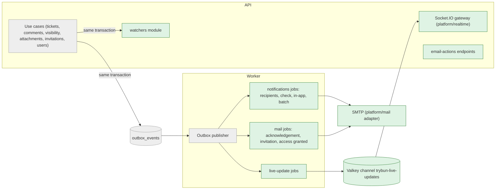
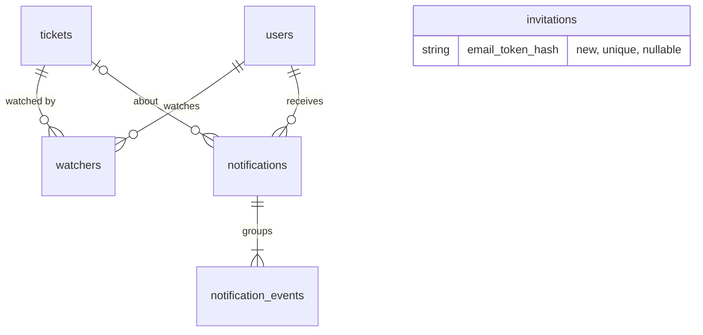

# Watching and notifications – watchers, notification center, e-mails and live updates

| | |
|---|---|
| Status | `draft` |
| Created | 2026-10-26 |
| Plan task | `S1-15` |
| System specification sections | §6.4–§6.7, §14.2, §14.4, §17.2, §18.3, §18.5; also §4.3, §5.7, §6.1, §6.3, §7.3, §7.4, §13.1, §13.2, §13.3, §15.6, glossary |
| Related issues / PRs | Sibling specifications: S1-01 projects ([#111](https://github.com/trybun/trybun/pull/111)), S1-02 organizations ([#112](https://github.com/trybun/trybun/pull/112)), S1-03 invitations and accounts ([#113](https://github.com/trybun/trybun/pull/113)), S1-04 permission layer ([#114](https://github.com/trybun/trybun/pull/114)), S1-05 ticket model ([#115](https://github.com/trybun/trybun/pull/115)), S1-06 statuses ([#116](https://github.com/trybun/trybun/pull/116)), S1-07 editor and `@trybun/markdown` ([#117](https://github.com/trybun/trybun/pull/117)), S1-08 attachments ([#119](https://github.com/trybun/trybun/pull/119)), S1-09 portal ([#118](https://github.com/trybun/trybun/pull/118)), S1-10 team ticket view ([#120](https://github.com/trybun/trybun/pull/120)), S1-11 visibility ([#121](https://github.com/trybun/trybun/pull/121)), S1-12 comments ([#122](https://github.com/trybun/trybun/pull/122)), S1-13 team list ([#123](https://github.com/trybun/trybun/pull/123)), S1-14 Kanban board ([#124](https://github.com/trybun/trybun/pull/124)); [ADR 0009](../../docs/adr/0009-invitation-flow.md) |

## Context

After Stage 1's earlier tasks, people can create, triage, comment on and close tickets, but **nobody hears about a change** unless they open the ticket again. A requester does not learn that the team answered. An assignee does not learn that the requester replied. A Project manager does not see a new ticket waiting for triage until they look at the queue. Every open view also stays stale until it is reloaded. The MVP promise of Stage 1 – "real users report tickets, the team handles them" – needs this feedback loop.

The specification describes it in [§6.4](../../docs/spec/06-comments-notifications.md)–[§6.7](../../docs/spec/06-comments-notifications.md) (watchers, channels, events and their defaults, the sending rules) and [§14.4](../../docs/spec/14-architecture.md) (one-time WebSocket tickets, CASL-authorized subscriptions, closing sockets). The plan row of S1-15 adds: outgoing e-mail via SMTP (Nodemailer) with React Email templates, the no-reply sender with a "Reply in the portal" link until S2-12 brings e-mail replies ([§6.3](../../docs/spec/06-comments-notifications.md)), Mailpit locally, the acknowledgement e-mail for new end-user tickets, and a "Send a test e-mail" action on the "Configure e-mail" item of the getting-started checklist ([§15.6](../../docs/spec/15-deployment.md)). The per-event settings stay fixed at the defaults of §6.6 until S2-11.

The sibling specifications of Stage 1 hand these items to S1-15, and this specification covers each of them without re-deciding the sibling's own questions:

| From | Item |
|---|---|
| S1-03 [#113](https://github.com/trybun/trybun/pull/113) Q1 | Invitation and "access granted" e-mails; how the invitation token reaches the e-mail when only its hash is stored |
| S1-05 [#115](https://github.com/trybun/trybun/pull/115) Q14 | Outbox events `ticket.created` and `ticket.updated` |
| S1-06 [#116](https://github.com/trybun/trybun/pull/116) Q10, Q11 | Watchers of a duplicate move to the original; the resolution-confirmation e-mail with signed links, the link token and the token-authorized `POST` |
| S1-08 [#119](https://github.com/trybun/trybun/pull/119) Q7, Q8 | The in-app notification of an infected upload; live attachment states replacing the 3-second polling |
| S1-09 [#118](https://github.com/trybun/trybun/pull/118) Q10, Q14 | Watched tickets in `involvement=mine`; the token on the confirmation page; the bell in the portal header |
| S1-10 [#120](https://github.com/trybun/trybun/pull/120) Q11 | The watch toggle in the field panel; live updates of an open ticket |
| S1-11 [#121](https://github.com/trybun/trybun/pull/121) Q10 | The notification of the project team about a sharing request; watchers after a change of organization |
| S1-07 [#117](https://github.com/trybun/trybun/pull/117) Q1 | E-mails render Markdown with `renderEmailMarkdown` of `platform/markdown` and decide which attachments the recipient may see |
| S1-12 [#122](https://github.com/trybun/trybun/pull/122) Q2, Q15 | `comment.created`; mention, comment and reopen notifications; watchers added by commenting and mentioning; e-mails resolve `@{userId}` for their recipient |
| S1-13 [#123](https://github.com/trybun/trybun/pull/123) | Live updates of the team list through query invalidation |
| S1-14 [#124](https://github.com/trybun/trybun/pull/124) Q15 | The board subscription, authorized with `view_board`, that invalidates the board query |

The specification leaves several points open (listed under [Open questions](#open-questions)). Agents may not decide them (Rule 8), so each has a proposed answer for a human to accept, change or reject. The design below already assumes the proposed answers.

## Goals

- People become watchers automatically (requester, assignee, mentioned people, commenters, watchers and requester of a duplicate) or manually, and leave with one click in the ticket, in every in-app notification and in every e-mail ([§6.4](../../docs/spec/06-comments-notifications.md)).
- An in-app notification center (bell with unread count) in the team shell and the portal, with "mark as read" per item and for all ([§6.5](../../docs/spec/06-comments-notifications.md)).
- E-mails in the recipient's language and time zone, from the no-reply sender, with a "Reply in the portal" link and an unwatch link; the acknowledgement e-mail for new end-user tickets; invitation, "access granted" and resolution-confirmation e-mails ([§6.3](../../docs/spec/06-comments-notifications.md), [§6.7](../../docs/spec/06-comments-notifications.md), [§4.3](../../docs/spec/04-ticket-lifecycle.md), [§7.4](../../docs/spec/07-users-organizations-permissions.md)).
- The rules of §6.7: no self-notifications, permissions re-checked at the moment of sending with removal of watchers who lost access, the 2-minute trailing batching window capped at 10 minutes, `@mention` and "Ticket assigned to me" immediate, never an internal event to an end user.
- The events of §6.6 that exist in Stage 1, with the fixed defaults.
- Live updates over the Socket.IO gateway: one-time tickets, CASL-authorized subscriptions with a permission check before every delivery, sockets closed on sign-out, session expiry and deactivation ([§14.4](../../docs/spec/14-architecture.md)).
- "Send a test e-mail" on the "Configure e-mail" item of the getting-started checklist ([§15.6](../../docs/spec/15-deployment.md)).

## Non-goals

- The per-event settings UI and per-user channel choices (S2-11). The defaults are constants of the code.
- Incoming e-mail, personal reply addresses and their tokens (S2-12, [§6.3](../../docs/spec/06-comments-notifications.md)). The e-mails of S1-15 use the no-reply sender and the "Reply in the portal" link.
- Events whose source does not exist in Stage 1: "All sub-tickets completed" (S2-07), "I have the same problem" as a watcher source (S2-02), SLA at risk and breached (Stage 4), import finished and webhook disabled (Stage 6). Each task that introduces the source adds its event with the mechanism of this specification ([§6.6](../../docs/spec/06-comments-notifications.md), last paragraph).
- The events of S1-16 (deletion request submitted or due soon, data export ready). S1-16 runs in the same group 7; whichever of the two tasks lands later adds them with this mechanism, as the plan's rule on cross-cutting parts says.
- A list of watchers on the ticket, and adding other people as watchers. §6.4 has neither.
- Bounce handling, delivery status per e-mail, and a mail queue UI. Failed e-mail jobs stay in BullMQ's failed set, visible to the Administrator ([§17.2](../../docs/spec/17-conventions.md)).
- Live updates of portal lists. The portal's "My tickets" list refreshes on focus (TanStack Query defaults), like today.
- Web push and mobile push notifications.

## Proposed change

### Behaviour

#### Watching

- **Automatic watchers** ([§6.4](../../docs/spec/06-comments-notifications.md)) are added **in the transaction of the change** that makes them watchers, through `WatchersService.addAutomatic(tx, ticketId, userIds, reason)` of the new `watchers` module ([Q6](#open-questions)):
  - the requester, when the ticket is created (S1-05) and when the requester changes;
  - the assignee, when the ticket is created with one or assigned (S1-05);
  - the author of a comment or note, and every person in its `comment_mentions` (S1-12);
  - when a ticket becomes a `duplicate` (S1-06's duplicate use case, [#116](https://github.com/trybun/trybun/pull/116) Q10): the requester and the watchers of the duplicate become watchers of the original. This also makes the author of an `only_me` ticket a watcher of the redacted shared copy ([§5.2](../../docs/spec/05-visibility-and-search.md)). Tickets marked as duplicates before S1-15 are not migrated, as #116 Q10 proposes.
  
  A person who already watches keeps the original reason. Adding is idempotent (`INSERT … ON CONFLICT DO NOTHING`).
- **Manual watching**: **Watch** / **Unwatch** (PL: „Obserwuj” / „Przestań obserwować”) in the field panel of the team ticket view ([#120](https://github.com/trybun/trybun/pull/120)) and in the portal ticket view ([#118](https://github.com/trybun/trybun/pull/118)). It is a toggle button (`aria-pressed`) with an optimistic update that is rolled back on error ([§18.5](../../docs/spec/18-code-patterns.md) "Changing data").
- **Unwatching is not remembered.** It deletes the row. A later trigger – a new comment of the person, a new mention, a new assignment – adds them again, as on GitHub ([Q6](#open-questions)).
- **My tickets** (`GET /api/v1/tickets?involvement=mine`, [#118](https://github.com/trybun/trybun/pull/118) Q10) widens from "requested" to "requested **or watched**", without a new parameter. The filter stays inside `accessibleBy(ability, 'read')`, so a watcher row of a ticket the person can no longer see never shows up.

#### Events, recipients and channels

Each event type has a pure recipient rule in `modules/notifications/domain/recipients.ts`: from the event, the ticket and its watchers, it returns the candidates with the notification type and the channels. The defaults are fixed in `domain/channel-defaults.ts` and follow §6.6:

| Notification type (`notification_type`) | Source event | Recipients | In-app | E-mail | Batched |
|---|---|---|---|---|---|
| `mentioned` | `comment.created` | people in `comment_mentions` of the new comment | ✅ | ✅ | no (immediate) |
| `assigned` | `ticket.created`, `ticket.updated` with a new assignee | the new assignee | ✅ | ✅ | no (immediate) |
| `commented` | `comment.created` | watchers (team: every kind they may read; end users: public comments whose audience includes them) | ✅ | team –, end user ✅ | yes |
| `status_changed` | `ticket.status_changed` | watchers (end users only when the **public** status changed, `fromPublic ≠ toPublic`, [§4.3](../../docs/spec/04-ticket-lifecycle.md)) | ✅ | team –, end user ✅ | yes |
| `ticket_awaiting_triage` | `ticket.created` in `triage` | Project managers of the project | ✅ | – | no |
| `requester_replied` | `ticket.status_changed` with `commentId` and `from = waiting_for_requester` | the assignee and team watchers | ✅ | ✅ | yes |
| `ticket_reopened` | `ticket.status_changed` with `reopen` and `commentId` ([§6.1](../../docs/spec/06-comments-notifications.md)) | the assignee | ✅ | ✅ | yes ([Q10](#open-questions)) |
| `sharing_approval_requested` | `ticket.sharing_requested` | Developers and Project managers of the project ([§5.2](../../docs/spec/05-visibility-and-search.md)) | ✅ | – | no |
| `attachment_infected` | `attachment.infected` | the uploader, team member or end user ([§13.3](../../docs/spec/13-non-functional.md)) | ✅ | – | no |

- When one event gives one recipient several types (a watcher who is also mentioned), the recipient gets one entry with the strongest type: `mentioned` › `assigned` › `ticket_reopened` › `requester_replied` › `status_changed` › `commented`.
- **No self-notifications** ([§6.7](../../docs/spec/06-comments-notifications.md)): the actor of the event (`actorId`) is never a recipient. Automatic changes have no actor, so the automatic close of an unconfirmed resolution notifies the requester like any other public status change.
- **Editing never notifies** ([§6.1](../../docs/spec/06-comments-notifications.md)): a mention added by editing a comment notifies nobody. Mentions in the ticket description notify nobody either, because S1-12 stores mentions only for comments ([Q10](#open-questions)).
- **E-mails outside the notification center**, sent once per event with a deterministic job ID:

| E-mail | Source event | Recipient | Language |
|---|---|---|---|
| Acknowledgement "We have received your ticket ERP-123" (PL: „Otrzymaliśmy Twoje zgłoszenie ERP-123”) | `ticket.created` when the actor is the requester and an end user ([§6.7](../../docs/spec/06-comments-notifications.md)) | the requester | recipient's |
| Invitation | `invitation.issued`, `invitation.resent` | the invited address | system default ([§7.4](../../docs/spec/07-users-organizations-permissions.md)) |
| "You now have access to {project/organization}" | `user.access_granted` | the account | recipient's |
| Test e-mail | the action on the checklist | the Administrator who pressed it | recipient's |

#### Sending rules

- **Permission check at the moment of sending** ([§6.7](../../docs/spec/06-comments-notifications.md)). The job loads each candidate's principal and ability (`AbilityFactory.forPrincipal()`, the same as a request) and checks, at the moment the in-app entry is written and again at the moment an e-mail is sent:
  - the account is `active`;
  - `read` on the ticket;
  - for a comment: `read` on the comment (S1-12's rule with its kind and audience), so an internal note never reaches an end user;
  - for an end user, the event is public (public comment, public status change; `attachment_infected` only about their own upload).

  A watcher who fails the first two checks receives nothing and is **removed from the watchers** in the same job (`WatchersService.removeWithoutAccess`). This covers narrowed visibility, removal from a project, a change of organization ([§7.3](../../docs/spec/07-users-organizations-permissions.md), [#121](https://github.com/trybun/trybun/pull/121) Q10) and deactivation, without a new outbox event ([Q7](#open-questions)). Lists that read watchers (`involvement=mine`, the notification center) filter through the ability anyway.
- **Never internal events to end users**: an end user's recipient rule only produces public types, and the check above runs again at sending. A test parses every end-user e-mail and in-app response with the strict end-user schemas of S1-09.
- **Batching** ([§6.7](../../docs/spec/06-comments-notifications.md), [Q5](#open-questions)) applies to e-mails. The in-app center already shows one entry per ticket ([In-app notification center](#in-app-notification-center)), updated at once.
  - Each batched notification event is stored with `email_state = 'pending'`. The job then adds the delayed job `send-notification-batch` with payload `{ recipientId, ticketId }` and deduplication `{ id: notification-batch-<recipientId>-<ticketId>, ttl: delay, extend: true, replace: true }` ([§17.2](../../docs/spec/17-conventions.md), memory `bullmq.md`).
  - `delay = min(now + 2 min, firstPendingAt + 10 min) − now`, where `firstPendingAt` is the oldest pending event of that recipient and ticket. Each further change within the window postpones sending by 2 minutes, never past 10 minutes after the first change.
  - When the batch job runs, it locks the pending rows of the pair (`FOR UPDATE SKIP LOCKED`), re-checks each event as above (a deleted comment, a comment the recipient may no longer read, a ticket they no longer see → `skipped`), renders **one** e-mail with the remaining events, sends it and marks them `sent`. Because the deduplication key expires with the delay, a change after the batch was sent starts a new batch and a new e-mail. A row added while the job is sending is not among its locked rows; its own event has already started the next batch. Sending is at least once: a crash after the SMTP server accepted the message and before the rows are marked `sent` sends that e-mail again on retry, as the outbox delivers events at least once ([§17.2](../../docs/spec/17-conventions.md)).
  - `mentioned` and `assigned` are never batched: the job enqueues `send-notification-email` at once, with `jobId` `notification-email-<notificationEventId>`.
- **Language and time zone** ([§13.1](../../docs/spec/13-non-functional.md)): every e-mail is rendered with the `Translator` of `platform/i18n` in `localeOf(recipient)` and the recipient's time zone, except the invitation (system default, §7.4). Status names come from the `tickets` namespace (public names for end users, [#116](https://github.com/trybun/trybun/pull/116)).
- **No SMTP configured** (`isSmtpConfigured` false): the e-mail channel is off. Events get `email_state = 'skipped'` and are never sent later; in-app notifications work ([Q17](#open-questions)).

#### E-mails

- **Templates**: React Email components, rendered on the server with `render()` of React Email. The layout (brand from `docs/brand/`, footer) lives in `platform/mail/`, and each template in its module's `emails/` folder (`modules/notifications/emails/notification-batch.tsx`, `…/acknowledgement.tsx`, `modules/invitations/emails/invitation.tsx`, …). Texts only from the `Translator` with the typed keys of the `emails` namespace of `@trybun/i18n` ([§18.3](../../docs/spec/18-code-patterns.md)).
- **Content**: subject `[ERP-123] {title}`. The body lists the batched events in order: comments rendered with `renderEmailMarkdown(source, { baseUrl })` of S1-07 ([#117](https://github.com/trybun/trybun/pull/117)), after the mention tokens `@{userId}` are replaced with the display names **for the recipient**, following the identity rule of [§5.4](../../docs/spec/05-visibility-and-search.md) as S1-12 does for the API ([#122](https://github.com/trybun/trybun/pull/122) Q2). Status changes are shown as "{actor} changed the status from X to Y". Attachments appear as links, never embedded ([§13.3](../../docs/spec/13-non-functional.md)); opening one needs a session, like any attachment link (ADR 0008).
- **Links**: **View ticket** goes to the route of the recipient's account kind (`/tickets/{identifier}` for the team, `/portal/tickets/{identifier}` for end users, [#118](https://github.com/trybun/trybun/pull/118) Q1). "Reply in the portal" (PL: „Odpowiedz w portalu”) goes to the comment field of the same route ([§6.3](../../docs/spec/06-comments-notifications.md)). **Unwatch** opens `/unwatch#token=…` ([Signed e-mail links](#signed-e-mail-links)), so unwatching is one click from every e-mail.
- **Headers**: `From: TRYBUN_MAIL_FROM`, `Auto-Submitted: auto-generated` ([§6.3](../../docs/spec/06-comments-notifications.md)). No `List-Unsubscribe` header: RFC 8058's one-click `POST` needs the token in the URL, which [§17.2](../../docs/spec/17-conventions.md) forbids ([Q8](#open-questions)). Every e-mail has its own `Message-ID`; every e-mail about a ticket also has `References` and `In-Reply-To` set to a stable thread ID `<ticket-<ticketId>-<recipientId>@<domain>>`. The acknowledgement e-mail uses the thread ID as its `Message-ID`, so the requester's messages thread under it ([§6.7](../../docs/spec/06-comments-notifications.md)); for other recipients, mail clients thread by the shared reference.
- **Resolution confirmation** ([§4.3](../../docs/spec/04-ticket-lifecycle.md), [#116](https://github.com/trybun/trybun/pull/116) Q11). When a batch for the requester contains the change into `waiting_for_requester` with reason `confirmation`, and the ticket still waits at sending time, the e-mail shows "Is your problem solved?" with two buttons, **Yes, solved** and **No, still a problem**. Each button is a signed link to the confirmation page of S1-09 ([#118](https://github.com/trybun/trybun/pull/118) Q14). It is part of the normal batched e-mail, so §6.7 needs no new immediate event ([Q9](#open-questions)).
- **Invitation e-mail** ([§7.4](../../docs/spec/07-users-organizations-permissions.md), [#113](https://github.com/trybun/trybun/pull/113) Q1). Only the hash of the copied link's token is stored, so no job can read it. The e-mail job therefore **issues its own token**: it generates a random token with the same generator as ADR 0009, stores its SHA-256 hash in a second column `invitations.email_token_hash` with a conditional update (`WHERE id = … AND used_at IS NULL AND revoked_at IS NULL`), and sends the link `https://<domain>/invitations#token=<token>`. Acceptance accepts either hash. Resending replaces both tokens and sends a new e-mail; revoking and accepting invalidate both. No token, plain or encrypted, ever leaves the job or is stored ([Q2](#open-questions)). With SMTP configured, the note under the copied link in S1-03's dialog changes from "Only this link works" to "We also e-mailed a link. Both work until {date}."; without SMTP no invitation e-mail is sent ([Q17](#open-questions)) and the note stays. A retry of the job after a delivered e-mail (a crash before completion) issues a new e-mail token, so only the latest e-mail link works; the copied link is unaffected.
- **Test e-mail** ([§15.6](../../docs/spec/15-deployment.md)): "Configure e-mail" is ticked when `TRYBUN_SMTP_HOST` is set (the item exists since S0-12). It gains **Send a test e-mail**, which sends synchronously to the signed-in Administrator's own address and shows "Test e-mail sent to {address}" or the error ([Q11](#open-questions)). The address cannot be chosen, so the action cannot be used to send mail elsewhere.
- **Delivery failures**: each e-mail job retries with exponential backoff (10 attempts, starting at 1 minute, about 17 hours in total) and then stays in the failed set ([§17.2](../../docs/spec/17-conventions.md)). The adapter maps SMTP errors to `AppError` codes and logs only the code, never the address or the content ([§13.5](../../docs/spec/13-non-functional.md)).

#### Signed e-mail links

The resolution-confirmation buttons and the unwatch link carry a **signed token** ([§4.3](../../docs/spec/04-ticket-lifecycle.md): "signed one-click links"):

- **Format**: a compact JWS (HS256) built with `jose` (already a dependency of the server), with the claims `purpose` (`resolution_confirmation` or `watching`), `sub` (user ID), `tid` (ticket ID), `iat`, `exp`. Resolution-confirmation tokens expire after 30 days, unwatch tokens after 90 days (the lifetime of the reply tokens of §6.3).
- **Key**: a random 256-bit key per installation, stored in the table `email_signing_keys` and created by the server on first use (`INSERT … ON CONFLICT DO NOTHING`), so existing installations need no new environment variable and the key is restored with the database backup. The key ID (`kid`) allows rotation by inserting a new key ([Q3](#open-questions)). S2-12 reuses the same key for reply tokens.
- **Transport**: the token is in the URL fragment (`#token=…`), which the browser never sends to a server, as with the setup link ([§15.6](../../docs/spec/15-deployment.md)). The page sends it in the body of a `POST`.
- **Pages**:
  - `/portal/tickets/{identifier}/resolution-confirmation?answer=…#token=…` (S1-09's page, [#118](https://github.com/trybun/trybun/pull/118) Q14): with a token, the button calls `POST /api/v1/email-actions/resolution-confirmation`. Nothing changes on `GET`, so link scanners cannot answer.
  - `/unwatch#token=…`: shows "Stop watching ERP-123?" and submits automatically once the page has loaded, then shows "You no longer watch ERP-123" with **Watch again** (the same token with `watching: true`, Rule 2 undo). Unwatching is harmless and reversible, so a scanner that runs JavaScript costs only an e-mail ([Q8](#open-questions)).
- **Authorization**: the endpoints need no session. They act as the token's user: the account must be `active`, and the action goes through the same service method and the same ability as the signed-in action (S1-06's `confirm_resolution`, the `watch` action below). An invalid, expired or foreign token, and a user who can no longer read the ticket, all return the same `email_action.token_invalid`, so nothing is revealed. The endpoints are rate-limited by client IP like other unauthenticated endpoints ([§14.4](../../docs/spec/14-architecture.md)).

#### In-app notification center

- **Bell** in the header of the team shell and of the portal ([#118](https://github.com/trybun/trybun/pull/118)), with the unread count as a badge (capped at "99+") and an accessible name "Notifications, 3 unread" (PL: „Powiadomienia, 3 nieprzeczytane”). The count is never shown by colour alone ([§13.4](../../docs/spec/13-non-functional.md)).
- Pressing it opens a popover from the tablet breakpoint and a bottom sheet on phones ([§18.6](../../docs/spec/18-code-patterns.md)), loaded lazily ([§18.5](../../docs/spec/18-code-patterns.md)). It lists the entries newest first with **Load more** (cursor envelope). There is no separate page ([Q16](#open-questions)).
- **One entry per ticket** (GitHub's thread model, [Q4](#open-questions)): a new event of the same ticket moves the entry to the top, marks it unread again and replaces its text with the latest one ("Anna Nowak mentioned you", "3 updates since you last read"). Notifications without a ticket (an infected draft upload) are entries of their own.
- Each entry shows the actor, the text of its type, the ticket identifier and title, the relative time in the user's locale, and an unread marker (icon and text for screen readers, not only colour). Pressing the entry opens the ticket and marks it read. A menu per entry has **Mark as read** and **Unwatch** (when the person watches the ticket), so unwatching is one action from every notification ([§6.4](../../docs/spec/06-comments-notifications.md)). **Mark all as read** sits at the top. All targets are 44 px (Rule 9).
- **Retention**: entries older than 90 days (by their last event) are deleted by the daily job scheduler `purge-old-notifications` ([§13.2](../../docs/spec/13-non-functional.md), "Notifications 90 days").

#### Live updates

- **Connection** ([§14.4](../../docs/spec/14-architecture.md)): the real-time client of `lib/realtime` asks the BFF for a ticket (`POST /api/v1/realtime-tickets`). The API stores a random 128-bit ticket bound to the user and the Keycloak session (`sid` of the access token) in Valkey with a 30-second TTL and consumes it with `GETDEL` in the handshake. The gateway refuses a handshake without a valid ticket or with an `Origin` other than `https://${TRYBUN_DOMAIN}`. Every reconnection asks for a new ticket and, once connected, invalidates the queries of all active subscriptions, so events missed while offline are caught up.
- **Topics** ([Q13](#open-questions)), each registered by its feature module with its ability check:

| Topic | Room | Authorized with | Events | Web reaction |
|---|---|---|---|---|
| `ticket` | `ticket-<ticketId>` | `read` on the `Ticket` | ticket fields, status, comments, attachments of the ticket | invalidates `['tickets', 'detail', id]`, the timeline and the attachments of the ticket |
| `project` | `project-<projectId>` | `view_board` on the `Project` ([#124](https://github.com/trybun/trybun/pull/124) Q15) | any change of a ticket of the project | invalidates `['tickets', 'board', projectId]` and `['tickets', 'list']` ([#123](https://github.com/trybun/trybun/pull/123)) |
| `user` | `user-<userId>`, joined automatically | the socket's own user | the person's notifications; state changes of their own uploads | invalidates `['notifications', …]`, the unread count and the attachment query |

- **Thin events** ([§18.3](../../docs/spec/18-code-patterns.md)): `{ topic, id, event, subjectId, version? }`, e.g. `{ topic: 'ticket', id, event: 'comment.created', subjectId: commentId }`. No record content. The schemas live in `@trybun/contracts/realtime`.
- **Path of an event**: an outbox event → a Worker job per event type of the producing module (`publish-ticket-live-update`, `publish-attachment-live-update`, …) → a message on the Valkey channel `trybun-live-updates` (published with the existing `ioredis` client, [Q12](#open-questions)) → every API instance → for the local sockets of the room, the gateway loads the current principals of their users (one query) and emits only to the sockets that pass the **event's** check ([§14.4](../../docs/spec/14-architecture.md): "permissions are checked again before each event is delivered").
- **The check is per event, not only per topic.** Each topic registers, next to its subscription action, a check per event subject: `read` on the `Ticket` for ticket events (also on the `project` topic, so a board viewer never learns about a ticket they cannot see, e.g. an `only_me` ticket), `read` on the `Comment` for comment events (S1-12's rule with kind and audience, so an end user's socket never learns that an internal note exists), `read` on the `Attachment` for attachment events. The subject record is loaded once per event with its record descriptor ([#114](https://github.com/trybun/trybun/pull/114)); a deleted subject (e.g. `comment.changed` for a deletion) is checked against its ticket and, for comments, against the kind and audience carried in the event.
- **Attachment states** ([#119](https://github.com/trybun/trybun/pull/119) Q7): `attachment.available` and `attachment.infected` are delivered to the uploader's `user` topic, and to the ticket's topic when the attachment is linked. The 3-second `refetchInterval` of S1-08 is removed, so only one mechanism remains ([§18.5](../../docs/spec/18-code-patterns.md)).
- **Closing sockets** ([§14.4](../../docs/spec/14-architecture.md), [Q14](#open-questions)):
  - **sign-out**: the web's sign-out calls `DELETE /api/v1/realtime-connections/current` with the session's token before it deletes the session; the API disconnects the sockets of that `sid` on every instance (`in('session-<sid>').disconnectSockets()` through the Redis adapter). A failed call never blocks the sign-out; the re-validation below closes the sockets then;
  - **deactivation**: a Worker job on S1-03's `user.deactivated` ([#113](https://github.com/trybun/trybun/pull/113)) disconnects all sockets of the user (`user-<userId>` room) through the Valkey channel;
  - **session expiry and back-channel logout**: every API instance re-validates its sockets every 60 seconds – one query for the session rows of their `sid`s (not expired) and their users (`active`) – and disconnects those that fail (the interval is a constant of `platform/realtime` that integration tests shorten). This is well within "at least once per access-token lifetime" (5 minutes).
- **Valkey unavailable** ([§14.4](../../docs/spec/14-architecture.md), [§17.2](../../docs/spec/17-conventions.md)): `POST /realtime-tickets` returns `503 realtime.unavailable`, the client retries with backoff, and the UI keeps working with the refresh on focus.

### Architecture

Takeaway: every side effect starts from an outbox event ([§18.3](../../docs/spec/18-code-patterns.md) "After the commit, only through the outbox"); only the watcher rows are written synchronously, because they are part of the change itself.

- **New server modules**: `watchers` (model, endpoints, `addAutomatic`, `removeWithoutAccess`, `copyToTicket` for duplicates), `notifications` (model, recipient rules, jobs, endpoints, templates), `email-actions` (the two token endpoints; it uses the exported services of `tickets` and `watchers`). **New platform modules**: `mail` (adapter interface `MailTransport` with the DI token, Nodemailer implementation, React Email layout and `render`), `realtime` (ticket endpoint, gateway, topic registry `RealtimeModule.forRoot({ topics })` like `AuthorizationModule.forRoot`, delivery, re-validation sweep, `RealtimePublisher` for the Worker), `signed-tokens` (key table, `sign`/`verify` with `jose`).
- **Dependencies between modules**: `tickets`, `comments` → `watchers`; `notifications` → `watchers`; `email-actions` → `tickets`, `watchers`. `platform` imports no module; the topics, like the abilities, are passed by the root modules. No cycles.
- **Dependencies (npm)**, all named in [§14.2](../../docs/spec/14-architecture.md): `nodemailer`, React Email (`@react-email/components`, `@react-email/render`), `@nestjs/websockets`, `@nestjs/platform-socket.io`, `socket.io`, `@socket.io/redis-adapter`, and `socket.io-client` in the web. Each is added at its latest stable version after the 7-day cooldown, with an explicit range (Rule 10). Integration tests use a Mailpit container (Testcontainers, generic container) as the real SMTP server and read its API.

### Outbox events

New events and additive fields in sibling use cases ([§17.2](../../docs/spec/17-conventions.md) "Payload compatibility"; [Q15](#open-questions)). Payloads carry identifiers and changed values only ([§18.3](../../docs/spec/18-code-patterns.md)):

| Event | Written by | Payload | Consumers (jobs) |
|---|---|---|---|
| `ticket.created` (new) | S1-05 create | `{ ticketId, projectId, requesterId, assigneeId \| null, status, actorId \| null }` | `notify-ticket-created`, `send-acknowledgement-email`, `publish-ticket-live-update` |
| `ticket.updated` (new) | every use case that changes the ticket's own fields except the status (S1-05 update and automatic unassignment, S1-11 visibility) | `{ ticketId, projectId, version, fields, assigneeFrom?, assigneeTo?, actorId \| null }` | `notify-ticket-updated` (only assignee changes), `publish-ticket-live-update` |
| `ticket.status_changed` (S1-06, `commentId` from S1-12) | S1-06 | adds optional `version` | `notify-status-changed`, `publish-ticket-live-update` |
| `ticket.sharing_requested` (new) | S1-11 request use case | `{ ticketId, projectId, actorId }` | `notify-sharing-requested`, `publish-ticket-live-update` |
| `comment.created` (as #122 names it) | S1-12 create | `{ commentId, ticketId, kind, authorId }` | `notify-comment-created`, `publish-ticket-live-update` |
| `comment.changed` (new) | S1-12 edit, delete, redact | `{ commentId, ticketId, kind, audience, change }` (kind and audience let the gateway check a deleted comment) | `publish-ticket-live-update` only (editing never notifies) |
| `attachment.linked` (new) | S1-08 link request | `{ attachmentId, ticketId }` | `publish-ticket-live-update` only |
| `attachment.available`, `attachment.infected`, `attachment.deleted` (S1-08) | S1-08 | unchanged | `notify-attachment-infected`, `publish-attachment-live-update` |
| `invitation.issued` (S1-03), `invitation.resent` (new) | S1-03 issue, resend | `{ invitationId }` | `send-invitation-email` |
| `user.access_granted` (S1-03) | S1-03 | unchanged | `send-access-granted-email` |
| `user.deactivated` (S1-03) | S1-03 | unchanged | `disconnect-user-sockets` |

Every consumer is its own job ([§18.3](../../docs/spec/18-code-patterns.md) "Handlers"), validates its payload with the producer's schema, and is idempotent: notification events are unique per `(recipient_id, source_event_id)`, and e-mail jobs use `jobId`s derived from their source (`ack-<ticketId>`, `invitation-email-<outboxEventId>`, `notification-email-<notificationEventId>`).

### Data model

- **`Watcher`** (`watchers`): `ticketId` (FK, `ON DELETE CASCADE` – tickets are deleted only by undoing an import, [§17.2](../../docs/spec/17-conventions.md)), `userId` (FK `users`), `reason` enum `watch_reason` (`requester`, `assignee`, `mention`, `comment`, `duplicate`, `manual`), `createdAt`. Primary key `(ticket_id, user_id)`, index on `user_id` for `involvement=mine`. Not versioned; watching does not change the ticket's `version` ([§17.2](../../docs/spec/17-conventions.md) "Concurrency").
- **`Notification`** (`notifications`), one entry of the center: `id`, `recipientId` (FK `users`), `ticketId` (FK, nullable, cascade), `type` (the latest `notification_type`), `actorId` (latest actor, FK `users`, nullable), `unreadEventCount`, `readAt`, `lastEventAt`, `createdAt`. Partial unique index `(recipient_id, ticket_id) WHERE ticket_id IS NOT NULL`; index `(recipient_id, last_event_at DESC, id)` for the list and the unread count.
- **`NotificationEvent`** (`notification_events`), one row per recipient per source event: `id`, `notificationId` (FK, cascade), `recipientId`, `sourceEventId` (the outbox event ID), `type`, `actorId`, `data` (jsonb: identifiers and changed values, e.g. `{ commentId }`, `{ from, to, fromPublic, toPublic }`, `{ attachmentId }`; never content), `emailState` enum `notification_email_state` (`none`, `pending`, `sent`, `skipped`), `emailedAt`, `createdAt`. Unique `(recipient_id, source_event_id)`; partial index `(recipient_id, notification_id) WHERE email_state = 'pending'` for the batch.
- **`EmailSigningKey`** (`email_signing_keys`): `id` (the `kid`), `key` (bytea, 32 random bytes), `createdAt`.
- **`Invitation`** (S1-03): `emailTokenHash` (SHA-256 base64url, unique, nullable).
- Enums are defined once in `@trybun/contracts` with a test against the Prisma enums ([§18.4](../../docs/spec/18-code-patterns.md)).
- **Personal data** ([§13.2](../../docs/spec/13-non-functional.md)): watchers, notifications and notification events of a user are deleted by anonymization and the retention job, and listed in the data export ("watched tickets", "notifications" without other users' names), added to S1-16's export and anonymization by whichever task lands later. The notification events reference actors by ID; the display name is resolved when reading, so an anonymized actor appears as "Deleted user".

### API contracts

| Endpoint | Check | Contract |
|---|---|---|
| `GET /api/v1/tickets/{ticketId}/watchers/me` | `read` on the `Ticket` (target record guard) | `{ watching, reason \| null, allowedActions }` (`watch` when permitted) |
| `PUT /api/v1/tickets/{ticketId}/watchers/me` | `watch` | `200` with the same shape; idempotent; reason `manual` unless already watching |
| `DELETE /api/v1/tickets/{ticketId}/watchers/me` | `watch` | `204`; idempotent |
| `GET /api/v1/notifications?cursor&limit` | own entries only | Cursor envelope ([§18.4](../../docs/spec/18-code-patterns.md)) of `{ id, type, ticket: { id, identifier, title } \| null, actor: { id, displayName } \| null, unreadEventCount, readAt, lastEventAt, data, allowedActions }`; entries of tickets the person can no longer `read` are left out (`accessibleBy` on the relation) |
| `GET /api/v1/notifications/unread-count` | own | `{ count }`, counted with the same filter |
| `POST /api/v1/notifications/{notificationId}/read` | own entry (an entry of someone else is `404`) | `204`; idempotent |
| `POST /api/v1/notifications/read` | own | Body `{ upTo }` (the `lastEventAt` of the newest entry the person saw), so an entry that arrives during the click stays unread; `204` |
| `POST /api/v1/email-actions/resolution-confirmation` | `@Public()`, signed token, rate limit by IP | Body `{ token, answer: 'solved' \| 'not_solved' }`; calls S1-06's confirmation service as the token's user; `200` `{ ticketIdentifier, publicStatus }`; `409 ticket.resolution_confirmation_not_pending` (S1-06) |
| `POST /api/v1/email-actions/watching` | `@Public()`, signed token, rate limit by IP | Body `{ token, watching }`; `200` `{ ticketIdentifier, watching }` |
| `POST /api/v1/realtime-tickets` | session principal only (an API token gets `403`) | `201` `{ ticket }`; `503 realtime.unavailable` |
| `DELETE /api/v1/realtime-connections/current` | session principal | `204`; disconnects the sockets of the token's `sid` |
| `POST /api/v1/administration/test-email` | `open_administration` (Administrator) | `200` `{ sentTo }`; `409 mail.not_configured`; `502 mail.delivery_failed` |

- **Socket.IO messages** (schemas in `@trybun/contracts/realtime`, validated with `@MessageBody({ schema })` like every parameter, [§18.3](../../docs/spec/18-code-patterns.md)): client → server `subscribe { topic, id }` and `unsubscribe { topic, id }`, acknowledged with `{ ok: true }` or `{ ok: false, code: 'request.not_found' }` – an invisible or missing record and a forbidden topic give the same answer, as with `404`; server → client `live-update` with the thin event.
- **Action codes**: `Ticket` gains `watch` (all roles on tickets they can `read`, §7.5 "Watch / unwatch visible tickets"). S1-04's fail-closed restriction of project-owned subjects forbids it on archived projects with the reason `project.archived`, so the answer is `409 project.archived` ([#114](https://github.com/trybun/trybun/pull/114) Q10). No other permission rule: the notification endpoints read only the principal's own rows.
- **New error codes**: `email_action.token_invalid` (the status of ADR 0009's `invitation.token_invalid`), `realtime.unavailable` (503), `mail.not_configured` (409), `mail.delivery_failed` (502).
- The OpenAPI document and the web client are regenerated with `pnpm api:generate`.

### Web application

- `features/notifications/`: `queries.ts` (`['notifications', 'list']`, `['notifications', 'unread-count']`), `mutations.ts` (mark read, mark all read), `components/notification-bell.tsx` and the lazy `lazy-notification-list.tsx`.
- `features/watchers/`: `queries.ts` (`['watchers', 'me', ticketId]`), `mutations.ts` (watch, unwatch, optimistic), `components/watch-toggle.tsx`, used by the team ticket view and the portal ticket view.
- `lib/realtime/`: the single Socket.IO client (`import 'client-only'`), started by a provider in the team and portal shells, with `useRealtimeSubscription(topic, id, onEvent)`. Feature hooks call it and only invalidate their own query keys ([§18.5](../../docs/spec/18-code-patterns.md)).
- Routes: `/unwatch` (outside both shells, no session needed, like `/invitations`); S1-09's confirmation page reads the token from the fragment.
- Administration: **Send a test e-mail** on the "Configure e-mail" item, a mutation with a toast for the result.
- UI components in `@trybun/ui` (Rule 6): `NotificationBell` (button with badge) and `NotificationItem` (presentational), each with stories for all states (unread, read, without ticket, long title) in the three viewports. Popover and bottom sheet reuse the existing components.
- Texts in the `notifications` and `watchers` namespaces of `@trybun/i18n` (EN, PL), and the e-mail texts in the server-only `emails` namespace.

### Edge cases and failure scenarios

- **SMTP down or rejecting**: e-mail jobs retry for about 17 hours and then stay in the failed set. In-app notifications are unaffected. The test e-mail shows `mail.delivery_failed` with the translated message (no SMTP details).
- **SMTP not configured**: no e-mail job is enqueued; notification events are `skipped`; the test-e-mail action is not offered (the item is unticked).
- **Recipient lost access between the in-app entry and the e-mail**: the e-mail re-check drops the event, and the watcher is removed. If no event remains, no e-mail is sent.
- **Comment deleted or redacted before the batch is sent**: the e-mail renders the current state. A deleted comment is skipped; a redacted one shows its redacted text.
- **The same outbox event delivered twice**: the unique `(recipient_id, source_event_id)` makes the second run a no-op, and e-mail jobs use deterministic IDs.
- **A change while the batch job is sending**: the new row is not among the locked rows, so the next batch sends it.
- **Valkey unavailable**: no realtime tickets and no live updates; the outbox publisher cannot enqueue, so outbox events wait in `outbox_events` and are published when Valkey is back ([§17.2](../../docs/spec/17-conventions.md)) – no notification is lost, only delayed. In-app entries already written stay readable.
- **A socket whose user lost access**: the delivery check drops the event; the subscription stays but receives nothing more. A deactivated user's sockets are closed.
- **An e-mail link opened by another person** (forwarded e-mail): the token acts as its user, as the link's purpose requires. Only unwatching and the requester's confirmation are possible, both reversible by the team or the user.
- **Archived project**: no events happen; watch, unwatch and the confirmation answer return `409 project.archived` (S1-01). A pending batch for a ticket of a project archived in the meantime is still sent, since it describes changes made before archiving.

### Prior art

- **GitHub notifications**: one thread per issue with the latest reason, unsubscribe from a thread that re-subscribes on a new mention, RFC 8058 one-click unsubscribe, `List-Id`/`References` threading. Trybun adopts the thread model, the re-subscribing triggers and the headers; it skips reasons filters and saved filters (S2-11 territory).
- **Jira**: watchers added automatically for reporter, assignee and commenters, and e-mail batching per issue (10 minutes in Jira Cloud). Trybun's window is shorter and trailing (§6.7).
- **Zammad, Zendesk**: the acknowledgement e-mail starts the thread for the customer. Trybun does the same, with the no-reply sender until S2-12.
- **Linear inbox**: live updates over a socket that only invalidate client data. Trybun follows the same thin-event idea ([§18.3](../../docs/spec/18-code-patterns.md)).

## Changes to the system specification

| Section | Change |
|---|---|
| §4.3 | The signed links of the confirmation e-mail: purpose-bound JWS tokens (30 days) in the URL fragment, `POST /email-actions/resolution-confirmation` (Q3, Q9); the question is part of the batched e-mail |
| §5.7 | "My tickets" lists requested or watched tickets (`involvement=mine`) |
| §6.3 | Headers of outgoing e-mails: `References`/`In-Reply-To` with the per-recipient thread ID started by the acknowledgement e-mail; no `List-Unsubscribe` (Q8); the signing key is shared with the reply tokens of S2-12 |
| §6.4 | Automatic watchers are added in the transaction of the change; the watchers of a duplicate move to the original; unwatching is not remembered (Q6) |
| §6.5 | One in-app entry per ticket (Q4), the bell in both shells, **Unwatch** in every entry's menu, no separate page (Q16) |
| §6.6 | The Stage 1 events with their types and recipients – "Requester replied" goes to the assignee and the team watchers, the infected-upload notification to every uploader including team members ([§13.3](../../docs/spec/13-non-functional.md)) –, the reopen notification (Q10), the e-mails outside the center (acknowledgement, invitation, access granted, test) |
| §6.7 | Batching applies to e-mails; the in-app entry updates at once (Q5); the check at sending covers the in-app entry and the e-mail; watchers without access are removed at sending only (Q7); no e-mail without SMTP (Q17) |
| §7.3 | "Removed from their watchers" happens at the next notification, as for a removal from a project (Q7) |
| §7.4 | The invitation e-mail carries its own token; acceptance accepts the hash of either token (Q2) |
| §13.2 | Watchers, notifications and notification events in export, anonymization and the 90-day purge |
| §14.4 | "Real-time connections": topics `ticket`, `project`, `user` (Q13); delivery path through the Valkey channel `trybun-live-updates` (Q12); sign-out disconnect, 60-second re-validation, deactivation through `user.deactivated` (Q14); the signing key table (Q3) |
| §15.6 | "Send a test e-mail" sends to the Administrator's own address, synchronously (Q11) |
| §17.2 | Error codes `email_action.token_invalid`, `realtime.unavailable`, `mail.not_configured`, `mail.delivery_failed`; e-mail retries (Q17) |
| §18.3 | Topic registry `RealtimeModule.forRoot({ topics })`; e-mail templates in the module's `emails/` folder with the layout of `platform/mail` |
| §18.5 | The 3-second polling of attachment states (S1-08) is replaced by the `user` and `ticket` topics |
| §18.9 | Reference implementations: "E-mail template and sending" (`apps/server/src/platform/mail/`, `modules/notifications/emails/`) and "Real-time topic and live-update job" (`apps/server/src/platform/realtime/`, `apps/web/src/lib/realtime/`), task S1-15 |
| ADR 0009 | A note that the invitation has a second, e-mail token (Q2) |
| Plan | S1-15 takes the items of #113 Q1, #116 Q10/Q11, #118 Q10/Q14, #119 Q7/Q8, #121 Q10, #122 and #124 Q15 listed under [Context](#context); a possible split into three tasks (Q1). The maintainer changes the plan |

New or changed glossary terms (code identifier, EN/PL labels):

- Notification – `notification` – Notification / Powiadomienie: an entry of the in-app notification center, one per ticket and recipient.
- Notification type – `notification_type`: `mentioned`, `assigned`, `commented`, `status_changed`, `ticket_awaiting_triage`, `requester_replied`, `ticket_reopened`, `sharing_approval_requested`, `attachment_infected` – with EN/PL texts in the `notifications` namespace (e.g. "mentioned you" / „wspomniał(a) o Tobie”).
- Watch reason – `watch_reason`: `requester`, `assignee`, `mention`, `comment`, `duplicate`, `manual`.
- Notification center – no code – Notifications / Powiadomienia: the bell and its list.
- Acknowledgement e-mail – no code – subject "We have received your ticket {identifier}" / „Otrzymaliśmy Twoje zgłoszenie {identifier}”: the e-mail that confirms a new end-user ticket and starts its e-mail thread.
- E-mail action token – no code, no UI label – a signed, purpose-bound token in an e-mail link (resolution confirmation, unwatch).
- Real-time topic – `ticket`, `project`, `user`, no UI label – a subject a socket subscribes to, authorized with CASL.

## Open questions

Implementation must not start until every question has an answer. Every answer below is a **proposal awaiting human approval**, chosen as the smallest and most reversible option that still meets the plan. Answers marked ⚠ NEEDS HUMAN CONFIRMATION change a security mechanism, an accepted ADR or the plan.

1. ⚠ NEEDS HUMAN CONFIRMATION **Scope of the task.** The plan row bundles three capabilities that each work without the others: the e-mail platform (SMTP, templates, test e-mail, invitation e-mails), watching with notifications, and the real-time gateway. — **Answer (proposed, awaiting approval):** one specification, because the three share events, rules and tests. The implementation follows the phases below. The maintainer splits S1-15 in the plan into three tasks along Phases 1–2, 3 and 4 (the plan allows splitting a task that turns out larger), each one pull request that leaves the system working. Alternative: one pull request for the whole row, as written.
2. ⚠ NEEDS HUMAN CONFIRMATION **How the invitation token reaches the e-mail** ([#113](https://github.com/trybun/trybun/pull/113) Q1). Only the hash of the copied link's token is stored. — **Answer (proposed, awaiting approval):** the e-mail job issues a second token and stores its hash in `invitations.email_token_hash`; acceptance accepts either hash; resend replaces both; revoke and acceptance invalidate both. No token is stored, encrypted or put in a job payload, so "only its hash is stored" ([§13.5](../../docs/spec/13-non-functional.md)) holds. ADR 0009 gets a note. Alternatives: (a) send synchronously in the issuing request – breaks "nothing is sent from the request" ([§18.3](../../docs/spec/18-code-patterns.md)) and ties the request to SMTP; (b) an encrypted token in the outbox payload – the ciphertext and its key end up in the same backup.
3. ⚠ NEEDS HUMAN CONFIRMATION **Key of the signed links.** §4.3 and §6.3 want signed tokens; the server has no secret for it. — **Answer (proposed, awaiting approval):** HS256 JWS with `jose` and a random 256-bit key per installation in `email_signing_keys`, created on first use. Existing installations need no new variable (a new required variable would break `./trybun update` of 0.2.x installations), the key follows the database backup, and `kid` allows rotation. Residual risk: whoever can read the database can forge confirmation and unwatch links – both reversible actions, and such a reader already sees all ticket data. Alternative: a new secret `TRYBUN_SIGNING_SECRET` generated by the install script and added by `./trybun update`, which keeps the key out of database dumps.
4. **Shape of the in-app center.** §6.5 says "list of notifications", §6.7 "combined into one notification". — **Answer (proposed, awaiting approval):** one entry per ticket and recipient, moved to the top and marked unread by each new event (GitHub's threads); events are kept per entry for the e-mail batch. Alternative: one entry per event – a busy ticket floods the list, and §6.7 is met only for e-mails.
5. **What batching applies to.** — **Answer (proposed, awaiting approval):** the 2-minute window applies to e-mails; the in-app entry is updated at once, because Q4 already combines it. Alternative: delay in-app entries by the same window – people in the app would see changes up to 10 minutes late.
6. **Watchers in the transaction or by a job; unwatching remembered?** — **Answer (proposed, awaiting approval):** automatic watchers are written in the transaction of the change through `WatchersService.addAutomatic(tx, …)`, as #116 Q10 proposes for duplicates, so the watch toggle is right immediately after the person's own comment. Unwatching deletes the row and a later trigger adds the person again (GitHub). Alternatives: a job per event (a short window in which the toggle is wrong); an "unwatched" marker that blocks automatic re-adding (a person who unwatched would miss a later mention's follow-ups).
7. **Watchers after a change of organization** ([#121](https://github.com/trybun/trybun/pull/121) Q10, [§7.3](../../docs/spec/07-users-organizations-permissions.md)). — **Answer (proposed, awaiting approval):** removed at the next notification by the check at sending ([§6.7](../../docs/spec/06-comments-notifications.md)), like a removal from a project ([§7.4](../../docs/spec/07-users-organizations-permissions.md)); every read of watchers goes through the ability, so a stale row is never visible. No outbox event is added to S1-02's membership use case. Alternative: an event `organization_member.changed` with a job that deletes the rows at once.
8. **One-click unwatch from an e-mail.** A plain `GET` link would let link scanners act; a page with a button takes two clicks. — **Answer (proposed, awaiting approval):** `/unwatch#token=…` submits automatically after loading and offers **Watch again**. Unwatching is reversible, so the small risk from scanners that run JavaScript is accepted. No RFC 8058 `List-Unsubscribe-Post` header, because the mail client's `POST` carries no body and no fragment, so the token would have to be in the URL ([§17.2](../../docs/spec/17-conventions.md)). Alternatives: a confirmation button, as for the resolution answer; or an exception to §17.2 for this one URL to support the header.
9. **The confirmation e-mail: immediate or batched?** — **Answer (proposed, awaiting approval):** batched, as part of the requester's normal e-mail; the question and the two signed links appear only while the ticket still waits for confirmation at sending time. §6.7 keeps its two immediate events. Token lifetime: 30 days (the timer closes the ticket after 7, and the endpoint answers `409` once it no longer waits). Alternative: a separate immediate e-mail, a third exception to batching.
10. **Events and channels the §6.6 table does not list.** — **Answer (proposed, awaiting approval):** (a) the reopen by a requester comment ([§6.1](../../docs/spec/06-comments-notifications.md) "notifies the assignee") uses the channels of "Requester replied" (in-app and e-mail, batched); an unassigned reopened ticket notifies nobody extra, because it appears in the triage queue; (b) "access granted" ([§7.4](../../docs/spec/07-users-organizations-permissions.md)) is an e-mail only; (c) mentions added by editing and mentions in descriptions notify nobody ([§6.1](../../docs/spec/06-comments-notifications.md): editing never notifies; S1-12 stores mentions for comments only).
11. **The test e-mail.** — **Answer (proposed, awaiting approval):** sent synchronously in the request (the action has no data change, so the outbox rule does not apply, and the Administrator needs the SMTP result now), always to the Administrator's own address. Alternative: a job with the result shown later in the panel.
12. **How the Worker reaches the sockets.** The Worker has no Socket.IO server, and the permission check must run before each delivery. — **Answer (proposed, awaiting approval):** the Worker publishes the thin event on the Valkey channel `trybun-live-updates` with the existing `ioredis` client; each API instance checks its local sockets with fresh principals. No new dependency. Alternative: `@socket.io/redis-emitter` – emits directly to rooms and therefore bypasses the per-socket check.
13. **Topics in Stage 1.** — **Answer (proposed, awaiting approval):** `ticket` (`read`), `project` (`view_board`, used by the board and the team list), `user` (own). The portal's lists get no live updates. Alternative: a topic per list filter – more rooms for little gain at Stage 1 scale.
14. **Closing sockets on sign-out and session expiry.** The API does not see the web session end. — **Answer (proposed, awaiting approval):** the web's sign-out calls `DELETE /realtime-connections/current`; deactivation closes sockets through `user.deactivated`; each API instance re-validates its sockets every 60 seconds against the session rows and the account state. Alternative: re-validation only (up to 60 seconds after a sign-out).
15. **New outbox events in sibling use cases.** S1-05 (Q14) and S1-12 (Q15) leave them to S1-15. — **Answer (proposed, awaiting approval):** the events of [Outbox events](#outbox-events), all additive; S1-15 adds them to the use cases of S1-03, S1-05, S1-08, S1-11 and S1-12 ("cross-cutting parts grow with the features"). Alternative: one generic `ticket.changed` event – consumers would have to reload and diff the ticket to know what changed.
16. **A notifications page.** — **Answer (proposed, awaiting approval):** none; the popover or bottom sheet with **Load more** is the whole center (Rule 2). Alternative: a `/notifications` page with filters, left for S2-11.
17. **E-mail without SMTP and retries.** — **Answer (proposed, awaiting approval):** without `TRYBUN_SMTP_HOST` no e-mail of any kind is enqueued (notification events are marked `skipped`, invitation, acknowledgement and access e-mails are not sent) and nothing is sent later (a flood of old e-mails after configuring SMTP would confuse recipients); with SMTP, 10 attempts with exponential backoff from 1 minute. Alternative: keep them pending until SMTP is configured.

## Implementation plan

Each step leaves the application working and is verified by the named tests. If the plan is split (Q1), each resulting pull request carries the user documentation, the specification updates and the acceptance criteria of its phases (Rules 3 and 8); Phase 5 lists them for the single-PR case.

**Phase 1 – E-mail platform**

1. `platform/mail`: configuration (existing `TRYBUN_SMTP_*`, `TRYBUN_MAIL_FROM`), `MailTransport` adapter with Nodemailer, React Email layout and `render`, the `emails` namespace, `Auto-Submitted` header. Test: integration against a Mailpit container – an e-mail arrives with the headers; SMTP refusing maps to `mail.delivery_failed`.
2. `POST /administration/test-email` and **Send a test e-mail** on the checklist item. Test: integration (sent, `mail.not_configured`, a Developer gets `403`); E2E on three viewports.
3. `platform/signed-tokens`: `email_signing_keys`, `sign`/`verify` with purpose, `kid` and expiry. Test: unit table (valid, expired, other purpose, unknown `kid`, tampered).
4. Invitation and "access granted" e-mails: `invitations.email_token_hash`, acceptance by either hash, the new outbox event `invitation.resent` in S1-03's resend, the jobs on `invitation.issued`, `invitation.resent` and `user.access_granted`. Test: integration – the e-mail link is accepted, the copied link still works, resend invalidates both, the job payload and `outbox_events` contain no token.

**Phase 2 – Watching**

5. `watchers` module: model, migration, `watch` action, endpoints. Test: abilities table (§7.5 row, allowed and denied), integration (`404` for an invisible ticket, `409` for an archived project, idempotency).
6. Automatic watchers in S1-05 create and assignment, S1-12 comment create with mentions, S1-06 duplicate transfer. Test: integration per trigger; re-adding after unwatching.
7. `involvement=mine` with watched tickets. Test: integration – a watched ticket that became invisible is not listed.
8. `WatchToggle` and `features/watchers` in both ticket views. Test: stories; E2E toggle on three viewports.

**Phase 3 – Notifications**

9. Outbox events of [Outbox events](#outbox-events) in the sibling use cases. Test: unit parse tests of the previous payload shapes ([§18.7](../../docs/spec/18-code-patterns.md)).
10. `notifications/domain/recipients.ts` and `channel-defaults.ts`. Test: unit tables – no self-notification, end users only public types, strongest type wins, public status rule.
11. Models `notifications`, `notification_events`; jobs that write in-app entries with the check at sending and watcher removal. Test: integration – a watcher who lost access receives nothing and is removed; an end user never gets an entry for an internal note.
12. Batch and immediate e-mails, acknowledgement e-mail, confirmation question with signed links, thread headers, unwatch link. Test: unit table of the delay function with a fixed clock (2-minute trailing window, 10-minute cap); integration with Mailpit that asserts the delayed job's delay and deduplication key and runs it with `job.promote()` – three changes within 2 minutes give one e-mail; a change after a sent batch gives a new e-mail; a mention is sent without waiting; a Polish recipient gets Polish text and dates in their time zone; the invitation e-mail uses the system default language.
13. `email-actions` endpoints, `/unwatch` page, the token on S1-09's confirmation page. Test: integration (valid, expired, foreign token → same code; not pending → `409`); E2E from a Mailpit link.
14. Notification endpoints, `NotificationBell`, `NotificationItem`, the lazy list, both shells; infected-upload notification; `purge-old-notifications`. Test: stories in three viewports; E2E with axe; integration of the purge.
15. Watchers and notifications in export and anonymization, if S1-16 has landed (otherwise S1-16 adds them).

**Phase 4 – Live updates**

16. `platform/realtime`: tickets in Valkey, gateway with the Redis adapter, `Origin` check, topic registry. Test: integration – a socket without a valid ticket or with a reused one is refused.
17. Live-update jobs, the Valkey channel, per-socket delivery check, topics `ticket`, `project`, `user`. Test: integration – a socket of a user who lost access receives no event; an end user's socket on the `ticket` topic receives no event of an internal note; a board socket receives no event of an `only_me` ticket.
18. Sign-out disconnect, `disconnect-user-sockets` on `user.deactivated`, the 60-second re-validation. Test: integration – deactivating a user closes their open sockets; an expired session's socket is closed within one sweep.
19. `lib/realtime` and the hooks of the ticket view, board, team list, notifications and attachments; removal of S1-08's polling. Test: E2E – a comment by another user appears in an open ticket view without reload.

**Phase 5 – Documentation and specification**

20. User documentation EN/PL (watching, notifications, e-mails, the test e-mail for Administrators), catalogue texts, demo dataset (watchers and a few notifications for the demo accounts), README if commands change. Update the specification sections of the table above as approved, §18.9 references, move this file to `implemented/`. Test: `pnpm lint:spec`, `pnpm help:generate` up to date.

## Acceptance criteria

- [ ] Three changes within 2 minutes produce one e-mail
- [ ] After a batch was sent, a further change of the same ticket for the same recipient produces a new e-mail
- [ ] A watcher who lost access receives nothing and is removed
- [ ] An end user never receives a notification about an internal note (in-app or e-mail), and their socket never receives a live event of an internal note or of a ticket they cannot see
- [ ] A socket without a valid ticket is refused
- [ ] Deactivating a user closes their open sockets
- [ ] Nobody is notified about their own action; an end user who creates a ticket receives the acknowledgement e-mail
- [ ] `@mention` and "Ticket assigned to me" e-mails are sent without waiting for the batch window; no batch waits more than 10 minutes after its first change
- [ ] E-mails are in the recipient's language and time zone; the invitation e-mail in the system default language; each has `Auto-Submitted: auto-generated`, "Reply in the portal" and an unwatch link
- [ ] The confirmation e-mail's links open the portal page and change nothing until the button is pressed; an expired or foreign token is refused
- [ ] The invitation e-mail's link is accepted, and no token appears in the database, the outbox or job data
- [ ] Watchers of a duplicate become watchers of the original; "My tickets" lists watched tickets
- [ ] Live updates reach an open ticket view, the board and the team list; attachment states update without polling
- [ ] "Send a test e-mail" delivers to the Administrator's address (Mailpit locally)
- [ ] Works on phone, tablet and desktop (Rule 9)
- [ ] User documentation EN/PL updated; no product tour in this task (Rules 3, 4)

## Changelog

- 2026-10-26 – Created.
