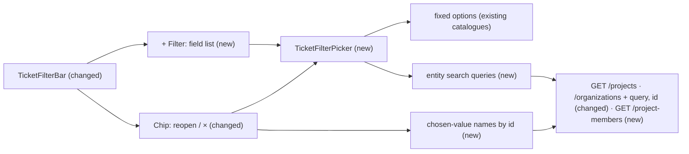

# Ticket list filters: one searchable picker per field

| | |
|---|---|
| Status | `draft` |
| Created | 2026-11-10 |
| Plan task | – (follow-up of `S1-13`) |
| System specification sections | §7.5, §8.1, §12.1, §17.2, §18.5, §18.6 |
| Related issues / PRs | #279, #276, #272, #270, [S1-13 spec](implemented/2026-10-26-team-list-view.md), [#272 spec](2026-11-10-ticket-filter-options-all-pages.md) |

## 📝 TLDR

A team member who filters the ticket list (§8.1) today ticks values in **one long panel** that stacks all eight filters, has no search and applies only with **Show tickets** – with 150 projects the Organization section starts ~7,000 px down, and on a phone the panel is unusable (#279). Proposed: **+ Filter** opens a list of fields, each field opens **its own picker** with a search input and a checkbox list (chosen values on top), each change applies at once, and the chip of a field reopens its picker. Projects, organizations and people are searched **on the server**, so the 2,000-per-list bound of `allPageItems` (`ALL_PAGES_MAX_PAGES`, #276) disappears from the panel.

## 📝 Problem Statement

Found in the manual QA of #276 (150 projects, 120 organizations, 120 members; screenshots in #279):

1. **One panel for every filter.** `TicketFilterPanel` (`ticket-filter-panel.tsx`) renders every section of `useTicketFilterSections` as a `fieldset` of checkboxes in one popover / one bottom sheet. At 46 px per row, 150 projects push every later filter out of reach; a phone shows 11 rows at a time.
2. **No search.** Choosing one of 150 projects, organizations or people means scrolling.
3. **Draft vs applied inconsistency.** The panel edits a `draft` that applies with **Show tickets**, while the Assignee options follow the *applied* `filters.projectId` (`ticket-filter-options.ts`, `assigneeFilterOptionsQueryOptions(…, filters.projectId)`) and the hint "Choose projects to filter by their people" follows the *draft* (`ticket-filter-panel.tsx`). Ticking a project hides the hint, but no people appear until the panel is applied and reopened.
4. **The selection is hard to see.** A chosen `QM150` sits at row 150.
5. **Bounded options.** Since #276 (spec of #272) the panel reads every page of each option list up to 2,000 entries; beyond that, options are missing and chips of visible records say "Unknown".

Who has it: every team member (Developer and above) in an installation with more than a handful of projects, organizations or people.

## 📝 Proposed Solution

The filter follows the convention of Linear, GitHub Projects, Jira and the faceted filter of shadcn/ui's data table:

- **+ Filter** opens the list of fields not yet active (Project, Organization – while organizations exist –, Type, Status, Priority, Assignee, Source, Sharing request). Choosing a field opens **that field's picker** in place.
- **A picker** is a search input (focused on open) over a checkbox list. The chosen values are pinned on top; the rest follows by name – for projects and organizations the active ones first, then the archived ones, deduplicated by ID. Toggling a value **applies at once**: the URL and the list change, the picker stays open for further choices.
- **Entity fields** (Project, Organization, Assignee) search on the server: the first page is shown on open, typing narrows it (`useDeferredValue`, as the assignee picker of S1-10). **Fixed fields** (Type, Status, Priority, Source, Sharing request) filter their few options on the client; Status keeps the **Open** shortcut (the six non-terminal statuses) and its kind groups; Assignee keeps **Me** and **Unassigned** on top.
- **Chips**: one per active field, "Project: QM150 +2" (the first chosen name and the count of the rest). The chip reopens the field's picker; its **×** removes the filter; **Clear filters** stays.
- **Assignee follows the projects at once**: its options are the members of the projects in the current filter, which is now always the applied one – the hint "Choose projects to filter by their people" shows exactly when no project is chosen.

**Alternatives considered:**

- **Client-side search over the lists of #276.** No contract change, but it keeps the 2,000 bound, loads every project, organization and member just to open the panel, and adds a second way of searching people next to the server-searched assignee picker of S1-10 (Rule 12). Lost on convention (unbounded lists are searched on the server) and on the bound.
- **Keep one panel and add a search per section.** Still one long scroll and still a draft that disagrees with the Assignee options.
- **Batch "Show tickets" mode on phones.** Saves list reads while ticking several values, but adds a step (Rule 2) and keeps two behaviours; Linear and GitHub apply at once on every device.

## 📝 Architecture

Takeaway: the change is in the web filter bar, two additive query parameters on two list endpoints and one new read endpoint for people; the ticket list endpoint, its filters and the URL format stay as they are.

**Web application (`apps/web/src/features/tickets/`):**

- `ticket-filter-bar.tsx` – the **+ Filter** trigger, the field list, the chips (two buttons each: reopen, remove) and **Clear filters**. Popover from the tablet width on; on phones one bottom sheet (`Drawer`, §18.6) whose first step is the field list and second step the picker, with a back button.
- new `ticket-filter-picker.tsx` – one field's picker on the `Combobox` of `@trybun/ui` in `multiple` mode (`ComboboxPopupInput` + `ComboboxCheckboxItem`, below), `filter={null}` for entity fields and a controlled `inputValue`, as `assignee-control.tsx` (memory: "Combobox searched on the server").
- `ticket-filter-options.ts` – split into the fixed sections (unchanged catalogues) and per-field hooks for entity fields: `useEntityFilterOptions(key, search)` and `useFilterValueNames(filters)` (names of the chosen IDs for chips and the pinned rows).
- `queries.ts` – the three `*FilterOptionsQueryOptions` of #276 (every page) are replaced by search factories (`projectFilterSearchQueryOptions(client, search)` etc., first page of `FILTER_SEARCH_LIMIT` = 50; projects and organizations one request per state, people one request for all chosen projects) and name factories (`…FilterNamesQueryOptions(client, ids)` with `id` / `userId`). `allPageItems` stays for `creatableProjects()` of the new-ticket form.
- `ticket-list.tsx` – the list query gains `placeholderData: keepPreviousData`: today `useInfiniteQuery(ticketListInfiniteQueryOptions(…))` has none, so with changes applied at once every toggle would flash an empty list.
- `ticket-filter-panel.tsx` and `lazy-ticket-filter-panel.tsx` are removed. The picker is lazily loaded the same way the panel is today.

**`@trybun/ui`:** `combobox.tsx` gains two parts of the shadcn/ui Combobox recipe on Base UI: `ComboboxPopupInput` (a `Combobox.Input` rendered inside `ComboboxContent`, 44 px, 16 px text below the desktop breakpoint, focused on open) and `ComboboxCheckboxItem` (a `Combobox.Item` with a checkbox-styled `ItemIndicator` for `multiple`). Stories: phone, tablet, desktop; loading, empty, error; and `play` tests of the keyboard – ↓/↑ move, Home/End jump, Enter toggles and keeps the popup open, Esc closes and returns focus to the trigger – and of `aria-multiselectable` / `aria-selected`. No new primitive library (Rule 6).

**API (`apps/server`, `packages/contracts`):** additive query parameters and one new read endpoint (details under API Contracts); CASL scoping unchanged – every search runs inside today's `accessibleBy(...)` conditions, so search can never reveal a record the list would not.

**Consumers:** the Kanban board (S1-14, not built) is expected to reuse the picker and bar; nothing else uses the filter panel today.

## 📝 API Contracts

All additive (§17.2; `BACKWARD_COMPATIBILITY.md`: the API is called only by the web app of the same release – regenerate OpenAPI and the client).

| Endpoint | Change | Behaviour |
|---|---|---|
| `GET /api/v1/projects` | `query` (string, trimmed, ≤ 100) | Case-insensitive substring of `key` or `name`; within the given `state` |
| `GET /api/v1/projects` | `id` (UUID, repeated, ≤ `MAX_TICKET_FILTER_VALUES` = 50) | Only these projects; still within `state` and the person's abilities; invisible IDs are simply absent |
| `GET /api/v1/organizations` | `query`, `id` (as above) | `query` searches `name`; both the Administrator's summary and the team member's `read_name` items (S1-13 Q6); combined with the existing `projectId` by AND |
| `GET /api/v1/project-members` (**new**) | `projectId` (UUID, repeated, ≤ 50, optional), `query`, `userId` (UUID, repeated, ≤ 50), cursor | The distinct accounts (`projectAccountSchema`, no e-mail) with a **team role** (`teamRolesFrom('developer')`) in the given projects – or, without `projectId`, in every project whose members the person may read (the rule of `GET /projects/{id}/members`) – sorted by display name, cursor-paginated. Memberships with the `end_user` role (personal access, §7.3) are left out: only team roles can be assignees (`ASSIGNABLE_MEMBER`, §3.2). Deactivated accounts stay, so former assignees can be found. `query` searches display name and GitHub login (`accountsMatching`). Invisible projects contribute nothing. |

**Why a new endpoint for people:** searching the members of *n* chosen projects through `GET /projects/{id}/members` costs *n* requests per deferred search; with 50 chosen projects two keystrokes exceed the default per-user rate limit (`TRYBUN_RATE_LIMIT_PER_USER` = 100/min, §14.4). One request also lets a chip name a chosen assignee without knowing their project (a shared link with only `assigneeId`), so "Unknown" stays reserved for people the person cannot see. `GET /projects/{id}/members` is unchanged.

**Matching:** Prisma `contains` with `mode: 'insensitive'`, as `accountsMatching` of `projects.service.ts` does; a test with a project key containing `_` (and a query of `%`) asserts the literal match – if Prisma does not escape the wildcards for `contains`, the service escapes them before the query (memory `prisma.md` warns about `ILIKE` wildcards for *equality*). `%x%` cannot use the `(name, id)` indexes; a sequential scan is accepted at today's sizes (hundreds of rows per table); a trigram index is a later option, not part of this change.

**Who may use them:** the new parameters and the new endpoint are for **team accounts** only. An end user sending `query` or `id` to `GET /api/v1/projects` gets `422 field.unrecognized`, as with the ticket filters (§8.1); `GET /project-members` answers `404 request.not_found` to an end user, like `GET /organizations` to a person without the read rule.

**Shared contract pieces:** `MAX_TICKET_FILTER_VALUES` and `oneOrMore` move from `contracts/tickets` to `contracts/pagination` (re-exported from `tickets` for the existing imports); the query length reuses `MEMBER_CANDIDATE_QUERY_MAX_LENGTH`, renamed to `LIST_SEARCH_QUERY_MAX_LENGTH`. Cursor pagination, sort order (`name`, `id`) and response shapes of the existing endpoints are unchanged; a cursor combined with a different `query` simply yields that query's next page.

Both `state` values of projects and organizations are still read with two parallel requests (active, archived), as #276 does; no `state=all` value is added. Request budget per deferred search: 2 (projects), 2 (organizations) or 1 (people); per toggle: the list page plus at most one name lookup per entity field.

## 📝 UI/UX

Proposal mockups (illustrative static HTML, not accepted designs; the app's real components and tokens apply):

- [Field list of **+ Filter**](assets/ticket-list-filter-pickers/mockup-01-field-list.png)
- [Project picker with search, pinned choices and chips, desktop](assets/ticket-list-filter-pickers/mockup-02-project-picker-desktop.png)
- [Project picker as the second step of the bottom sheet, phone 360 px](assets/ticket-list-filter-pickers/mockup-03-project-picker-phone.png)

Current state (QA of #276, 150 projects): [panel on desktop](assets/ticket-list-filter-pickers/current-01-panel-desktop.png), [panel on a phone](assets/ticket-list-filter-pickers/current-02-panel-phone.png).

**Flow (desktop / tablet):** **+ Filter** → popover with the field list (one 44 px row per field, active fields omitted) → choosing *Project* swaps the popover's content to the Project picker, input focused → typing `qm1` shows matching projects after the deferred search → ticking `QM150` applies (URL `?projectId=…`, list reloads, chip "Project: QM150" appears) → Esc or click outside closes. Choosing the chip reopens the Project picker with `QM150` checked on top.

**Flow (phone, 360 px):** **+ Filter** → bottom sheet, step 1 field list → step 2 picker with a back button ("Filters") and a **Done** button that only closes the sheet (changes are already applied). The input is 16 px text (no iOS zoom), rows 44 px.

**States:** loading (skeleton rows under the pinned values), more results (when a search page has a `nextCursor`, a status line "Type to find more" below the list, outside the listbox's options – the picker shows one page of `FILTER_SEARCH_LIMIT` per state and never scrolls further), empty search ("No projects match "qm9"."), error (inline message with **Try again**; pinned values stay), no projects chosen in Assignee (Me, Unassigned, then the hint "Choose projects to filter by their people").

**Labels:** projects `KEY · Name` as today; people by display name (deleted user: "Deleted user"); organizations by name; "No organization" / "None" / "Unassigned" / "Me" stay as fixed first options of their fields.

**Accessibility:** the picker follows the WAI-ARIA combobox pattern with a multi-select listbox (Base UI: `aria-multiselectable`, `aria-selected`); the field list is a menu of buttons; chip buttons have names "Change filter Project: QM150 +2" and "Remove filter Project: QM150 +2"; the result count of the list is announced as today. Every target ≥ 44 px (Rule 9).

**Texts (EN / PL, new or changed):** "Add filter" / „Dodaj filtr”; "Search projects…" / „Szukaj projektów…” (one per entity field); "No {field} match "{query}"." / „Brak wyników dla „{query}”.”; "Done" / „Gotowe”; "Type to find more" / „Wpisz, aby znaleźć więcej”; "{first} +{count}" chip value; removed: "Show tickets" („Pokaż zgłoszenia”).

**Product tour:** the ticket list has no product tour today (`features/product-tours/tours/` holds `first-login` and `organization-detail`), so there is none to update; no tour is added (see Resolved assumptions, Q5). The bar gets `data-tour="ticket-list-filter"` so a later tour can target it.

**User documentation:** `docs/user/{en,pl}/team/reference/ticket-list.md`, section *Filters*: one picker per field, search, applied at once, chip reopens the picker.

## 📝 Edge Cases & Failure Scenarios

- **Value of an invisible record** (shared link): the name lookup does not return it, the chip shows "Unknown" („Nieznany”), it matches no ticket (S1-13 Q5, unchanged). A pinned row "Unknown" is shown in the picker so it can be unticked.
- **Chosen value beyond the first search page:** always visible – pinned rows come from the name lookup by ID, not from the search page.
- **Assignee after removing projects, or from a link without projects:** the chip names the person through `GET /project-members?userId=…` (all projects of the signed-in person), so it shows "Unknown" only for someone they cannot see. The Assignee options still follow the chosen projects (S1-13 Q7, unchanged).
- **Former assignee without any membership:** a person removed from every project the signed-in person can read is not returned by the lookup, so their chip says "Unknown" although tickets assigned to them may still be listed – the same as today; naming them would need a people lookup outside project membership, which is not part of this change.
- **Many projects chosen (up to 50):** the Assignee search is still one request (`projectId` repeated), within the rate limit.
- **Fast typing:** `useDeferredValue` plus TanStack Query cancels stale requests via `signal`; results of an older query never replace newer ones (query key includes the search).
- **Each toggle reloads the list:** with `keepPreviousData` (new, see Architecture) the list keeps its rows while the new page loads, so toggling several values does not flash an empty list. Rapid toggles cancel the superseded list requests through `signal`.
- **Rate limit (`429`):** a refused search or name lookup shows the error state of the picker with **Try again**; nothing is retried automatically (the query `retry` rule of `queries.ts` skips 4xx).
- **Search request fails:** the picker shows the error with **Try again**; the chips and the list are unaffected.
- **Name lookup fails:** chips show the value count only ("Project: 3") until it succeeds; never "Unknown" for a failure.
- **Integration source:** "Integration" stays offered only when already chosen (S1-13 behaviour).
- **Organizations disappear** (last one deleted): the Organization field leaves the field list; an existing chip still renders and can be removed.

## 📝 Risks & Impact Review

- **Contracts:** additive query parameters on two list endpoints and one new read endpoint on `/api/v1` – cheap to keep, would become protected once API tokens exist (`BACKWARD_COMPATIBILITY.md`). No schema change, no migration, no new index (substring search scans; accepted at today's sizes).
- **Security:** search runs inside the existing CASL conditions; the `read_name` rule for organizations is not widened; `GET /project-members` reuses the read rule of project members and returns no e-mail. Search texts are not logged (the request serializer keeps the method and route template only).
- **Behaviour change:** "apply at once" replaces **Show tickets** for everyone; reversible in the web app only.
- **Rollback:** reverting the web change restores the panel (the parameters are unused but harmless).
- **Product direction vs rule:** dropping the batch mode on phones is a direction call (Q3), not a rule violation.

## Changes to the system specification

| Section | Change |
|---|---|
| §8.1 | The filter bar: **+ Filter** with one searchable picker per field, changes apply at once, the chip reopens its picker; projects, organizations and people are searched on the server, so every visible record can be chosen (the 2,000 bound of #272 is removed); chips name chosen values looked up by ID, "Unknown" stays for invisible records. |
| §17.2 / §12.1 | `GET /projects` and `GET /organizations` accept `query` and repeated `id` (team accounts); new `GET /project-members` with repeated `projectId`, `userId` and `query`. |
| §7.5 | `GET /project-members`: the members of the projects whose members the person may read (no new rule, the existing one applied across projects). |
| §18.5 | The example "the options of a filter" of the `allPageItems` rule is replaced by the new-ticket project picker; a picker over an unbounded list searches on the server with `useDeferredValue` and the Combobox recipe of S1-10 (an existing pattern, now named). Proposed for the maintainer's approval with this spec (Rule 12); no ADR, because no existing pattern changes – `allPageItems` keeps its rule for whole lists. |
| §18.6 | Multi-step bottom sheet on phones (field list → picker) as the pattern for faceted filters. |

Glossary: no new domain terms.

## Non-goals

- Saved views and predefined views (S1-13 behaviour unchanged; changing a filter still leaves the view).
- Filters of later stages (labels, milestone, SLA).
- Counts of matching tickets per option.
- The Kanban board's filters beyond reusing these components (S1-14).
- A product tour of the ticket list.

## Resolved assumptions (autonomous defaults)

| # | Question | Applied default | Why | Confirm? |
|---|---|---|---|---|
| Q1 | Search on the server or on the client over the lists of #276? | Server-side for Project, Organization and Assignee; client-side for the fixed fields. | The issue's recommendation; convention for unbounded lists; reuses the server-searched assignee picker of S1-10 (Rule 12) and removes the 2,000 bound. The contract cost is additive. | reversible |
| Q2 | How do chips resolve names of chosen IDs? | A repeated `id` filter on `GET /projects` and `GET /organizations`, and `userId` on the new `GET /project-members`, inside the existing abilities. | One request per field for ≤ 50 values; keeps "Unknown" for invisible records by construction; no per-ID detail reads (the organization detail is Administrator-only, S1-13 Q6); one people endpoint also keeps the Assignee search within the rate limit. | reversible |
| Q3 | Batch "Show tickets" on phones, or apply at once everywhere? | Apply at once everywhere; phones get a **Done** button that only closes the sheet. | Fewer steps (Rule 2), one behaviour, as Linear and GitHub; fixes the draft/applied mismatch. | reversible |
| Q4 | Counts of matching tickets per option? | Not now. | Needs a new aggregate endpoint; no evidence it is needed. | reversible |
| Q6 | End users and the new parameters? | Team accounts only: `422 field.unrecognized` on `GET /projects`, `404` on `GET /project-members`. | Same rule as the ticket filters (§8.1); the portal has no use for them. | reversible |
| Q5 | The issue asks to update "the product tour of the ticket list" – none exists. Add one? | No new tour; only a `data-tour` target on the bar. | Smallest scope; a filter bar with **+ Filter** is a familiar pattern; a tour can follow separately (Rule 4 allows short, role-aware tours, not one per view). | reversible |

## Acceptance criteria

- [ ] Every Project, Organization and Assignee option the person can see can be found by typing part of its key or name, with 150+ projects, 120+ organizations and 120+ members of one project, on phone, tablet and desktop.
- [ ] Each filter has its own picker; no panel stacks all filters; chosen values are pinned on top.
- [ ] Each change applies at once; a change of the Project filter changes the Assignee options at once.
- [ ] The chip of a visible record shows its name (also beyond the first search page); "Unknown" only for records the person cannot see (S1-13 Q5) and for a former assignee without any membership (Edge Cases); the chip reopens its picker, × removes it.
- [ ] The Assignee options and lookups never contain an end user with personal access.
- [ ] The search and the lookups never return a record the person cannot read: integration tests per endpoint for the Administrator, a Developer who is a member, a Developer who is not, a team member without organization access, and an end user (`422` / `404`).
- [ ] Toggling a value keeps the previous rows of the list until the new page arrives.
- [ ] 360 px phone, tablet and desktop; 44 px targets; the keyboard `play` tests of `ComboboxPopupInput` / `ComboboxCheckboxItem` pass; axe clean on the open picker (Rule 9).
- [ ] E2E: choosing a filter value by search, and a reload keeping it.
- [ ] User docs (EN, PL) and §8.1, §17.2, §18.5, §18.6 updated (Rules 3, 8).

## 📋 Phasing

- **Phase 1 – API search and lookup** (one PR): the parameters, the new endpoint, tests, OpenAPI and client. Ships unused but harmless.
- **Phase 2 – Combobox parts in `@trybun/ui`** (one PR, independent of Phase 1): `ComboboxPopupInput`, `ComboboxCheckboxItem`, stories.
- **Phase 3 – pickers in the web app** (one PR): the bar, the picker, `keepPreviousData`, docs, E2E. Depends on Phases 1 and 2.

## 📋 Implementation Plan

**Phase 1 – API search and lookup**

1. Contracts: move `MAX_TICKET_FILTER_VALUES` and `oneOrMore` to `pagination`; `query` and repeated `id` on `listProjectsQuerySchema` and `listOrganizationsQuerySchema`; the schemas of `GET /project-members`. Unit tests of the schemas (single value, repeated, > 50 rejected, blank `query` ignored).
2. `ProjectsService.list` and `OrganizationsService.list` (both branches) apply `query` and `id`; an end user's `query`/`id` → `422 field.unrecognized`. Integration tests (Testcontainers): matching by key and name, case-insensitive, a key with `_` matched literally, with cursor; `id` returns only visible records; Administrator, member Developer, non-member Developer, team member without organization access, end user.
3. `GET /project-members` in the projects module (controller, service, the read rule of project members across projects, distinct accounts, sort, cursor). Integration tests: several projects, no `projectId`, `userId`, `query`, an invisible project ignored, an `end_user` membership left out, a deactivated member kept, an end user `404`.
4. `pnpm api:generate`; §7.5, §12.1, §17.2 updated.

**Phase 2 – Combobox parts**

5. `ComboboxPopupInput` and `ComboboxCheckboxItem` in `combobox.tsx` with stories (phone, tablet, desktop; loading, empty, error) and the keyboard and ARIA `play` tests listed under Architecture.

**Phase 3 – one picker per field**

6. `queries.ts`: search and name factories for projects, organizations and people; unit tests with a mocked client (search, merge of states, dedupe by ID, names by ID).
7. `ticket-list.tsx`: `placeholderData: keepPreviousData`; a component test that the rows stay while the next filter's page loads.
8. `ticket-filter-picker.tsx`: fixed and entity variants, pinned chosen values, Status **Open** shortcut, Assignee **Me** / **Unassigned** and hint; component tests (search narrows, toggle calls `onFiltersChange` at once, pinned rows, "Unknown" row, error and `429` with **Try again**).
9. `ticket-filter-bar.tsx`: **+ Filter** field list, chips with reopen and ×, popover / two-step sheet; remove `ticket-filter-panel.tsx` and its lazy wrapper; component tests for phone and desktop.
10. Translations EN / PL; `docs/user/{en,pl}/team/reference/ticket-list.md` and `pnpm help:generate`; §8.1, §18.5, §18.6.
11. E2E (`web/e2e/ticket-list.spec.ts`): choose a project by typing part of its key, then an assignee of it, reload keeps both; axe on the open picker on phone, tablet, desktop. Run the validation gate.

## Changelog

- 2026-11-10 – Created (autonomous defaults, #279).
- 2026-11-10 – Specification review (fresh context): one `GET /project-members` instead of one request per project (rate limit) and for assignee names without projects; team-only parameters; `keepPreviousData`; named Combobox parts and keyboard tests; Phase 2 split; §18.5 wording.
- 2026-11-10 – Review of #280: `GET /project-members` returns team-role memberships only (no end users), `query` fields named; order of merged active and archived pages; "Type to find more" row; former assignees without membership stay "Unknown".
