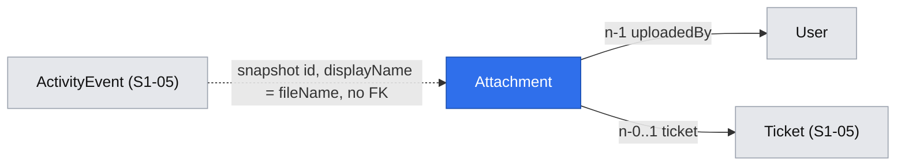

# Attachments – upload, linking, permissions, views and the object storage configuration

| | |
|---|---|
| Status | `implemented` |
| Created | 2026-10-26 |
| Plan task | `S1-08` |
| System specification sections | §3.2, §4.5, §6.2, §7.5, §13.3, §14.4, §15.3, §15.9, §15.10, §17.2, §18.3, §18.4, §18.5, §18.9, glossary |
| Related issues / PRs | [ADR 0008](../../../docs/adr/0008-attachment-serving.md) and its gaps [attachment serving](2026-10-25-attachment-serving.md) (implemented by S1-08); implemented sibling specifications [permission layer](2026-10-26-permission-layer.md) (S1-04), [ticket model](2026-10-26-ticket-model.md) (S1-05), [GFM editor](2026-10-26-gfm-editor.md) (S1-07), [end-user portal](2026-10-26-end-user-portal.md) (S1-09) |

## Context

Tickets and comments carry files – screenshots, logs, documents ([§3.2](../../../docs/spec/03-ticket-model.md), [§6.2](../../../docs/spec/06-comments-notifications.md)). [§13.3](../../../docs/spec/13-non-functional.md) fixes the rules: an allowlist checked against the file content, a size limit configurable by the Administrator, a ClamAV scan in the Worker with the state "Checking…", EXIF stripping, draft attachments purged after 24 hours, and downloads only through `GET /api/v1/attachments/{id}/content` with forced headers.

Two documents already cover most of the "how":

- [ADR 0008](../../../docs/adr/0008-attachment-serving.md) (status `proposed`) designs the upload into quarantine, the type detection, the scan job, the move to `available/`, EXIF stripping, the download through the BFF, the inline display under the CSP and the purge of drafts.
- [Attachment serving](2026-10-25-attachment-serving.md) (status `draft`) proposes the specification gaps the ADR found: text formats, the clamd limits and the status `rejected`, the content responses for files that are not available, two more forced headers, previews of drafts, encrypted PDFs and the ClamAV client.

This specification does **not** repeat or re-decide them. It builds on the answers approved there on 2026-11-06 (e.g. the status `rejected`), which the plan row of S1-08 requires before implementation. It amends ADR 0008 in two places, recorded in Q10 and Q21: recovery replaces `job.retry()`, and an infected row is updated before its object is deleted. It covers what neither document decides:

- the data model;
- the endpoints that list, link and delete attachments;
- the permission rules of the three attachment rows of [§7.5](../../../docs/spec/07-users-organizations-permissions.md);
- the activity events;
- the web feature and the UI components;
- the configuration of the object storage and of ClamAV;
- the backup of an external S3 storage ([§15.10](../../../docs/spec/15-deployment.md)).

Current state (main, 2026-11-06):

- No attachments module, no `attachments` table, no storage or ClamAV adapter. `@aws-sdk/client-s3`, `@aws-sdk/lib-storage`, `file-type`, `yauzl`, `sharp`, `clamscan` and `@types/multer` are not dependencies yet. The API runs on `@nestjs/platform-express`, so multer is available.
- The object storage is configured only for SeaweedFS of Compose: `TRYBUN_S3_ACCESS_KEY_ID` and `TRYBUN_S3_SECRET_ACCESS_KEY`, required with the `seaweedfs` profile (`.env.example`). The API and the Worker get no storage variables (`compose.yaml`, `x-server`).
- The backup service copies the objects with rclone (`rclone sync objects: …`, `docker/backup/backup.sh`) only when the `seaweedfs` profile is on. Its remote `objects` points at `http://seaweedfs:8333`. With an external storage, the objects are not backed up at all.
- The outbox publisher marks events without consumers as published (`apps/server/src/platform/outbox/outbox-publisher.service.ts`). A module can therefore emit events that a later task consumes.
- Implemented since this proposal was first written: the permission layer (S1-04), the ticket model with its activity events (S1-05), the statuses (S1-06), the GFM editor with `@trybun/markdown` (S1-07) and the end-user portal (S1-09). The editor takes `onFilesAdd` and `attachmentImageIds` and hides "Attach files" without `onFilesAdd` (`packages/ui/src/components/markdown-editor.tsx`). The portal shipped **without** attachments: its form passes no `onFilesAdd` (`apps/web/src/features/tickets/components/new-ticket-form.tsx`), and its specification and the plan row of S1-09 hand the attachment field of the form and the attachments of the ticket view to S1-08 (S1-09 Q8, applied to attachments).
- `Idempotency-Key` ([§12.1](../../../docs/spec/12-api-webhooks-import.md)) is not built yet; it comes with S6-01.

S1-08 is in group 4 of the plan, after S1-04 (permission layer), S1-05 (tickets) and S1-06 (statuses). The portal (S1-09, group 5) is merged and waits for S1-08 to wire attachments into its form and view. The team view (S1-10) is not built yet. Comments come with S1-12, notifications and live updates with S1-15.

## Goals

- Files can be uploaded, linked to a ticket, listed, downloaded and deleted by exactly the people [§7.5](../../../docs/spec/07-users-organizations-permissions.md) allows. Invisible attachments return `404`.
- Each step of [ADR 0008](../../../docs/adr/0008-attachment-serving.md) is built, including the answers of [attachment serving](2026-10-25-attachment-serving.md).
- The S1-07 editor's `onFilesAdd` ([GFM editor](2026-10-26-gfm-editor.md) Q7) gets its upload. The portal's ticket form and ticket view (S1-09) show attachments; the team view of S1-10 gets ready-made attachment components ([Q5](#open-questions)).
- One set of storage variables configures SeaweedFS of Compose or an external S3 storage, for the API, the Worker and the backup alike.
- Done when (plan):
  - an HTML file renamed to `.png` is rejected;
  - the EICAR test file is marked infected and is never downloadable;
  - a JPEG with GPS EXIF is served without it;
  - a user without access to the ticket gets `404` for its attachment;
  - with an external S3 storage, an attachment is restored by `./trybun restore`.

## Non-goals

- Anything decided in [ADR 0008](../../../docs/adr/0008-attachment-serving.md) or proposed in [attachment serving](2026-10-25-attachment-serving.md).
- Comment attachments, their audience and their access rules (S1-12). S1-12 adds the comment link to the same table and endpoints.
- The in-app notification of an infected upload and live updates of attachment states over Socket.IO (S1-15, [Q7](#open-questions), [Q8](#open-questions)).
- Anonymization and data export of attachments (S1-16, plan "How to use this plan").
- Attachments of incoming e-mails ([§6.3](../../../docs/spec/06-comments-notifications.md)), imports ([§12.5](../../../docs/spec/12-api-webhooks-import.md)) and the GitHub synchronization ([§11.4](../../../docs/spec/11-github-integration.md)).
- Moving the objects of an existing installation from SeaweedFS to an external storage, or back.
- Attachments in the demo dataset.

## Proposed change

### What the user sees

- **Adding files.** One entry point, in any form with the editor ([Q5](#open-questions)): drag and drop, paste, or the "Attach files" button of the S1-07 toolbar. Each file is uploaded at once and appears in the form's attachment list below the editor:
  - while uploading: "Uploading…" („Przesyłanie…”, the wording of the editor's placeholder `[Uploading {name}…]()`, `ui.markdownEditor.uploading`);
  - then: "Checking…" („Sprawdzanie…”).
  
  The editor inserts `` for an image, else `[name](…)`. The form can be saved while files are still being checked.
- **At most 10 files in one drop, paste or selection** ([Q6](#open-questions)). The editor inserts a placeholder for every file it gets, so files beyond the limit are rejected by their own promise with "At most 10 files can be added at once", and the editor removes their placeholders.
- **Rejected files** never appear in the list. An error toast names the file and the reason: "Files of this type are not allowed" (`attachment.type_not_allowed`), "The file is larger than 25 MB" (with the configured limit), or the standard message for other errors. The editor removes its placeholder (S1-07 Q7). A file over the limit is refused in the browser before it is sent, from the limit the web server reads from `TRYBUN_ATTACHMENT_MAX_SIZE_MB` ([Q2](#open-questions)); the API's `413 request.too_large` stays the authoritative check.
- **Removing a file before saving** deletes the draft at once, without confirmation, and removes its Markdown reference from the form's text. It cannot be anything but the user's own draft.
- **On a ticket**, the attachment list shows, for each file:
  - the name, size and type icon, with a thumbnail for available images;
  - the state, always as text and icon, never by colour alone ([§13.4](../../../docs/spec/13-non-functional.md)): "Checking…", "File removed: malware detected", or "File removed: could not be checked" (status `rejected` of attachment serving item 2).

  Opening a file opens the stable path. Images open inline, every other file downloads ([§13.3](../../../docs/spec/13-non-functional.md)). "Delete" is shown only when `allowedActions` contains `delete` ([§18.5](../../../docs/spec/18-code-patterns.md)). It asks for confirmation in the existing `ConfirmDialog` ([Q19](#open-questions)), because the file cannot be restored.
- **Where it appears in S1-08** ([Q5](#open-questions)): the portal's form "Create ticket" (`/portal/projects/{projectId}/tickets/new`) gets the attachment field, and the portal's ticket view (`/portal/tickets/{identifier}`) gets the attachment list below the description, whose images it shows inline. The team view follows with S1-10.
- **States update** without reloading: a list polls with one request while one of its files is being checked, starting at 3 seconds and slowing down to 30 ([Q7](#open-questions)). An attachment changes from "Checking…" to available within a few seconds of a quick scan. Dropping 10 files stays far below the rate limit per user of [§14.4](../../../docs/spec/14-architecture.md).
- **Timeline**: "Anna added the file screenshot.png" and "Jan deleted the file log.txt" for files added to or deleted from an existing ticket, shown to everyone who sees the ticket, end users included ([Q9](#open-questions), [Q15](#open-questions)). Files attached in the form that creates the ticket write no event: the timeline begins with the ticket ([Q16](#open-questions)). The portal's timeline, which today shows only status changes, shows these events too.
- Phones, tablets and desktops ([§2.9](../../../docs/spec/02-agent-rules.md)):
  - the list is one column on phones;
  - "Attach files" and "Delete" are 44 px targets;
  - every action works without dragging and without hover;
  - state changes are announced in a polite live region.

### Data model

`attachments` (model `Attachment`, module `attachments`):

| Field | Column | Type and rule |
|---|---|---|
| `id` | `id` | UUIDv7, generated before the upload, because it is the object key ([ADR 0008](../../../docs/adr/0008-attachment-serving.md)) |
| `fileName` | `file_name` | The client's file name after normalization: Unicode NFC; control characters removed; `/` and `\` replaced by `_`; trimmed; 1–255 characters, keeping the extension. Never logged ([§13.5](../../../docs/spec/13-non-functional.md)) |
| `contentType` | `content_type` | The type of the allowlist entry of the extension (ADR 0008), never the client's |
| `size` | `size` | Integer bytes, the stored size (updated after EXIF stripping). The maximum is 100 MB ([Q2](#open-questions)), so `integer` suffices |
| `status` | `status` | Enum `AttachmentStatus`: `quarantine`, `available`, `infected`, `rejected` (attachment serving item 2). Default `quarantine` |
| `uploadedById` | `uploaded_by_id` | FK `users`, `RESTRICT`. Anonymization and retention delete the user's attachments ([§13.2](../../../docs/spec/13-non-functional.md)) through the attachments service (S1-16) |
| `ticketId` | `ticket_id` | FK `tickets`, nullable (`null` = draft), `RESTRICT`. An import undo ([§12.5](../../../docs/spec/12-api-webhooks-import.md)) deletes the attachments of its tickets through the attachments service first |
| `createdAt`, `updatedAt` | `created_at`, `updated_at` | `timestamptz` |

Notes:

- No `version`. An attachment never changes through the API, and the scan changes only `status`, `size` and `updatedAt`, so deleting needs no `If-Match`. [§17.2](../../../docs/spec/17-conventions.md) already treats attachments as child records that do not change the ticket's `version`.
- S1-12 adds `comment_id` and a check that an attachment links to at most one parent. The purge condition then becomes "neither ticket nor comment".
- Indexes:
  - `(ticket_id, created_at, id)` for the list;
  - partial `(created_at) WHERE ticket_id IS NULL` for the purge;
  - partial `(updated_at) WHERE status = 'quarantine'` for the recovery job ([Q10](#open-questions)).
- A unit test checks that the Prisma enum equals `attachmentStatusSchema` ([§18.4](../../../docs/spec/18-code-patterns.md)).

Attachments hang off users and, once linked, off a ticket. Activity events refer to them only by snapshot, so deleting a file never breaks the history ([§17.2](../../../docs/spec/17-conventions.md)).

### API

All endpoints go through the BFF ([§14.4](../../../docs/spec/14-architecture.md)). Schemas live in `@trybun/contracts/attachments`.

| Endpoint | Check | Notes |
|---|---|---|
| `POST /api/v1/attachments` | `ability.can('create', 'Attachment')` – every user account | `multipart/form-data`, field `files`, 1–10 files (more: `422 request.validation_failed` with the field code `array.too_long` at pointer `/files`). A file over the limit stops the request while it streams: `413 request.too_large`. A type mismatch: `422 attachment.type_not_allowed` with the field code `field.invalid` at pointer `/files/{index}`. All or nothing ([Q6](#open-questions)): on any rejection, the objects already stored by the request are deleted. No `Idempotency-Key` until S6-01 builds it for every `POST`; a retried upload leaves an unused draft, which the purge removes after 24 hours. `201` with `{ items: Attachment[] }` in `quarantine` |
| `GET /api/v1/attachments?id={id}&id=…` | `read`, as a filter (`accessibleBy`) | 1–50 IDs; the `pageSchema` envelope with the readable ones among them and `nextCursor: null`, no `cursor` parameter (a list bounded by the IDs of the request, [§18.4](../../../docs/spec/18-code-patterns.md)); unknown and invisible IDs are left out, so nothing is revealed. The form polls its drafts with it, and the ticket view gets the image attachments its description references ([Q7](#open-questions)) |
| `GET /api/v1/attachments/{attachmentId}` | `read` (target record guard) | The attachment |
| `GET /api/v1/attachments/{attachmentId}/content` | `read` | As in ADR 0008 and attachment serving (items 3 and 4) |
| `DELETE /api/v1/attachments/{attachmentId}` | `delete` | `204`. Deletes the row and, for a linked attachment, writes `attachment_deleted`; the outbox event `attachment.deleted` removes both possible objects ([Writing data](#writing-data-and-jobs)) |
| `GET /api/v1/tickets/{ticketId}/attachments` | `read` on the `Ticket` | Cursor envelope ([§18.4](../../../docs/spec/18-code-patterns.md)), oldest first, `limit` default 50, at most 100. The query adds `accessibleBy(ability, 'read').Attachment` |
| `POST /api/v1/tickets/{ticketId}/attachments` | `add_attachment` on the `Ticket` | Body `{ attachmentIds }`, 1–100 UUIDs. Links the principal's own drafts ([Q4](#open-questions)). `200` with `{ items: Attachment[] }` |
| `POST /api/v1/tickets` (S1-05) | `create_ticket` on the `Project` | `createTicketSchema` gains optional `attachmentIds` (0–100), linked in the transaction that creates the ticket ([Q4](#open-questions)), without activity events ([Q16](#open-questions)) |

An attachment or ticket the principal can read but not change answers `403 request.forbidden` ([§18.3](../../../docs/spec/18-code-patterns.md)), e.g. an end user deleting another person's attachment or adding a file after losing access to the project ([Q14](#open-questions)); in an archived project `409 project.archived`.

Rules for `attachmentIds`, checked in the service inside the transaction, after the body is validated:

- An ID that is not an attachment the principal can read returns `404 request.not_found`. This includes another user's draft, which is invisible ([§17.2](../../../docs/spec/17-conventions.md), order of checks).
- An own attachment already linked to a ticket returns `422 attachment.already_linked` with the field code `field.invalid` at pointer `/attachmentIds/{index}` ([Q11](#open-questions)).
- A draft in any status can be linked. An infected draft stays on the ticket as "File removed: malware detected", which tells the others what happened.
- The link is one `updateMany` on `id IN (…) AND uploaded_by_id = principal AND ticket_id IS NULL`. A count lower than the number of IDs means a concurrent link or purge: the transaction is rolled back and the IDs are classified as above. A link and a purge at the same moment therefore never both succeed (ADR 0008).

Response `attachmentSchema`:

- `id`, `fileName`, `contentType`, `size`;
- `isImage` – a raster image shown inline;
- `status`;
- `ticketId` (`null` for a draft);
- `uploadedBy { id, displayName }`;
- `createdAt`;
- `allowedActions` – closed list `read`, `delete`.

The web builds the content path with `attachmentContentPath(id)` of `@trybun/markdown` (S1-07), so the path exists in one place.

### Permissions

Rules in `attachments.abilities.ts`, written in the form of the [permission layer](2026-10-26-permission-layer.md) (to-one relations as `{ relation: { is: … } }`, team roles through `members: { some: { userId, role: { in: teamRolesFrom(…) } } }`):

- The rules `attachmentsAbilities`, the restriction `archivedProjectsOfAttachmentsRestriction` and the record descriptor `attachmentRecords` are registered in `ABILITY_DEFINITIONS` (`apps/server/src/ability-definitions.ts`).
- `Attachment` joins `AppSubject` and gets an `AttachmentRuleRecord` (`platform/authorization/ability-factory.ts`), and joins `RuleRecords` and `RecordFilters` (`record-descriptor.ts`). The descriptor selects `uploadedById`, `ticketId` and, of the ticket, `ticketRuleSelect(principal)` of `tickets.abilities.ts`.
- `tickets.abilities.ts` exports the conditions under which a principal reads a ticket, `ticketReadConditions(principal)` (end user, team member; the Administrator reads every ticket), and the team condition `memberFrom(principal, role)`, today a local closure. The ticket rules use it themselves, and the attachment rules wrap it in `ticket: { is: … }`. Attachments therefore follow every visibility change of S1-11 without code of their own.
- The ticket action `add_attachment` joins the closed list `ticketActionSchema` of S1-05. The Administrator gets it through `TEAM_ACTIONS`; the team rule and the end-user branch name it.
- The attachment actions are the closed list `attachmentActionSchema`: `read`, `delete`.

| §7.5 row or rule | Subject, action and condition |
|---|---|
| Drafts belong to the uploader ([§13.3](../../../docs/spec/13-non-functional.md)) | `Attachment` `read`, `delete` with `{ ticketId: null, uploadedById: userId }`. Nobody else, not even the Administrator, sees a draft |
| Viewing a ticket's attachments | `Attachment` `read` with `{ ticket: { is: ticketReadConditions(principal) } }`; for the Administrator `{ ticketId: { not: null } }` |
| Add attachments to visible tickets (all roles) | `Ticket` `add_attachment`: for the team and the Administrator under the read conditions of the ticket; for an end user under the read conditions **and** the current project access that the end-user `update` rule requires ([Q14](#open-questions)) |
| Delete own attachments (all roles) | `Attachment` `delete` with `{ uploadedById: userId, ticket: { is: <the conditions of add_attachment> } }` ([Q14](#open-questions)) |
| Delete any attachment (Developer, Project manager, Administrator) | `Attachment` `delete` with `{ ticket: { is: { project: { is: memberFrom(principal, 'developer') } } } }`; `{ ticketId: { not: null } }` for the Administrator |
| Archived project ([§7.5](../../../docs/spec/07-users-organizations-permissions.md)) | `add_attachment` is a ticket action, so `archivedProjectsOfTicketsRestriction` already refuses it with `409 project.archived`. The new restriction refuses every attachment action except `read` with `{ ticket: { is: { project: { is: { state: 'archived' } } } } }` and the reason `project.archived`. Reading and downloading stay allowed. Drafts belong to no project and are not restricted |
| Upload | `create` on `Attachment` for every user principal. Integration tokens get it with their scopes (S6-02) |

Tests:

- `attachments.abilities.spec.ts`: the three §7.5 rows, each with an allowed and a denied case, plus the draft rule, the end user without current project access ([Q14](#open-questions)) and the archived restriction.
- `ability-definitions.spec.ts`: the descriptor of `Attachment` selects every field its rules read.
- `permission-layer.integration.spec.ts`: an `Attachment` case in "lists equal details (§14.4)", and the new endpoints in "the denied case of every endpoint".
- An integration test: a user who cannot see the ticket gets `404` for the attachment, its content, its deletion and the ticket's attachment list, with the same body as for an unknown ID.

### Writing data and jobs

Only what ADR 0008 leaves open:

- **Linking to an existing ticket** (`POST /tickets/{ticketId}/attachments`): in the same transaction, the service writes one public activity event `attachment_added` per file through `ActivityEventsService.record(tx, actor, ticketId, events)` with `isPublic: true` and the data `{ from: null, to: { id, displayName: fileName } }`, the existing snapshot shape of §4.5 ([Q9](#open-questions), [Q15](#open-questions)). Linking in `POST /tickets` writes no event ([Q16](#open-questions)). No outbox event: S1-15 decides what notifies and what updates live.
- **Deleting**, in one transaction:
  - delete the row;
  - for a linked attachment, write `attachment_deleted` with `{ from: { id, displayName: fileName }, to: null }`, public;
  - write the outbox event `attachment.deleted` with `{ attachmentId }`.

  Its consumer (queue `delete-attachment-objects`, its own job, [§18.3](../../../docs/spec/18-code-patterns.md)) deletes `quarantine/{id}` and `available/{id}`. `DeleteObject` of a missing key succeeds, so the job is idempotent. A scan job that still runs for the deleted row finds no row and deletes what it wrote.
- **Purge of drafts**: as ADR 0008, except that the job deletes the rows and writes `attachment.deleted` per row in the same transaction, so objects of a deleted attachment are removed in one way only (Rule 12). Objects under `quarantine/` without a row are still deleted by the purge itself, since no row exists to carry an event.
- **Scan, move, EXIF stripping**: as ADR 0008, with the consumer of `attachment.uploaded` in queue `scan-attachment` (queue names are verb phrases, like `close-unconfirmed-resolution` of S1-06).
- **Recovery of lost scans** ([Q10](#open-questions)): the recurring job of ADR 0008 (every 5 minutes) checks clamd with `PING`. Only when it answers does it write, for every attachment that has been in `quarantine` for more than 15 minutes, a new outbox event `attachment.uploaded` and set its `updatedAt`, in one transaction per batch. This replaces ADR 0008's `job.retry()` of failed scans, so one mechanism remains (Rule 12): a scan that failed all its attempts is picked up as a row still in `quarantine`. During a ClamAV outage nothing is enqueued, and the new `updatedAt` keeps a row from being re-enqueued for another 15 minutes. The scan keeps one consumer, one job data shape (`OutboxEventJobData`) and its `jobId` (the outbox event ID). It applies only to a row still in `quarantine`. A row still in `quarantine` 24 hours after its upload, while `PING` answers, is set `rejected` (attachment serving item 2) – a file the scan can never finish is never released and is not rescanned forever. This covers scan jobs lost with Valkey (it is not backed up, [§15.10](../../../docs/spec/15-deployment.md)) and failed jobs removed after 30 days.
- **Rows and objects out of step** ([Q21](#open-questions)), e.g. after a restore, because the backup dumps the database before it copies the objects while the API and the Worker run:
  - a scan that finds `quarantine/{id}` gone but `available/{id}` present finishes the move (sets the row `available`);
  - an infected file is handled like the move: the row is set `infected` together with its outbox event first, and the object is deleted after that, so a duplicate scan in between finds the row no longer in `quarantine` (an amendment of ADR 0008, which deletes first);
  - a scan that finds neither object, or a duplicate that overlaps a finished scan, ends without effect when the row is no longer in `quarantine`, and otherwise sets the row `rejected`;
  - the content of an `available` row whose object is gone answers like a removed file (attachment serving item 3);
  - the purge also deletes `available/` objects without a row that are older than 24 hours.
- **Image decoding** ([Q22](#open-questions)): the Worker runs `sharp` with `concurrency(1)`, its cache off and `limitInputPixels` of 40 megapixels counted over all frames, so the Worker stays within its 512 MB (`mem_limit` of `x-server`). An image above the limit is handled like an image `sharp` cannot decode (attachment serving item 2). The API's `lib-storage` `Upload` uses parts of 5 MB with a queue of 2.
- **End-user events** ([Q15](#open-questions)): `activityEventTypeSchema` gains `attachment_added` and `attachment_deleted`. `endUserActivityEventDataSchema` becomes a union that adds `{ from: snapshot | null, to: snapshot | null }` (`activityEventSnapshotSchema`), and `endUserDataOf` (`modules/activity-events/domain/end-user-events.ts`) passes the data of the attachment events unchanged (the file name is visible to everyone who sees the ticket's attachment list anyway).
- **Outbox events for S1-15**: `attachment.available`, `attachment.infected` (ADR 0008) and `attachment.rejected` (attachment serving item 2), each with `attachmentId` and `uploadedById`.
- **Logs**: attachment ID, status, size and the ClamAV signature name. Never the file name or content ([§13.5](../../../docs/spec/13-non-functional.md)).

### Web application

- **Feature `features/attachments/`** ([§18.5](../../../docs/spec/18-code-patterns.md)):
  - `queries.ts`, in the form of `features/tickets/queries.ts`: `attachmentsQueryOptions(client, ids)` (the list by IDs) for the drafts of a form and the images of a description, and `ticketAttachmentsQueryOptions(client, ticketId)` as `infiniteQueryOptions` for a ticket's list. Each sets `refetchInterval` while it holds an attachment in `quarantine`, 3 seconds doubling up to 30 ([Q7](#open-questions)), so a list makes one request per interval, not one per file.
  - `mutations.ts`:
    - `useUploadAttachment`: one file per request ([Q6](#open-questions)), `FormData` through the browser API client;
    - `useDeleteAttachment`;
    - `useAddTicketAttachments`.
  - `use-attachment-drafts.ts` ([Q18](#open-questions)): the hook a form calls with its `form` and the name of its Markdown field. It returns the editor props `onFilesAdd` (S1-07 Q7, resolving `{ id, name, isImage }`, rejecting files beyond 10) and `attachmentImageIds`, and the drafts for the list. It keeps the IDs of the drafts in the form field `attachmentIds` (`setValue`), and removing a draft removes its Markdown reference from the text field. `attachmentImageIds` holds the image attachments of the ticket and the form's own image drafts ([attachment serving](2026-10-25-attachment-serving.md) item 5), so the Preview shows them (the editor takes the list as given, S1-07).
  - `components/attachment-drafts.tsx`: the list of the drafts of a form, below the editor.
  - `components/ticket-attachments.tsx`: the list of a ticket.
  - `attachmentImageIds` of a ticket's description: the attachment IDs its Markdown references (`parseAttachmentContentPath` of `@trybun/markdown`), looked up with `attachmentsQueryOptions` (in chunks of 50) and kept when they are available images of the same ticket – independent of the pages of the list.
  - Both are loaded lazily where they appear only later ([§18.5](../../../docs/spec/18-code-patterns.md)).
- **Portal** ([Q5](#open-questions)): `NewTicketForm` calls `useAttachmentDrafts`, passes its props to `LazyMarkdownEditor`, renders `AttachmentDrafts` below it and sends `attachmentIds`. `TicketView` renders `TicketAttachments` below the description and passes the image IDs to its `Markdown`; the page prefetches both queries on the server, like the ticket, so images do not appear late. The portal timeline renders `attachment_added` and `attachment_deleted`, and linking or deleting invalidates the ticket's activity events.
- **`@trybun/ui`** (Rule 6): `AttachmentList` and `AttachmentItem`, presentational.
  - States: uploading, checking, available (image with thumbnail, or file), removed (infected, rejected). A rejected upload is no item: its message is a toast.
  - Delete through a callback; the feature confirms it with the existing `LazyConfirmDialog` of `features/projects/`, as organizations, invitations and accounts already do ([Q19](#open-questions)).
  - Texts from the `ui` namespace.
  - Stories for every state in the three viewports.
- **BFF** (`apps/web/src/lib/bff/bff-proxy.ts`): keeps `content-length` when the response has no `content-encoding` (ADR 0008), so downloads show progress; today it always drops it. Uploads show no progress bar: `fetch` reports no upload progress, so the item shows "Uploading…".
- **No separate drop zone** besides the editor ([Q5](#open-questions)).

### Configuration, storage and backups

New and changed variables ([§15.3](../../../docs/spec/15-deployment.md), [Q2](#open-questions), [Q3](#open-questions)). All are optional with safe defaults, which is a MINOR change by `BACKWARD_COMPATIBILITY.md`:

| Variable | Meaning | Default |
|---|---|---|
| `TRYBUN_S3_URL` | URL of the bucket with an optional folder, in the same form as `TRYBUN_BACKUP_S3_URL` (e.g. `https://s3.eu-central-1.amazonaws.com/my-bucket/trybun`). The server and the backup split it into endpoint (origin), bucket (first segment) and folder (rest); objects are `{folder}/quarantine/{id}` and `{folder}/available/{id}` | `http://seaweedfs:8333/trybun` in Compose (`${TRYBUN_S3_URL:-…}`); `http://localhost:8333/trybun` as the default of the configuration schema for `pnpm dev`. Commented out in `.env.example`, like `TRYBUN_BACKUP_S3_URL`, because `./trybun install` writes `.env` from it and a set value would override the Compose default |
| `TRYBUN_S3_ACCESS_KEY_ID`, `TRYBUN_S3_SECRET_ACCESS_KEY` | Existing. Now also the credentials of an external storage, and passed to the API and the Worker | – (required with the `seaweedfs` profile, as today; required for an external storage) |
| `TRYBUN_S3_REGION` | Region, for providers that need one | `us-east-1` |
| `TRYBUN_CLAMAV_URL` | clamd over TCP, e.g. `tcp://clamav:3310` | `tcp://clamav:3310` in Compose; `tcp://localhost:3310` as the default of the configuration schema; commented out in `.env.example`, as `TRYBUN_S3_URL` |
| `TRYBUN_ATTACHMENT_MAX_SIZE_MB` | Maximum size of one file, 1–100 | `25` |

How these variables are used:

- **Requests**: path-style addressing (`forcePathStyle`), which SeaweedFS needs and S3-compatible providers support. A provider that accepts only virtual-hosted addressing is out of scope.
- **Bucket**: the API creates it at start-up when `HeadBucket` reports it missing. This is the case for a new SeaweedFS installation. When creation is refused (e.g. an external identity without the right), it logs a warning and `/health/ready` reports the storage as `degraded` ([§17.2](../../../docs/spec/17-conventions.md)).
- **Compose**: `x-server` passes the storage variables and `TRYBUN_CLAMAV_URL` to the API and the Worker, and `web` gets `TRYBUN_ATTACHMENT_MAX_SIZE_MB` for the check in the browser ([Q2](#open-questions)), like `TRYBUN_DEFAULT_LANGUAGE`. The `api` service joins the network `outbound` besides `internal`, as the Worker does, because an external storage is outside the internal network ([Q20](#open-questions)). The ClamAV service mounts `docker/clamav/clamd.conf` (ADR 0008). The API and the Worker depend on `seaweedfs` as `service_healthy`, `required: false` ([§15.9](../../../docs/spec/15-deployment.md)).
- **Backup** ([§15.10](../../../docs/spec/15-deployment.md), [Q13](#open-questions)):
  - The rclone remote `objects` is configured from the same variables: endpoint, credentials and region; provider `SeaweedFS` when the `seaweedfs` profile is on, else `Other`.
  - Every backup copies the folder of `TRYBUN_S3_URL` (`objects:{bucket}/{folder}`) into the snapshot's `objects/`, with SeaweedFS and with an external storage alike.
  - `./trybun restore` syncs `objects/` back into the same folder. Objects in that folder that are not in the backup are deleted. The folder must therefore belong to Trybun alone, as `.env.example` and `INSTALL.md` state.
  - An installation marker guards the restore ([Q13](#open-questions)). Each server has a server ID in `/backup/server-id` of the volume `backup-data`, outside everything a backup contains (not in `.env`, not in the database, not in the configuration list of `backup.sh`), so a restore never brings back another server's ID. `./trybun install` creates it, and `./trybun restore` creates it when it is missing. Every backup writes `{folder}/.trybun-installation` with that ID; copy and sync exclude the marker (`--exclude /.trybun-installation`), and the restore rewrites it with the restoring server's ID afterwards. Before syncing, the restore reads the marker of the target folder: missing or equal to the own ID → it continues; another ID → the folder belongs to another server, e.g. production when a production backup is restored onto a test server with the production `.env`. Then it asks a second question, "The storage folder {url} belongs to another Trybun server. Replace its content? [y/N]", default no; without a terminal it refuses, and the flag `--replace-foreign-objects` answers yes. `INSTALL.md`, `usage()` and `deploy/trybun.spec.js` describe it; a disaster-recovery restore onto a new server meets the question by design, because the folder still names the lost server. The restore test's SeaweedFS case starts with an empty storage and never meets it; its external-storage variant first checks that the restore without the flag is refused, then passes `--replace-foreign-objects`.
  - The database is dumped before the objects are copied, while the API and the Worker run; the rules under [Writing data and jobs](#writing-data-and-jobs) reconcile rows and objects after a restore ([Q21](#open-questions)).
  - A snapshot taken before S1-08 holds no attachments (the bucket did not exist); restoring it leaves the folder empty, which is the state of that time.
- **Restore test** (`scripts/restore-test.sh`): the existing case writes its object into the attachment folder (`objects:{bucket}/{folder}/available/…`, best an attachment uploaded through the API and downloaded after the restore) and compares only that folder, since the backup no longer copies the whole storage. A new variant without the `seaweedfs` profile uses the S3 server the test already starts for the backup repository (`trybun-restore-test-s3`), in its own bucket, as the external storage, and checks that an attachment object deleted after the backup is back after the restore.
- **`.env.example`, `INSTALL.md`, README**: the variables, the dedicated folder, and switching to an external storage before the first upload. They document the external storage only with phase 4, so no release offers an external storage whose objects are not backed up ([Q1](#open-questions)).

### Prior art

- **Jira** keeps attachments as a list per issue and records "Attachment" additions and deletions with the file name in the issue history. This proposal does the same in the activity timeline ([Q9](#open-questions)).
- **GitHub** (issues): files dropped into the editor are uploaded at once and referenced from the Markdown. Removing the reference does not delete the upload.
- **GitLab** (issues): files dropped into the editor are uploads of the project, referenced from the Markdown; there is no separate attachment list.

The proposal keeps GitHub's single entry point (the editor) but links files explicitly ([Q4](#open-questions)), because [§13.3](../../../docs/spec/13-non-functional.md) requires drafts that expire and access checked by the ticket. With a link of their own, removing the reference never decides the access.

## Changes to the system specification

Sections of the header without a row here are read by this specification, not changed.

| Section | Change |
|---|---|
| §3.2 | Attachments of a ticket are linked when the ticket is created (`attachmentIds`) or later through `POST /api/v1/tickets/{ticketId}/attachments` ([Q4](#open-questions)) |
| §4.5 | Activity events `attachment_added` and `attachment_deleted`, public, with the snapshot `{ id, displayName }` of the file in `{ from, to }` ([Q9](#open-questions)); attachments linked when the ticket is created write no event, as "Creating a ticket writes no event" ([Q16](#open-questions)); the sentence on what end users see adds "attachments added to or deleted from the ticket" ([Q15](#open-questions)) |
| §13.3 | Maximum file size set by `TRYBUN_ATTACHMENT_MAX_SIZE_MB` (1–100, default 25) ([Q2](#open-questions)); linking rules: only own drafts, invisible `404`, already linked `422 attachment.already_linked` ([Q4](#open-questions), [Q11](#open-questions)); an upload request is all or nothing ([Q6](#open-questions)); the objects of a deleted attachment are removed by an outbox job; lost scans are re-enqueued ([Q10](#open-questions)); error codes: `attachment.type_not_allowed` `422`, new `attachment.already_linked` `422` and `attachment.draft_limit_reached` `422`, each with the field code `field.invalid` at the file's or the ID's pointer ([Q11](#open-questions)); at most 50 drafts and 250 MB of drafts per user at a time ([Q23](#open-questions)); the image decoding limit ([Q22](#open-questions)); rows and objects out of step are reconciled ([Q21](#open-questions)) |
| §7.5 | The rows "Add attachments to visible tickets" and "Delete own attachments" require, for end users, the current access to the project, like editing ([Q14](#open-questions)) |
| §15.9 | The `api` service joins the network `outbound` ([Q20](#open-questions)) |
| §15.3 | Variables `TRYBUN_S3_URL`, `TRYBUN_S3_REGION`, `TRYBUN_CLAMAV_URL`, `TRYBUN_ATTACHMENT_MAX_SIZE_MB` (also read by `web`); `TRYBUN_S3_ACCESS_KEY_ID` and `TRYBUN_S3_SECRET_ACCESS_KEY` also for an external storage ([Q3](#open-questions)) |
| §15.10 | Every backup copies the storage folder of `TRYBUN_S3_URL`, also on an external storage; restore replaces its content, guarded by the installation marker; the folder must be dedicated to Trybun ([Q13](#open-questions)); "one consistent set" is qualified: rows and objects are reconciled after a restore ([Q21](#open-questions)) |
| §18.4 "Lists" | The exception for a list bounded by a small closed set also covers a list bounded by the IDs of the request (at most 50): `nextCursor: null`, no `cursor` parameter |
| §18.5 | Until S1-15, a pending server state (an attachment in `quarantine`) is polled with `refetchInterval` from the feature's `queryOptions`, one request per list, 3 seconds doubling up to 30; S1-15 replaces it with live updates ([Q7](#open-questions)) |
| §18.9 | Reference implementation rows for S1-08: "Upload streamed into the object storage and streamed download" (`modules/attachments/`, `platform/storage/`); the ClamAV adapter (`platform/clamav/`) follows the existing row "Adapter of an external service tested against its container" and needs no row of its own; the rows say that `@UploadedFiles()` carries no Zod schema, because the storage engine validates the files – the lint rule for parameter schemas covers only `@Body`, `@Query`, `@Param` and `@MessageBody` and needs no change ([Q12](#open-questions)) |
| Plan (`docs/plan/`) | S1-08: the attachment field of the portal form and the attachments of the portal view move from the "Out of scope → S1-12" clause, where they read as out of scope, into the scope of the row ([Q5](#open-questions)); S1-10 places the components in the team view; S1-15 gains "the in-app notification of an infected upload and live updates of attachment states" ([Q7](#open-questions), [Q8](#open-questions)); the S1-08 row is ticked by its implementation PR |

New or changed glossary terms (code identifier, EN/PL labels):

- `activity_event.type` `attachment_added` – "added the file {name}" / „dodał(a) plik {name}”; `attachment_deleted` – "deleted the file {name}" / „usunął(-ęła) plik {name}”.
- Ticket action `add_attachment`; attachment actions `read`, `delete`.
- Attachment states in the UI: "Uploading…" / „Przesyłanie…” (client only, not a status value, the wording of the editor's placeholder).

## Open questions

Every question is answered. The maintainer approved every proposed answer on 2026-11-06, Q13 (⚠, a protected contract of `BACKWARD_COMPATIBILITY.md`) explicitly, together with the answers of [attachment serving](2026-10-25-attachment-serving.md).

1. **One specification or two.** The external storage in the backup could ship without attachments. — **Answer (approved by the maintainer on 2026-11-06):** one specification, as the plan defines one task whose Done-when includes the restore. The storage variables (Q3) are needed by the attachments adapter itself and stay with phases 1–3. Q13 gates only phase 4: phases 1–3 may start once Q1–Q12 and Q14–Q23 are answered, and phase 4 ships as its own PR. The last PR moves the specifications to `implemented/` and ticks the plan; the external storage is documented only with phase 4, so no release offers it without the backup of its objects. Alternative: a separate specification and plan task for the backup of an external storage, which removes the restore from the Done-when of S1-08.
2. **How the Administrator sets the maximum file size.** [§13.3](../../../docs/spec/13-non-functional.md) says "configurable by the Administrator" without saying where. — **Answer (approved by the maintainer on 2026-11-06):** an environment variable `TRYBUN_ATTACHMENT_MAX_SIZE_MB` (integer 1–100, default 25), like the system default language "set by the Administrator" (`TRYBUN_DEFAULT_LANGUAGE`, [§13.1](../../../docs/spec/13-non-functional.md)). The upper bound of 100 follows item 2 of [attachment serving](2026-10-25-attachment-serving.md); without it, the bound is clamd's `StreamMaxLength`. The web server reads the same variable, so the browser refuses a larger file before sending it (a `413` sent while the body streams through the BFF can reach the browser as a reset connection). Alternative: a setting in the Administrator panel. That needs an installation-settings table, an endpoint and a form, and can replace the variable later with the variable as its default.
3. **Variables of the object storage.** [§15.3](../../../docs/spec/15-deployment.md) says only that "setting variables" switches to an external storage. — **Answer (approved by the maintainer on 2026-11-06):** `TRYBUN_S3_URL` (bucket URL with optional folder, same form as `TRYBUN_BACKUP_S3_URL`), the existing `TRYBUN_S3_ACCESS_KEY_ID`/`_SECRET_ACCESS_KEY`, and optional `TRYBUN_S3_REGION`. Path-style addressing. The API creates a missing bucket. The default points at SeaweedFS of Compose, so existing `.env` files keep working. Alternative: separate `TRYBUN_S3_ENDPOINT`, `TRYBUN_S3_BUCKET` and `TRYBUN_S3_PREFIX`. They are more explicit, but differ from the backup variables.
4. **How a file becomes an attachment of a ticket.** — **Answer (approved by the maintainer on 2026-11-06):** explicitly. `POST /api/v1/tickets` accepts `attachmentIds`, and `POST /api/v1/tickets/{ticketId}/attachments` links drafts to an existing ticket. Only the principal's own unlinked drafts can be linked, at most 100 per request. A ticket edit (S1-05's `PATCH`) does not link: the edit form calls the link endpoint, because attachments are separate resources that do not change the ticket's `version` ([§17.2](../../../docs/spec/17-conventions.md)). Alternative: the server links the drafts referenced in the saved Markdown. That needs no extra field, but a file in the list without a reference would be purged, and parsing the Markdown would decide access.
5. **Scope of the UI in S1-08.** *Updated on 2026-11-06:* the portal (S1-09) is merged without attachments and hands its form and view to S1-08 (S1-09 Q8, applied to attachments); the team view (S1-10) is not built. — **Answer (approved by the maintainer on 2026-11-06):** S1-08 builds the web feature (queries, mutations, `useAttachmentDrafts`, `AttachmentDrafts`, `TicketAttachments`) and the `@trybun/ui` components with stories, and places them in the portal's `NewTicketForm` and `TicketView`; the portal E2E tests (`apps/web/e2e/portal.spec.ts`) cover adding, checking, showing and deleting a file on the three devices. S1-10 places them in the team view. The only entry point is the editor's (drag and drop, paste, "Attach files"), with no second drop zone (Rule 2: one place to add files). Alternative: a separate attachment field next to the editor, like Jira.
6. **Several files at once.** [§13.3](../../../docs/spec/13-non-functional.md) allows up to 10 files per upload. — **Answer (approved by the maintainer on 2026-11-06):** the endpoint accepts 1–10 files and is all or nothing: one rejected file rejects the request and deletes what it stored. The web sends **one request per file**, so every file succeeds or fails on its own (the per-file promise of S1-07 Q7), and limits one drop to 10 files: the editor inserts a placeholder for every file it gets, so `onFilesAdd` returns a rejected promise for the 11th file onwards. Alternative: per-file results in one response (`207`-like). That needs a second response shape and partial-success handling in every client.
7. **"Checking…" before live updates exist** (S1-15). — **Answer (updated on 2026-11-06, approved by the maintainer on 2026-11-06):** a list polls with **one request** while one of its attachments is in `quarantine` – the drafts of a form through `GET /api/v1/attachments?id=…`, a ticket's list through its own endpoint – every 3 seconds, doubling up to 30, and stops when none is left in `quarantine` or the component unmounts. One poll per file would exceed the limit of 100 requests per minute per user ([§14.4](../../../docs/spec/14-architecture.md)) with 10 files. S1-15 replaces the polling with a live update from the outbox events `attachment.available`, `attachment.infected` (both written by S1-08, ADR 0008) and `attachment.rejected`, so only one mechanism remains ([§18.5](../../../docs/spec/18-code-patterns.md)). The plan row of S1-15 says so. Alternative: no updates until a reload.
8. **In-app notification of an infected upload** ([§13.3](../../../docs/spec/13-non-functional.md), [§6.6](../../../docs/spec/06-comments-notifications.md)). The notification center arrives with S1-15. — **Answer (approved by the maintainer on 2026-11-06):** S1-08 writes the outbox event `attachment.infected` (with `attachmentId` and `uploadedById`). S1-15 adds its consumer that creates the notification, and its plan row says so. Until then, the uploader sees the state in the list. Alternative: S1-08 builds a minimal notification model, which S1-15 would have to absorb.
9. **Timeline events of attachments.** [§4.5](../../../docs/spec/04-ticket-lifecycle.md) records every change of a ticket field, and attachments are a field of [§3.2](../../../docs/spec/03-ticket-model.md). [§17.2](../../../docs/spec/17-conventions.md) records a deletion in the timeline or the audit log. Neither names events for attachments. — **Answer (approved by the maintainer on 2026-11-06):** `attachment_added` (one per file) and `attachment_deleted`, public, with the snapshot [§17.2](../../../docs/spec/17-conventions.md) requires for deletable records, in the existing data shape of §4.5: `{ from: null, to: { id, displayName } }` when added and `{ from: { id, displayName }, to: null }` when deleted, `displayName` being the file name. The data schema needs no change. A file name can contain personal data; it stays in the history ([Q17](#open-questions)). Comment attachments (S1-12) write no events of their own; the comment is the entry. Alternative: events without the file name ("added a file").
10. **Attachments stuck in quarantine.** ADR 0008 retries only failed scan jobs. Valkey is not backed up, so after `./trybun restore` (or after failed jobs expire after 30 days) a linked file can stay "Checking…" forever. — **Answer (updated on 2026-11-06, approved by the maintainer on 2026-11-06):** the 5-minute recovery job checks clamd with `PING` and only when it answers writes a new outbox event `attachment.uploaded` for every attachment in `quarantine` for more than 15 minutes, setting its `updatedAt`, so a row is re-enqueued at most every 15 minutes and never during an outage. This replaces ADR 0008's `job.retry()` of failed scans (one mechanism, Rule 12); the implementation PR amends the ADR, which is still `proposed`. The scan keeps one consumer and its `jobId` (the outbox event ID), and is idempotent. Alternatives: a step in `./trybun restore`, which would not cover expired jobs; the first proposal, a direct job with `jobId` `attachment-scan-{id}`, which would not deduplicate against the outbox job and would need a second job data shape.
11. **Error codes and statuses.** — **Answer (approved by the maintainer on 2026-11-06):**
    - `attachment.type_not_allowed`: `422` with the field code `field.invalid` at the file's pointer;
    - an oversized file: the existing `413 request.too_large`;
    - more than 10 files: `422 request.validation_failed` with the field code `array.too_long`;
    - linking another user's draft or an unknown ID: `404 request.not_found`, because drafts are invisible to others;
    - linking an own attachment that is already linked: new `422 attachment.already_linked`, `field.invalid` at the ID's pointer;
    - more drafts than the quota of [Q23](#open-questions): new `422 attachment.draft_limit_reached`, `field.invalid` at `/files`.

    The feature codes are listed in §13.3 and `@trybun/contracts/errors`, like `ticket.assignee_not_eligible` in §3.2; the table of §17.2 keeps only the shared `request.*` and `server.*` codes.

    Alternative: one code `attachment.not_linkable` for both linking cases. That would reveal that another user's draft exists.
12. **New patterns** (Rule 12). S1-08 is the first upload, the first streamed download and the first poll. — **Answer (approved by the maintainer on 2026-11-06):** they become reference implementations in [§18.9](../../../docs/spec/18-code-patterns.md), as listed under "Changes to the system specification": `modules/attachments/` with `platform/storage/` (custom multer storage engine streaming to the storage adapter, `StreamableFile` with forced headers); the ClamAV adapter `platform/clamav/` follows the existing row "Adapter of an external service tested against its container". `@UploadedFiles()` carries no Zod schema, because multer, not Zod, receives the files and the storage engine checks them; the lint rule for parameter schemas covers only `@Body`, `@Query`, `@Param` and `@MessageBody` (`packages/eslint-config/src/nestjs.js`), so it needs no exemption. Polling follows Q7. Alternative: an ADR for the patterns. ADR 0008 already records their design, so a pattern row is enough.
13. ⚠ **Backup and restore of an external storage** (protected surface "Backups" of `BACKWARD_COMPATIBILITY.md`). — **Answer (approved by the maintainer on 2026-11-06):** every backup copies the folder of `TRYBUN_S3_URL` into `objects/`, whether the storage is SeaweedFS or external. The snapshot layout changes from "the whole SeaweedFS" to "the attachment folder"; snapshots of earlier releases hold no attachments and still restore. `./trybun restore` replaces the content of that folder, deleting objects that are not in the backup. The folder must therefore be dedicated to Trybun, as `.env.example` and `INSTALL.md` state. Needs confirmation because a restore with a wrong `TRYBUN_S3_URL` deletes data on a storage outside the server. The restore puts the backup's `.env` back before the data (`deploy/trybun`), so restoring a production backup onto a test server would target the production folder by construction: a marker object `{folder}/.trybun-installation` with a server ID that no backup contains guards it: the restore asks a second question, default no, before it replaces a folder whose marker names another server, and refuses without a terminal unless `--replace-foreign-objects` is passed. The question and the flag are additions to the protected CLI surface of `./trybun restore`; the existing confirmation and its answers are unchanged. Alternatives:
    - restore with `rclone copy`, deleting nothing (later files would survive a restore of an earlier state);
    - restore only the prefixes `quarantine/` and `available/` of the folder.
14. **Adding and deleting after losing project access.** *Added on 2026-11-06.* An end user keeps reading their own tickets after losing access to the project (§7.3), but the end-user `update` rule of S1-05 requires the current access (`requesterId` and `project: { is: access }`). "Add attachments to visible tickets" (§7.5) would let them add files to a project they no longer belong to. — **Answer (approved by the maintainer on 2026-11-06):** for end users, `add_attachment` and deleting their own attachments require the read conditions **and** the current project access, like `update`; they keep reading and downloading. For the team, reading a ticket already requires a team role in its project, so the read conditions suffice. Alternative: the read conditions alone, as the §7.5 row reads literally.
15. **Attachment events for end users.** *Added on 2026-11-06.* §4.5 shows end users only "public status changes, public comments and assignment to a public milestone", and S1-09 sends end users an allow-list of event data (`endUserActivityEventDataSchema`), giving other public events `data: null`. — **Answer (approved by the maintainer on 2026-11-06):** the attachment events are public and reach end users with their data: `endUserActivityEventDataSchema` and `toEndUserEvent` gain them, and the §4.5 sentence adds attachments. The file name is no secret to anyone who sees the ticket's attachment list. Alternative: internal events, so end users see only the list.
16. **Events for attachments linked at creation.** *Added on 2026-11-06.* §4.5 and S1-05 Q11: "Creating a ticket writes no event: the timeline begins with the ticket itself". — **Answer (approved by the maintainer on 2026-11-06):** linking in `POST /tickets` writes no event; the attachment list shows the files. Only links to an existing ticket and deletions write events. Alternative: one `attachment_added` per file at creation, which amends the §4.5 sentence.
17. **File names in the history.** *Added on 2026-11-06.* Title redaction (S1-21, approved) purges earlier titles from `title_changed` events, because they may hold personal data. File names in attachment events can too ("invoice_kowalski.pdf"), and deleting the file leaves its name in `attachment_deleted`. — **Answer (approved by the maintainer on 2026-11-06):** out of scope of S1-08. The names stay in the history; anonymization (S1-16) treats them as other free text of the person. If redaction of file names is needed, it reuses the guarded rewrite of S1-21 in its own plan task. Alternative: events without the file name ("added a file"), the alternative of Q9.
18. **How a form connects the editor and the attachments.** *Added on 2026-11-06.* The portal form holds the editor in its own `description` `Controller`, and removing a draft must also remove its reference from that text. — **Answer (approved by the maintainer on 2026-11-06):** a hook `useAttachmentDrafts({ form, textField })` of `features/attachments/` returns the editor props (`onFilesAdd`, `attachmentImageIds`) and the drafts for `AttachmentDrafts`, and keeps `attachmentIds` in the form state; the form spreads the props on `LazyMarkdownEditor`. One hook serves the portal form, the team form of S1-10 and the comment form of S1-12. Alternative: one `AttachmentsField` component wrapping the editor, which every form would have to use instead of the editor.
19. **Confirming a deletion.** *Added on 2026-11-06, updated by the specification review.* `@trybun/ui` has no `AlertDialog`, but `apps/web` already confirms destructive actions with `ConfirmDialog` and `LazyConfirmDialog` of `features/projects/components/`, which organizations, invitations and accounts already import across features. — **Answer (approved by the maintainer on 2026-11-06):** the attachments feature imports `LazyConfirmDialog` the same way; no second confirmation primitive (Rule 12). Moving it to `@trybun/ui` is a separate clean-up. Alternative: a new `AlertDialog` (a second pattern, which would need an ADR and a migration).
20. **The API reaching an external storage.** *Added by the specification review of 2026-11-06.* Every service is on the network `internal`, which has no outside access; only the Worker, Keycloak, ClamAV, the backup and Caddy also join `outbound` (`compose.yaml`). The API streams uploads and downloads, so with an external storage it must reach it. — **Answer (approved by the maintainer on 2026-11-06):** the `api` service joins `outbound` always, like the Worker; the API makes no other outgoing requests, and one Compose file stays one set-up. Alternative: an override file for an external storage, which the Administrator must remember.
21. **Rows and objects out of step after a restore.** *Added by the specification review of 2026-11-06.* The backup dumps the database before it copies the objects while the API and the Worker run, so a restore can bring back a `quarantine` row whose file was moved to `available/` meanwhile, an `available` row without its object, or objects without a row. §15.10 promises "one consistent set". — **Answer (approved by the maintainer on 2026-11-06):** reconcile instead of stopping the services: the scan finishes a move it finds done, a scan that finds no object sets the row `rejected`, the content of a missing object answers like a removed file, and the purge also deletes `available/` objects without a row older than 24 hours; §15.10 says so. Alternative: stop the API and the Worker during the backup (downtime on every backup).
22. **Memory of image decoding.** *Added by the specification review of 2026-11-06.* Neither ADR 0008 nor attachment serving bounds it. The Worker has 512 MB, and `sharp`'s default `limitInputPixels` (268 megapixels) with `autoOrient` and all frames of an animation can exceed it, so a small file with huge dimensions could crash-loop the Worker and stall every queue. — **Answer (approved by the maintainer on 2026-11-06):** `sharp.concurrency(1)`, its cache off, `limitInputPixels` of 40 megapixels counted over all frames; an image above it is handled like an image `sharp` cannot decode (attachment serving item 2). The API's `Upload` uses parts of 5 MB with a queue of 2. Test: a small PNG with huge dimensions. Alternative: a larger `mem_limit` for the Worker, which only moves the bound.
23. **Storage filled by uploads.** *Added by the specification review of 2026-11-06.* Every account, end users included, can upload 10 × 25 MB per request, and drafts live 24 hours; the general limit of 100 requests per minute allows about 25 GB of drafts an hour. — **Answer (approved by the maintainer on 2026-11-06):** at most 50 drafts and 250 MB of drafts per user at a time; one more returns `422 attachment.draft_limit_reached` (pointer `/files`). Linking or deleting drafts frees the quota. Drafts in every status count toward the number, only stored objects toward the bytes. The upload locks the user's row through `UsersService.lockForUpdate` (a locking read in `users.sql.ts`, the "Row lock" pattern of [§18.3](../../../docs/spec/18-code-patterns.md)) in the transaction that inserts its rows, so parallel uploads of one person cannot pass the check together, and multer's `fileSize` is the smaller of the size limit and the remaining bytes. Alternative: a separate rate limit for uploads, which bounds the speed but not the total.
24. **Test restore with an external storage.** *Added on 2026-11-07.* The quarterly manual restore test on a separate server ([§13.6](../../../docs/spec/13-non-functional.md)) cannot work with an external attachment storage: the restore brings back the backup's `.env`, whose `TRYBUN_S3_URL` points at the folder of production, so the guard of Q13 asks the second question, and `y` would replace the attachments of production. — **Answer (approved by the maintainer on 2026-11-07):** restore into an isolated target, as GitLab restores into a new instance with buckets of its own and `pg_restore` into another database: `./trybun restore [<backup>] [--storage-url <url>] [--replace-foreign-objects]`, the flag before or after the backup ID like `--replace-foreign-objects`. `<url>` is validated before anything changes, as the server validates `TRYBUN_S3_URL` (http(s), a bucket, an optional folder, no credentials, query or fragment); after the backup's `.env` is brought back, its `TRYBUN_S3_URL` is replaced by `<url>`, and the objects are restored into that folder. The guard checks that folder, so an empty test folder asks no question. The S3 credentials stay those of the backup's `.env` – the simpler correct behaviour, since the objects are written during the restore, before the Administrator could edit `.env` – so the test folder must be writable with them, which the documentation says. The restore never touches the folder of the backup's own URL: a `<url>` that contains that folder or lies inside it (same origin) is refused. An additive change of the protected CLI surface; production stays untouched. Alternatives:
    - a separate issue later, leaving the quarterly test without attachments on an external storage until then;
    - documentation only: copy `.env`, edit `TRYBUN_S3_URL` by hand before the restore – which does not work, because the restore brings back the backup's `.env` before it restores the objects.
25. **Backups of a test restore.** *Added on 2026-11-07.* A test restore with `--storage-url` (Q24) also brings back `TRYBUN_BACKUP_S3_URL` and its credentials in the backup's `.env`, so the daily backups of the test server go into the restic repository of production under the same fixed host name (`trybun` in `docker/backup/backup.sh`), and its `restic forget --host trybun --keep-daily …` can prune the snapshots of production. — **Answer (approved by the maintainer on 2026-11-07):** a restore with `--storage-url` is a test restore by definition, so it also empties `TRYBUN_BACKUP_S3_URL` of the restored `.env` – the line stays with an empty value – and prints that the test server makes no backups on the external S3 storage until the Administrator sets a repository of its own (another one than production's). The backup service uses the external repository only when `TRYBUN_BACKUP_S3_URL` is set, so the `TRYBUN_BACKUP_S3_*` credentials, unused without it, stay unchanged. A restore without `--storage-url` is unchanged. Alternatives:
    - a `--backup-url <url>` flag that sets a repository of the test server during the restore – a second flag for something the Administrator can set in `.env` afterwards;
    - documentation only: tell the Administrator to empty `TRYBUN_BACKUP_S3_URL` after the restore – the first daily backup could already have pruned production's snapshots;
    - a separate issue later, leaving the test restore able to prune production's backups until then.

## Implementation plan

Each step leaves the application working and has its tests.

**Phase 1 – storage and scanning**

1. Configuration: the variables of Q2, Q3 and `TRYBUN_CLAMAV_URL` in `platform/config` (Zod, start-up validation), `.env.example` and `compose.yaml` (`api` on `outbound`, Q20; `TRYBUN_ATTACHMENT_MAX_SIZE_MB` for `web`, Q2). Test: `load-config.spec.ts` with defaults, an external URL with a folder, and invalid values.
2. Storage adapter `platform/storage/`: put stream, get, ranged get, copy, delete, list by prefix, `HeadBucket`/`CreateBucket`. It joins `/health/ready`. Test: integration against the SeaweedFS container (Testcontainers), and a storage outage reported as `degraded`.
3. ClamAV adapter `platform/clamav/` (`INSTREAM`, `PING`, timeout) and `docker/clamav/clamd.conf`. Test: integration with the pinned ClamAV image – EICAR infected, a clean file clean, a ZIP above the limits not clean.

**Phase 2 – attachments in the API**

4. Prisma model, migration, contracts (schemas, enum, actions, error codes, translations `errors.*`), `attachments.abilities.ts` with the record descriptor and its registration, `ticketReadConditions` extracted in `tickets.abilities.ts`, `add_attachment` in `ticketActionSchema`. Test: enum equality; the abilities table (Q14 included); the descriptor's selected fields (`ability-definitions.spec.ts`); "lists equal details" and "the denied case of every endpoint" of `permission-layer.integration.spec.ts`.
5. Upload: `POST /api/v1/attachments` with the storage engine (`Upload` parts of 5 MB, queue of 2, Q22), type detection, size and count limits, the draft quota (Q23), all-or-nothing. Test: integration – an HTML file renamed to `.png` is rejected, the 51st draft gets `422 attachment.draft_limit_reached`, a 26 MB file gets `413` and leaves no object, 11 files get `422`, encrypted ZIP rejected, and the text formats of attachment serving item 1.
6. Scan job, move, EXIF stripping with the decoding limits (Q22), `attachment.available`/`attachment.infected` events, recovery (after `PING` only, Q10), reconciliation (Q21) and purge jobs. Test: integration – EICAR becomes `infected` and its object is gone; a JPEG with GPS EXIF comes out without EXIF and keeps its orientation; a draft older than 24 hours is purged; a stuck `quarantine` row is rescanned, and nothing is enqueued while `PING` fails; a `quarantine` row whose object is already in `available/` becomes `available`; an `available/` object without a row is purged; a small PNG with huge dimensions does not crash the Worker; ClamAV down keeps the file in quarantine and releases it once ClamAV is back (the recovery job invoked directly, not through its 5-minute schedule); a file deleted during its scan leaves no object.
7. Content, detail, list by IDs, delete, ticket list and link endpoints, `attachmentIds` in ticket creation, activity events and their end-user data (Q15, Q16). Test: integration – headers of the content response, the responses per status (attachment serving item 3), `404` for a user without access to the ticket, `403` for an action the reader may not take (Q14), the list by IDs leaves out invisible IDs, linking rules of Q4/Q11, `409 project.archived`, delete removes the objects, the events returned by the activity API for the team and for the requester, no event for files linked at creation.

**Phase 3 – web**

8. `AttachmentList`/`AttachmentItem` in `@trybun/ui` with stories (all states, three viewports, 44 px, live region).
9. Feature `features/attachments/`: queries with polling, mutations, `useAttachmentDrafts`, `AttachmentDrafts`, `TicketAttachments`; the BFF keeps `content-length`. Test: component tests with `createFakeApiClient()` ([§18.7](../../../docs/spec/18-code-patterns.md), ADR 0012) (upload per file, the 11th file rejected, a file over the limit refused before sending, rejection message as a toast, one polling request for all drafts with the backoff, polling stops at `available`, delete with confirmation, removing a draft removes its reference); the spec of `bff-proxy.ts` for `content-length` with and without `content-encoding`; play functions of the stories that add and delete files by keyboard only.
10. Portal: `NewTicketForm` and `TicketView` with attachments (Q5), the attachments prefetched with the ticket, the timeline with the attachment events. Test: component tests of both; `portal.spec.ts` on phone, tablet and desktop – a ticket created with an image attachment shows it inline after the check, the requester deletes it and the timeline shows the deletion; dropping 10 files never yields `429`; a 26 MB file shows the size message.
11. User documentation EN/PL (`docs/user/`): a how-to "Attaching files" (types, size, "Checking…", removed files, who may delete), with `views` for the portal form and view, and the end-user page "Report a problem" updated; then `pnpm help:generate`.

**Phase 4 – backup of an external storage**

12. Backup service: rclone remote from the storage variables, copy and restore of the folder with the installation marker (Q13); `INSTALL.md`, README, `.env.example` for the external storage. Test: the existing `restore-test.sh` case moved into the attachment folder; a variant with the external S3 server: an object deleted after the backup is restored; without `--replace-foreign-objects` the restore into the old server's folder is refused, with it the object is back; the marker is rewritten with the new server ID; ShellCheck.

The implementation PR also:

- updates the system specification as listed above (Rule 8);
- sets [ADR 0008](../../../docs/adr/0008-attachment-serving.md) to `accepted`;
- moves this specification and [attachment serving](2026-10-25-attachment-serving.md) to `implemented/`;
- adds the reference rows of [§18.9](../../../docs/spec/18-code-patterns.md) (Q12);
- ticks S1-08 in the plan.

## Acceptance criteria

- [ ] An HTML file renamed to `.png` is rejected with `attachment.type_not_allowed`
- [ ] The EICAR test file becomes `infected`, its content is never downloadable, and the list shows "File removed: malware detected"
- [ ] A JPEG with GPS EXIF is served without EXIF data
- [ ] A user without access to the ticket gets `404` for its attachment, the content, the deletion and the ticket's list
- [ ] With an external S3 storage, an attachment deleted after a backup is back after `./trybun restore`
- [ ] Another user's draft cannot be read, downloaded, deleted or linked (`404`); an own linked attachment cannot be linked again (`422 attachment.already_linked`)
- [ ] In the portal, an end user attaches files while creating a ticket and sees them, images inline, in the ticket view on phone, tablet and desktop
- [ ] An end user can delete their own attachment but not another person's, and cannot add or delete after losing access to the project; a Developer can delete any attachment of their project; nobody can add or delete attachments in an archived project
- [ ] Adding a file to an existing ticket and deleting one appear in the timeline with the file name, for the team and the requester; files attached at creation write no event
- [ ] A draft not linked within 24 hours is deleted with its objects; a user cannot hold more than 50 drafts or 250 MB of drafts
- [ ] Dropping 10 files into a form never yields `429`
- [ ] While ClamAV is unavailable, files stay "Checking…" and become available without manual action once it is back
- [ ] Works on phone, tablet and desktop (Rule 9): the attachment components' stories in three viewports, 44 px targets, no hover-only or drag-only actions
- [ ] User documentation (EN, PL) updated; no product tour (Rules 3, 4)

## Changelog

- 2026-10-26 – Created (draft) for plan task S1-08; open questions answered with proposals awaiting human approval.
- 2026-11-06 – Brought up to date with `main` after S1-04 to S1-07 and S1-09 were implemented: the related specifications point to `implemented/`; the permission rules use the relation form `{ is: … }`, a shared `ticketReadConditions`, the central subject registration and the existing archived restriction of tickets; events use `ActivityEventsService.record` and the `{ from, to }` snapshot shape; field codes under `422`; no `Idempotency-Key` until S6-01; the `queryOptions` naming and the fake API client of the web tests; the `.env.example` defaults stay commented; the restore test reuses its S3 server; „Przesyłanie…”. Q5 now wires the portal form and view (S1-09 shipped without them), Q10 re-enqueues through the outbox, Q11 and Q12 corrected. New questions Q14–Q19. No earlier question was renumbered.
- 2026-11-06 – Specification review fixes: the `api` service on `outbound` (new Q20); the existing restore test case moved into the attachment folder; one polling request per list with a backoff and the list by IDs (Q7); reconciliation of rows and objects after a restore (new Q21), with an infected row updated before its object is deleted and a bound of 24 hours in `quarantine`; recovery only after `PING`, replacing `job.retry()` (Q10); image decoding limits (new Q22); a draft quota (new Q23); the installation marker guarding the restore, with a server ID in `backup-data` that no backup contains and a second question of `./trybun restore`, met by design on a disaster-recovery restore (Q13); the list by IDs in the `pageSchema` envelope (§18.4 row); the draft quota checked under a row lock; the start gate of Q1 includes Q14–Q23; §7.5 and §15.9 rows; the portal timeline shows attachment events; the size limit checked in the browser (Q2); rejected uploads as toasts; `403` for visible records the reader may not change; the end-user event data union; image IDs from the description's references, prefetched; `LazyConfirmDialog` reused as is (Q19); no §18.9 row for the ClamAV adapter; `attachment.rejected` for S1-15.
- 2026-11-06 – Approved: the maintainer accepted every proposed answer, Q13 (⚠) explicitly and the others as proposed, together with the seven answers of attachment serving (status `rejected`, `409`/`410` content responses, two more headers, previews of own drafts, encrypted PDFs rejected, `clamscan` kept); the conditions on attachment serving are resolved; status `approved`.
- 2026-11-06 – Phases 1–3 implemented in #244; phase 4 (the backup of the storage folder with the installation marker, Q13) follows in its own PR, which moves this specification to `implemented/`, sets ADR 0008 to `accepted` and ticks S1-08. ADR 0008 records the amendments of Q10, Q12, Q21 and Q22 and the clamd finding below. Deviations of the implementation: `tickets.abilities.ts` also exports `ticketChangeConditions` (the read conditions plus, for end users, the current project access of `update`), which `add_attachment` and the deletion of own attachments wrap (Q14); the link of drafts lives in `AttachmentLinksService` of its own `AttachmentLinksModule`, which the tickets modules of the API and the Worker import for `attachmentIds` of `POST /tickets`, instead of the whole attachments module; the upload uses an own interceptor that builds multer per request instead of `FilesInterceptor`, whose static limits cannot hold the draft quota of Q23 and whose error mapping loses which limit was hit; the path helpers of `@trybun/markdown` (`attachmentContentPath`, `parseAttachmentContentPath`) reach the web application through `@trybun/ui` (§14.6); clamd 1.5.4 scans a file inside a ZIP larger than `MaxFileSize` only up to that size without an alert, so `docker/clamav/clamd.conf` sets `MaxFileSize 401M` above `MaxScanSize 400M`; the help pages of the portal form and the ticket view keep their existing `views` (report a problem, follow your tickets), and the new how-to "Attach files" is linked from them, with an Administrator how-to for the maximum file size; **Submit** of the portal form is disabled only while a file is still uploading, files being checked are attached (Q5); the demo dataset deletes the attachments of demo tickets, writing `attachment.deleted` for each, before it loads the tickets again. `TRYBUN_S3_ACCESS_KEY_ID` and `TRYBUN_S3_SECRET_ACCESS_KEY` are required by the API and the Worker with any storage, not only with the `seaweedfs` profile (§15.3, `.env.example`, `x-server` of `compose.yaml`): a `.env` without them, which `./trybun install` never writes, no longer starts. Not a breaking change: the `seaweedfs` service already required them, and Compose interpolates every service, including those of a disabled profile, so no `.env` without them could start Trybun before.
- 2026-11-06 – Phase 4 implemented in #247; status `implemented`, moved to `implemented/` together with [attachment serving](2026-10-25-attachment-serving.md); ADR 0008 `accepted`; S1-08 ticked. Deviations of the implementation: the server ID is created by the backup service on first use – when the service starts, which `./trybun install` does, or by `./trybun restore` on a new server – instead of by an explicit step of `./trybun install`; every set has a file `layout` (`objects=folder`), so the restore tells a set of the attachment folder from a set of an earlier release, whose `objects/` held the whole SeaweedFS of Compose: such a set restores the folder from its bucket and folder path there, and leaves it empty only when it is missing; `./trybun restore` reads the marker of the folder of the backup's `.env` through the new internal command `storage-owner` of the backup service (which also creates a missing server ID), and `restore-data` takes `--replace-foreign-objects` and refuses a folder of another server itself; the new internal command `rclone` runs rclone with the remote `objects` for the restore test and diagnosis; the SeaweedFS case of the restore test writes its object into the attachment folder with rclone instead of uploading an attachment through the API. Known limitation: a backup whose `.env` uses the SeaweedFS of Compose cannot be restored while the `seaweedfs` profile of the current `.env` is off – the marker cannot be read, and the restore stops with nothing changed (§15.10, `INSTALL.md`).
- 2026-11-07 – Q24 added and answered (approved by the maintainer on 2026-11-07): `./trybun restore --storage-url <url>` restores the attachments into another folder for a test restore while production runs; implemented in #247 with the validation, the rewritten `TRYBUN_S3_URL` of the restored `.env`, the guard on the new folder through `storage-owner <url>` of the backup service and the refusal of a folder overlapping the backup's one; `INSTALL.md`, the user documentation "Restore a backup", §13.6, §15.10, ADR 0008, `BACKWARD_COMPATIBILITY.md` and the restore test updated.
- 2026-11-07 – Q25 added and answered (approved by the maintainer on 2026-11-07): `./trybun restore --storage-url <url>` also empties `TRYBUN_BACKUP_S3_URL` of the restored `.env` and says that the test server makes no off-site backups; implemented in #247; `INSTALL.md`, the user documentation "Restore a backup", §15.10 and the restore test updated.
