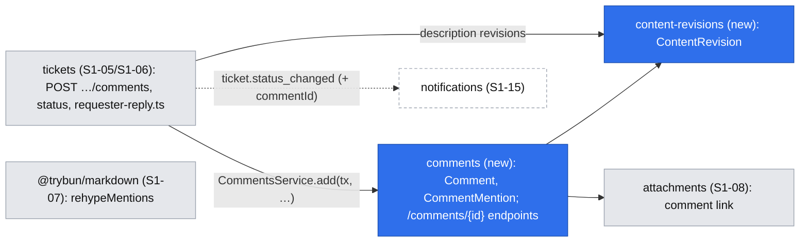
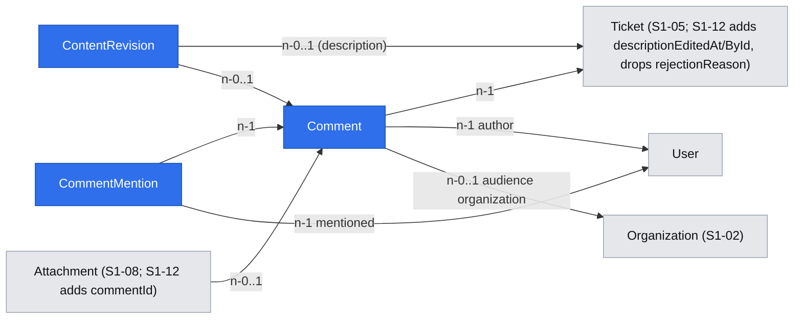

# Comments and internal notes – audience, mentions, edit history, redaction and requester replies

| | |
|---|---|
| Status | `implemented` |
| Created | 2026-10-26 |
| Plan task | `S1-12` |
| System specification sections | §4.3, §5.2, §6.1, §7.5, §13.2, §13.3; also §4.5, §5.4, §6.2, §7.3, §8.6, §13.5, §15.10, §17.2, §18.2, §18.3, §18.5, glossary |
| Related issues / PRs | Sibling specifications, all implemented (`.ai/specs/implemented/`): S1-04 permission layer ([#114](https://github.com/trybun/trybun/pull/114)), S1-05 ticket model ([#115](https://github.com/trybun/trybun/pull/115)), S1-06 statuses ([#116](https://github.com/trybun/trybun/pull/116)), S1-07 editor and `@trybun/markdown` ([#117](https://github.com/trybun/trybun/pull/117)), S1-08 attachments ([#119](https://github.com/trybun/trybun/pull/119)), S1-09 portal ([#118](https://github.com/trybun/trybun/pull/118)), S1-10 team ticket view ([#120](https://github.com/trybun/trybun/pull/120)), S1-11 visibility ([#121](https://github.com/trybun/trybun/pull/121)); depends on this one: S1-21 title redaction (`.ai/specs/2026-10-26-title-redaction.md`); [ADR 0008](../../../docs/adr/0008-attachment-serving.md) |

## Context

People talk about a ticket in its comments. The team also writes **internal notes** that end users never see ([§6.1](../../../docs/spec/06-comments-notifications.md)). For team members the default kind is the internal note, so a technical discussion does not reach the customer by accident. Every public comment stores its **audience**: the visibility the ticket had when the comment was written. A comment written before a ticket was shared therefore stays inside its original scope ([§5.2](../../../docs/spec/05-visibility-and-search.md)), and its attachments follow it ([§13.3](../../../docs/spec/13-non-functional.md)). Texts keep an edit history, which the team can **redact** to remove personal data ([§6.1](../../../docs/spec/06-comments-notifications.md), [§13.2](../../../docs/spec/13-non-functional.md)). A comment by the requester can change the status: it answers a request for information, declines a resolution, or reopens a recently closed ticket ([§4.3](../../../docs/spec/04-ticket-lifecycle.md)).

None of this exists yet: there is no `comments` module, no comment endpoint and no `features/comments/` in the web application. The implemented sibling tasks of Stage 1 leave these pieces to S1-12:

- S1-05 writes the description (0–65,536 characters, `TICKET_DESCRIPTION_MAX_LENGTH`) and records the internal `description_edited` event without content. Revisions are left to S1-12. Activity events live in `activity_events`: the type is text from the closed list `activityEventTypeSchema`, and database triggers refuse every update and deletion of a row except the cascade of a deleted ticket.
- S1-06 stores the rejection reason in a temporary column `tickets.rejection_reason`, with the check `tickets_rejection_reason_rejected` and the team response field `rejectionReason`. The reason is cleared when the ticket leaves `rejected`, and a new reason on a rejected ticket writes the internal `rejection_reason_changed`. S1-12 publishes the reason as a public comment, migrates the stored reasons and drops the column ([#116](https://github.com/trybun/trybun/pull/116), Q2). S1-06 also stores what the requester-reply rules need: `statusBeforeWaiting`, `waitingReason` (`information`, `confirmation`) and `closedAt`, and its pure `changeStatus()` records `reopen` when a ticket leaves a terminal status.
- S1-07 renders GFM with the shared package `@trybun/markdown` (`markdownRehypePlugins`, [#117](https://github.com/trybun/trybun/pull/117), Q1), used by the `Markdown` and `MarkdownEditor` components of `@trybun/ui`. S1-12 renders comments with them and adds mentions.
- S1-08 links attachments to tickets only (`attachments.ticket_id`; a draft is `ticket_id IS NULL`, `AttachmentLinksService.linkDrafts(tx, principal, ticketId, ids)`). S1-12 adds the link to comments and the access rule by comment kind and audience ([#119](https://github.com/trybun/trybun/pull/119)).
- S1-09 and S1-10 build the portal and team ticket views without a comment field. Both load the timeline from `GET /api/v1/tickets/{ticketId}/activity-events`. The account setting `hideTimelineEvents` already hides the events, and S1-10 leaves the interleaving of comments to S1-12. S1-09 leaves the end user's editing of their own title and description to S1-12 ([#118](https://github.com/trybun/trybun/pull/118), Q12).
- S1-11 builds visibility, sharing requests and the identity rule of §5.4 ([#121](https://github.com/trybun/trybun/pull/121)). It stores the latest refusal reason in a temporary column `tickets.sharing_refusal_reason` (team response field `sharingRefusalReason`, shown by the team view's visibility control), which S1-12 publishes as a public comment, migrates and drops (its Q8). It leaves the comment audience to S1-12.

The plan's "Done when" for S1-12:

- An end user sees "edited" but not previous versions.
- After a redaction, no earlier version contains the redacted text.
- `@mention` suggestions contain only people who can see the ticket.
- A comment written before sharing is not visible to other organizations.
- Internal notes never appear in the end-user view.
- While the ticket awaits confirmation, any requester comment moves it to `in_progress`. A requester comment on a `done` ticket within 14 days reopens it as `triage`.
- The reason of a sharing refusal appears to the author as a public comment.

The specification leaves several points open, and some of them contradict the plan. Agents may not decide them (Rule 8). Each one is listed under [Open questions](#open-questions) with the answer the maintainer approved on 2026-11-09. The design below follows these answers.

## Goals

- Everyone who can see a ticket can comment on it, within the rules for closed tickets (§4.3). The team adds internal notes, which no end-user response ever contains.
- An end user sees a public comment only if they can see the ticket and the comment's audience includes them. Lists and details use one CASL rule, so they never disagree ([§18.3](../../../docs/spec/18-code-patterns.md)).
- Comment attachments follow the comment's kind and audience without code of their own.
- `@mentions` suggest and accept only people who can see the ticket and the comment. A mention never grants access, and its display follows the identity rule of [§5.4](../../../docs/spec/05-visibility-and-search.md).
- Comments and descriptions keep their earlier versions as content revisions. The team sees them, and so does the author of a text ([Q3](#open-questions)). Redaction replaces the text and purges the selected revisions, so no copy remains in the database.
- The requester's public comment applies the status rules of §4.3 in the same transaction.
- Rejection reasons and sharing-refusal reasons are public comments.

## Non-goals

- Notifications of mentions, comments and reopens, watchers added by commenting or mentioning, live updates (S1-15). S1-12 stores what S1-15 needs: the mentions and the cause of a status change ([Q15](#open-questions)).
- E-mail replies as comments ([§6.3](../../../docs/spec/06-comments-notifications.md), S2-12). They will call the same use case.
- Mentions in descriptions ([Q5](#open-questions)).
- Comments imported from GitHub as internal notes with a GitHub author ([§11.5](../../../docs/spec/11-github-integration.md), Stage 3), and the SLA first response from the first public team comment ([§9.1](../../../docs/spec/09-sla.md), S4).
- Anonymization and export of comments and revisions (S1-16). S1-12 keeps the author of each revision, so S1-16 can purge a person's revisions ([§13.2](../../../docs/spec/13-non-functional.md)).
- Comments by integration tokens (S6-02). The token scope `comments:write` ([§12.2](../../../docs/spec/12-api-webhooks-import.md)) is mapped when tokens exist.
- Ticking task-list items in a rendered comment ([#117](https://github.com/trybun/trybun/pull/117), Q6).
- Search in comments (S2-03).

## Proposed change

### Behaviour

**Adding a comment** (`POST /api/v1/tickets/{ticketId}/comments`, body `{ kind, body, attachmentIds? }`):

1. The kind is required. The guard checks `add_comment` on the ticket: every role that can comment has it, and it carries the restriction `ticket.comments_closed`. The body's `kind` is known only after validation, so the service then checks `add_internal_note` for `kind: 'internal'` and returns `403` without it (end users never have it). A team member chooses in the UI, where the internal note is preselected ([UI](#web-application)).
2. Inside one transaction, the ticket is locked as the existing ticket writes lock it: the project's share lock first, then the ticket row with `lockTicketsForUpdate` (the private `lockAndFindTicket` of `TicketsService`, the "Row lock" pattern of [§18.3](../../../docs/spec/18-code-patterns.md)). The rules below are checked on the locked row.
3. A public comment takes its **audience** from the ticket's effective visibility at that moment ([§5.2](../../../docs/spec/05-visibility-and-search.md)): `only_me`, `my_organization` with the ticket's organization, or `all_customers`. An internal note has no audience.
4. Mentions in the body are checked against the mention scope ([Mentions](#mentions)) and stored.
5. The principal's own draft attachments in `attachmentIds` are linked to the comment (S1-08's linking rules, with the comment as the parent, [Q16](#open-questions)).
6. A public comment by an end-user requester applies the [requester-reply rules](#requester-replies) to the ticket.
7. Nothing else changes the ticket: comments are child records and do not change its `version` ([§17.2](../../../docs/spec/17-conventions.md)). Only a status change caused by the requester increases it.

**Reading.** An end user gets a public comment when all of these hold:

- they can read the ticket;
- the comment's audience includes them:
  - `only_me`: they are the ticket's requester;
  - `my_organization`: they are a current member of the comment's organization;
  - `all_customers`: always;
- **or**, instead of the audience, they wrote the comment ([§5.2](../../../docs/spec/05-visibility-and-search.md)).

Team members of the project and the Administrator get every comment, internal notes included. The audience is never changed later, by any visibility change ([§5.3](../../../docs/spec/05-visibility-and-search.md)).

**Editing** (`PATCH /api/v1/comments/{commentId}`, `If-Match`): only the author edits their own comment or note. The previous text becomes a content revision. The comment gets `editedAt` and `editedById`, and the internal event `comment_edited` without content. The kind and the audience never change ([Q12](#open-questions)). Mentions that are new in the text are checked, and existing ones are kept even if the person is no longer in the scope. Removed ones are deleted. New draft attachments may be linked.

**Description edits.** S1-05's `PATCH /api/v1/tickets/{ticketId}` writes the description and `description_edited`. S1-12 adds, in the same transaction, the content revision of the replaced text (an empty earlier description is not kept as a revision), `descriptionEditedAt` and `descriptionEditedById`. There is no separate "delete description" action: emptying the description is an edit, and removing content from the history is a redaction ([Q8](#open-questions)).

**Deleting** (`DELETE /api/v1/comments/{commentId}`, `If-Match`): the author deletes their own comment or note; the team deletes any comment. The row, its revisions, its mentions and its attachments are deleted physically ([§6.1](../../../docs/spec/06-comments-notifications.md), [§17.2](../../../docs/spec/17-conventions.md)). The attachments are deleted in the same transaction through a new function of S1-08's exported `AttachmentLinksModule` (`AttachmentsModule` exports nothing, and `AttachmentsService.delete` opens its own transaction); their objects are removed through S1-08's outbox event `attachment.deleted`, one per file, so the module of that function needs the outbox. No `attachment_deleted` activity event is written for them, because `comment_deleted` covers the comment. The internal event `comment_deleted` (with the person who deleted it, and the time) stays in the team timeline. Every deletion by a team member is written to the audit log as `comment.deleted`, as [§13.5](../../../docs/spec/13-non-functional.md) lists "deletion of comments by the team". An end user simply no longer sees the comment ([Q6](#open-questions), [Q7](#open-questions)).

**Redacting** (team, `POST /api/v1/comments/{commentId}/redaction` and `POST /api/v1/tickets/{ticketId}/description-redaction`, `If-Match` of the comment or the ticket): the body is `{ body, purgeRevisionIds }` for a comment and `{ description, purgeRevisionIds }` for a description, each named after the field it replaces.

- The new text replaces the current one, and the replaced text is **never** stored as a revision.
- The listed revisions are deleted. The UI preselects all of them ([Q9](#open-questions)).
- The redaction sets the edited marker, writes the internal event `comment_redacted` or `description_redacted` ("Content redacted", PL „Treść zredagowana”, without content, [§4.5](../../../docs/spec/04-ticket-lifecycle.md)), and an audit log entry `comment.redacted` or `ticket.description_redacted`.
- Mentions are re-read from the new text. Mentions that disappear are deleted.

After a redaction with every revision selected, no row of the database contains the earlier text. Outbox payloads, events and the stored replays of `Idempotency-Key` never contain it ([Q19](#open-questions)) ([§18.3](../../../docs/spec/18-code-patterns.md)). E-mails that were already sent cannot be recalled (Edge cases).

**Edit history** (`GET /api/v1/comments/{commentId}/revisions`, `GET /api/v1/tickets/{ticketId}/description-revisions`): the earlier versions, newest first, each with its author and the time it was written. The team gets every revision of every text it can see. The author of a text gets the revisions of that text: the comment's author, or the requester for the description ([§6.1](../../../docs/spec/06-comments-notifications.md), [§7.5](../../../docs/spec/07-users-organizations-permissions.md), [Q3](#open-questions)). Everyone else gets `403` (for a visible text), and the response of the text carries only `editedAt`. The UI shows "edited" (PL „edytowano”).

#### Requester replies

A pure function `modules/tickets/domain/requester-reply.ts` takes the locked ticket, whether the comment is a public comment by the ticket's requester with an end-user account ([Q10](#open-questions)), and `now`. It returns the status change or none:

| Ticket | Effect of the requester's public comment |
|---|---|
| `waiting_for_requester`, reason `confirmation` | → `in_progress`, as "No, still a problem" ([§4.3](../../../docs/spec/04-ticket-lifecycle.md)) |
| `waiting_for_requester`, reason `information` | → the status before waiting (`statusBeforeWaiting` of S1-06) |
| `done`, `closedAt` less than 14 × 24 hours ago | → `triage`, a reopen (S1-06's `changeStatus()` records `reopen: true` and clears `closedAt`) |
| `done` 14 days or more after `closedAt`, `rejected`, `duplicate` | The comment is refused before this function runs: `409 ticket.comments_closed` |
| Any other status | No change |

Comments of other end users and of the team never change the status. The change goes through a new method `TicketsService.applyRequesterReply(tx, …)` on top of S1-06's private `applyStatusChange` with `version` `null`: the state-conditional update S1-06 already uses for its automatic changes, in the transaction of the comment. It does not use `If-Match`, increases the ticket's `version` ([§17.2](../../../docs/spec/17-conventions.md)), and writes S1-06's `status_changed` event with the requester as its actor and no `automaticSource`, as S1-06 records the answer "No, still a problem", and the outbox event `ticket.status_changed` with the requester as `actorId` and the new optional field `commentId` ([Q15](#open-questions)). A requester's comment and a "Yes, solved" sent at the same moment are serialized by the comment's row lock against S1-06's state-conditional update (`confirmResolution` takes only the project share lock and updates the ticket only while it still waits). Solved first: the ticket is `done` with a fresh `closedAt`, and the comment then reopens it to `triage`, as the newer intent. Comment first: the ticket is `in_progress`, and "Yes, solved" returns `409 ticket.resolution_confirmation_not_pending`.

#### Reasons as public comments

- **Rejection** (S1-06's `PUT /api/v1/tickets/{ticketId}/status`, `changeTicketStatusSchema` with `{ status: 'rejected', rejectionReason }`). The reason becomes a public comment by the acting team member, in the same transaction. Its audience is the ticket's effective visibility, which includes the requester while they can read the ticket. A new reason on a ticket that is already `rejected` adds another comment instead of S1-06's `rejection_reason_changed` event, even with the same text, as any explicit comment does. The request schema, its length (1–2000 characters, `TICKET_REJECTION_REASON_MAX_LENGTH`) and its `422` stay as in S1-06. `rejectionReason` leaves the team response, and the team view shows the comment instead.
- **Migration of S1-06's column** ([Q13](#open-questions)). S1-06 clears the reason when a ticket leaves `rejected`, so only tickets that are rejected now hold one; earlier reasons were never kept and cannot be recovered. A first migration copies every stored `tickets.rejection_reason` into a public comment:
  - the author and the time are those of the ticket's latest `status_changed` event into `rejected` or `rejection_reason_changed` event, whichever is newer (only the team rejects, and events are immutable, so production data always has one). A migration must run unattended during `./trybun update` ([`BACKWARD_COMPATIBILITY.md`](../../../BACKWARD_COMPATIBILITY.md)), so it never aborts: without such an event (seeded data), the author is the ticket's assignee or, without one, the earliest Administrator account, and the time is the ticket's `updated_at`;
  - the ID is `uuidv7(<event time> - now())` of PostgreSQL 18, so the comment takes its place in the time-ordered timeline;
  - the audience is the ticket's current visibility. The visibility at the time of the rejection was not recorded, so this is the closest value.

  A second migration drops the column and its check constraint `tickets_rejection_reason_rejected`. Copy before drop, so nothing is lost ([§17.2](../../../docs/spec/17-conventions.md), "Migrations").
- **Sharing refusal** (S1-11's `POST /api/v1/tickets/{ticketId}/sharing/reject`, body `{ reason }`, GFM 1–2000 characters, [#121](https://github.com/trybun/trybun/pull/121) Q8). On every refusal the reason becomes a public comment by the refusing team member, in the same transaction. Its audience is the unchanged visibility, so the author sees it. S1-11 keeps only the latest reason and clears it on a new request, an approval or a change to `all_customers`. The stored `tickets.sharing_refusal_reason` of tickets with a `rejected` request is copied into comments in the same way as the rejection reason (author and time of the ticket's latest `sharing_rejected` event, with the same fallback; the demo dataset gains the missing event), and the column and its check `tickets_sharing_refusal_reason_rejected` are dropped in the second migration ([Q14](#open-questions)). `sharingRefusalReason` leaves the team response; the visibility control of the team view shows "Refused – the reason is in the timeline" (PL „Odrzucono – powód jest na osi czasu”) instead of the reason. No response field points to the comment.

#### Mentions

- **Markup** ([Q2](#open-questions)): a mention is stored in the source as `@{<userId>}`, plain GFM text without the person's name. The editor inserts it from the suggestions. The API returns each comment with a `mentions` map `{ id, displayName }`, built for the viewer with the identity rule of [§5.4](../../../docs/spec/05-visibility-and-search.md): a customer of another organization appears as "Customer" (PL „Klient”). A new plugin of `@trybun/markdown`, `rehypeMentions({ mentions })`, joins `markdownRehypePlugins` through a new `mentions` option and renders each token found in the map as `@Display name` (a `span` with the class `mention`, not a link). Tokens not in the map stay plain text. For a viewer who must not see a mentioned person (§5.4), the API replaces that person's token in `body` and in revision bodies with `@{customer}`, and the map has the entry `{ id: 'customer', displayName: null }`, which the web shows as "Customer" (PL „Klient”) from its catalogue, as for any hidden person. No hidden user ID leaves the server, as S1-11 returns such a person as `null` without an ID. The stored text keeps the real ID (Q2). On an edit, each `@{customer}` token of the submitted body is replaced, in order, by the stored hidden-person tokens of the previous text; extra ones are refused with `422 comment.mention_not_allowed`. `mentions[].id` is therefore `z.uuid().or(z.literal('customer'))`. As several texts now render on one page, footnote IDs must be unique per text. `remark-rehype` gets a per-text `clobberPrefix`, and the sanitize schema keeps its own empty prefix (`.ai/memory/markdown.md`). The footnotes' heading keeps the fixed ID `footnote-label` in `remark-rehype` (its `footnoteLabelProperties` cannot override it), so a small rehype plugin of `@trybun/markdown`, run after `remark-rehype` and before sanitizing, rewrites that ID and every `aria-describedby="footnote-label"` to the per-text prefix; the implementation updates `.ai/memory/markdown.md` accordingly. E-mails (S1-15) and the GitHub synchronization (Stage 3) resolve the tokens for their audience.
- **Scope** ([§7.3](../../../docs/spec/07-users-organizations-permissions.md), [Q4](#open-questions)). A person can be mentioned only if they can see the ticket **and** would see this comment. Each set below is therefore intersected with "the ticket read conditions R1–R4 hold for the candidate". This is a candidate query (`UserWhereInput`) built from the same definitions as `ticketReadConditions`, with a table test that both agree for every demo person, so a requester who left the organization or a member without project access is never suggested or accepted:
  - in a public comment by an end user: the team members who take part in the ticket – its assignee and the team members who wrote a public comment on it that the author can read ([Q20](#open-questions)) – and the members of the author's organization, if the ticket's visibility includes them (`my_organization` of that organization, or `all_customers`);
  - in a public comment by a team member: the project's team members, by the predicate of the assignee picker (`ASSIGNABLE_MEMBER`: active team accounts with the Developer role or higher in the project, S1-05 Q9), the requester, and the members of the ticket's organization if the visibility is `my_organization` or `all_customers`;
  - in an internal note: the project's team members only.

  Deactivated and anonymized accounts are never in the scope.
- **Suggestions** (`POST /api/v1/tickets/{ticketId}/mention-candidates`, body `{ kind, query }`). The query is free text, so it goes in the body, never in the URL ([§17.2](../../../docs/spec/17-conventions.md)). The endpoint returns at most 10 people of the scope whose display name contains the query, team members first. The display names follow §5.4. The guard checks `add_comment`; for `kind: 'internal'` the service also checks `add_internal_note` (`403`), as for adding a comment.
- **Saving**: a new mention outside the scope returns `422 comment.mention_not_allowed` with pointer `/body` and field code `field.invalid`. The code is the same for an unknown ID, so nothing is revealed. At most 50 distinct mentions per text (GitHub's limit), otherwise `422 comment.too_many_mentions` (also at `/body`, `field.invalid`). A mention never grants access to the ticket.

### Architecture

The arrows point one way only: tickets → comments → content revisions and attachments ([Q11](#open-questions)).

- **Module `comments`** owns `Comment` and `CommentMention`. Its controller serves `/api/v1/comments/{commentId}` (read, edit, delete, redaction, revisions), the ticket's comment list and the timeline. It exports `CommentsService.add(tx, principal, lockedTicket, input)`, which writes a comment for a ticket the caller has already locked and checked.
- **Module `tickets`** keeps every write of the ticket. It owns `POST /api/v1/tickets/{ticketId}/comments` because adding a comment locks the ticket and may change its status. The status change with a reason calls the same `CommentsService.add`. A dependency from comments to tickets would create a cycle, which [§18.3](../../../docs/spec/18-code-patterns.md) forbids.
- **Module `content-revisions`** owns `ContentRevision`. It exports `record(tx, …)`, `purge(tx, …)` and the list query. Both tickets and comments use it, and S1-16 will use it for anonymization.
- **Attachments**: S1-08's `AttachmentLinksService` gains a comment parent (`linkDrafts` for a ticket or a comment) and a deletion of a comment's attachments inside the caller's transaction. `AttachmentLinksModule` stays the only module the others import.
- **Modules of the API and the Worker**: `TicketsService` also runs in the Worker through `tickets-worker.module.ts`, which imports `AttachmentLinksModule` so it loads no controller. The comment services (`CommentsService`, mentions, content revisions) are therefore a service-only module, `CommentsCoreModule`, imported by `TicketsModule` and `TicketsWorkerModule`. The controller lives in `CommentsModule`, which only the API imports.
- **Timeline** (`GET /api/v1/tickets/{ticketId}/timeline`, [Q11](#open-questions)): one cursor list of comments and activity events, oldest first. Both use time-ordered UUIDv7 IDs, so the cursor is the last ID (as S1-05's `GET …/activity-events` already pages by `id > after`). Each page takes the next `limit` items of both queries, merges them by ID and keeps `limit`. Comments go through `accessibleBy(ability, 'read').Comment`. Events are not a CASL subject. Their end-user shaping lives today in `TicketsService.listActivityEvents`: `isPublic` only, `toEndUserEvent`, the originals readable through the `Ticket` ability, actors through `visiblePerson`, which moves with the identity helpers to the users module (`modules/users/visible-person.ts`, `modules/users/domain/identities.ts`), which `activity-events` may import. It moves into the `activity-events` module: `ActivityEventsService.listForViewer(tx, principal, ticketId, page, readableOriginals)` for `GET …/activity-events` and `eventsForViewer` for the timeline, with the readable-originals condition passed in by the caller. Both `GET …/activity-events` and the timeline use it, so `comments` never calls `tickets`. With the account setting `hideTimelineEvents` on, the timeline returns only comments, so the view keeps its "Events are hidden" state (S1-10). S1-09 and S1-10 switch their timelines to it. `GET …/activity-events` stays as a published endpoint, and the new `GET …/comments` is the comments-only list.

### Data model

**`Comment`** (`comments`, module `comments`):

| Field | Column | Type and rule |
|---|---|---|
| `id` | `id` | UUIDv7 |
| `ticketId` | `ticket_id` | FK `tickets`, `ON DELETE CASCADE` (tickets are deleted only by an import undo, [§17.2](../../../docs/spec/17-conventions.md)) |
| `authorId` | `author_id` | FK `users`, `RESTRICT`; anonymization keeps the tombstone ([§13.2](../../../docs/spec/13-non-functional.md)) |
| `kind` | `kind` | enum `comment_kind`: `public`, `internal` |
| `audience` | `audience` | enum `ticket_visibility` (the visibility codes of §5.1), set exactly when `kind = 'public'` |
| `audienceOrganizationId` | `audience_organization_id` | FK `organizations`, `RESTRICT`, set exactly when `audience = 'my_organization'` (the ticket's organization snapshot) |
| `body` | `body` | GFM, trimmed, 1–65,536 characters (the description limit of S1-05 Q4) |
| `editedAt`, `editedById` | `edited_at`, `edited_by_id` | Last edit or redaction, nullable; FK `users` |
| `version` | `version` | Optimistic locking ([§17.2](../../../docs/spec/17-conventions.md)) |
| `createdAt`, `updatedAt` | `created_at`, `updated_at` | `timestamptz` |

Check constraints for the kind, audience and organization rules above. Index `(ticket_id, id)`.

**`CommentMention`** (`comment_mentions`): `commentId` (FK, `ON DELETE CASCADE`), `userId` (FK `users`), `createdAt`. Primary key `(comment_id, user_id)`. It is the source for S1-15's notifications and for the viewer's `mentions` map.

**`ContentRevision`** (`content_revisions`, module `content-revisions`): one row per replaced version of a text.

| Field | Column | Type and rule |
|---|---|---|
| `id` | `id` | UUIDv7 |
| `ticketId` | `ticket_id` | FK `tickets`, `ON DELETE CASCADE`: set for a description revision |
| `commentId` | `comment_id` | FK `comments`, `ON DELETE CASCADE`: set for a comment revision |
| `body` | `body` | The replaced text |
| `authorId` | `author_id` | FK `users`: who wrote this version |
| `writtenAt` | `written_at` | When this version was written (the creation, or the edit that produced it) |
| `createdAt` | `created_at` | When it was replaced |

A check constraint allows exactly one of `ticket_id` and `comment_id`. Revisions are never updated. They are deleted by a redaction, by the deletion of their comment, by S1-16's anonymization of their author, or by an import undo.

**Other tables:**

- `Ticket`: `descriptionEditedAt`, `descriptionEditedById` (nullable). `rejection_reason` and `sharing_refusal_reason` are dropped after the copy ([Reasons](#reasons-as-public-comments)).
- `Attachment` (S1-08): `commentId` (FK `comments`, nullable), with a check that `ticket_id` and `comment_id` are never both set ([#119](https://github.com/trybun/trybun/pull/119), "S1-12 adds `comment_id`"). Deleting a comment deletes its attachments first, so the FK can stay `RESTRICT`. The draft condition becomes "neither ticket nor comment" everywhere S1-08 reads `ticket_id IS NULL` as a draft:
  - `AttachmentPurgeService.purgeDrafts` and the partial index `attachments_draft_created_at_idx`;
  - the draft rule of `attachments.abilities.ts`, `{ ticketId: null, commentId: null, uploadedById: me }`, so an uploader loses a comment attachment together with its comment;
  - the draft filter of `AttachmentLinksService.linkDrafts`, so a comment attachment is never linked again (`422 field.invalid`, not the check constraint's `500`);
  - the draft quota of `AttachmentsService`;
  - `attachmentRuleSelect`, which also selects `commentId` and the comment's rule fields, so the in-memory check of `@TargetRecord` (download, delete) works for comment attachments;
  - the contract (`attachmentSchema` gains `commentId`; `ticketId` and `commentId` are both `null` for a draft) and the glossary's "Draft attachment".

  In the same file, the Administrator's rule (`{ ticketId: { not: null } }`) also covers `{ commentId: { not: null } }`, and the archived restriction gains `{ comment: { is: { ticket: { is: { project: { is: { state: 'archived' } } } } } } }`. `AttachmentsService.delete` of a comment attachment takes the project share lock of the comment's ticket and writes the internal `attachment_deleted` (Q16).
- `ActivityEvent` (S1-05): new types in `activityEventTypeSchema` (the column is text, so no enum migration) `comment_edited` (data `{ commentId }`), `comment_deleted` (data `{ commentId, kind }`), `comment_redacted` (data `{ commentId }`) and `description_redacted`. All are internal ([Q6](#open-questions)). Events are immutable (S1-05's triggers), so their data holds only IDs, never content that a deletion or redaction would have to remove. `activityEventDataSchema` requires `{ from, to }` today and strips unknown keys, so the contract gains a member `{ commentId, kind? }` for the comment events (`description_redacted` keeps `null`), with a parse test of the data of each type. `rejection_reason_changed` stays in the closed list for existing events but is no longer written.

**Personal data.** Comment bodies, revision bodies and mentions are personal data. S1-16 includes them in export (own comments only, never internal notes, [§13.2](../../../docs/spec/13-non-functional.md)) and anonymization (revisions of the person's own texts purged; mentions of the person deleted, their token then stays plain text). Logs carry only IDs, never bodies, display names or mention queries ([§13.5](../../../docs/spec/13-non-functional.md)).

### API contracts

`@trybun/contracts/comments` (new) and `@trybun/contracts/tickets`:

| Endpoint | Check | Notes |
|---|---|---|
| `GET /api/v1/tickets/{ticketId}/comments?cursor&limit` | `read` on the `Ticket` | Cursor envelope, oldest first; the query adds `accessibleBy(ability, 'read').Comment` |
| `GET /api/v1/tickets/{ticketId}/timeline?cursor&limit` | `read` on the `Ticket` | Items `{ type: 'comment', comment } \| { type: 'event', event }` ([Q11](#open-questions)) |
| `POST /api/v1/tickets/{ticketId}/comments` | `add_comment` on the `Ticket` (guard); `add_internal_note` for `kind: 'internal'` (service, after validation) | Body `createCommentSchema` `{ kind, body, attachmentIds? }`. `201` with the comment. `Idempotency-Key` arrives with its interceptor in S6-01 (Q19); until then a retried request adds a second comment, and the web form disables its button while sending |
| `POST /api/v1/tickets/{ticketId}/mention-candidates` | As adding a comment | Body `{ kind, query }` (query 0–100 characters); `{ items: [{ id, displayName, userKind }], nextCursor: null }`, at most 10 |
| `GET /api/v1/comments/{commentId}` | `read` | The comment |
| `PATCH /api/v1/comments/{commentId}` | `update` | `{ body, attachmentIds? }`, `If-Match` |
| `DELETE /api/v1/comments/{commentId}` | `delete` | `If-Match`, `204` |
| `POST /api/v1/comments/{commentId}/redaction` | `redact` | `{ body, purgeRevisionIds }` (0–1000 UUIDs of this comment's revisions, else `422 field.invalid` at `/purgeRevisionIds/{index}`, as S1-08's link errors at `/attachmentIds/{index}`), `If-Match` |
| `GET /api/v1/comments/{commentId}/revisions` | `read_revisions` | Newest first, cursor envelope |
| `GET /api/v1/tickets/{ticketId}/description-revisions` | `read_description_revisions` | As above |
| `POST /api/v1/tickets/{ticketId}/description-redaction` | `redact_description` | `{ description, purgeRevisionIds }`, `If-Match` of the ticket; returns the ticket |

**Responses.**

- `commentSchema` (team): `id`, `ticketId`, `kind`, `audience`, `audienceOrganization { id, name } | null`, `author { id, displayName }`, `body`, `mentions [{ id, displayName }]`, `attachments [attachmentSchema]`, `editedAt`, `version`, `createdAt`, `allowedActions`.
- `endUserCommentSchema`: the same without `kind` (always public), `audience` and `audienceOrganization`. `author` and `mentions` follow §5.4 through S1-11's helpers ([#121](https://github.com/trybun/trybun/pull/121)): `identitySelect(principal)` loads what the rule needs, and `visiblePerson(principal, row)` (`modules/tickets/visible-person.ts`, built on the pure `identityVisibleTo` of `domain/identities.ts`) returns the person or `null`, which is shown as "Customer". The helpers move to the users module (`modules/users/visible-person.ts`, `modules/users/domain/identities.ts`), which both modules may import, so `comments` does not depend on `tickets` ([Q11](#open-questions)).
- `contentRevisionSchema`: `id`, `body`, `author { id, displayName }`, `writtenAt`. For end users, `author` follows §5.4 like the comment author.
- Ticket responses gain `descriptionEditedAt`; the team response loses `rejectionReason` and `sharingRefusalReason` (as long as no API tokens exist, only the web application of the same release calls the API, so this needs a regenerated OpenAPI document and client, not a new API version, [`BACKWARD_COMPATIBILITY.md`](../../../BACKWARD_COMPATIBILITY.md)).
- `allowedActions` of a comment: `update`, `delete`, `redact`, `read_revisions` (a new `commentActionSchema`). Of a ticket, new in `ticketActionSchema`: `add_comment`, `add_internal_note`, `read_description_revisions`, `redact_description`. The portal shows the comment field exactly when `add_comment` is present.

**Error codes:** `ticket.comments_closed` (409, the reason of the restriction for closed tickets), `comment.mention_not_allowed` (422), `comment.too_many_mentions` (422). Order of checks ([§18.3](../../../docs/spec/18-code-patterns.md)): an invisible ticket or comment → `404`; an archived project → `409 project.archived`; a closed ticket for an end user → `409 ticket.comments_closed`; another forbidden action of the guard → `403`; invisible draft attachments → `404`; validation → `422`; `add_internal_note` for an internal note → `403`; mention rules → `422`; stale version → `412` (a missing `If-Match` → `428` at validation), as in [§18.3](../../../docs/spec/18-code-patterns.md).

**Outbox:** S1-12 writes no new outbox event, because nothing consumes one before S1-15 (as S1-05 Q14). It adds the optional field `commentId` to S1-06's `ticket.status_changed`, set when a requester comment caused the change. The field is additive ([§17.2](../../../docs/spec/17-conventions.md), "Payload compatibility"). S1-15 adds `comment.created` with `{ commentId, ticketId, kind, authorId }` and reads the mentions from `comment_mentions`.

### Permissions

Rules in `comments.abilities.ts` and `tickets.abilities.ts`, following S1-04 ([#114](https://github.com/trybun/trybun/pull/114)), each §7.5 row with an allowed and a denied case. `Comment` joins `AppSubject` and `ability-definitions.ts`. Revisions are not a subject of their own: they are read through `Comment` `read_revisions` and `Ticket` `read_description_revisions`, which carry the read conditions and the archived restriction. "The read conditions" of a ticket are S1-11's `ticketReadConditions(principal)`, one rule per condition (R1–R4). A to-one relation is wrapped in `is`, so the condition also works in memory, as `attachments.abilities.ts` does: `{ ticket: { is: <condition> } }`.

| §7.5 row | Rule |
|---|---|
| View other people's tickets according to visibility and comment audience | `Comment` `read`: team of the project (all kinds); end users: one rule per pair of a ticket read condition and an audience condition, `{ kind: 'public', ticket: { is: <read condition> }, …<audience condition> }`, the audience condition being one of `{ authorId: me }`; `{ audience: 'all_customers' }`; `{ audience: 'my_organization', audienceOrganization: { is: { members: { some: { userId: me } } } } }`, a relation condition like `ownOrganization()` because the principal holds no organization (S1-04 Q2); `{ audience: 'only_me' }` with the ticket condition `{ is: { AND: [<read condition>, { requesterId: me }] } }` |
| Add public comments to visible tickets (terminal tickets: §4.3) | `Ticket` `add_comment` with the read conditions, all roles. End-user restriction with the reason `ticket.comments_closed`: `{ status: { in: ['rejected', 'duplicate'] } }` and `{ status: 'done', closedAt: { lte: now − 14 days } }`. S1-04's `AbilityFactory.forPrincipal(principal)` has no time today, so the factory gains the injected clock and passes `now` to the rules ([Q21](#open-questions)); `ticketRuleSelect` loads `closedAt`. The condition then works in memory and as a filter. The guard and the service each build the ability with the current time; the check on the locked row decides, so a request that passes the guard just before the 14-day boundary and reaches the service after it returns `409 ticket.comments_closed` |
| Add internal notes | `Ticket` `add_internal_note`, Developer and above |
| Edit or delete own comments and notes | `Comment` `update`, `delete` with `{ authorId: me }` and the read conditions; also on closed tickets ([Q12](#open-questions)) |
| Delete any comment | `Comment` `delete`, Developer and above of the project |
| View edit history | `Comment` `read_revisions`: team; end users `{ authorId: me }` together with the `Comment` read conditions. `Ticket` `read_description_revisions`: team; end users `{ requesterId: me }` together with the `Ticket` read conditions ([Q3](#open-questions)) |
| Redact a description or any comment | `Comment` `redact`, `Ticket` `redact_description`, Developer and above |
| Archived project | `Comment` restriction with `{ ticket: { is: { project: { is: { state: 'archived' } } } } }` and the reason `project.archived` for the closed list minus `read` and `read_revisions` (S1-04 Q10); the new ticket actions are restricted by S1-04's fail-closed list, and `read_description_revisions` joins `ACTIONS_OF_ARCHIVED_PROJECTS`, so it stays readable |
| Attachments of comments ([§13.3](../../../docs/spec/13-non-functional.md)) | `Attachment` `read` with `{ comment: { is: <a Comment read condition> } }`; `delete` with the comment's `delete` conditions. Defined in `attachments.abilities.ts` with the other attachment rules, which imports the comment conditions of `comments.abilities.ts`; `comments.abilities.ts` imports no attachment file |

Tests: the filter-equals-check test of S1-04 (`lists equal details` in `permission-layer.integration.spec.ts`) gets cases and fixtures for `Comment`. A property test over the demo dataset checks that no end-user list (comments, timeline, attachments) returns a record whose detail returns `404`.

### Web application

- **Team ticket view** (S1-10's timeline):
  - A comment form at the end of the timeline with `LazyMarkdownEditor` (S1-07, `features/tickets/components/`) and S1-08's `useAttachmentDrafts` (its Q18). Above it, a two-option switch "Internal note" (PL „Notatka wewnętrzna”), preselected on every new form, and "Public comment" (PL „Komentarz publiczny”).
  - With "Public comment" chosen, a one-line hint states who will see it ("Visible to the requester" / "Visible to organization X" / "Visible to all customers of the project", PL „Widoczny dla zgłaszającego” / „Widoczny dla organizacji X” / „Widoczny dla wszystkich klientów projektu”). The hint is built from the ticket's visibility. The submit button reads "Add internal note" (PL „Dodaj notatkę wewnętrzną”) or "Comment publicly" (PL „Skomentuj publicznie”).
  - Internal notes in the timeline and the form in internal mode have their own background token, a lock icon and the label "Internal note". Colour is never the only signal ([§13.4](../../../docs/spec/13-non-functional.md)).
- **Portal ticket view** (S1-09):
  - A comment field below the public timeline, always public.
  - When `allowedActions` lacks `add_comment` because the ticket is closed, the view shows "Create a new ticket" (PL „Utwórz nowe zgłoszenie”) instead ([§4.3](../../../docs/spec/04-ticket-lifecycle.md)).
  - "Edit" of the own title and description, as §7.5 allows and the plan's S1-12 row asks ([#118](https://github.com/trybun/trybun/pull/118), Q12), with S1-05's `PATCH /api/v1/tickets/{ticketId}` and its existing end-user rule.
- **Comment actions** in a `DropdownMenu` ("⋯", 44 px, no hover): Edit (inline editor), Delete (confirmation dialog, because the content cannot be restored), Redact (team).
- **"edited" marker**: plain text for people without `read_revisions`. For the others it is a button that opens the history in a `Dialog` (bottom sheet on phones), with the versions rendered by `Markdown`.
- **Redaction dialog**: the editor prefilled with the current text, the list of earlier versions as checkboxes (all checked), and a warning that this cannot be undone.
- **Mentions**: typing `@` in the editor opens a suggestion list (Base UI `Combobox` popup anchored to the caret line, a list above the keyboard on phones) fed by `mention-candidates`. Choosing a person inserts `@{id}`. `MarkdownEditor` of `@trybun/ui` gains a presentational prop `onMentionSearch(query) → Promise<candidate[]>`, and it and `Markdown` gain `mentions` for the rendering ([#117](https://github.com/trybun/trybun/pull/117), Rule 6, with stories).
- **Images in comments**: the allowed set of `Markdown` (`attachmentImageIds`) is the set of attachment IDs the API returned to the viewer for the ticket: the ticket's own attachments and those of the visible comments. `ticketImageIdsOf` (`features/attachments/markdown-references.ts`), which keeps only `attachment.ticketId === ticketId` today, also takes the attachments of the loaded comments. An image of an internal note, referenced in a public comment, therefore renders as a link for an end user, and the link itself returns `404`.
- Feature `features/comments/` with `queries.ts` (comments, timeline, revisions) and `mutations.ts` (add, edit, delete, redact; each invalidates the ticket's timeline and, after a requester reply, the ticket).

**User documentation** (EN, PL, Rule 3): a team page "Comments and internal notes" (kinds, audience, mentions, edit history, redaction, deleting) and an end-user page "Comment on your ticket" (replying, "edited", closed tickets). No new product tour: the tours of Stage 1 come with S1-18 (Rule 4).

### Edge cases and failure scenarios

- **Visibility changes after a comment:** narrowing a shared ticket hides its `all_customers` comments from other organizations, because they can no longer read the ticket. Widening it does not reveal the earlier `only_me` or `my_organization` comments ([§5.2](../../../docs/spec/05-visibility-and-search.md)).
- **The author leaves the organization:** the author of a `my_organization` comment loses the ticket ([§7.3](../../../docs/spec/07-users-organizations-permissions.md)). If the ticket is later shared, they see their own comment again through the author rule.
- **Two edits at once:** the second one gets `412` and the conflict message ([§17.2](../../../docs/spec/17-conventions.md)). A redaction against a stale version also gets `412`, so it never redacts a text the redactor has not seen.
- **Redaction after e-mails were sent:** e-mails already delivered keep the old text. The redaction dialog says so. Outbox payloads never held the text.
- **Redaction and backups:** backups ([§15.10](../../../docs/spec/15-deployment.md)) keep the earlier text until they rotate out. The redaction dialog says so, as it does for e-mails.
- **The requester comments while the timer closes the ticket:** the ticket lock serializes both. If the close came first, the ticket is `done` with a fresh `closedAt`, and the comment reopens it to `triage` within the 14 days.
- **A comment on a `done` ticket by a former member of the organization** who can no longer see it: `404`, as for any invisible ticket.
- **Archived project:** every write returns `409 project.archived`. Reading the comments and their history stays possible.
- **Object storage down while deleting a comment:** the rows are deleted in the transaction. S1-08's outbox job removes the objects when the storage is back.
- **A mention token typed by hand** for someone outside the scope: `422` on save. The editor shows the error under the field, and the author removes the token.

### Prior art

- **GitHub**: edit history with "edited" on every comment and the issue body. The history is visible to everyone who can read the issue, and maintainers can delete single revisions. Mentions are limited to 50 per comment and notify only people with access. Trybun restricts the history (§6.1), keeps the deletion of revisions as redaction, and adopts the limit.
- **Jira Service Management**: "Reply to customer" and "Add internal note" side by side. Internal notes are highlighted and labelled. Trybun preselects the note (§6.1).
- **Zendesk**: a public reply is the agent's default, and a reply by the requester to a *Pending* ticket reopens it. Trybun adopts the reopen and reverses the default.
- **Linear**: mentions are stored as user IDs and rendered with the current name, as proposed here.

## Changes to the system specification

| Section | Change |
|---|---|
| §4.3 | The requester-reply rules apply to public comments of the requester's end-user account (Q10); "within 14 days" is 14 × 24 hours after `closedAt`; the rejection reason's "Until comments exist, the reason is stored on the ticket …" is removed (Q13) |
| §4.5 | Comment edits, deletions and redactions are internal events; end users see the "edited" marker on the text (Q6); attachment events of comment attachments are internal (Q16); with **Hide events** the timeline returns the comments only (Q11) |
| §5.2 | The comment audience is set from the effective visibility on the locked ticket; the author rule; the mention scope per kind (Q4); the refusal reason's "Until comments exist …" storage sentence is removed (Q14) |
| §6.1 | Mention markup and display (Q2); end users see the revisions of their own texts (Q3); emptying a description is an edit, removing it from history is a redaction (Q8); the redacted current text is never stored and every revision is preselected (Q9); kind and audience are immutable, and own comments can be edited and deleted on closed tickets (Q12); at most 50 mentions per text; end users mention the team members who take part in the ticket, not every team member (Q20) |
| §6.2 | Mentions render as `@Display name` from the API's map; tokens outside it stay text; a hidden person's token reaches the viewer as `@{customer}` |
| §8.6 | The comment form with the kind switch and audience hint at the end of the timeline; comments and events in one timeline |
| §7.3 | The mention scope for team authors and internal notes (Q4); end users mention only the team members who take part in the ticket, not every team member of the project (Q20) |
| §7.5 | Row "Delete any comment" and the history rows apply to descriptions as stated in Q3 and Q8 |
| §13.3 | Comment attachments are readable with their comment and deleted with it; an image renders if its attachment belongs to the same ticket or to one of its comments the viewer can read |
| §13.5 | Audit action codes for the existing "redaction and deletion of comments by the team": `comment.redacted`, `comment.deleted`, `ticket.description_redacted` |
| §17.2 | Error codes `ticket.comments_closed`, `comment.mention_not_allowed`, `comment.too_many_mentions` |
| §18.2, §18.3 | The timeline is one cursor list merged from comments and events by their UUIDv7 IDs (Q11); the ability factory takes the injected clock and passes `now` to the rules (Q21) |
| Plan | S1-12 already names the copy and drop of both reason columns and the portal edit of title and description. S1-15: `comment.created`, notifications of mentions and reopens, watchers from comments and mentions. S2-12: e-mail replies call the comment use case. S1-16: comment bodies, revisions and mentions in export and anonymization. The maintainer changes the plan |

New or changed glossary terms (code identifier, EN/PL labels):

- Mention – `comment_mention` – Mention / Wzmianka: a person named in a comment with `@`; notifies them, never grants access.
- `comment.kind` gets the UI labels of the switch: Internal note / Notatka wewnętrzna, Public comment / Komentarz publiczny. The glossary's label of a public comment elsewhere stays Comment / Komentarz.
- Draft attachment – `attachment.ticket_id = null and attachment.comment_id = null`.
- `comment.audience` – values are the visibility codes plus the organization for `my_organization`.
- `ticket.rejection_reason` (from S1-06) and `ticket.sharing_refusal_reason` (from S1-11) are removed.
- Activity event types `comment_edited`, `comment_deleted`, `comment_redacted`, `description_redacted` – "edited a comment" / „edytował(a) komentarz”, "Comment deleted" / „Komentarz usunięty”, "Content redacted" / „Treść zredagowana”.

## Open questions

Implementation must not start until every question has an answer. The maintainer approved every answer explicitly on 2026-11-09, each as the option that follows the established conventions of comparable products and the project's rules. Q2 sets a durable format, and Q3 and Q20 resolve a difference between the plan or §7.3 and this specification.

1. **Dependencies.** S1-12 (group 6) builds on S1-04 to S1-11. — **Answer (approved by the maintainer, 2026-11-09):** S1-04 to S1-11 are implemented, and this specification uses their code as it is (aligned on 2026-11-09). The identity rule of §5.4 ("Customer") is S1-11's `visiblePerson` and `identityVisibleTo` ([#121](https://github.com/trybun/trybun/pull/121)); S1-12 applies it to comment authors and mention names. Comment rules build on S1-11's ticket read conditions, so `add_comment` also covers the own `only_me` and `all_customers` tickets (R1) a user keeps after an organization change without project access ("read and comment", [§7.3](../../../docs/spec/07-users-organizations-permissions.md)).
2. **Mention markup.** §6.1 has mentions, but people have no handle (no `@login` for end users), and a name in the source would reach every reader of the source. That breaks §5.4 for customers of other organizations, and the name stays after anonymization. — **Answer (approved by the maintainer, 2026-11-09):** `@{<userId>}` in the source, as Slack (`<@U123>`), Jira (`[~accountid:…]`) and Linear store a stable ID and render the current name. The API sends a `mentions` map per viewer, and `rehypeMentions` of `@trybun/markdown` renders it. The format is stored in content and is costly to change later. The Write tab shows the raw token, as GitHub shows `@login`. Alternatives: (a) `@[Name](id)` markup, readable in the textarea, but it leaks names across organizations; (b) a new unique handle per account, which is a new user field, and customers' handles would be visible to others.
3. **Who sees the edit history.** The plan says "edit history (team only)" and "an end user sees 'edited' but not previous versions". §6.1 and §7.5 let the author of a text see the revisions of their own text. — **Answer (approved by the maintainer, 2026-11-09):** follow the system specification: team members see every revision; an end user sees only the revisions of texts they wrote (their comments, and the description of a ticket they requested). The "Done when" is tested for a text written by someone else. An author always knows their own versions, so nothing leaks. Rejected alternative: team only, which changes §6.1 and §7.5.
4. **Mention scope for team authors and internal notes.** §7.3 defines the suggestions for end users only. — **Answer (approved by the maintainer, 2026-11-09):** internal notes mention team members only. Public comments by the team mention team members, the requester and, for `my_organization` or `all_customers`, the members of the ticket's organization – never customers of other organizations, even on shared tickets. Team members are active accounts with a team membership of the project (S1-05 Q9). New mentions outside the scope are rejected with `422`; existing ones survive an edit. At most 50 per text.
5. **Mentions in descriptions.** §6.1 lists mentions with comments only, and the plan names them under comments. — **Answer (approved by the maintainer, 2026-11-09):** comments and internal notes only. The description editor offers no suggestions, and a typed token stays text. Can be added later without changing the stored format; GitHub, Jira and Linear offer mentions in descriptions, so a follow-up task may add them.
6. **Who sees edit, deletion and redaction events.** §4.5 lists the public events (public status changes, public comments, public milestones), and these events are not among them. A public event about an audience-limited comment would also reveal it to other organizations. — **Answer (approved by the maintainer, 2026-11-09):** all four event types are internal. End users see the "edited" marker on the text, and a deleted comment disappears from their view. Rejected alternative: public events that copy the comment's audience, which needs audience columns on `activity_events`.
7. **"Comment deleted" with author and time.** §6.1 does not say whose name. — **Answer (approved by the maintainer, 2026-11-09):** the event's actor is the person who deleted it, at the time of deletion (GitHub's "deleted a comment"). Its data holds only the comment ID and kind, no author snapshot or content. The row is deleted physically, without a soft delete ([§17.2](../../../docs/spec/17-conventions.md)).
8. **"Deleting of descriptions" in the plan.** §6.1 and §7.5 define deleting for comments only. — **Answer (approved by the maintainer, 2026-11-09):** no separate action. Emptying the description is an edit (S1-05 allows an empty description) and keeps a revision; removing text from the history is a redaction. Rejected alternative: a delete action that empties the text and purges every revision.
9. **What a redaction keeps.** §6.1 purges "the selected earlier revisions"; the "Done when" requires that no earlier version contains the redacted text. — **Answer (approved by the maintainer, 2026-11-09):** the replaced current text is never stored, the UI preselects every revision, and the team may keep some. The test covers the default. Rejected alternative: always purge every revision (simpler, but against "selected").
10. **Whose comment triggers the status rules.** §4.3 says "the requester", and the requester can be a team member (team tickets, source `developer`). — **Answer (approved by the maintainer, 2026-11-09):** only public comments of the requester's `end_user` account, because the rules model the customer's reply and "The team can always comment" (§4.3). Internal notes never trigger them.
11. **Module boundaries and the timeline.** Adding a comment changes the ticket, and a status change adds a comment, which would make tickets and comments depend on each other. S1-05 leaves the interleaving to S1-12. — **Answer (approved by the maintainer, 2026-11-09):** tickets → comments → content revisions, attachments. The tickets module owns `POST …/comments` and both reason comments. A merged `GET …/timeline` with one UUIDv7 cursor replaces two client-side lists; it honours `hideTimelineEvents`. Events keep their `isPublic` filter, as they are not a CASL subject. S1-11's identity helpers move out of the tickets module (or are passed in), so comments do not import tickets. Rejected alternative: two infinite lists merged in the browser, which cannot page correctly.
12. **Changing an existing comment.** — **Answer (approved by the maintainer, 2026-11-09):** the kind and audience never change; to publish a note, write a public comment. Authors may edit and delete their own comments also on closed tickets: deleting removes personal data, and editing changes only their own text. Rejected alternative: end users cannot edit on closed tickets.
13. **Migration of S1-06's `rejection_reason`** ([#116](https://github.com/trybun/trybun/pull/116) Q2). — **Answer (approved by the maintainer, 2026-11-09):** copy each stored reason into a public comment (author and time: the latest `status_changed` into `rejected` or `rejection_reason_changed` event; UUIDv7 from that time; audience: the current visibility), then drop the column in a second migration. Only tickets rejected now hold a reason (S1-06 clears it on leaving `rejected`). A new reason on a rejected ticket adds a comment.
14. **Sharing refusal reason before S1-12** ([#121](https://github.com/trybun/trybun/pull/121) Q8: required reason, temporary column `tickets.sharing_refusal_reason`). — **Answer (approved by the maintainer, 2026-11-09):** S1-12 publishes the reason as a public comment on every refusal, copies the stored reasons of tickets with a `rejected` request into comments as in Q13 (from the latest `sharing_rejected` event), and drops the column. The request schema `{ reason }` stays as S1-11 defines it; the plan's S1-12 row already names this.
15. **Outbox events for comments.** — **Answer (approved by the maintainer, 2026-11-09):** none new in S1-12, following S1-05 Q14: nothing consumes them before S1-15. S1-12 adds the optional `commentId` to `ticket.status_changed`, so S1-15 can notify about "Requester replied" and reopens.
16. **Comment attachments.** — **Answer (approved by the maintainer, 2026-11-09):** an attachment has one parent, ticket or comment (S1-08). Comment attachments are returned with the comment, not in the ticket's attachment list. Linking writes no `attachment_added` event, because the comment shows them. Deleting a single comment attachment writes `attachment_deleted` as an internal event (S1-08 writes it public for ticket attachments, with the file name), so its file name does not leak beyond the comment's audience.
17. **UI scope.** — **Answer (approved by the maintainer, 2026-11-09):** S1-12 adds the comment form, actions, history and redaction dialogs to the team view (S1-10) and the portal view (S1-09), the mention suggestions to `MarkdownEditor`, the edit of the own title and description to the portal (the plan's S1-12 row, S1-09 Q12), and the two help pages. No product tour.
18. **One specification or several.** Mentions (a stored format and an editor popup), revisions and redaction, the status rules and the reasons could each ship after the core comments. — **Answer (approved by the maintainer, 2026-11-09):** one specification, as the plan defines one task and every part extends the same comment model and endpoints. The phases below are independently shippable, so the implementation may be one PR per phase (core comments and reading first). Rejected alternative: split mentions and redaction into their own plan tasks and specifications.
19. **Limits and replays.** The specification gives no numbers. — **Answer (approved by the maintainer, 2026-11-09):** "within 14 days" is 14 × 24 hours after `closedAt` (as S1-06 Q7 for the 7 days); comment bodies 1–65,536 characters (S1-05 Q4); at most 50 mentions per text (GitHub); at most 10 mention candidates; at most 1000 revision IDs per redaction. The `Idempotency-Key` replay of `POST …/comments` stores only the status and the comment ID, and a replay reloads the comment through the ability, so no stored replay keeps a text that is later edited or redacted ([§12.1](../../../docs/spec/12-api-webhooks-import.md); the mechanism has no implementation yet).
20. **Team members in end users' mention suggestions.** §7.3 lets end users mention team members, which shows them the names of the project's team. — **Answer (approved by the maintainer, 2026-11-09):** only the team members who take part in the ticket: its assignee and the team members who wrote a public comment on it that the author can read. Jira Service Management and Zendesk do not let customers mention agents at all, and the narrowest set discloses the fewest names (least privilege) while still reaching the people handling the ticket. §7.3 is narrowed accordingly. Rejected alternative: all active team members of the project, as §7.3 reads today.
21. **The time in the abilities.** The end-user restriction "`done` for 14 days or more" (§4.3) depends on the current time, and S1-04's `AbilityFactory.forPrincipal(principal)` and `AbilityRules` (`(builder, principal)`) receive none. — **Answer (approved by the maintainer, 2026-11-09):** the factory gets the injected clock (`platform/clock`, [§18.3](../../../docs/spec/18-code-patterns.md)) and passes `now` to every rule set as a third argument; the existing rules ignore it. `allowedActions`, lists and details then agree, and tests use the fixed clock. Extending the signature of the rules changes the pattern of S1-04, so an ADR records it (Rule 12), written with the first implementation step, and §18.3 describes it. Rejected alternative: a job sets a `comments_closed` flag 14 days after `closedAt`, which needs a new column and leaves a window of up to one job interval.

## Implementation plan

Each step leaves the application working and has its tests.

**Phase 1 – Model, rules and reading**

1. Contracts: `comment_kind`, comment schemas, action and error codes, `createCommentSchema`, mention candidate and revision schemas. Enum equality with Prisma.
2. Migrations: `comments`, `comment_mentions`, `content_revisions` with check constraints; `attachments.comment_id` with the new draft condition at every S1-08 site (purge, partial index, abilities, links, quota, contract); the ticket's description-edit columns. Factories.
3. The clock in `AbilityFactory` with its ADR (Q21); `comments.abilities.ts` registered in `ability-definitions.ts`: `Comment` read with audience, `Attachment` of comments, archived restriction. Ability table tests; filter-equals-check cases. Integration: a comment written while `my_organization` is invisible to another organization after the ticket is shared; an internal note never appears in an end-user list, detail or timeline.
4. `CommentsCoreModule` and `CommentsModule`; the end-user event shaping moved to `ActivityEventsService.listForViewer`; `GET …/comments`, `GET /comments/{id}`, `GET …/timeline` with the merged cursor. Property test over the demo dataset.

**Phase 2 – Writing**

5. `POST …/comments` in the tickets module with `lockAndFindTicket`, the audience, draft attachments (`AttachmentLinksService` with a comment parent) and `ticket.comments_closed`. `CommentsService.add`.
6. Mentions: `@{id}` parsing in `@trybun/markdown` (table tests), the scope with the per-candidate read conditions, the `@{customer}` rewrite for hidden people, `mention-candidates`, `422` codes, the 50 limit. Integration: suggestions contain only people who can see the ticket, per kind.
7. Editing with revisions for comments and descriptions, `editedAt`, the internal events. Revisions endpoints with their rules. Integration: an end user sees "edited" but gets `403` for the revisions of someone else's text.
8. Deleting with revisions, mentions and attachments; audit entries.
9. Redaction for comments and descriptions; audit entries. Integration: after a redaction with the default selection, no row of `content_revisions`, `comments`, `tickets`, `activity_events` or `outbox_events` contains the redacted text.

**Phase 3 – Status rules and reasons**

10. `domain/requester-reply.ts` with table tests per row; `applyRequesterReply` in the comment transaction; `commentId` in `ticket.status_changed` with a parse test of the previous payload shape ([§18.7](../../../docs/spec/18-code-patterns.md)). Integration: confirmation → `in_progress`; information → the status before waiting; `done` at 13 days → `triage` with `reopen`, at 14 days → `409`; another end user's comment changes nothing; a concurrent "Yes, solved" and a comment → one result.
11. The rejection reason as a comment; the copy migration and the drop migration, with a migration test on a seeded rejected ticket. The demo dataset, the factories, `openapi.json` and the team view's reject dialog stop using `rejectionReason`.
12. The sharing refusal reason as a comment, with the copy and drop of `sharing_refusal_reason`; the visibility control and the sharing dialogs of the team view show the comment. Integration: the author sees the reason as a public comment, another organization does not.

**Phase 4 – Web and documentation**

13. `MarkdownEditor` mention suggestions and `rehypeMentions` rendering, with stories in three viewports (Rule 6).
14. `features/comments/`: team form with the kind switch and audience hint, portal field and "Create a new ticket", comment menu, history and redaction dialogs, title and description edit in the portal; the views switch from `GET …/activity-events` to the timeline. E2E with axe on phone, tablet and desktop: an internal note is labelled and never shown in the portal.
15. User documentation EN/PL, catalogue texts, `pnpm api:generate`, demo dataset (a ticket with a public comment before sharing, an internal note, an edited comment), with time-ordered IDs for comments and events, as the timeline merges by ID and `demoId()` gives every row the same timestamp today. Update the sections of the table above as approved; move this file to `implemented/`.

## Acceptance criteria

- [ ] An end user sees "edited" on another person's text and gets no earlier versions; the author of a text sees its revisions (Q3)
- [ ] After a redaction with the default selection, no earlier version contains the redacted text
- [ ] `@mention` suggestions contain only people who can see the ticket and the comment; a new mention outside the scope returns `422`
- [ ] A comment written before sharing is not visible to other organizations
- [ ] Internal notes never appear in an end-user response (list, detail, timeline, attachments)
- [ ] While the ticket awaits confirmation, any public comment of the requester moves it to `in_progress`; a requester comment on a `done` ticket within 14 days reopens it as `triage`; after 14 days the comment returns `409 ticket.comments_closed`
- [ ] The reason of a sharing refusal appears to the author as a public comment; the reason of a rejection appears to the requester as a public comment, also for tickets rejected before S1-12
- [ ] Deleting a comment removes its content, revisions and attachments and leaves "Comment deleted" in the team timeline
- [ ] A Developer of project A gets `404` for a comment of project B; an archived project returns `409 project.archived` for every write
- [ ] Works on phone, tablet and desktop (Rule 9)
- [ ] User documentation EN/PL for team members and end users; no product tour in this task (Rules 3, 4)

## Changelog

- 2026-10-26 – Created.
- 2026-11-09 – Aligned with the implemented S1-04 to S1-11: the lock (`lockAndFindTicket`), the status use case (`applyStatusChange`), the S1-11 identity helpers, CASL `is` conditions, the attachment links module and draft condition, the timeline's event filter and `hideTimelineEvents`, the migrations of both reason columns, the portal title edit, the §13.5 audit scope; new Q21 (the time in the abilities).
- 2026-11-09 – The maintainer approved all answers; Q20 narrowed to the participants of the ticket, Q21 recorded in an ADR.
- 2026-11-09 – Specification review applied: every S1-08 draft site, the organization audience as a relation condition, both orderings of a reply and "Yes, solved", hidden people's mention tokens, mention candidates checked against the read conditions, the guard of internal notes, the event data contract, the event shaping in `activity-events`, a service-only comments module for the Worker, migrations that never abort, and the smaller corrections; the re-review's minors (footnote heading ID, the time at the 14-day boundary, hidden tokens on edit, `attachmentRuleSelect`, the order of checks).
- 2026-11-09 – Implemented in #260, with these facts recorded in the system specification: the hidden-person entry of the `mentions` map is `{ id: 'customer', displayName: null }`, shown as "Customer" (PL „Klient”) from the web catalogue; an empty earlier description is not kept as a revision; mention errors use pointer `/body` with field code `field.invalid`; revisions are no CASL subject of their own (read through `Comment` `read_revisions` and `Ticket` `read_description_revisions`); the rules of comment attachments live in `attachments.abilities.ts`, which imports the comment rules (`comments.abilities.ts` imports no attachment file); the identity helpers moved to `modules/users/visible-person.ts` and `modules/users/domain/identities.ts`, and the end-user shaping of events is `ActivityEventsService.listForViewer` / `eventsForViewer`; every deletion of a comment by a team member is audited (`comment.deleted`), as are `comment.redacted` and `ticket.description_redacted`; the requester-reply status change is recorded with the requester as actor, without an automatic source. Status `implemented`.
