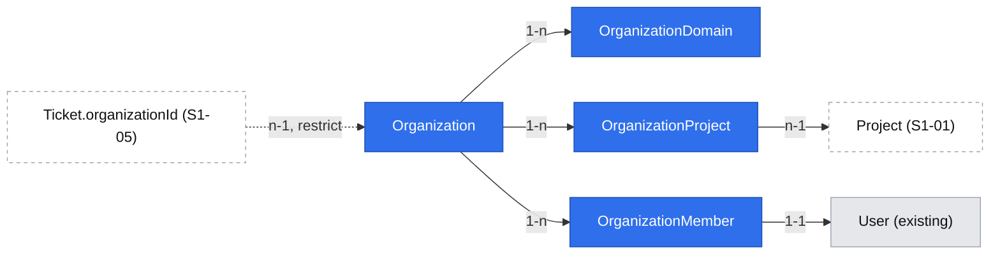

# Organizations

| | |
|---|---|
| Status | `implemented` |
| Created | 2026-10-26 |
| Plan task | `S1-02` |
| System specification sections | §7.3, §7.5 (also §3.2, §13.5, §15.6, §17.2, §18.3) |
| Related issues / PRs | S1-01 (projects, change specification in parallel), S1-03 (invitations, [`2026-10-25-invitation-acceptance.md`](../2026-10-25-invitation-acceptance.md)), S1-04 (permission layer), S1-11 (visibility after an organization change) |

## Context

An organization is a customer company that groups end users ([§7.3](../../../docs/spec/07-users-organizations-permissions.md)). It has a name, e-mail domains, the projects it may access and its members; organizations are optional, and the system works without them. Only the Administrator manages them ([§7.5](../../../docs/spec/07-users-organizations-permissions.md)), and every change of an organization, its domains and its members is recorded in the audit log ([§13.5](../../../docs/spec/13-non-functional.md)).

Nothing of this exists yet. The database has accounts (`users`) and the audit log, but no organizations, no projects (S1-01, in parallel) and no invitations (S1-03, later). The Administrator panel (`/admin`) has only the getting-started checklist and the about page.

Plan task S1-02 builds the organization model, unique e-mail domains with public mail domains blocked, project access, membership and its changes by the Administrator, and organization archiving. Its acceptance: `gmail.com` cannot be added as a domain, and a domain of another organization cannot be added. Out of scope are the effects of an organization change on ticket visibility (S1-11).

Writing this specification found gaps in §7.3 and §13.5 that the specification does not decide. They are listed as open questions with proposed answers; the proposals are not decisions.

## Goals

- The Administrator creates, renames, archives, unarchives and deletes organizations in the Administrator panel, on a phone as well as on a desktop.
- A domain belongs to at most one organization, and a public mail domain such as `gmail.com` can never be added.
- The Administrator grants and removes the access of an organization to projects.
- The Administrator adds end users to an organization, removes them and moves them to another one; an end user belongs to at most one organization.
- Every change is recorded in the audit log in the transaction of the change, with enough information to tell later which domain, project or person it concerned.
- S1-03 can ask one service method which organization an invited e-mail address joins.

## Non-goals

- Effects of a membership change on ticket visibility and watchers ([§7.3](../../../docs/spec/07-users-organizations-permissions.md) "Changing a user's organization") → S1-11. No tickets exist before S1-05.
- Invitations, domain matching on acceptance, the hint "This person will join the organization X" and inviting new end users to an organization → S1-03. S1-02 provides the matching rule only.
- The access of end users to projects derived from their organization in the CASL abilities of projects → S1-04 (the permission layer), which reads the data S1-02 stores.
- Hiding organization elements while no organization exists ([§7.3](../../../docs/spec/07-users-organizations-permissions.md) "System without organizations") → each later task for its own element (plan "How to use this plan"); the signal they use is open question 8.
- The SLA policy of an organization ([§9.3](../../../docs/spec/09-sla.md)) → the SLA tasks of Stage 4, which add the field.
- Anonymization and data export of the membership → S1-16 ("anonymization and data export for the data of Stage 1").
- Changing the account kind, which removes the membership ([§7.1](../../../docs/spec/07-users-organizations-permissions.md)) → the task that builds the kind change; it calls the membership removal of S1-02.

## Proposed change

### Data model

A new feature module `organizations` (server `modules/organizations/`, contracts `@trybun/contracts/organizations`, web `features/organizations/`, [§18.1](../../../docs/spec/18-code-patterns.md)) owns four models:

| Model (table) | Fields | Rules |
|---|---|---|
| `Organization` (`organizations`) | `id` (UUIDv7), `name`, `state` (`OrganizationState`: `active`, `archived`), `version`, `createdAt`, `updatedAt` | `name` trimmed, 1–100 characters, unique case-insensitively across active and archived organizations (index on `lower(name)` created in SQL, [§17.2](../../../docs/spec/17-conventions.md)) – open question 3. Versioned record ([§17.2](../../../docs/spec/17-conventions.md)) |
| `OrganizationDomain` (`organization_domains`) | `id`, `organizationId`, `domain`, `createdAt` | `domain` unique across all organizations, archived ones included (open question 3); stored normalized (open question 2); deleted with its organization |
| `OrganizationProject` (`organization_projects`) | `organizationId`, `projectId`, `createdAt` | Primary key on both; deleted with the organization or the project |
| `OrganizationMember` (`organization_members`) | `userId`, `organizationId`, `createdAt` | Primary key on `userId`, so an account belongs to at most one organization by construction; only `end_user` accounts (checked by the service); deleted with the organization |

- Membership is a table of the module rather than a column of `users`, so the `users` module does not change and the organizations module writes only its own models ([§18.3](../../../docs/spec/18-code-patterns.md) "Ownership"). `createdAt` is the date the person joined, shown in the member list.
- Personal access of end users to a project stays a `project_member` row with role `end_user` ([§7.4](../../../docs/spec/07-users-organizations-permissions.md)) and is independent of the membership: joining or leaving an organization never changes it.
- The organization snapshot of tickets ([§3.2](../../../docs/spec/03-ticket-model.md)) is a foreign key added by S1-05 with `ON DELETE RESTRICT`, which is what keeps an organization with tickets from being deleted (open question 7).

The organization is the centre of three small link tables; only the planned ticket snapshot points at it from outside, and that link is what blocks deletion later.

### E-mail domains

- A domain is checked as a pure rule (`domain/email-domains.ts`): normalized to lower-case ASCII (an internationalized domain to its punycode form with `domainToASCII` of `node:url`, no new dependency), at least two labels, no wildcard, no `@`, no trailing dot (open question 2).
- A domain on the **blocklist of public mail domains** is rejected with `organization.domain_public` at its field (`/domains/<index>`). The blocklist is a data file of the server module, taken from a maintained open-source list and updated with the dependencies (Rule 10), like the password blocklist ([§13.5](../../../docs/spec/13-non-functional.md)) – source in open question 1.
- A domain of another organization is rejected with `organization.domain_taken` at its field; the unique index decides under concurrency, so two Administrators adding the same domain at the same time get one success and one `409`.
- Adding or removing a domain never moves existing members ([§7.3](../../../docs/spec/07-users-organizations-permissions.md)).
- **Matching for S1-03**: a proposed interface, whose final shape is agreed with the change specification of S1-03 – `OrganizationsService.findForInvitation(tx, email, projectId)` returns the active organization whose domain equals the domain of the address exactly, and only if `projectId` is among its projects; otherwise none ([§7.3](../../../docs/spec/07-users-organizations-permissions.md)). The rule is a pure function with table tests. Matching applies only to end-user invitations, because team members never belong to organizations ([§7.3](../../../docs/spec/07-users-organizations-permissions.md)).

### Membership

- Members are added **by e-mail address** of an existing `end_user` account (the address goes in the request body, never the URL, [§17.2](../../../docs/spec/17-conventions.md)). The lookup ignores letter case. S1-03 later turns an address without an account into an invitation in the same form ("invite end users to an organization", [§7.5](../../../docs/spec/07-users-organizations-permissions.md)); until then it is rejected at the field with `organization.member_not_found`.
- A `team` account is rejected with `organization.member_not_end_user`.
- **Moving**: an account that belongs to another organization is rejected with `409 organization.member_of_other_organization`, unless the request says `"move": true`. The web application then asks "This person already belongs to another organization. Moving them changes which tickets they can see." and repeats the request after confirmation. The move is one transaction with two audit entries (removed from the old, added to the new organization). The confirmation is the one extra step that Rule 2 allows for predictability, because a move changes what the person sees (S1-11).
- Removing a member shows a toast with **Undo**, which adds the person again (Rule 2).
- Adding a person who is already a member of the same organization returns `200` with the member and writes no audit entry, so a repeated click changes nothing. `POST …/members` accepts an `Idempotency-Key` like every creating endpoint ([§18.3](../../../docs/spec/18-code-patterns.md)).
- **Removal by other use cases**: `OrganizationsService.removeMembership(tx, principal, userId)` is exported for the use cases that end a membership as a consequence of a change of the account – the kind change to `team` ([§7.1](../../../docs/spec/07-users-organizations-permissions.md)) and anonymization (S1-16). It works also when the organization is archived (open question 4) and writes the `organization.member_removed` entry.
- Members in state `invited`, `active` or `deactivated` can be added and removed – `invited` includes imported people without a Keycloak user ([§7.4](../../../docs/spec/07-users-organizations-permissions.md)); an anonymized account has no e-mail address and cannot be found.

### Archiving, unarchiving and deleting

- **Archive** and **unarchive** are actions of the Administrator with `If-Match`; both are recorded in the audit log ([§7.3](../../../docs/spec/07-users-organizations-permissions.md)).
- An archived organization is read-only ([glossary](../../../docs/spec/00-glossary.md) "Archived"): every change of it – name, domains, projects, members – is rejected with `409 organization.archived` until it is unarchived (open question 4). This is a CASL `cannot` rule with the error code as its reason, added last like `project.archived` ([§18.3](../../../docs/spec/18-code-patterns.md) "Authorization").
- While archived, its domains stay reserved and do not match (open question 3), and its members lose the access granted through it – the derived-access rule of S1-04 counts only active organizations. Pending invitations to it are revoked (open question 6, built by S1-03).
- **Delete** is allowed only for an organization without tickets ([§7.3](../../../docs/spec/07-users-organizations-permissions.md)); its domains, project access and memberships are deleted with it, with an audit entry for each removed member and one for the deletion (open question 7).

### Permissions

`organizations.abilities.ts` defines the rules of [§7.5](../../../docs/spec/07-users-organizations-permissions.md) for the subjects `Organization` and `OrganizationMember`: only the Administrator reads and manages them; for everyone else they are invisible (`404`). S1-04 later adds read access where other features need it (e.g. the organization filter for the team, Stage 2). `organizations.abilities.spec.ts` has an allowed and a denied case for each row: "Grant organizations access to projects", "Manage organization members and e-mail domains", "Create, archive, unarchive and delete (if empty) … organizations".

Allowed actions (closed list `organizationActionSchema` of `@trybun/contracts/organizations`): `update`, `archive`, `unarchive`, `delete`, `manage_members`, `manage_projects`. The global action `create_organization` comes with `GET /api/v1/users/me` ([§18.3](../../../docs/spec/18-code-patterns.md)). On an archived organization only `unarchive` (and `delete`, when empty) is allowed.

The plan places the permission layer (S1-04) after S1-02. S1-02 therefore builds its own Administrator-only rules with the existing ability factory of S0-12, as the change specification of S1-01 proposes for projects; S1-04 takes them over into the permission layer, adds the derived access of members to the organization's projects and keeps the tests of these rows (open question 11).

### API

All endpoints under `/api/v1`, schemas in `@trybun/contracts/organizations`, the request pipeline of [§18.3](../../../docs/spec/18-code-patterns.md).

| Endpoint | Purpose | Notes |
|---|---|---|
| `GET /organizations` | List | Cursor pagination ([§18.4](../../../docs/spec/18-code-patterns.md)); `state` filter (`active` default, `archived`); sorted by name; each item with domains, member count and `allowedActions` |
| `POST /organizations` | Create | `{ name, domains? }`; `Idempotency-Key`; `201` with the organization |
| `GET /organizations/{id}` | Detail | Name, state, domains, projects (ID, key, name), member count, `version`, `allowedActions` |
| `PATCH /organizations/{id}` | Change | `If-Match`; any of `{ name, domains, projectIds }`; a list replaces the whole set, and the service records one audit entry per added and removed element; increments `version` |
| `POST /organizations/{id}/archive`, `POST /organizations/{id}/unarchive` | Archive, unarchive | `If-Match` |
| `DELETE /organizations/{id}` | Delete | `If-Match`; `409 organization.not_empty` with tickets |
| `GET /organizations/{id}/members` | Members | Cursor pagination; display name, e-mail, account state, joined at |
| `POST /organizations/{id}/members` | Add or move | `{ email, move? }`; `Idempotency-Key`; `201` with the member, `200` when already a member |
| `DELETE /organizations/{id}/members/{userId}` | Remove | `204`; `404` when the person is not a member |

- A `projectIds` entry that does not exist returns `404`, as every referenced record ([§17.2](../../../docs/spec/17-conventions.md)); an archived project returns `409 project.archived` (open question 5).
- `version` changes with the name, the domains, the projects and the state; membership changes do not change it, because they are the person's attribute and need no `If-Match`.
- The archived state is checked by the target record guard through the `cannot` rule, so its `409` comes after the `404` of an invisible organization and before validation ([§18.3](../../../docs/spec/18-code-patterns.md) "Request pipeline").
- New error codes in `@trybun/contracts/errors`:

| Code | HTTP | When |
|---|---|---|
| `organization.name_taken` | 409 | The name is used by another organization (field `/name`) |
| `organization.domain_public` | 422 | The domain is on the blocklist of public mail domains (field `/domains/<index>`) |
| `organization.domain_taken` | 409 | The domain belongs to another organization (field `/domains/<index>`) |
| `organization.archived` | 409 | A change of an archived organization |
| `organization.not_empty` | 409 | Deleting an organization with tickets |
| `organization.member_not_found` | 422 | No account with this e-mail address (field `/email`) |
| `organization.member_not_end_user` | 422 | The account is a team account (field `/email`) |
| `organization.member_of_other_organization` | 409 | The account belongs to another organization and `move` was not set |

- No outbox event is written yet: nothing consumes organization changes before S1-11, which adds the event of a membership change it needs ([§18.1](../../../docs/spec/18-code-patterns.md) "Simple first").

### Audit log

Actions added to `AuditAction` ([§13.5](../../../docs/spec/13-non-functional.md)), each with the organization as its target and written in the transaction of the change: `organization.created`, `organization.renamed`, `organization.domain_added`, `organization.domain_removed`, `organization.project_added`, `organization.project_removed`, `organization.member_added`, `organization.member_removed`, `organization.archived`, `organization.unarchived`, `organization.deleted`.

An entry has only one target (model name and ID). A membership change concerns two records, and a removed domain has no record left to point at. The entries therefore need the second identifier or the domain: an optional, immutable `details` (JSONB) of identifiers and non-personal values only – `{ "userId": … }`, `{ "projectId": … }`, `{ "domain": "company.com" }` – under the same rule as outbox payloads ([§18.3](../../../docs/spec/18-code-patterns.md)). The migration also changes the immutability trigger so that it compares `details` too and still refuses every update except removing the IP address, and its integration test gains the case of an update of `details`. A domain in `details` is company data; a user ID points to the tombstone after anonymization, like `actorId` ([§13.2](../../../docs/spec/13-non-functional.md)). This changes the audit log shared by every later task; it is open question 9, confirmed by the maintainer.

### Web application

All views are in the Administrator panel (`(team)/admin/organizations`), from 360 px with 44 px targets (Rule 9):

- **List** (`/admin/organizations`): name, domains and member count; cards on phones, a table from the tablet breakpoint; the state filter **Active** / **Archived** in the URL ([§18.5](../../../docs/spec/18-code-patterns.md)); **New organization** when `create_organization` is allowed. An empty list explains what organizations are for and that they are optional.
- **Create**: a dialog (a bottom sheet on phones) with the name and optional domains; on success the detail page opens.
- **Detail** (`/admin/organizations/{id}`): sections **Domains** (add field, remove buttons, errors at the field), **Projects** (add from the active projects, remove), **Members** (add by e-mail, remove with undo, paginated list); a menu with **Archive**, **Unarchive** and **Delete** (with confirmation), shown according to `allowedActions`. An archived organization shows a banner "This organization is archived" with **Unarchive**, and its sections read-only.
- **Project settings** (S1-01): a read-only section **Organizations with access** linking to each organization, so the Administrator sees the access from both sides without a second way to edit it.
- **Getting-started checklist** ([§15.6](../../../docs/spec/15-deployment.md)): the item "Create an organization (optional)" arrives with this task and is ticked when an organization exists.
- **Help**: a how-to "Manage organizations" for administrators (EN, PL) under `docs/user/*/administrator/how-to/`, naming the routes of the views (Rule 3).
- **Product tour** of the detail view (Rule 4): three steps – domains, projects, members – with `data-tour` targets; the members step is optional (its target is shown only with `manage_members`).
- All texts in the `organizations` namespace of the catalogues, EN and PL.

### Alternatives considered

- **Domains as an array column of `organizations`** – rejected: uniqueness across organizations cannot be a unique index on array elements, so it would rely on a check that races.
- **Organization as a column `users.organization_id`** – workable and simple, but the organizations module would then write a model of the users module ([§18.3](../../../docs/spec/18-code-patterns.md) "Ownership").
- **Members and domains as one `PATCH` of the organization** – rejected for members: lists of members can be long and are paginated, and a move needs its own confirmation; small sets (domains, projects) stay in `PATCH` with `If-Match`.
- **Market practice**: Zendesk and Freshdesk also assign end users to an organization (company) by mapped e-mail domain and keep a domain with one organization; Zendesk optionally allows several organizations per user, which §7.3 excludes. Trybun keeps the stricter single-organization model of §7.3.

### Edge cases

| Case | Behaviour |
|---|---|
| Two Administrators add the same domain to two organizations at once | One succeeds, the other gets `409 organization.domain_taken` (unique index) |
| Two Administrators rename the same organization | The second gets `412` ([§17.2](../../../docs/spec/17-conventions.md)) |
| One person added to two organizations at once | One succeeds, the other gets `409 organization.member_of_other_organization` (primary key) |
| A project with organization access is deleted (S1-01 allows deleting empty projects) | Its access rows are deleted with it by the foreign key; the audit entry of the project deletion covers it, so the projects module does not call the organizations module (no cycle, [§18.3](../../../docs/spec/18-code-patterns.md)) |
| **Undo** of a removal after another Administrator added the person to a different organization | `409 organization.member_of_other_organization`; the toast is replaced by the error message, nothing is moved without confirmation |
| A member is deactivated | Stays a member; deactivation itself ends sessions ([§7.4](../../../docs/spec/07-users-organizations-permissions.md)) |
| A domain is removed | Members stay; only future invitations stop matching ([§7.3](../../../docs/spec/07-users-organizations-permissions.md)) |
| The organization of an existing ticket is archived (from S1-05) | The ticket keeps its snapshot; visibility follows S1-11 |

## Changes to the system specification

| Section | Change |
|---|---|
| §7.3 Organizations | Name unique case-insensitively (Q3); domain format and exact matching without subdomains (Q2); the source and update of the blocklist of public mail domains (Q1); domains of an archived organization stay reserved (Q3); an archived organization is read-only, including its members, except removals caused by a change of the account (Q4); pending invitations to an organization are revoked on archiving (Q6); deleting an organization removes its domains, project access and memberships (Q7); "an organization exists" includes archived ones (Q8) |
| §7.5 | No new row. The rule "an archived project forbids every change" gains "and an archived organization" with `organization.archived` |
| §13.5 Administrative audit log | The entry gains optional `details` of identifiers and non-personal values (Q9); "Recorded so far" lists the `organization.*` actions |
| §17.2 | The new error codes of the table above |
| §18.3 Authorization | Global restrictions added last as `cannot` rules: the archived state of projects **and organizations** |
| §15.6 | The checklist item "Create an organization (optional)" is built |

New or changed glossary terms (code identifier, EN/PL labels):

- Organization member – `organization_member` – Organization member / Członek organizacji – an end-user account belonging to an organization ([§7.3](../../../docs/spec/07-users-organizations-permissions.md)).
- E-mail domain – `organization_domain` – E-mail domain / Domena e-mail – a domain of an organization used for assignment on invitation ([§7.3](../../../docs/spec/07-users-organizations-permissions.md)).
- Audit log: the `organization.*` actions above.

## Open questions

Every question has an answer. The maintainer accepted the specification and the answers below – including question 9 – in the review of #112 on 2026-10-28; each answer was chosen as the most reversible option that still ships the task.

1. **Blocklist of public mail domains**: §7.3 asks for "a maintained blocklist" without a source. Where does it come from, and how is it kept current? — **Answer:** a vendored copy of a maintained, MIT-compatible open-source list of free mail domains (e.g. `free-email-domains`, derived from HubSpot's list; licence and maintenance verified when implementing, Rule 10), stored as a data file of the server module and updated with the dependencies, like the password blocklist. No online lookup. Disposable-mail lists are not included: only the Administrator adds domains.
2. **Domain format and matching**: does `company.com` also match `pl.company.com`, and how are letter case and internationalized domains handled? — **Answer:** exact match only; a subdomain is added as its own domain. Domains are stored lower-case in ASCII (punycode for internationalized names, shown as entered in Unicode where the browser does), with at least two labels, no wildcard and no trailing dot. No public-suffix check (it would need a further dependency); the blocklist covers the common public domains.
3. **Uniqueness**: does an archived organization keep its domains reserved, and must organization names be unique? — **Answer:** domains stay reserved while the organization is archived, so unarchiving never conflicts – as project keys are unique across active and archived projects ([§3.1](../../../docs/spec/03-ticket-model.md)); to reuse a domain, the Administrator removes it from the archived organization after unarchiving it, or deletes the organization. Names are unique case-insensitively across all organizations, because names identify organizations in pickers, filters and ticket snapshots; dropping the rule later is easy, adding it later is not.
4. **What an archived organization forbids**: the glossary says an archived organization "can no longer be changed", but §7.3 does not say whether a member can still be removed or moved to another organization. — **Answer:** every change is rejected with `409 organization.archived` – name, domains, projects, adding, removing and moving members – until it is unarchived; unarchiving is one action. This mirrors archived projects and keeps an archived organization exactly as it was. The one exception is the removal of a membership as a consequence of a change of the account – the kind change to `team` and anonymization – which must not be blocked by the state of the organization; it goes through `removeMembership` and is recorded in the audit log.
5. **Archived projects**: may the Administrator grant or remove an organization's access to an archived project? — **Answer:** no, `409 project.archived`, because the access is part of the project, which is read-only for every role ([§7.3](../../../docs/spec/07-users-organizations-permissions.md)); the project picker offers only active projects.
6. **Invitations to an archived organization**: §7.3 revokes pending invitations to an archived project but says nothing about organizations. — **Answer:** pending invitations whose target is the organization are revoked on archiving, and new ones are rejected while it is archived; S1-03, which builds invitations, adds this to the archive use case. Domain matching is already off ([§7.3](../../../docs/spec/07-users-organizations-permissions.md)).
7. **Deleting**: the plan row of S1-02 names archiving but not deletion, which §7.5 lists for the Administrator. Is deletion part of S1-02, and what happens to the members? — **Answer:** yes, deletion is part of S1-02, so an organization created by mistake can be removed. It is allowed while the organization has no tickets – enforced from S1-05 by the restricting foreign key of the ticket snapshot, mapped to `organization.not_empty`. Until S1-05 no tickets exist, so deletion always succeeds; S1-05 adds the foreign key and the test of `organization.not_empty`, and `delete` in `allowedActions` follows from then on. Domains, project access and memberships are deleted with it; each removed member gets an audit entry, and the members keep their accounts and personal project access.
8. **"System without organizations"**: does an archived organization count as existing, and how will later tasks know? — **Answer:** an organization exists when one exists in any state, because archived organizations still appear in ticket snapshots and filters. S1-02 adds no signal of its own (nothing hides yet); the first task that hides an element adds one boolean to the response of `GET /api/v1/users/me` for team accounts, and every later task reuses it.
9. **Audit log details**: an audit entry has a single target ([§13.5](../../../docs/spec/13-non-functional.md)), so "member X removed from organization Y" or "domain `company.com` removed" cannot be recorded completely. — **Answer:** add an optional, immutable `details` JSONB column to `audit_log_entries` (one additive migration, the trigger unchanged in effect) with identifiers and non-personal values only, under the rule of outbox payloads, and a typed `details` per action in `AuditLogEntriesService.record`. Other Stage 1 tasks (project membership in S1-01, invitations in S1-03) meet the same gap and would use the same column. It changes a durable contract of the immutable audit log; the maintainer confirmed it in the review of #112.
10. **One specification or several**: organizations, domains, project access and membership could be split. — **Answer:** one specification and one implementation pull request, as the plan defines one task: domains, project access and membership are not usable without the organization, and each phase below leaves the application working. Phase 2 needs the project model of S1-01, so the implementation pull request is opened after S1-01 is merged. The alternative – two implementation pull requests, Phase 1 at once and Phase 2 after S1-01 – would start sooner but departs from "one task = one focused PR" of `AGENTS.md`.
11. **Sequencing with the permission layer**: the plan gives S1-04 (group 2) "the rules for projects, organizations and accounts" and their tests, but S1-02 (group 1) needs its rules to work. — **Answer:** S1-02 builds the minimal Administrator-only rules of its subjects, with an allowed and a denied test for each of its rows, and the `organization.archived` restriction; S1-04 takes them over into the permission layer without changing their behaviour and adds the derived access of members to the organization's projects – the same split the change specification of S1-01 proposes for projects.

## Phasing and implementation plan

Each step leaves the application working and is tested.

**Phase 1 – Organizations and domains** (independent of S1-01)

1. Prisma models `Organization`, `OrganizationDomain`, the `OrganizationState` enum, the `lower(name)` index; contracts with schemas, enums, action codes and error codes; factories. Test: the enum test of [§18.4](../../../docs/spec/18-code-patterns.md).
2. Pure rules `domain/email-domains.ts` (normalization, format, blocklist, matching) with the blocklist data file. Test: table tests including `gmail.com`, upper case, punycode and subdomains.
3. `organizations.abilities.ts` and `organizations.abilities.spec.ts`; `create_organization` in `GET /api/v1/users/me`. Test: allowed and denied cases per row.
4. Endpoints list, create, detail, change (name, domains), archive, unarchive, delete, with audit entries (including the `details` migration of Q9 and the `AuditAction` additions). Test: integration tests for `organization.domain_public`, `organization.domain_taken` (also concurrent), `organization.name_taken`, `organization.archived`, `412`, and the audit entries.
5. Web: list, create dialog, detail with the domains section, archive/unarchive/delete, the checklist item. Test: component tests and an E2E test on the three viewports with axe.

**Phase 2 – Project access and membership** (after S1-01 is merged)

6. `OrganizationProject` and `projectIds` in `PATCH`; `findForInvitation` for S1-03. Test: integration tests incl. `project.archived` and an unknown project (`404`); table tests of the matching rule.
7. `OrganizationMember` and the member endpoints with move and the cascade on delete. Test: integration tests for team accounts, unknown addresses, a move with two audit entries, concurrent adds.
8. Web: projects and members sections, the move confirmation, undo of a removal, the section in the project settings. Test: component and E2E tests.
9. User documentation "Manage organizations" (EN, PL), `pnpm help:generate`, the product tour, the specification updates of the table above, this file moved to `implemented/`. Test: the tour target E2E check, `pnpm lint:spec`.

## Acceptance criteria

- [x] `gmail.com` (in any letter case) cannot be added as a domain: `422 organization.domain_public` at the field
- [x] A domain of another organization, active or archived, cannot be added: `409 organization.domain_taken` at the field
- [x] An end user belongs to at most one organization; adding them to a second one requires the move confirmation and records two audit entries
- [x] A team account cannot be added as a member
- [x] Every change of an archived organization returns `409 organization.archived`; unarchiving restores it
- [x] Every change of name, domains, projects, members, archiving, unarchiving and deletion has an audit entry naming the affected domain, project or person
- [x] Non-Administrators get `404` for every organization endpoint; each §7.5 row about organizations has an allowed and a denied test of the Administrator-only rules (taken over by S1-04)
- [x] Adding an existing member again changes nothing; a membership is removed by the kind change and by anonymization also when the organization is archived
- [x] `details` of an audit entry cannot be updated
- [x] `findForInvitation` returns the organization only for an exact domain of an active organization that has the inviting project
- [x] Works on phone, tablet and desktop (Rule 9)
- [x] User documentation and product tour updated where relevant (Rules 3, 4)

## Changelog

- 2026-10-26 – Created (S1-02).
- 2026-10-28 – Approved in the review of #112 (open questions 1–11 as proposed, question 9 confirmed by the maintainer).
- 2026-10-28 – Implemented in #149. Deviations, each following an existing pattern: archiving and unarchiving are `PUT` and `DELETE /organizations/{id}/archive` like projects, not two `POST` endpoints; the action list gains `read`, the action of the detail and the members list; `GET /organizations` gains a `projectId` filter for the section of the project settings; the `details` column already existed (S1-01), so no migration of the audit log was needed; `Idempotency-Key` arrives for every creating endpoint with S6-01; the blocklist is `free-email-domains` 1.15.9 (MIT). The specification changes are in §7.3, §7.5, §13.5, §15.6, §18.3 and the glossary; the error codes live in `@trybun/contracts/errors`, as §17.2 lists none.
