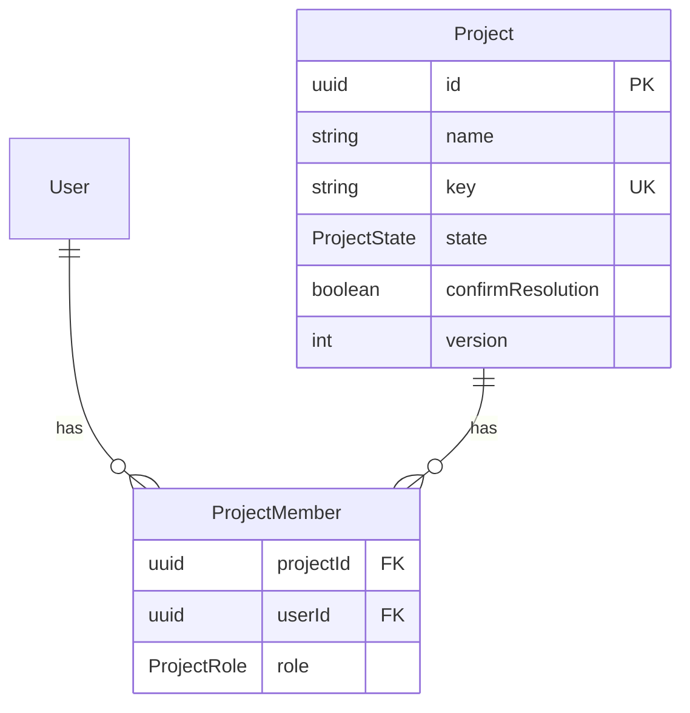

# Projects – model, CRUD, membership, settings and archiving

| | |
|---|---|
| Status | `implemented` |
| Created | 2026-10-26 |
| Plan task | `S1-01` |
| System specification sections | §3.1, §7.1, §7.2, §7.3, §7.4, §7.5, §13.5, §15.6, §17.2, §18.3, §18.5, §18.9, glossary |
| Related issues / PRs | #111 (specification), #134 (implementation) |

## Context

Every ticket belongs to exactly one project ([§3.1](../../../docs/spec/03-ticket-model.md)), and team roles are granted per project ([§7.1](../../../docs/spec/07-users-organizations-permissions.md)). Nothing of this exists yet: the database has no `projects` or `project_members` table, the contracts have no `projects` feature, and the web application has no project page. The Administrator panel's getting-started checklist ([§15.6](../../../docs/spec/15-deployment.md)) has no "Create a project" item yet, because it arrives with this task.

S1-01 is the first Stage 1 task. It is also the reference implementation of "Feature module with endpoints, list, form and mutations" ([§18.9](../../../docs/spec/18-code-patterns.md)): `modules/projects/` in the server and `features/projects/` in the web. Every later feature module copies its structure.

The plan's "Done when" for S1-01: a key `erp` or `1ERP` is rejected, and every write in an archived project returns `409 project.archived`.

While reading the specification against the code, this proposal found gaps and one sequencing conflict. The specification does not decide them, so agents may not decide them either (Rule 8). Each is listed under [Open questions](#open-questions) with a proposed answer for a human to accept, change or reject. The design below already assumes the proposed answers.

## Goals

- The Administrator creates a project (name and key), edits it, archives it, unarchives it and deletes it while it is empty, in as few steps as possible (Rule 2).
- The key follows `^[A-Z][A-Z0-9]{1,9}$` and is unique across active and archived projects.
- The Administrator and the project's Project managers add existing team accounts to the project as Developer or Project manager, change their role, or remove them.
- Project managers switch resolution confirmation on and off ([§4.3](../../../docs/spec/04-ticket-lifecycle.md)).
- An archived project is read-only for everyone, the Administrator included, until it is unarchived. Every change returns `409 project.archived`.
- Team members see only the projects they belong to; the Administrator sees all. An invisible project returns `404`.
- The pattern reference for a feature module (server, contracts, web) that later tasks follow.

## Non-goals

- Project settings of later stages: GitHub repositories and sync direction (Stage 3), default SLA policy (Stage 4), WIP limits (S1-14). No placeholder fields or UI for them.
- Making the key immutable after the first ticket, and unassigning the open tickets of a removed member (S1-05, as the plan states).
- Invitations by e-mail, end-user access to projects, and "existing accounts added without a new invitation" (S1-03).
- Organizations and their access to projects (S1-02). S1-02 adds a read-only "Organizations with access" section to the project settings page built here, and rejects granting access to an archived project with `project.archived`.
- The full permission layer: roles of organizations and accounts, the complete `§7.5` test matrix, token scopes (S1-04). See [Q1](#open-questions).
- Effects of archiving on features that do not exist yet: SLA clocks, integration tokens, GitHub events, webhooks and pending invitations. Each later task adds its effect to the archive use case when it builds the feature.
- A product tour. [§2.4](../../../docs/spec/02-agent-rules.md) lists no tour for project administration.

## Proposed change

### What the user sees

- **Projects page** (`/projects`, a new **Projects** item in the side navigation and the bottom navigation, team views only). It lists the active projects the person can see, sorted by name. Each row shows the name, the key and the person's role. An **Archived** tab lists the archived projects the person can still read. On phones the rows are cards. Targets are at least 44 px (Rule 9).
- **New project** (button on the Projects page, shown only when `GET /api/v1/users/me` returns the global action `create_project`). It opens a dialog: a bottom sheet on phones ([§18.6](../../../docs/spec/18-code-patterns.md)). The dialog has two fields:
  - **Name**;
  - **Key**, suggested from the name while the person has not edited it (see [Q7](#open-questions)), with typed letters shown in upper case.

  After creation the web application opens the new project's settings on the **Members** tab, because adding people is the next step (Rule 2).
- **Project settings** (`/projects/{projectId}/settings`), with tabs:
  - **General**: name and key (editable only when `allowedActions` contains `update`, i.e. for the Administrator), and **Resolution confirmation**, a switch editable with `update_settings` (Project manager and Administrator). Fields the person may not change are shown read-only, never hidden, so the person can see why they cannot edit.
  - **Members**: the list of members with display name, GitHub login and role. With `manage_members`, the tab has an **Add member** action (a searchable picker of the active team accounts that are not yet members, plus a role), a role select per row and **Remove** per row. Removing the last Project manager, or changing their role to Developer, asks for confirmation with the warning of [§7.4](../../../docs/spec/07-users-organizations-permissions.md): "This project will have no Project manager. The Administrator covers the role."
  - **Danger zone** (only with `archive`, `unarchive` or `delete`): **Archive project**, **Unarchive project**, and **Delete project**. Delete asks the person to type the key to confirm, following GitHub's repository deletion.
- **Archived project.** Every page of the project shows a banner: "This project is archived and read-only." Actions disappear because `allowedActions` no longer lists them. The project disappears from navigation and from the active list, and stays on the Archived tab for those who can read it ([§7.3](../../../docs/spec/07-users-organizations-permissions.md)).
- **Getting-started checklist** ([§15.6](../../../docs/spec/15-deployment.md)): the item **Create a project**, first in the list. It is ticked once any project exists, and links to its help page.
- **Texts** in EN and PL in the `projects` namespace. Errors are shown through `errors.<code>` ([§18.5](../../../docs/spec/18-code-patterns.md)).

### Data model

`User` already exists; `Project` and `ProjectMember` are new.

- `Project` (`projects`): `id` UUIDv7; `name` (trimmed, 1–100 characters, not unique, [Q7](#open-questions)); `key` (unique, `^[A-Z][A-Z0-9]{1,9}$`); `state` enum `project_state` (`active`, `archived`); `confirmResolution` (`confirm_resolution`, default `false`); `version` (versioned record, [§17.2](../../../docs/spec/17-conventions.md)); `createdAt`, `updatedAt`. A check constraint enforces the key pattern in the database too.
- `ProjectMember` (`project_members`): `projectId`, `userId`, `role` enum `project_role`, `createdAt`, `updatedAt`. The primary key is `(projectId, userId)`, so a person has one role per project. Deleting a project deletes its memberships; a user is never deleted (anonymization keeps the row, [§13.2](../../../docs/spec/13-non-functional.md)), so the user foreign key restricts. `project_role` has `developer` and `project_manager`; S1-03 adds `end_user` ([Q9](#open-questions)). Not versioned (not in the list of [§17.2](../../../docs/spec/17-conventions.md)).
- A unit test keeps the Prisma enums equal to the contract enums ([§18.4](../../../docs/spec/18-code-patterns.md)).
- No personal data is added: memberships reference users by ID. Anonymization and export of memberships come with S1-16 under the plan's cross-cutting rule.

### API

All endpoints follow the request pipeline of [§18.3](../../../docs/spec/18-code-patterns.md): target record guard (`404` for an invisible project, then `409 project.archived` or `403` from the abilities, see [Permissions](#permissions)), validation (`422`) and a missing `If-Match` on the versioned project (`428`), then the service: field-level `403`, business rules (`422`/`409`), stale version (`412`). Schemas are in `@trybun/contracts/projects`.

| Endpoint | Action on `Project` | Notes |
|---|---|---|
| `GET /api/v1/projects?state=active\|archived&cursor&limit` | `read` | Cursor envelope ([§18.4](../../../docs/spec/18-code-patterns.md)); `state` defaults to `active`; sorted by name, then `id` |
| `POST /api/v1/projects` | global `create_project` | `{ name, key }`; `201` with the project. Supports `Idempotency-Key` |
| `GET /api/v1/projects/{projectId}` | `read` | Weak `ETag` |
| `PATCH /api/v1/projects/{projectId}` | `update` for `name`, `key`; `update_settings` for `confirmResolution` | `If-Match`. A body with any field the principal may not change is rejected as a whole with `403` (field-level rule, [§18.3](../../../docs/spec/18-code-patterns.md)); nothing is changed. The key stays editable in S1-01, as §3.1 allows while the project has no tickets |
| `PUT /api/v1/projects/{projectId}/archive` | `archive` | `If-Match`; sets `archived`. Archiving an archived project returns `409 project.archived` like every other change |
| `DELETE /api/v1/projects/{projectId}/archive` | `unarchive` | `If-Match`; sets `active`. On an active project, `If-Match` is still checked (`412` when stale), then `204` with no change and no audit entry ([Q11](#open-questions)) |
| `DELETE /api/v1/projects/{projectId}` | `delete` | `If-Match`; deletes the project and its memberships; the `project.deleted` audit entry stands for both, with no entry per membership ([Q5](#open-questions), [Q6](#open-questions)). The key becomes free again (§3.1) |
| `GET /api/v1/projects/{projectId}/members?role&cursor&limit` | `read_members` | Sorted by display name (accounts without one last), then user ID, so the cursor is stable; the optional `role` filter lets the web application count the Project managers for the last-Project-manager warning without loading every page |
| `POST /api/v1/projects/{projectId}/members` | `manage_members` | `{ userId, role }`. The user must be an active `team` account, otherwise `422` `project_member.user_not_eligible` (pointer `/userId`); an existing member returns `409 project_member.exists` |
| `PATCH /api/v1/projects/{projectId}/members/{userId}` | `manage_members` | `{ role }`; a non-member returns `404` |
| `DELETE /api/v1/projects/{projectId}/members/{userId}` | `manage_members` | `204`; a non-member returns `404` |
| `GET /api/v1/projects/{projectId}/member-candidates?query&cursor&limit` | `manage_members` | The member picker: active team accounts that are not members of the project, `{ id, displayName, githubLogin }` only, searchable by those two fields, sorted like the member list ([Q3](#open-questions)) |

- **Project response**: `id`, `name`, `key`, `state`, `confirmResolution`, `version`, `createdAt`, `updatedAt`, `allowedActions`. **Member response**: `user { id, displayName, githubLogin }`, `role`, `createdAt`.
- **Action codes** of `Project` (closed list in the contracts): `read`, `update`, `update_settings`, `archive`, `unarchive`, `delete`, `read_members`, `manage_members`. Global action of the account: `create_project`.
- **New error codes**: `project.archived` (409), `project.key_taken` (422 with pointer `/key`, like `setup.email_taken`), `project_member.exists` (409), `project_member.user_not_eligible` (422). An invalid key format is the standard field error `string.invalid_format` at `/key`.
- **Key uniqueness** is checked in the transaction and backed by the unique index. A concurrent duplicate that only the index catches is mapped to `project.key_taken` too, never to a `500`.

### Permissions

The abilities are the CASL rules of `modules/projects/projects.abilities.ts` ([§18.3](../../../docs/spec/18-code-patterns.md)), under the sequencing of [Q1](#open-questions):

| Principal | Rules |
|---|---|
| Administrator | `create_project`; on every project: `read`, `update`, `update_settings`, `archive`, `unarchive`, `delete`, `read_members`, `manage_members` |
| Project manager of the project | `read`, `update_settings`, `read_members`, `manage_members` |
| Developer of the project | `read`, `read_members` ([Q13](#open-questions)) |
| End user | none in S1-01 (access arrives with S1-02 and S1-03) |
| Global restriction, added last | `cannot` every action except `read`, `read_members` and `unarchive` on `{ state: 'archived' }`, with the reason `project.archived` |

The archived restriction carries `project.archived` as its reason, so the target record guard returns it with its status `409` instead of `403` ([§18.3](../../../docs/spec/18-code-patterns.md), "Authorization"). The order stays that of the request pipeline: `404` for an invisible project, then `409` for an archived one, then validation, preconditions and field-level `403`. Reads are not changes, so `read` and `read_members` stay allowed.

Queries use `accessibleBy(ability, 'read')`, so the list and the detail never disagree, and a team member of project A gets `404` for project B. Team actions also require completed 2FA, which the authentication guard already enforces ([§7.4](../../../docs/spec/07-users-organizations-permissions.md)).

### Writing data

Each use case is one service method in one transaction ([§18.3](../../../docs/spec/18-code-patterns.md)). Archiving, unarchiving and every project update increment `version`. Memberships are not versioned, so a membership write locks the project row (`SELECT … FOR SHARE`) and re-checks its state inside the transaction; a concurrent archive therefore either waits for it or makes it return `409 project.archived`, and no member is changed in an archived project. Audit log entries via `AuditLogEntriesService.record(tx, …)`, new actions in `AuditAction` ([Q4](#open-questions)):

| Use case | Audit action |
|---|---|
| Create | `project.created` |
| Archive / unarchive | `project.archived` / `project.unarchived` (required by [§7.3](../../../docs/spec/07-users-organizations-permissions.md)) |
| Delete | `project.deleted` |
| Add member / change role / remove member | `project_member.added` / `project_member.role_changed` / `project_member.removed` (required by [§13.5](../../../docs/spec/13-non-functional.md)) |
| Edit name, key, resolution confirmation | none |

An entry has one target (model and ID, [§13.5](../../../docs/spec/13-non-functional.md)). A membership entry targets the `Project` and needs the user and the role as well ([Q14](#open-questions)).

No outbox events: no consumer exists in S1-01. Projects have no activity timeline ([§4.5](../../../docs/spec/04-ticket-lifecycle.md) covers tickets).

### Web application

`features/projects/` with `components/`, `queries.ts` (`['projects', 'list', state]`, `['projects', 'detail', id]`, `['projects', 'members', id]`), `mutations.ts` (create, update, archive, unarchive, delete, add member, change role, remove member; each sends `If-Match` where the project is versioned and invalidates its keys), and `search-params.ts` (the tab of the Projects page). Routes `app/(team)/projects/page.tsx` and `app/(team)/projects/[projectId]/settings/page.tsx` stay thin: parse, prefetch, compose. The forms use React Hook Form with `createProjectSchema` and `updateProjectSchema` of the contracts ([§18.5](../../../docs/spec/18-code-patterns.md)). Archiving shows a toast with **Undo**, which calls unarchive (Rule 2). Delete cannot be undone, so it has no Undo.

### Demo dataset

`pnpm db:seed` adds two projects with the seeded team accounts as members in both roles, and one archived project, so `pnpm dev` shows every state.

### Prior art

- **Key**: Jira requires an upper-case key of 2–10 characters that starts with a letter, and suggests it from the project name. §3.1 already follows the format; this spec adopts the suggestion ([Q7](#open-questions)).
- **Archive**: GitHub and GitLab make an archived repository or project read-only with a banner, and allow unarchiving. This matches §7.3. GitHub's typed-name confirmation for deletion is adopted for **Delete project**.
- **Not adopted**: Jira's trash with 60-day restore. §7.3 allows deleting only empty projects, so there is nothing to restore.

## Changes to the system specification

| Section | Change |
|---|---|
| §3.1 | Name: trimmed, 1–100 characters, not unique (Q7). The key is suggested from the name in the creation form (Q7) |
| §7.3 | Deleting an archived project is rejected with `project.archived` until it is unarchived (Q5) |
| §7.4 | Team accounts are added to a project directly by the Administrator or a Project manager (Q2); the member picker lists the active team accounts that are not yet members, to whoever may manage the members of that project (Q3) |
| §7.5 | New row "View project members": Developer, Project manager, Admin (Q13). |
| §13.5 | Recorded actions: project creation and deletion, besides archiving and membership (Q4); the `details` of an entry, shared with the S1-02 proposal (Q14) |
| §15.6 | Getting-started checklist item "Create a project" ticked when any project exists (as specified; no change of meaning) |
| §18.9 | Reference implementation paths of the feature module become the actual ones (in the implementation PR) |
| Plan, S1-05 | "Done when" gains "deleting a project with tickets returns `409 project.has_tickets`" (Q6). The maintainer changes the plan |
| Plan, S1-01/S1-04 | S1-01 builds the project rules; S1-04 takes them over and generalizes them (Q1). Changed in this pull request |

New or changed glossary terms (code identifier, EN/PL labels):

- `project_member.role`: `developer`, `project_manager` (later `end_user`) – the existing role labels of [§7.2](../../../docs/spec/07-users-organizations-permissions.md).
- `project.state` already exists (Active / Aktywne, Archived / Zarchiwizowane).

## Open questions

Implementation must not start until every question has an answer. Each answer not marked **Decided** is a **proposal awaiting human approval**, accepted when the pull request is approved, chosen as the smallest and most reversible option. Q1, Q3 and Q14 change the plan, a permission rule or a shared table; they were decided on 2026-10-27 by the agent on the maintainer's delegation, with the reasons given.

1. **Sequencing with S1-04.** The "Done when" of S1-01 needs `409 project.archived`, but the archived `cannot` rule, `RecordAccess` with real subjects and `allowedActions` of projects are planned for S1-04 (group 2). Today `NoSubjectRecordAccess` answers `404` for every record, and `ability-factory.ts` says the archived rule "joins with the permission layer (S1-04)". — **Decided (2026-10-27, by the agent on the maintainer's delegation):** S1-01 writes the first `projects.abilities.ts` with the rules in [Permissions](#permissions). It also adds the archived `cannot` rule with its reason, a Prisma-backed `RecordAccess` for the subject `Project`, `allowedActions` on the project response, and the global action `create_project`. Its `projects.abilities.spec.ts` covers the §7.5 rows S1-01 builds, each with an allowed and a denied case. S1-04 then generalizes `RecordAccess` to all subjects, adds the rules of organizations and accounts and the token-scope restriction, and completes the matrix; it stays the reference of the abilities pattern in §18.9. Why: §18.3 puts each module's rules in its own `<feature>.abilities.ts`, and the plan already has every task add its rules with its resource. Moving S1-04 earlier would make it build the rules of a `Project` that does not exist yet. The S1-02 proposal splits its rules the same way (its Q11). The S1-01 and S1-04 rows of the plan are changed in this pull request. Rejected: moving S1-04 before S1-01.
2. **Adding members before invitations exist.** §7.5 lets Project managers "invite team members and grant or remove the roles", but invitations come with S1-03. — **Answer (proposed, awaiting approval):** S1-01 adds existing active team accounts directly (`POST …/members`). S1-03 adds invitations by e-mail, and for existing accounts calls the same membership service. Alternative: S1-01 only lists, changes and removes members, and adding waits for S1-03.
3. **Who may list team accounts for the member picker.** No endpoint lists accounts, and §7.5 has no row for it. — **Decided (2026-10-27, by the agent on the maintainer's delegation):** the picker reads `GET /api/v1/projects/{projectId}/member-candidates`, which requires `manage_members` on that project. It returns only the active team accounts that are not yet members, with `id`, `displayName` and `githubLogin` (no e-mail address). It is searchable by those two fields. Why: the endpoint is scoped to the one project the person manages, so it needs no new rule and no new §7.5 row ("Manage project members" covers it). The target record guard gives `404` for an invisible project and `409 project.archived` for an archived one, and the response returns only the data the picker needs. The general account list `GET /api/v1/users`, with e-mail addresses, stays free for the Accounts page of the Administrator (S1-03, S1-20). One resource is never served to two audiences with different fields. Rejected: a global listing for anyone who is a Project manager of at least one project, which would also show the accounts to people who manage other projects; and adding by the Administrator only, which contradicts §7.5 ("invite team members and grant or remove the roles").
4. **Audit log entries.** §7.3 requires entries for archiving and unarchiving, and §13.5 for membership changes; neither names project creation, deletion or settings changes. — **Answer (proposed, awaiting approval):** also record `project.created` and `project.deleted`; do not record changes of name, key or resolution confirmation.
5. **Deleting an archived project.** §7.3 allows deleting empty projects; §7.5 forbids every change of an archived project "until it is unarchived". — **Answer (proposed, awaiting approval):** deletion is a change, so an archived project must be unarchived first; `DELETE` returns `409 project.archived`.
6. **Deleting before tickets exist.** "Only projects without tickets can be deleted", but the ticket model is S1-05. — **Answer (proposed, awaiting approval):** in S1-01 every unarchived project can be deleted. S1-05 adds the rejection `409 project.has_tickets` and its test. The maintainer adds this to S1-05 in the plan.
7. **Name and key input.** §3.1 does not limit the name, and does not say whether the key is suggested. — **Answer (proposed, awaiting approval):** the name is trimmed, 1–100 characters, and not unique (the key identifies the project). The creation form suggests a key from the name until the person edits the key: the initials of the words for names with several words, otherwise the first letters, upper case, at most 4 characters. The form shows typed letters in upper case. The API accepts only the exact pattern, so `erp` and `1ERP` are rejected with `string.invalid_format`. A key already used returns `project.key_taken`.
8. **Web routes.** — **Answer (proposed, awaiting approval):** `/projects` and `/projects/{projectId}/settings`, using the project ID. Keys in URLs are deferred, because a key can still change until the first ticket.
9. **Role enum.** — **Answer (proposed, awaiting approval):** `project_role` has `developer` and `project_manager`; S1-03 adds `end_user` with the end users' personal access (§7.4). This avoids a placeholder value (plan, "Out of scope" rule).
10. **One task or two.** Project CRUD with archiving, and membership management, could ship separately. — **Answer (proposed, awaiting approval):** keep one task as the plan defines. Membership is what makes a project usable for the team, and both are the reference of one feature module.
11. **Unarchiving an active project.** — **Answer (proposed, awaiting approval):** an idempotent `204` with no change and no audit entry, rather than a new error code.
12. **Where projects are created.** — **Answer (proposed, awaiting approval):** a dialog on the team Projects page, not a separate page in the Administrator panel. The checklist item links to the help page; the help page points to the Projects page. One list serves every role through `allowedActions` (Rule 2).
13. **Who sees the member list.** §7.5 does not say. — **Answer (proposed, awaiting approval):** every team member of the project and the Administrator (`read_members`); end users never.
14. **Audit entries with more than one record.** An audit entry has only one target, but a membership change concerns a project, a user and a role. The S1-02 organizations specification hits the same gap for organization members and domains, and proposes an optional immutable `details` JSONB column that holds only identifiers and non-personal values, with the same rule as outbox payloads. — **Decided (2026-10-27, by the agent on the maintainer's delegation):** use the same column as S1-02 proposes: target `Project` + `projectId`, `details` `{ "userId": "…", "role": "developer" }` (for a role change, `previousRole` as well). `details` is typed per `AuditAction` in `AuditLogEntriesService.record`, so it is never free-form. It holds identifiers and non-personal values only, under the rule of outbox payloads. After anonymization a user ID points to the tombstone, like `actorId`. The first of S1-01 and S1-02 to be implemented adds the column, in one additive migration that also extends the immutability trigger to `details`. Why: it is the common shape of structured audit metadata (e.g. the fields of GitHub's audit log, Keycloak's admin events). It keeps one target per entry, and one column serves every later task. Rejected: a second target column, which fits only two-record cases (S1-02 also records a removed domain); and targeting only the project, which loses who was added.

## Implementation plan

Each step leaves the application working and has its tests.

**Phase 1 – Model and API**

1. Prisma models, enums, migration with the key check constraint; contracts `@trybun/contracts/projects` (schemas, enums, action codes, error codes); enum equality test; factories `project.factory.ts`, `project-member.factory.ts`.
2. `@casl/prisma` (specified in [§14.2](../../../docs/spec/14-architecture.md), not yet installed; checked against Rule 10) and its client extension on `PrismaService` ([§18.3](../../../docs/spec/18-code-patterns.md)); `projects.abilities.ts`, the archived restriction, `RecordAccess` for `Project`, `create_project` on `/users/me`; `projects.abilities.spec.ts` with an allowed and a denied case per row ([Q1](#open-questions)).
3. Create, read, list, update, with `If-Match`, field-level `403` and `project.key_taken`; integration tests for `erp`/`1ERP`, a duplicate key, two concurrent creations with one key, and a Developer of project A getting `404` for project B.
4. Archive, unarchive, delete with audit entries; an integration test that sends every write endpoint of the module to an archived project and expects `409 project.archived`.
5. Members: list, add, change role, remove, with audit entries (the `details` column of [Q14](#open-questions) if S1-02 has not added it yet); the member candidates ([Q3](#open-questions)); integration tests.
6. `pnpm api:generate`.

**Phase 2 – Web, documentation, checklist**

7. `features/projects/` queries, mutations and components; the Projects page and the navigation item; New project dialog with key suggestion; component tests.
8. Settings page: General, Members and Danger zone, Undo for archiving, last-Project-manager warning, archived banner.
9. Getting-started item "Create a project"; demo dataset.
10. User documentation EN and PL: administrator how-to "Create, archive and delete a project", team how-to "Manage project members", reference "Project settings", with `views` set to the new routes; `pnpm help:generate`.
11. E2E (phone, tablet, desktop, axe): an Administrator creates a project, adds a member, archives and unarchives it; a Developer sees no actions they may not perform.
12. Update §3.1, §7.3, §7.4, §7.5, §13.5 and §18.9 as approved; move this file to `implemented/`.

## Acceptance criteria

- [ ] A key `erp` or `1ERP` is rejected with `string.invalid_format` at `/key`; a key of an active or archived project with `project.key_taken`; the key of a deleted project can be used again
- [ ] Every write endpoint of the module on an archived project returns `409 project.archived`, for the Administrator too; unarchiving works
- [ ] A Developer of project A gets `404` for project B and for its members
- [ ] A Project manager changes resolution confirmation and gets `403` for a body that also changes the name or the key, with nothing changed
- [ ] A Developer gets `403` from the member candidates of their project and `404` for another project; a Project manager gets only active team accounts that are not members, without e-mail addresses ([Q3](#open-questions))
- [ ] Unarchiving an active project returns `204` and writes no audit entry
- [ ] A project response lists exactly the actions the principal may perform on it: a table test per principal (Administrator, Project manager, Developer) and state (active, archived)
- [ ] Adding, changing and removing a member, creating, archiving, unarchiving and deleting a project each write their audit entry in the same transaction
- [ ] Removing the last Project manager, or changing their role to Developer, shows the warning and succeeds
- [ ] A membership write racing an archive of the same project never leaves a changed member in the archived project
- [ ] The getting-started item "Create a project" is ticked once a project exists
- [ ] Works on phone, tablet and desktop (Rule 9): the E2E of step 11 passes on the three device projects, with axe and touch-target checks
- [ ] User documentation in EN and PL for the new views (Rule 3); no product tour, as §2.4 lists none for these views (Rule 4)

## Changelog

- 2026-10-27 – Deviations accepted by the maintainer: `Idempotency-Key` of `POST /api/v1/projects` with S6-01 (added to its "Done when"); the `role` field of the project response; the patterns of keyset cursors and `isUniqueViolation()` (§18.3, §18.4); a confirmation before every member removal, because from S1-05 removing a member also unassigns their open tickets, which Undo could not restore.
- 2026-10-26 – Created.
- 2026-10-27 – Q1, Q3 and Q14 decided on the maintainer's delegation; the member picker became the project-scoped member candidates; plan rows S1-01 and S1-04 changed.
- 2026-10-27 – Review fixes: order of checks aligned with §18.3, stable sort of the member list, warning on demoting the last Project manager, membership writes against a concurrent archive, `@casl/prisma` introduced in step 2.
- 2026-10-27 – Implemented (#134). Deviations: the project response also carries `role`, the principal's own role, which the Projects list shows; `Idempotency-Key` of `POST /api/v1/projects` arrives with its interceptor in S6-01; the first list endpoints introduce keyset cursors (§18.4).
